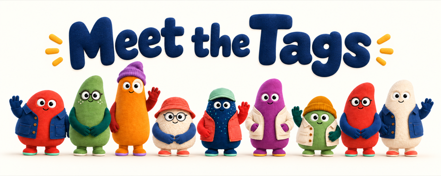
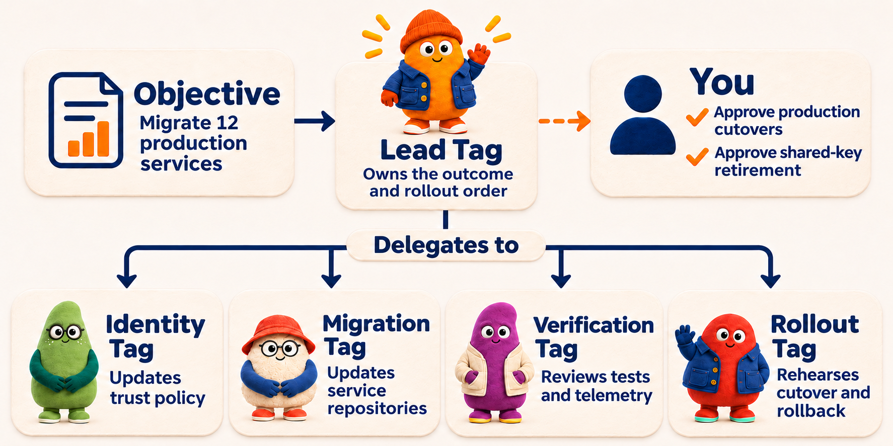
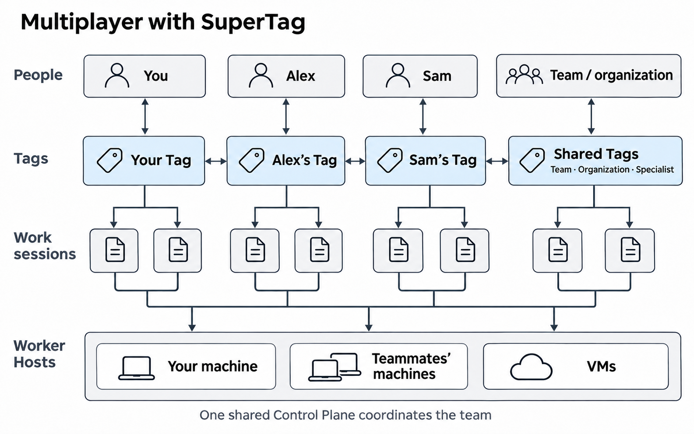

<div align="center">

<h1>
  
  SuperTag
</h1>

**Persistent, proactive, multiplayer AI actors for engineering work.**

**Define outcomes, not tasks.** Give a Tag an engineering outcome or an enduring responsibility. It carries the work across sessions, acts on its responsibilities without being asked, and works alongside your teammates and their Tags, on Claude Code, Codex, Cursor, or OpenCode and on machines you choose.

[Define outcomes](#define-outcomes-not-tasks) · [Persistent](#persistent) · [Proactive](#proactive) · [Multiplayer](#multiplayer) · [Run your first Tag](#run-your-first-tag) · [Documentation](docs/README.md)

<p>
  
</p>

</div>

## Define outcomes, not tasks

A coding agent takes one task per session. It can investigate a bug, write a fix, and run tests.
When the work is bigger than one session, you become its project manager: you split the work,
start each session, carry context between them, and decide what happens next.

With SuperTag, you hand that job to a Tag. An **Objective** records an outcome, the evidence
you'll use to decide when it's done, and any constraints, budget, or deadline you set. The owning
Tag decides what work to start, hands pieces to the other Tags on its **Team**, reviews what comes
back, and brings you findings, branches, and the decisions that need your approval. You steer the
owning Tag; you don't manage its sessions. A **Session** is one thread of work, such as
investigating a dependency or preparing its update.

To move 12 services to short-lived credentials, give `lead` the rollout Objective. It coordinates
Tags that update trust policy and service code, review tests and telemetry, and rehearse the
cutover. You approve production cutovers and decide when to retire the shared keys.



Give each Tag its own job and permissions. You could let `lead` coordinate, give a builder
permission to edit the repository, and give a reviewer read-only access.

[Write an Objective](docs/guides/write-an-objective.md) · [How you direct work](docs/concepts/interaction-model.md)

## What makes a Tag different

### Persistent

A **Tag** is a persistent AI actor with its own identity, responsibilities, permissions, and work
history. Its work runs as sessions of your coding agents, and the Tag is what persists across
them. The same Tag can investigate today's issue, review the results tomorrow, and answer
questions about both next week, even when the next session runs on another coding agent or
machine. It can recall its earlier Sessions and Objectives on its own.

<a name="next-add-your-teams-chat"></a>

Reach the same Tag from the tools you use. Talk to it in the terminal, or add a Slack channel,
GitHub repository, or Linear team to its locations. Each conversation has its own thread, and the
same Tag keeps the responsibilities you assigned it. [Connect a work tool](docs/surfaces/README.md)

### Proactive

Give a Tag an enduring responsibility, and it works to fulfill it without waiting to be asked.
Say `triage` is responsible for new production errors:

> Investigate each new or regressed error. Reproduce it, find the change that caused it, and
> prepare a fix with a failing test. Ask me before anything that touches production. Leave
> merging to me.

When Sentry reports a new error, `triage` takes it up under that responsibility. It decides
whether the error matters, starts work to reproduce and fix it, and brings you the branch, the
test, and any decision that's yours. When nothing needs doing, it rests until the next report,
message, or result. Run it on an always-on host, and it keeps the responsibility while your
laptop is off.

| A Tag responsible for | Wakes on | Does | Leaves to you |
| --- | --- | --- | --- |
| Watching a service | A PagerDuty, Datadog, or health-check alert | Builds a timeline from logs, recent deploys, and the error spike, and prepares a revert branch | Rolling back or escalating |
| Keeping main green | A failed CI run on main | Finds the breaking commit, tells a flaky test from a real failure, and prepares a fix or revert | Merging and quarantining tests |
| Keeping dependencies safe | A Dependabot or Snyk advisory | Checks whether the project is affected and prepares the upgrade with test results | Major upgrades and merging |
| Triaging bug reports | A new Linear or GitHub issue | Reproduces it, links duplicates, and asks the reporter for missing details | Priority |

You choose which events reach a Tag and what it may do in response. Forward alerts and reports
to its responsibility through the Control Plane API, or mention it in Slack, GitHub, or Linear.
[Set up an ongoing responsibility](docs/guides/ongoing-responsibilities.md)

### Multiplayer

Self-host one shared Control Plane, and your team works with Tags together. Each teammate directs
Tags from their own terminal or connected tools, and private terminal conversations stay private
to each person. One person can ask `triage` about an error in Slack, and another can follow up on
the same findings on GitHub.

Tags work together across machines and coding agents. A Tag on your laptop running Claude Code and
a Tag on a teammate's machine running Codex can work toward the same Objective, message each
other, and post to their Team's shared Workstream. Each reports back to the Objective's owner.



[How multiplayer works](docs/concepts/multiplayer.md) · [Self-host SuperTag](docs/guides/self-hosting.md)

<a name="get-started"></a>

## Run your first Tag

On an Apple silicon Mac or Linux, install Git, Node.js, and a [supported coding agent](#works-with). [Check requirements and sign-in](docs/operations/requirements.md)

[Install SuperTag](docs/operations/install.md), then run this from an existing Git repository with
at least one commit.

```sh
curl -fsSL https://github.com/atemaguer/supertag/releases/latest/download/install.sh | sh
export PATH="$HOME/.local/bin:$PATH"
supertag init
supertag
```

`supertag init` checks your coding agent's sign-in, asks a few questions, and starts SuperTag in
the background. Keep the default Tag name, `lead`. It works in this repository, starting from the
commit you have checked out. Plain `supertag` opens the terminal UI. Select
`lead` and ask:

> Read this repository and tell me what you would improve first.

Follow up in the same conversation. When you’re ready to hand over an outcome, try an Objective
like this.

```text
/goal Add a test for an uncovered edge case. Done when the new test and its suite pass. Ask me before changing application code.
```

Open **Waiting on you** when the Tag needs a decision. Each delivered change arrives in your
repository as a `supertag/session/...` branch. Review it, then decide whether to merge it or ask
for a revision.

[Installation options](docs/operations/install.md) · [Talk to a Tag](docs/guides/talk-to-a-tag.md) · [Run your first Team](docs/guides/first-team.md) · [Direct SuperTag from your coding agent](docs/guides/coding-agent-operator.md)

## From one laptop to your whole team

`supertag init` starts a local **Control Plane**, the service that stores your Tags and schedules
their work, and connects your computer as a **Worker Host**, a machine or sandbox that runs the
work. When your team joins, deploy the Control Plane where everyone can reach it.

Connect teammates' laptops, servers, CI runners, or supported sandboxes as Worker Hosts. You can
choose a different coding agent and model for each Tag. Keep a Tag with an enduring
responsibility, such as `triage`, on an always-on host so it can act while everyone's laptop is
off.

[Self-host SuperTag](docs/guides/self-hosting.md) · [Connect a Worker Host](docs/guides/workers.md) · [See how the parts fit together](docs/concepts/how-it-works.md)

## Works with

| | Options |
| --- | --- |
| **Coding agents** | Claude Code · Codex · Cursor · OpenCode · OpenAI Agents · [your own harness adapter](docs/guides/harness-adapters.md) |
| **Where you talk to Tags** | Terminal · [Slack](docs/surfaces/slack.md) · [GitHub](docs/surfaces/github.md) · [Linear](docs/surfaces/linear.md) · [Lark/Feishu](docs/surfaces/lark.md) · [Microsoft Teams](docs/surfaces/teams.md) |
| **Where work runs** | Laptops · servers · CI runners · [Modal and E2B sandboxes](docs/guides/workers.md#run-cursor-in-a-sandbox) |

## When to choose SuperTag

| Compared with | What it does well | Why choose SuperTag |
| --- | --- | --- |
| **Hosted AI teammates** · [OpenAI dots](https://openai.com/index/introducing-dots/), [Grok Bot](https://x.ai/news/introducing-grok-bot) | Hand off work to agents that stay available and can pick it up again later. | **Run proactive agents on your own infrastructure.** Set up persistent Tags and choose each one’s coding agent, model, tools, and where the work runs. |
| **Coding agents** · [Claude Code](https://code.claude.com/docs/en/overview), [OpenCode](https://opencode.ai/docs/), [Codex](https://learn.chatgpt.com/docs/codex/cli) | Investigate, edit, and test code. | **Give the work a persistent owner.** Keep using your coding agents for execution. A Tag keeps its goal, permissions, and history across sessions, even when the next session uses a different coding agent. |
| **Parallel agent workspaces** · [Paradev (formerly Superset)](https://docs.paradev.com/recipes/parallel-workstreams), [Conductor](https://www.conductor.build/docs/concepts/parallel-agents) ([winding down](https://www.conductor.build/announcement)) | Run coding sessions in separate Git worktrees and review their changes in one place. | **Hand off coordination to a Tag.** Give it an outcome and a way to verify it. It can start sessions, review how their results fit together, and bring you branches and decisions. |
| **Agent projects** · [Cursor Projects](https://cursor.com/docs/agent/projects), [Claude Code Projects](https://code.claude.com/docs/en/claude-projects), [GitHub Copilot Projects](https://docs.github.com/en/copilot/how-tos/github-copilot-app/working-with-projects) | Coordinate agent sessions around an ongoing goal. Cursor Projects lets teammates work in one Project alongside their agents. | **Work together across coding agents and machines.** Each teammate's Tags can run on a different coding agent and machine, toward one shared outcome. The same Tags keep their responsibilities and permissions across goals, and SuperTag records who requested each piece of work and what it was allowed to do. |
| **Self-hosted agent runtimes** · [OpenClaw](https://docs.openclaw.ai/concepts/multi-agent), [Hermes Agent](https://hermes-agent.nousresearch.com/docs/user-guide/features/kanban) | Run agents with their own tools and history, and coordinate work between them. | **Know who owns the work and what they were allowed to do.** Each outcome has an owning Tag. SuperTag records who requested each piece of work, which permissions applied, and what came back. |

[See how SuperTag fits with other agent systems](docs/concepts/supertag-and-other-agent-systems.md).

## Build on SuperTag

Use the same infrastructure to give your own application persistent actors. The Control Plane's
gRPC API lets your application create and direct Tags, send them work, and inspect their
progress. For example, you could connect a dependency scanner to a maintenance Tag and show its
branches and test results in your own review interface. Generated Go, TypeScript, and Python
bindings come with the repository. [Explore the API](docs/reference/control-plane-api.md)

To bring your own execution system, write a **harness adapter**: a program that a Worker Host
starts for each Task Attempt and that drives your agent through the harness protocol. The built-in
Python and TypeScript adapters are working examples to read.

The TypeScript SDK, `supertag-ai` on npm, and the Python SDK, `supertag` on PyPI, connect an
application to a Control Plane and a harness adapter to its Worker Host:

```sh
npm install supertag-ai
python -m pip install 'supertag==0.3.0'
```

[Write a harness adapter](docs/guides/harness-adapters.md) · [Connect your own collaboration surface](docs/reference/connector-contract.md) · [Check API stability](docs/reference/api-stability.md)

## FAQ

**How do I control changes to my repository?** Set what each Tag is allowed to do. Repository
work happens in a separate pinned checkout and comes back as a branch you can review.
[Work with repository branches](docs/guides/workspaces.md)

**Do I need a server?** You can start the Control Plane and run work on your laptop. For shared
access or work that should stay available when your laptop is off, deploy the Control Plane and
connect a Worker Host that stays online. [Self-host SuperTag](docs/guides/self-hosting.md)

## Contributing and license

See the [contributor guide](CONTRIBUTING.md) for repository setup and checks. SuperTag is licensed
under [Apache 2.0](LICENSE).
