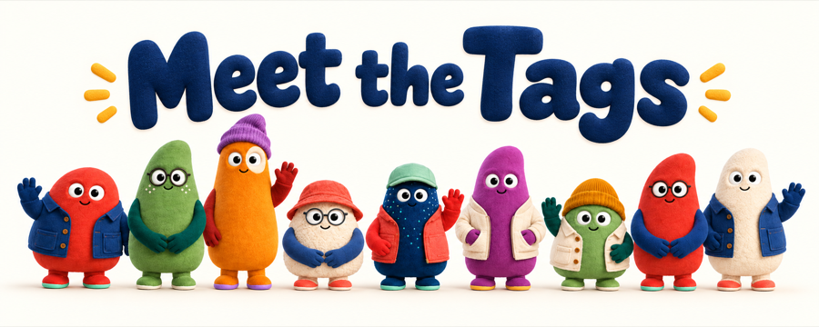

<div align="center">

<h1>
  
  SuperTag
</h1>

<h3>Define outcomes, not tasks. An AI engineering team delivers them.</h3>

<p>
  Stop writing tasks and coordinating 10+ parallel Claude Code, Codex, and Cursor sessions.
  Define the outcome once, from the coding agent you already use, and let a team plan the work,
  run it in parallel, review each other's results, and bring you only the decisions you kept.
</p>

<p>
  <sub>Open infrastructure on your models, harnesses, and machines.</sub>
</p>

<p>
  <a href="#get-started"><strong>Get started on your repository</strong></a> ·
  <a href="docs/README.md">Documentation</a> ·
  <a href="CONTRIBUTING.md">Contributing</a> ·
  <a href="LICENSE">Apache 2.0</a>
</p>

```sh
curl -fsSL https://github.com/atemaguer/supertag/releases/latest/download/install.sh | sh
cd your-repo && supertag init
```

<sub>macOS or Linux with <a href="docs/operations/requirements.md">Node.js</a> and Claude Code, Codex, Cursor, or OpenCode.</sub>

<p>
  
</p>

</div>

---

Coding agents work well when you give them one clear task. Bigger work is different. A feature that
touches the API, the web app, and the tests turns into ten or more agent sessions running side by
side, one per task. Your job becomes coordinating them: switching between threads, copying context
from one to another, answering each one's questions, and checking every result.

SuperTag lets you state the outcome instead: "people can invite teammates to a workspace and choose
their role; done when the end-to-end tests pass and the API docs cover it, within $300, by Friday."
That statement is an **Objective**. A team plans the work, runs it in parallel, reviews
each other's results, and comes back only for the decisions you reserved.

If you already use coding agents, two ideas will feel familiar:

- **Like `/goal`, for a team.** In Claude Code or Codex, `/goal` keeps one session working until a
  condition holds, such as "all tests pass," and the goal ends with that session. An
  [Objective](docs/guides/objectives.md) is that goal for a team. The invite feature above outlives
  any one session or machine, several members of the team work on it at once, and its $300 budget
  and your approvals apply throughout.
- **Like a Project, from the agent you already use.** Instead of opening a thread for each task,
  you talk to one conversation in Claude Code, Codex, or Cursor. Give it SuperTag's
  [operator skill](docs/guides/coding-agent-operator.md) and say "ship workspace invites by
  Friday." It creates the Objective, follows the team's progress, answers routine questions, and
  brings you only the decisions that need you, then the finished work to review.

Each member of the team is a **Tag**: a persistent AI identity with its own responsibilities and
permissions. For the invite feature, a lead Tag plans the work, a builder Tag writes the API and the
invite flow, and a reviewer Tag checks each change but may not edit the repository. Each Tag runs
the coding agent you choose, such as Claude Code, Codex, Cursor, OpenCode, or
[your own harness](docs/guides/harness-runtime.md), with any model it supports. SuperTag is open
infrastructure, so that work runs where you choose: your laptop, your servers, or cloud sandboxes
such as Modal and E2B.

[Get started](#get-started) with one Tag and a small Objective in your own repository; its changes
arrive as a git branch for you to review. Then add a builder to your first **Team**, a group of Tags
with a lead, in the [first Team walkthrough](docs/guides/first-team.md).

## From tasks to outcomes

**Today.** Say your company is moving from flat plans to usage-based billing this quarter. The work
spans event metering in the API, a usage pipeline, Stripe invoicing, a usage dashboard for
customers, migrating every existing plan, and a suite that proves each invoice matches recorded
usage. Coding agents can write each piece, but only after you write each task. You run dozens of
sessions across repositories, and each one waits on you for its next step. You pass the usage event
schema from the metering work to the pipeline and the dashboard, chase the plan migration finance
must approve, and rebuild context whenever a session ends. Coordinating the agents becomes your
full-time job.

**With SuperTag.** You state the outcome once: customers are billed for metered usage from July 1,
verified by a reconciliation suite that replays a month of real events and checks every invoice
line, within $5,000 of agent spend, with your approval before the plan migration and before any
change that charges a customer. That statement is an Objective, and a team of Tags takes it on:

```text
Objective: usage-based billing from July 1
    │
    └─▶ lead Tag ──── plans the work, forms Teams, tracks progress
            │
            ├─▶ backend Team ──── event metering, Stripe invoicing, plan migration
            ├─▶ frontend Team ─── usage dashboard, billing settings
            └─▶ quality Team ──── reconciliation suite, load tests
                                          │
You ◀────── approve the plan migration and anything that charges a customer
```

The lead Tag turns the outcome into **Tasks**, assignments that each Tag accepts and completes, and
divides them among three Teams. The backend Team
publishes the usage event schema in its Team channel, and the frontend Team builds the dashboard
against it. The quality Team reviews each submitted change and replays recorded events through it
to check the invoices. The work runs in parallel
and continues across machines and restarts without you prompting each step. You step in only for
the decisions you reserved. When a new engineer joins in week six, the owner, status, and history of
every piece of work are already on record.

SuperTag is built this way. Its own features are delivered as Objectives by a team of Tags, and
maintainers review and merge the results.

SuperTag supplies what lets [Tags](docs/concepts/tags.md) work together:

- **Clear ownership.** [Tasks](docs/concepts/tasks.md), [Teams](docs/guides/teams.md), and
  [Objectives](docs/guides/objectives.md) record who owns what, what it depends on, and what has been
  accepted.
- **Explicit authority.** A **Permission Set** lists the actions a Tag may take, and a
  **Context Set** selects the knowledge it may use ([context and permissions](docs/concepts/context-and-permissions.md)). [Approval points](docs/guides/objective-coordination.md#5-assign-a-task-that-needs-approval)
  and [operator decisions](docs/guides/objective-decisions.md) keep the decisions that matter with
  people.
- **Continuity.** An Objective keeps its criteria, [budget](docs/reference/coordination.md#budgets-and-allocation),
  and deadline, and its work [survives restarts and retries](docs/reference/scheduling-and-recovery.md).
- **Your choice of stack.** Each Tag can use a different model and [harness](docs/concepts/workers.md),
  including [your own harness](docs/guides/harness-runtime.md). You can host SuperTag's service
  yourself ([self-hosting](docs/guides/self-hosting.md)).

## How you use SuperTag

The recommended setup is one lasting thread in the coding agent you already use, such as Claude
Code, Codex, or Cursor, with SuperTag's [operator skill](docs/guides/coding-agent-operator.md). You
talk to that thread, and it runs SuperTag for you. You steer and the team does the steps. Day to
day, that's one loop. Here it is for the invite feature:

1. **State the outcome.** Tell your operator thread "ship workspace invites by Friday." It drafts
   the Objective with you and applies it. An Objective is a short YAML manifest, so you can also
   keep it in your repository and apply it yourself:

   ```yaml
   apiVersion: supertag/v1
   kind: Objective
   metadata:
     name: workspace-invites
   spec:
     owner: lead
     outcome: >-
       People can invite teammates to a workspace and choose their role. Done when the
       end-to-end tests pass and the API docs cover it. Ask me before changing the database schema.
     budget: { minor: 30000, currency: USD }
     deadline: 2027-01-15T17:00:00Z
   ```

   ```sh
   supertag apply -f workspace-invites.yaml
   ```

   `supertag create objective` does the same from the command line. Give the Objective
   done-when evidence, constraints, a budget, a deadline, and the approvals you want to keep. See
   [Write an Objective](docs/guides/write-an-objective.md).
2. **Let the team work.** The lead Tag splits the outcome into Tasks, builders work on them in
   parallel, each in its own git worktree, and the reviewer checks every change. Follow along with
   `supertag watch objective workspace-invites`, or ask your operator thread how it's going.
3. **Answer what needs you.** Only the decisions that need you reach you: questions, approvals,
   and findings, not every step. Your operator thread relays them, `supertag list inbox` lists them, and a connected Slack
   channel can notify you. Reply with `supertag message objective workspace-invites "..."` to
   clarify or redirect the work.
4. **Review and accept.** The result arrives as a git branch, such as
   `supertag/workspace-invites/...`, with the owner's summary and evidence in
   `supertag describe objective workspace-invites`. Merge it as you would any branch, or send it
   back with a message. If the Objective asked for your approval, `supertag approve objective
   workspace-invites` completes it.

The [operator skill guide](docs/guides/coding-agent-operator.md) sets up the thread and shows the
same loop run entirely from Claude Code, Codex, or Cursor, and the [interaction model](docs/concepts/interaction-model.md)
explains how the conversation and the team divide the work.

## Get started

Run a team of Tags on a repository you already have. SuperTag has two parts. The **Control
Plane** is the service that stores your Tags, Teams, and Objectives and schedules their work. A
**Worker Host** is a machine or sandbox that runs that work, where a **Worker** completes each Task,
usually through a coding harness. On your laptop, `supertag init` sets up both. Check the
[requirements](docs/operations/requirements.md) for supported systems, tools, and harness sign-in.

### 1. Install SuperTag

You need [Node.js and npm](docs/operations/requirements.md#system-and-tools) on macOS or Linux. Install the CLI with the installer script:

```sh
curl -fsSL https://github.com/atemaguer/supertag/releases/latest/download/install.sh | sh
supertag --version
```

It installs SuperTag in `~/.local/share/supertag` and links `supertag` into `~/.local/bin`; add
that directory to your `PATH` if it isn't already. To install with npm instead, run
`npm install -g supertag-ai`. See [installation and version matching](docs/operations/install.md)
for versions, upgrades, and removal.

### 2. Set up your repository

Run this inside a git repository with at least one commit. Here the repository is named `app`.
Before setup, sign in to every harness you plan to serve. For Codex, especially on macOS where
login may use Keychain, run `codex -c 'cli_auth_credentials_store="file"' login` so Tasks can
use the sign-in file. For Cursor, generate an API key in Cursor's dashboard and add
`CURSOR_API_KEY` to `~/.supertag/.env`; the Cursor app login is not enough. See
[Cursor setup](docs/operations/requirements.md#cursor-setup-and-limits). For Claude Code, run
`claude` and follow its sign-in prompt for Claude Code. For OpenCode, set your provider's API-key
environment variable for the host service. See [harness sign-in](docs/operations/requirements.md#choose-and-sign-in-to-a-harness)
for details. If port 3434 is busy, enter another number at init's `Port` prompt.

```sh
cd ~/code/app
supertag init
```

At `Harnesses this machine serves`, `init` labels each installed harness `signed in` or
`not signed in`. OpenCode says `sign-in not checked (choose a model)` until you select its
model. Installed harnesses start selected even when one is not signed in, so deselect any
that is not, or a Task on it can fail with `Not logged in`. For Codex file-backed sign-in, `signed in` only means a credential is present and
readable; it cannot confirm account access. Run Codex once to confirm access. Before finishing
setup, `init` prints
`not signed in (the credential check did not succeed)` for any failed check and gives its
sign-in instructions. If none of the selected harnesses pass, setup stops so you can sign in
and run `supertag init` again.

A **Workspace** connects a repository to SuperTag. Keep the Workspace name `app`, branch delivery,
the Tag name `lead`, and permission to edit files and run commands. If you choose a different name,
use it in the commands below.

`init` starts a local **Control Plane**, the service that coordinates work, and connects your
machine as a **Worker Host**, which runs it. It also creates `lead` and binds it to that host.
Settings live in `~/.supertag/supertag.yaml`. Run `supertag ps` to see both services.

### 3. Get one Tag's first result

Start with a small outcome whose result you can check in any repository:

```sh
supertag create objective first-reply --owner lead --workspace app \
  --budget-minor 1000 --budget-currency USD \
  --outcome 'Create SUPERTAG-HELLO.md containing exactly: Hello from SuperTag. Done when the file exists and you have checked its contents. Do this yourself without delegating; change no other files.'
```

```text
objective/first-reply created
Started lead with Task first-reply:start.
Follow it: supertag watch objective first-reply
See results: supertag describe objective first-reply
```

A **Task** is one assignment. Creating this Objective starts the lead's Task automatically.
Use a new Objective ID if you have already tried `first-reply`.

### 4. Follow it

```sh
supertag watch objective first-reply
```

This excerpt is actual output from the start of a run; your timestamps will differ:

```text
2026-10-06 14:52:43Z  operator      Objective first-reply created for lead: Create SUPERTAG-HELLO.md containing exactly: Hello from SuperTag. Done when the file exists and you have checked its co…
2026-10-06 14:52:43Z  lead          Task first-reply:start for lead: Coordinate this Objective through completion as its statement defines it, including how success is verified and every c…
2026-10-06 14:52:43Z  lead          Task first-reply:start started
```

`watch` prints progress until the Objective completes or is cancelled. Press Ctrl-C to stop
watching; the work continues. A quiet watch does not mean the harness stopped. Inspect the Task
with `supertag describe task first-reply:start` or follow service logs with `supertag logs -f`.

### 5. Inspect the result

```sh
supertag describe objective first-reply
```

While the Task is running, the view begins like this when the Control Plane has recorded
$0.00 of usage. Before it has a usage record, the budget line says
`Budget: unlimited; no cost recorded`:

```text
Objective first-reply: working
Outcome: Create SUPERTAG-HELLO.md containing exactly: Hello from SuperTag. Done when the file exists and you have checked its contents. Do this yourself without delegating; change no other files.
Owner: lead
Runnable: yes
Budget: unlimited; $0.00 from recorded usage

Delivered:
  Nothing yet.

Needs you:
  Nothing right now.
```

If **Needs you** later says `owner stalled` or `no owner activation`, the owner Tag has no running,
queued, or waiting **Task Attempt** (one run of a Task) to continue the Objective. See [troubleshooting](docs/guides/troubleshooting.md#a-harness-is-not-signed-in)
if the Task failed because its harness was unsigned.

When the Objective completes, the view adds a `Result:` line, **Delivered** lists the result and
commands to review and check out its branch, and the Tasks are listed below it. Each
Task works in a separate git worktree. Your original checkout stays on its current branch.
For example, `supertag describe task first-reply:start` reported this actual branch during the run:

```text
Workspace: app (branch supertag/first-reply/start, delivery branch)
```

Use the branch printed by your run to check the change:

```sh
git diff main...supertag/first-reply/start
git show supertag/first-reply/start:SUPERTAG-HELLO.md
```

The file should contain `Hello from SuperTag.`. Replace `main` if your repository uses another
base branch. See [Workspace delivery](docs/guides/workspaces.md) for patches and pull requests.

If **Needs you** shows a question, answer it with `supertag message objective first-reply 'YOUR ANSWER'`.
If the Task fails or stays queued, use [first-reply troubleshooting](docs/guides/troubleshooting.md).

### Next: add a teammate

[Add a builder and run your first Team](docs/guides/first-team.md). The lead will assign work to
another Tag and inspect its result. To start with a whole team instead, apply one of the
[example organizations](examples/organizations/README.md): a lead with builders, a review team, or
a team across Claude Code, Codex, and Cursor.

Stop the local services with `supertag down`; restart them with `supertag up`.

### Next: add your team's chat

[Connect Slack](docs/surfaces/slack.md), then [add a channel to the Tag's locations](docs/surfaces/slack.md#5-add-a-channel-to-a-tag).
People can direct `lead` from that channel. See the [collaboration surface guides](docs/surfaces/README.md)
for GitHub, Lark/Feishu, Linear, and Microsoft Teams.

## Ways to run SuperTag

Together, your Teams of Tags make up an **autonomous organization**. Teams may pursue different
Objectives, but they share one set of rules and one record of the work, kept by the Control Plane.
SuperTag runs wherever you can host a Control Plane and connect Worker Hosts to it. Two common
setups are below, and you can mix them or build others: for example, a fully hosted organization
whose Workers all run on cloud machines, or Workers in sandboxes such as Modal and E2B through a
[custom Worker](docs/guides/custom-workers.md).

### On your own (single-player)

Run the whole organization on your laptop. A local Control Plane coordinates Tags, and your laptop
runs their Tasks with the harnesses you have installed, all working in your repository:

```text
your laptop (supertag init)
├── Control Plane
└── Worker Host "laptop" ── Claude Code, Codex ──▶ lead Tag: plans, delegates, reviews
```

`supertag init` sets this up for your repository: it starts a local Control Plane in the
background and connects your laptop to it as a Worker Host, both as services in
`~/.supertag/supertag.yaml`. A lead Tag plans the work, does or
delegates each part, and reviews the results. Each Task works in its
own git worktree, and its changes arrive as a `supertag/...` branch in your repository. Nothing is
deployed, so this is the fastest way to try a team of Tags on a real repository.
[Get started](#get-started) walks through it.

### With your team (multiplayer)

Deploy one Control Plane for the team and connect everyone's machines to it. The organization, its
Objectives, and its history are shared; the work runs where the code and credentials already are:

```text
                 Control Plane (cloud) ◀── Slack, GitHub, Linear
                   │        │        │
       laptop          laptop         CI runner or cloud machine
       (Claude Code)   (Codex)        (always on)
```

For example, the team deploys the Control Plane with [Self-host SuperTag](docs/guides/self-hosting.md)
and connects Slack. An administrator, signed in with an **Operator Token**, declares the Tags and
their Workspaces as manifests and applies them with
`supertag apply -f`. Each engineer joins their laptop as a Worker Host over TLS: a host service in
their `supertag.yaml` names the shared Control Plane's URL and an **Auth Key**, a credential that
enrolls the host,
and `supertag up` connects it. Tags can then run next to local
checkouts and personal harness sign-ins. A CI runner or cloud machine serves as an always-on host
for overnight work. Anyone on the team can direct the same Tags
from a Slack channel or a GitHub issue, review their results, and see every Objective's owner,
status, and history. When a laptop goes offline, new work goes to another host bound to the same
Tag.

See [Run a Worker](docs/guides/workers.md) for enrolling and connecting Worker Hosts, and
[Multiplayer continuity](docs/concepts/multiplayer.md) for how shared Tags keep context across
people and tools.

## The basic model

SuperTag uses a small organizational vocabulary. Each term represents something a user can create,
inspect, or control:

| Term | Meaning |
| --- | --- |
| **Tag** | A persistent AI identity with its own responsibilities and permissions |
| **Role** | An enduring responsibility assigned to a Tag |
| **Team** | A group of Tags with a shared responsibility, lead, and capacity limit |
| **Objective** | An outcome owned by a Tag, with criteria for deciding when it is complete |
| **Task** | One request or assignment accepted for a Tag |
| **Session** | A group of Tasks from the same conversation |
| **Workstream** | A Team's channel: the shared thread every Team has for its members' posts |
| **Mailbox** | The direct delivery point through which one Tag receives internal messages |
| **Context Set** | Reusable knowledge that may be added to a Task |
| **Permission Set** | Actions that a Task is allowed to perform |

The **Control Plane** stores this organization, applies its rules, schedules work, and preserves its
history. A **Worker Host** is a machine or sandbox that provides execution capacity. Inside the
Control Plane, the **API Server** handles management and Worker Host connections, while the
**Gateway** carries traffic to and from external work tools. A **Worklet** connects a Worker Host to
the Control Plane. A **Worker** completes an accepted Task, and an optional **harness** connects the
Worker to an agent system such as Claude Code, Codex, OpenCode, or one you build.

People can direct the same organization from Slack, GitHub, Lark/Feishu, Linear, Microsoft Teams,
the command line, or an API. A Tag keeps one identity across those tools. Every Tag is a non-human
identity in SuperTag's identity and access management (IAM) model, and each Task keeps a fixed
record of its source, requester, knowledge, permissions, and limits, followed by its approvals and
results.

## Where to go next

| I want to… | Read |
| --- | --- |
| Connect Slack, GitHub, Lark/Feishu, Linear, or Teams | [collaboration surface guides](docs/surfaces/README.md) |
| Understand the main ideas | [Core concepts](docs/concepts/README.md) |
| Give a Team ongoing work, such as backlog triage or dependency upkeep | [Maintain an ongoing responsibility](docs/guides/ongoing-responsibilities.md) |
| Compare SuperTag with assistants, agent runtimes, and harnesses | [SuperTag and other agent systems](docs/concepts/supertag-and-other-agent-systems.md) |
| Understand the service architecture | [How SuperTag fits together](docs/concepts/how-it-works.md) |
| Run Claude Code, Codex, or OpenCode locally or remotely | [Run a Worker](docs/guides/workers.md) |
| Build and connect a custom Worker or harness | [Custom Worker guide](docs/guides/custom-workers.md) |
| Build a Worker in Python | [Build a Python Worker](docs/guides/python-workers.md) |
| Add a custom Context type | [Custom Context guide](docs/guides/custom-context.md) |
| Self-host an always-on Control Plane | [Self-host SuperTag](docs/guides/self-hosting.md) |
| Operate the Control Plane | [Control Plane operations](docs/operations/control-plane.md) |
| Direct and inspect work from the CLI | [CLI operator guide](docs/operations/cli.md) |
| Diagnose a missing or static reply | [First-reply troubleshooting](docs/guides/troubleshooting.md) |
| Contribute to the runtime | [Implementation reference](docs/README.md#implementation-reference) |

The [documentation map](docs/README.md) organizes the rest by task and depth.

## Build on SuperTag

Install the public extension SDK when you want to build an organizational application or implement
a custom Worker, harness, execution environment, collaboration surface, or permission-derived resource.
Install it from npm in your application:

```sh
npm install supertag-ai
```

```ts
import {
  createWorker,
  LocalExecutionEnvironmentProvider,
  LocalWorklet,
  connectWorklet,
} from "supertag-ai";
```

The package bundles SuperTag's internal runtime modules behind deliberate public entry points, so applications never depend on private workspace packages. See the [custom Worker and harness guide](docs/guides/custom-workers.md), [custom Context guide](docs/guides/custom-context.md), and [`supertag-ai` package reference](packages/supertag-ai/README.md).

For Python applications, install the matching SDK from PyPI:

```sh
python -m pip install 'supertag==0.2.0a6'
```

See [Build a Python Worker](docs/guides/python-workers.md) for optional harness integrations.

## Contributing

The setup above gets SuperTag running. Contributors should also verify the complete workspace before making changes:

```sh
git clone https://github.com/atemaguer/supertag.git
cd supertag
pnpm install
pnpm check       # formatting, schema checks, and TypeScript
pnpm test        # test suite
pnpm build       # production build
```

See [CONTRIBUTING.md](CONTRIBUTING.md) for the contribution workflow, public contract
proposal process, and required checks. [API stability](docs/reference/api-stability.md) explains
which extension contracts are compatibility promises.
