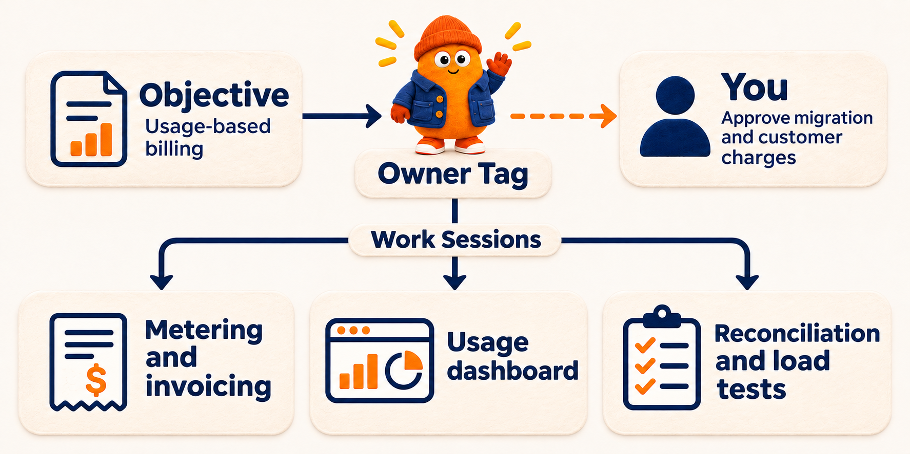

<div align="center">

<h1>
  
  SuperTag
</h1>

<h3>Persistent AI actors for engineering work.</h3>

<p>
  The open alternative to <a href="https://openai.com/index/introducing-dots/">dots</a>. Give a Tag,
  a persistent AI actor, an outcome. It keeps that outcome across sessions, coordinates your
  coding agents (Claude Code, Codex, Cursor, or OpenCode), and brings questions and results back
  to you.
</p>

<p>
  <a href="#get-started"><strong>Get started</strong></a> ·
  <a href="#see-it-work">See it work</a> ·
  <a href="#faq">FAQ</a> ·
  <a href="docs/README.md">Documentation</a> ·
  <a href="CONTRIBUTING.md">Contributing</a> ·
  <a href="LICENSE">Apache 2.0</a>
</p>

```sh
curl -fsSL https://unpkg.com/supertag-ai@latest/install.sh | sh
export PATH="$HOME/.local/bin:$PATH"
cd your-repo && supertag init
supertag
```

Select `lead` and ask it what it would improve first in your repository.

<sub>macOS or Linux with <a href="docs/operations/requirements.md">Node.js</a> and Claude Code, Codex, Cursor, or OpenCode.</sub>

<p>
  
</p>

</div>

---

Coding agents are good at one clear task. Bigger work turns into several agent sessions side by
side, and you become the manager between them: briefing each one, checking progress, answering
questions, and reconciling results.

SuperTag gives that work a persistent owner.

- **You steer a Tag.** A Tag is a persistent AI actor with a stable identity, responsibilities,
  permissions, and work history. It exists independently of the model or harness executing its
  work. Give it an outcome, guide it when decisions come up, and return to the same Tag when
  there is more work in its area.
- **The Tag manages work Sessions.** A work Session is a thread for one piece of work. The Tag
  starts Sessions, follows their progress, and reviews how their results fit together. It brings
  you the results and the decisions that need your input.
- **A Team brings together Tags with different responsibilities and permissions.** One Tag
  owns the outcome and coordinates the other members. Each member works within its own assigned
  permissions. You steer the Tag that owns the outcome. See the
  [first Team walkthrough](docs/guides/first-team.md).

## See it work

Say you want to move from flat plans to usage-based billing. Give `lead` an **Objective**,
an outcome and a way to check when it is done.

> Customers can see their metered usage, and test invoices match the usage records. Done when
> the billing reconciliation suite passes. Stay within $5,000. Ask me before migrating
> existing plans or doing anything that charges a customer.

One Tag can split the work across three work Sessions.



| Work Session | What it reports back to `lead` |
| --- | --- |
| Metering and invoicing | The event schema, metering code, tests for duplicate events, and test invoices |
| Usage dashboard | A dashboard that reads the usage records and shows how they were counted |
| Reconciliation and load tests | Evidence that the invoices match the usage records and the pipeline handles the expected load |

`lead` checks how the pieces fit together and brings you the branches and test results. You
decide whether to migrate existing plans or allow customer charges. When the next billing issue
comes up, you can go back to the same Tag.

## How you use SuperTag

| | Step | What happens |
| --- | --- | --- |
| **01** | **Talk to a Tag** | Open `supertag`, or mention the Tag in Slack or on a GitHub issue. Ask a question or give it a piece of work. [Talk to a Tag](docs/guides/talk-to-a-tag.md) |
| **02** | **Start a goal with `/goal`** | An Objective records the outcome, done-when evidence, constraints, and any budget or deadline you set. You keep the approvals. The owner starts work Sessions, reviews their results, and decides what runs next. [Write an Objective](docs/guides/write-an-objective.md) |
| **03** | **Review what the Tag brings back** | With branch delivery, a repository work Session uses its own git worktree and can deliver a branch. Review the change, then merge it or ask the Tag for a revision. |

In `lead`'s terminal conversation, type this and press Enter.

```text
/goal Show customers their metered usage. Done when the billing reconciliation suite passes. Ask me before migrating plans or charging customers.
```

`lead` owns the new Objective and takes its first turn. Enter `/goal` on its own to choose a Team
or set a budget before starting. See the [Objective guide](docs/guides/objectives.md#1-create-the-objective)
for the command palette, CLI, and manifests.

You steer the Objective through its owner. Findings come back to the conversation.
**Waiting on you** shows questions and approval requests that need your decisions.
Slack can also notify you.
To direct SuperTag from a Claude Code, Codex, or Cursor thread, give it the
[operator skill](docs/guides/coding-agent-operator.md). The
[interaction model](docs/concepts/interaction-model.md) explains how a conversation, an Objective,
and a Team divide the work.

## Works with

| | |
| --- | --- |
| **Coding agents** | Claude Code · Codex · Cursor · OpenCode · [your own harness](docs/guides/harness-runtime.md) |
| **Where you talk to it** | Terminal · [Slack](docs/surfaces/slack.md) · [GitHub](docs/surfaces/github.md) · [Linear](docs/surfaces/linear.md) · [Lark/Feishu](docs/surfaces/lark.md) · [Microsoft Teams](docs/surfaces/teams.md) |
| **Where the work runs** | Your laptop · your servers · CI runners · [Modal](docs/guides/modal-workers.md) and E2B sandboxes |

Each Tag can use a different coding agent and model, so one Team can mix Claude Code, Codex,
Cursor, and OpenCode.

## From one laptop to your whole team

Start on your laptop. When your team joins, everyone can use one hosted **Control Plane**, the
service that stores the organization and schedules work. The machines that run the work connect
as **Worker Hosts**.


| | |
| --- | --- |
| **One Control Plane, many machines** | Deploy one Control Plane for the team ([self-hosting](docs/guides/self-hosting.md)). Each laptop, CI runner, or cloud sandbox joins as a **Worker Host** with an **Auth Key**, and a Tag runs on the hosts it's bound to, next to the checkouts and harness sign-ins already there. |
| **Every surface reaches the same Tag** | The same Tag answers in Slack, on GitHub issues, in Linear, and in each person's terminal, with one memory of what it owns. A person's terminal conversation stays private to them. |
| **Tags that work together on their own** | Put Tags that run on different people's laptops on one Team. The Objective's owner hands them work, they message each other's inboxes and post findings to the Team's **Workstream**, and only decisions reach a person. |
| **Tags that belong to the organization** | Run a Tag on an always-on host with no one person behind it, such as a review, triage, or release Tag. Other Tags hand it work through their Teams and its inbox; its Roles and Permission Sets decide what it may do. |

Together, your Teams of Tags make up an **autonomous organization**: Teams may pursue different
Objectives but share one set of rules and one record of the work. When a laptop goes offline, new
work goes to another host bound to the same Tag. See [Run a Worker](docs/guides/workers.md) and
[multiplayer continuity](docs/concepts/multiplayer.md).

## Is SuperTag right for you?

- ✅ You already hand coding to agents, but you still act as the manager between their sessions.
- ✅ You want one Tag that remembers what it owns, whether you reach it from the terminal, Slack, or GitHub.
- ✅ You use more than one coding agent and want them working on one outcome.
- ✅ You want it open, on your models and your machines.

SuperTag is not:

- **A coding agent.** It runs yours: Claude Code, Codex, Cursor, OpenCode, or your own.
- **A hosted service.** You run the Control Plane, on your laptop or on a server you choose.
- **Always watching.** A Tag works when a message, a report, an approval, or a deadline reaches
  it. Monitoring needs something that sends it events.
- **Proof of correctness.** Completion is the owner Tag's assessment with its evidence. Ask for a
  reviewer Tag and your own approval when that matters.
- **Zero setup.** You install it, sign in to your harnesses, and run `supertag init`.

## Get started

SuperTag has two parts. The **Control Plane** stores your Tags, Teams, and Objectives and schedules
their work. A **Worker Host** is a machine or sandbox that supplies execution capacity. A **Worker**
completes each **Task**, one turn of a Session, usually through a coding harness. On your laptop,
`supertag init` sets up both. Check the [requirements](docs/operations/requirements.md) for
supported systems and tools.

### 1. Install SuperTag

You need [Node.js and npm](docs/operations/requirements.md#system-and-tools) on macOS or Linux:

```sh
curl -fsSL https://unpkg.com/supertag-ai@latest/install.sh | sh
export PATH="$HOME/.local/bin:$PATH"
supertag --version
```

The script installs the CLI and terminal UI. It puts the `supertag` command in `~/.local/bin`.
Add the `export` line to your shell startup file to use the command in new terminals.
See [installation options](docs/operations/install.md).

### 2. Set up your repository

Sign in to each harness you plan to use:

| Harness | Sign in |
| --- | --- |
| Claude Code | Run `claude` and follow its sign-in prompt. |
| Codex | Run `codex -c 'cli_auth_credentials_store="file"' login`, so Tasks can use the sign-in file, especially on macOS where login may use Keychain. |
| Cursor | Add `CURSOR_API_KEY` from Cursor's dashboard to `~/.supertag/.env`; the Cursor app login is not enough. See [Cursor setup](docs/operations/requirements.md#cursor-setup-and-limits). |
| OpenCode | Set your provider's API-key environment variable for the host service. |

See [harness sign-in](docs/operations/requirements.md#choose-and-sign-in-to-a-harness) for
details. Then run `init` inside a git repository with at least one commit, here named `app`. If
port 3434 is busy, enter another number at init's `Port` prompt.

```sh
cd ~/code/app
supertag init
```

Keep the defaults: the Workspace name `app`, branch delivery, the Tag name `lead`, and permission
to edit files and run commands. If you choose different names, use them below. `init` starts a
local Control Plane and connects your machine as a Worker Host. Settings live in
`~/.supertag/supertag.yaml`, and `supertag ps` shows both services.

<details>
<summary>What <code>init</code> checks about your harnesses</summary>

At `Harnesses this machine serves`, `init` labels each installed harness `signed in` or
`not signed in`. OpenCode says `sign-in not checked (choose a model)` until you select its
model. The defaults include only harnesses that pass the sign-in check. For Codex file-backed
sign-in, `signed in` only means a credential is present and
readable; it cannot confirm account access. Run Codex once to confirm access. Before finishing
setup, `init` prints
`not signed in (the credential check did not succeed)` for any failed check and gives its
sign-in instructions. If none of the selected harnesses pass, setup stops so you can sign in
and run `supertag init` again.

</details>

### 3. Talk to your Tag

Open the terminal UI from the same repository.

```sh
supertag
```

Select `lead`, type “Read this repository and tell me what you would improve first,” and press
Enter. The reply appears in the conversation. Follow up there, or open the
[terminal guide](docs/guides/talk-to-a-tag.md) to review a branch or create an Objective.

For automation, see the [CLI](docs/operations/cli.md#send-messages-from-the-cli),
the [operator API](docs/reference/control-plane-api.md), or
[run SuperTag from your coding agent](docs/guides/coding-agent-operator.md).

### Next: run your first Team

Say you need to move 12 production services from shared API keys to short-lived credentials
issued to each service. Give `lead` the Objective to migrate the services while keeping requests
working. The other Tags each own an area of the migration.


| Tag | Responsibility and access |
| --- | --- |
| `lead` | Owns the Objective and sequences the rollout waves. |
| `identity` | Updates trust policy in the identity repository. |
| `migration` | Updates the service repositories to use the new credentials. |
| `verification` | Has read-only access to test results and telemetry. Checks each wave against its error and latency limits. |
| `rollout` | Uses configured staging tools to rehearse each cutover and rollback. |

You steer `lead`. It starts and manages work Sessions with the other Tags and records their test
and rehearsal results in the Team's Workstream. You use that evidence to approve each production
cutover and decide when to retire the shared keys. The same Tags keep their responsibilities
for future migrations.

[Add a builder and run your first Team](docs/guides/first-team.md) for a small, runnable exercise.

To start with a configured Team, apply one of the
[example organizations](examples/organizations/README.md).

Stop the local services with `supertag down`; restart them with `supertag up`.

### Next: add your team's chat

[Connect Slack](docs/surfaces/slack.md), then [add a channel to the Tag's locations](docs/surfaces/slack.md#5-add-a-channel-to-a-tag).
People can direct `lead` from that channel. See the [collaboration surface guides](docs/surfaces/README.md)
for GitHub, Lark/Feishu, Linear, and Microsoft Teams.

## FAQ

**How is a Tag different from a coding agent session?** A session carries out a piece of work.
The Tag owns the outcome across sessions and keeps its identity, responsibilities, permissions,
and work history when a different model or harness runs the next piece.

**What does `/goal` create in SuperTag?** It creates an Objective owned by the Tag you selected.
The owner can start several work Sessions and coordinate their results across machines. If the
Objective names a Team, its owner can assign Sessions to other Tags. Budgets, deadlines, and
approval decisions apply across that work.

**Do I need a cloud account?** No. `supertag init` runs everything on your laptop. Deploy a Control
Plane only when your team shares Tags.

**Which models can a Tag use?** Any model its coding agent supports. Each Tag, and each Role, can
name its own harness and model.

**Can a Tag change my repository without me?** A Tag works in its own git worktree and delivers a
branch. A **Permission Set** lists what it may do, and you can require your approval for any action.

**How does it compare with other agent systems?** See
[SuperTag and other agent systems](docs/concepts/supertag-and-other-agent-systems.md).

## The basic model

SuperTag uses a small organizational vocabulary. Each term represents something a user can create,
inspect, or control:

| Term | Meaning |
| --- | --- |
| **Tag** | A persistent AI actor with a stable identity, responsibilities, permissions, and work history |
| **Role** | An enduring responsibility assigned to a Tag |
| **Team** | A flat list of member Tags, with an optional concurrency limit |
| **Objective** | An outcome owned by a Tag, with a budget, a deadline, and criteria for deciding when it is complete |
| **Session** | One Tag's thread of work: a conversation, an Objective's conversation, the Tag's inbox, or work started beneath one of those |
| **Task** | One turn of a Session |
| **Workstream** | A Team's shared record of its members' posts |
| **Mailbox** | A Tag's inbox for messages from other Tags |
| **Context Set** | Reusable knowledge that may be added to a Task |
| **Permission Set** | Actions that a Task is allowed to perform |

The **Control Plane** stores this organization, applies its rules, schedules work, and preserves its
history. A **Worker Host** is a machine or sandbox that provides execution capacity. Inside the
Control Plane, the **API Server** handles management and Worker Host connections, while the
**Gateway** carries traffic to and from external work tools. A **Worklet** connects a Worker Host to
the Control Plane. A **Worker** completes an accepted Task, and an optional **harness** connects the
Worker to an agent system such as Claude Code, Codex, OpenCode, or one you build.

People can direct the same organization from Slack, GitHub, Lark/Feishu, Linear, Microsoft Teams,
the command line, or an API. A Tag keeps one identity across those tools. Every Tag is a non-human
identity in SuperTag's identity and access management (IAM) model, and each Task keeps a fixed
record of its source, requester, knowledge, permissions, and limits, followed by its approvals and
results.

## Where to go next

| I want to… | Read |
| --- | --- |
| Connect Slack, GitHub, Lark/Feishu, Linear, or Teams | [collaboration surface guides](docs/surfaces/README.md) |
| Understand the main ideas | [Core concepts](docs/concepts/README.md) |
| Give a Team ongoing work, such as backlog triage or dependency upkeep | [Maintain an ongoing responsibility](docs/guides/ongoing-responsibilities.md) |
| Compare SuperTag with assistants, agent runtimes, and harnesses | [SuperTag and other agent systems](docs/concepts/supertag-and-other-agent-systems.md) |
| Understand the service architecture | [How SuperTag fits together](docs/concepts/how-it-works.md) |
| Run Claude Code, Codex, or OpenCode locally or remotely | [Run a Worker](docs/guides/workers.md) |
| Build and connect a custom Worker or harness | [Custom Worker guide](docs/guides/custom-workers.md) |
| Build a Worker in Python | [Build a Python Worker](docs/guides/python-workers.md) |
| Add a custom Context type | [Custom Context guide](docs/guides/custom-context.md) |
| Self-host an always-on Control Plane | [Self-host SuperTag](docs/guides/self-hosting.md) |
| Operate the Control Plane | [Control Plane operations](docs/operations/control-plane.md) |
| Direct and inspect work from the CLI | [CLI operator guide](docs/operations/cli.md) |
| Diagnose a missing or static reply | [First-reply troubleshooting](docs/guides/troubleshooting.md) |
| Contribute to the runtime | [Implementation reference](docs/README.md#implementation-reference) |

The [documentation map](docs/README.md) organizes the rest by task and depth.

## Build on SuperTag

Install the public extension SDK when you want to build an organizational application or implement
a custom Worker, harness, execution environment, collaboration surface, or permission-derived resource.
Install it from npm in your application:

```sh
npm install supertag-ai
```

```ts
import {
  createWorker,
  LocalExecutionEnvironmentProvider,
  LocalWorklet,
  connectWorklet,
} from "supertag-ai";
```

The package bundles SuperTag's internal runtime modules behind deliberate public entry points, so applications never depend on private workspace packages. See the [custom Worker and harness guide](docs/guides/custom-workers.md), [custom Context guide](docs/guides/custom-context.md), and [`supertag-ai` package reference](packages/supertag-ai/README.md).

For Python applications, install the matching SDK from PyPI:

```sh
python -m pip install 'supertag==0.2.0a7'
```

See [Build a Python Worker](docs/guides/python-workers.md) for optional harness integrations.

## Contributing

The setup above gets SuperTag running. Contributors should also verify the complete workspace before making changes:

```sh
git clone https://github.com/atemaguer/supertag.git
cd supertag
pnpm install
pnpm check       # formatting, schema checks, and TypeScript
pnpm test        # test suite
pnpm build       # production build
```

See [CONTRIBUTING.md](CONTRIBUTING.md) for the contribution workflow, public contract
proposal process, and required checks. [API stability](docs/reference/api-stability.md) explains
which extension contracts are compatibility promises.
