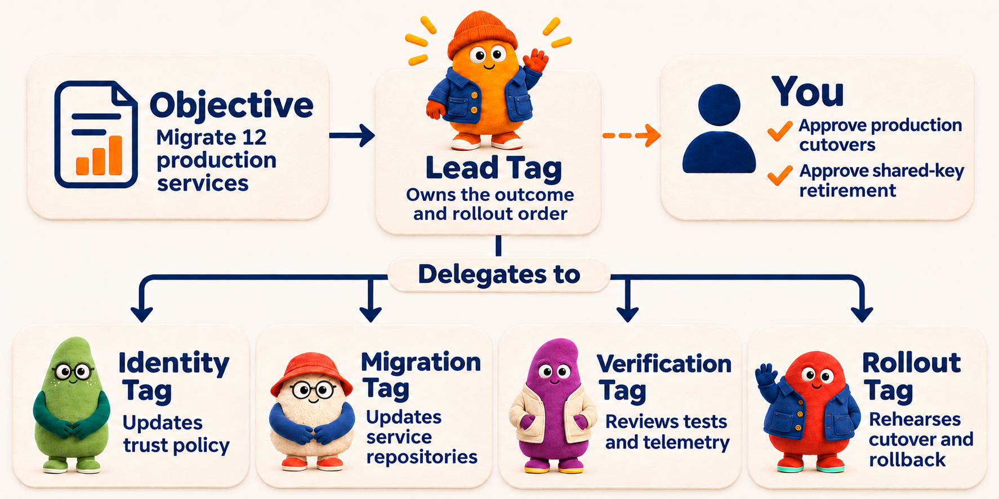
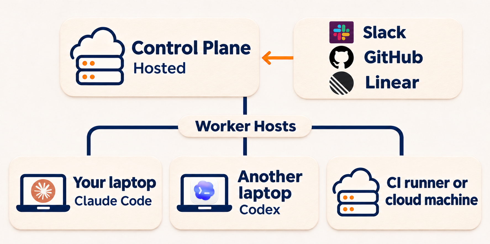

<div align="center">

<h1>
  
  SuperTag
</h1>

**Persistent AI actors for engineering work.**

Open infrastructure to build and run your own platform of persistent, proactive coding agents.

**Tags** are persistent AI actors with their own identities, responsibilities, and work history. Give a Tag an engineering goal or an ongoing responsibility. It carries the work across sessions, coordinates tools like Claude Code and Codex, and picks up the work when new reports arrive.

[Run your first Tag](#run-your-first-tag) · [See it work](#see-it-work) · [Build on SuperTag](#build-on-supertag) · [Documentation](docs/README.md)

<p>
  
</p>

</div>

## Engineering agents need more than a session

A coding agent can investigate a bug, write a fix, and run tests. When the work spans several
sessions, someone still has to carry the goal forward, coordinate the pieces, and decide what
happens next. And when another report arrives next week, someone has to pick it up again.

With SuperTag, you give that responsibility to a Tag. The same Tag can investigate today’s issue,
review the results tomorrow, and take up the next report when it arrives. Its identity,
responsibilities, permissions, and work history stay with it when the next piece of work runs
on another model or machine.

## See it work

Say you want to keep a service’s dependencies up to date. Give a `maintenance` Tag an ongoing
responsibility:

> Investigate new dependency reports. Prepare a branch for fixes and include the test results.
> Ask me before a major version upgrade. Leave merging to me.

When your scanner sends a report to SuperTag, `maintenance` can start a separate work session to
investigate the affected package and prepare a fix. It reviews the result and brings you the branch,
the tests, and any decision it needs from you.

Once that work is done, `maintenance` waits. When another report comes in, the same Tag picks it up
under the same responsibility. You can return to `maintenance` to ask about earlier work or change
how it handles future reports.

That’s what proactive means in SuperTag. A Tag can act when it receives a message, report, or another
configured event. You choose which tools send those events and what the Tag can do in response.

[Set up an ongoing responsibility](docs/guides/ongoing-responsibilities.md)

## How Tags work together

**Give work an owner.** An **Objective** records an outcome, the evidence you’ll use to decide
when it’s done, and any constraints, budget, or deadline you set. The owning Tag decides what work
to start and reviews what comes back. A **Session** is one thread of work, such as investigating
a dependency or preparing its update. [Write an Objective](docs/guides/write-an-objective.md)

**Give each Tag its own job and permissions.** A **Team** is a group of Tags that can hand work to
each other. You could let `maintenance` coordinate an update, give a builder permission to edit the
repository, and give a reviewer read-only access. You steer the owning Tag. It brings back
findings and decisions that need your approval. [How you direct work](docs/concepts/interaction-model.md)

To move 12 services to short-lived credentials, give `lead` the rollout Objective. It coordinates
Tags that update trust policy and service code, review tests and telemetry, and rehearse the
cutover. You approve production cutovers and decide when to retire the shared keys.



<a name="next-add-your-teams-chat"></a>

**Reach the same Tag from the tools you use.** Talk to it in the terminal or connect a work tool
and add its channel, repository, or team to the Tag’s locations. Each conversation has its own
thread, and the same Tag keeps the responsibilities you assigned it. [Connect a work tool](docs/surfaces/README.md)

<a name="get-started"></a>

## Run your first Tag

On macOS or Linux, install Node.js and Git, then set up a [supported coding agent](#works-with).
[Check requirements and sign-in](docs/operations/requirements.md)

Run this from an existing Git repository with at least one commit:

```sh
curl -fsSL https://unpkg.com/supertag-ai@latest/install.sh | sh
export PATH="$HOME/.local/bin:$PATH"
supertag init
supertag
```

Keep the default Tag name, `lead`. Select it in the terminal and ask:

> Read this repository and tell me what you would improve first.

Follow up in the same conversation. When you’re ready to hand over an outcome, try an Objective
like this.

```text
/goal Add a test for an uncovered edge case. Done when the new test and its suite pass. Ask me before changing application code.
```

Open **Waiting on you** when the Tag needs a decision. With branch delivery enabled, review the
branch it returns and decide whether to merge it or ask for a revision.

[Installation options](docs/operations/install.md) · [Talk to a Tag](docs/guides/talk-to-a-tag.md) · [Run your first Team](docs/guides/first-team.md) · [Direct SuperTag from your coding agent](docs/guides/coding-agent-operator.md)

## From one laptop to your whole team

### Single-player on your laptop

Run SuperTag from your terminal with the repository and coding agents you already use.
`supertag init` starts a local **Control Plane**, the service that stores your Tags and schedules
their work. It also connects your computer as a **Worker Host**, a machine or sandbox that runs
the work. You can give an Objective to one Tag and have it coordinate other Tags on the same
machine.

### Multiplayer with your team

Self-host one shared Control Plane so teammates can direct the same Tags from their own terminals
or connected tools. One person can ask `maintenance` to investigate an issue in Slack, and another
can ask the same Tag about the shared findings on GitHub. Private terminal conversations stay
private to each person.



Connect teammates’ laptops, servers, CI runners, or supported sandboxes as Worker Hosts. You can
choose a different coding agent and model for each Tag. Tags on different machines can work on the
same Objective and report back to its owner. You can also keep a shared Tag, such as
`maintenance`, on an always-on host so it can pick up reports when everyone’s laptop is off.

[Self-host SuperTag](docs/guides/self-hosting.md) · [Connect a Worker Host](docs/guides/workers.md) · [How multiplayer works](docs/concepts/multiplayer.md) · [See how the parts fit together](docs/concepts/how-it-works.md)

## Works with

| | Options |
| --- | --- |
| **Coding agents** | Claude Code · Codex · Cursor · OpenCode · [custom integrations](docs/guides/harness-runtime.md) |
| **Where you talk to Tags** | Terminal · [Slack](docs/surfaces/slack.md) · [GitHub](docs/surfaces/github.md) · [Linear](docs/surfaces/linear.md) · [Lark/Feishu](docs/surfaces/lark.md) · [Microsoft Teams](docs/surfaces/teams.md) |
| **Where work runs** | Laptops · servers · CI runners · [Modal](docs/guides/modal-workers.md) and [E2B](docs/guides/shared-execution.md) sandboxes |

## When to choose SuperTag

| Compared with | What it does well | Why choose SuperTag |
| --- | --- | --- |
| **Hosted AI teammates** · [OpenAI dots](https://openai.com/index/introducing-dots/), [Grok Bot](https://x.ai/news/introducing-grok-bot) | Hand off work to agents that stay available and can pick it up again later. | **Run proactive agents on your own infrastructure.** Set up persistent Tags and choose each one’s coding agent, model, tools, and where the work runs. |
| **Coding agents** · [Claude Code](https://code.claude.com/docs/en/overview), [OpenCode](https://opencode.ai/docs/), [Codex](https://learn.chatgpt.com/docs/codex/cli) | Investigate, edit, and test code. | **Give the work a persistent owner.** Keep using your coding agents for execution. A Tag keeps its goal, permissions, and history across sessions, even when the next session uses a different coding agent. |
| **Parallel agent workspaces** · [Paradev (formerly Superset)](https://docs.paradev.com/recipes/parallel-workstreams), [Conductor](https://www.conductor.build/docs/concepts/parallel-agents) ([winding down](https://www.conductor.build/announcement)) | Run coding sessions in separate Git worktrees and review their changes in one place. | **Hand off coordination to a Tag.** Give it an outcome and a way to verify it. It can start sessions, review how their results fit together, and bring you branches and decisions. |
| **Agent projects** · [Claude Code Projects](https://code.claude.com/docs/en/claude-projects), [Cursor Projects](https://cursor.com/docs/agent/projects), [GitHub Copilot Projects](https://docs.github.com/en/copilot/how-tos/github-copilot-app/working-with-projects) | Coordinate multiple agent sessions around an ongoing goal. | **Build a team you can reuse across projects.** The same lead, builder, and reviewer Tags keep their responsibilities and permissions across goals. Each can use a different coding agent and run on a different machine. |
| **Self-hosted agent runtimes** · [OpenClaw](https://docs.openclaw.ai/concepts/multi-agent), [Hermes Agent](https://hermes-agent.nousresearch.com/docs/user-guide/features/kanban) | Run agents with their own tools and history, and coordinate work between them. | **Know who owns the work and what they were allowed to do.** Each outcome has an owning Tag. SuperTag records who requested each piece of work, which permissions applied, and what came back. |

[See how SuperTag fits with other agent systems](docs/concepts/supertag-and-other-agent-systems.md).

## Build on SuperTag

Use the same infrastructure to give your own application persistent actors. The API lets your
application create and direct Tags, send them work, and inspect their progress. For example, you
could connect a dependency scanner to a maintenance Tag and show its branches and test results in
your own review interface. [Explore the API](docs/reference/control-plane-api.md)

To bring your own execution system, use the public SDK. A **Worker** runs a turn of work for a Tag.
A **harness** connects a Worker to a coding agent or another execution system. You can implement
either to fit your application.

```sh
npm install supertag-ai
```

For Python applications, install the SDK version that matches your Control Plane:

```sh
python -m pip install 'supertag==0.2.0a9'
```

[Build a custom Worker or harness](docs/guides/custom-workers.md) · [Use the Python SDK](docs/guides/python-workers.md) · [Check API stability](docs/reference/api-stability.md)

## FAQ

**How do I control changes to my repository?** Set what each Tag is allowed to do. With branch
delivery, repository work happens in a separate Git worktree and comes back as a branch you can
review. [Work with repository branches](docs/guides/workspaces.md)

**Do I need a server?** You can start the Control Plane and run work on your laptop. For shared
access or work that should stay available when your laptop is off, deploy the Control Plane and
connect a Worker Host that stays online. [Self-host SuperTag](docs/guides/self-hosting.md)

## Contributing and license

See the [contributor guide](CONTRIBUTING.md) for repository setup and checks. SuperTag is licensed
under [Apache 2.0](LICENSE).
