# Worker Hosts, Worklets, Workers, and harnesses

The components on this page provide the machines, code, and agent-system connections that run each
**Task**, one turn of work for a **Tag**, a persistent AI actor with its own
responsibilities and permissions. Tags work in Teams. Together, your Teams of Tags
make up an **autonomous organization**: Teams may pursue different goals but share one Control
Plane, its rules, and its record of the work. The **Control Plane**, the service that stores the
organization, decides what work to accept and keeps a lasting record of it. **Worker Hosts**
provide machines or sandboxes where the work can run, a **Worklet** connects each host to the
Control Plane, and a **Worker** defines how to complete a Task.

Two parts of the Control Plane appear in the diagram below: the **Gateway** carries traffic to and
from external work tools, and the **API Server** handles management and Worklet connections. The
table defines the execution terms; the [glossary](../reference/glossary.md) lists the rest.

| Term | Plain-language meaning |
| --- | --- |
| Worker Host | A machine, container, VM, or sandbox that provides execution capacity |
| Worklet | The supervisor program that connects a Worker Host to the Control Plane |
| Worker | The code that turns an accepted Task into completed work |
| Worker Profile | A saved, versioned recipe for running a Worker |
| Task Attempt | One execution or retry of a Task by a Worker |
| Harness | The connection between a Worker and Codex, Claude Code, Cursor, OpenCode, or another agent system |
| Harness runtime | The place where the harness process, model sign-in, and private state live |
| Execution environment | The local workspace or remote sandbox where tools act |

## Follow one Task

```mermaid
flowchart LR
    Surface["Collaboration surface"]

    subgraph ControlPlane["Control Plane"]
        Gateway["Gateway<br/>carries requests and replies"]
        Scheduler["Accept, store, and schedule"]
        API["API Server<br/>connects Worklets"]
    end

    subgraph Host["Worker Host"]
        Worklet["Worklet<br/>supervises Tasks"]
        Worker["Worker<br/>runs the Task Attempt"]
        Harness["Optional harness"]
        Environments["Harness runtime and<br/>execution environment"]
    end

    Surface --> Gateway --> Scheduler --> API
    API --> Worklet --> Worker
    Worker -.-> Harness -.-> Environments
    Worker -->|"events and result"| Worklet
    Worklet --> API --> Scheduler --> Gateway --> Surface
```

## Worker Host

A Worker Host is the execution location managed by SuperTag. It may be a laptop,
server, container, VM, or sandbox. One Worker Host can run several Workers, such
as separate Codex, Claude Code, Cursor, and OpenCode Workers.

The Control Plane observes a Worker Host through its Worklet connection. The observed host state
includes its Workers, capacity, active Task Attempts, and health. The Control Plane does not assign
new work to an unreachable, unready, full, or draining Worker Host.

## Worklet

A Worklet is the persistent supervisor that runs on a Worker Host. It connects outbound to the
Control Plane API Server's Worklet API, reports the host's Workers and capacity, renews its
heartbeat, accepts Tasks, enforces concurrency, and supervises execution.

The Worklet provides control and observation. It is not the Worker Host and does
not define how a Task is performed.

## Worker

A Worker defines how SuperTag completes an accepted Task. For each Task Attempt, it:

- confirms that it supports the selected Worker Profile;
- resolves the allowed context, workspace, tools, and continuity;
- chooses and configures any harness runtime and execution environment it uses;
- starts, monitors, cancels, and cleans up execution; and
- translates execution activity into ordered Task Attempt events and results.

A Worker may compose the standard providers shipped by SuperTag. It may also
implement execution directly. A deterministic workflow, an external execution
service, and an AI coding system can all be Workers. A Worker does not have to
use a harness or an execution environment provider.

## Worker Profile

A Worker Profile is a versioned execution recipe selected for a Task Attempt. It identifies the
Worker behavior, harness, execution environment, optional separate harness runtime, trusted
instructions, lifetime, and resource limits. Credentials stay inside the Worker Host's secret
boundary and do not appear in the profile.

Scheduling has two levels. The Control Plane chooses an eligible Worker Host using Tag bindings,
policy, affinity, health, locality, and reported capacity. The selected Worklet chooses a concrete
Worker and compatible profile using current host-local capacity. The Control Plane freezes the
resulting host, Worklet, Worker, and profile on the Task Attempt before dispatch, so admission and
recovery cannot silently move it elsewhere. An explicit `execution.profile` constraint requires
that exact revision; otherwise the Worklet can choose among compatible profiles.

## Harness

A harness adapts resolved execution inputs to Codex, Claude Code, Cursor, OpenCode, or another
execution system. It also translates native output, tool calls, and resumable
state into SuperTag's common event model.

A harness is one optional component used by a Worker. It is not the Worklet, the Worker Host, or the
Tag, the identity the work belongs to.

## Harness runtime and execution environment

A harness runtime hosts the harness process and its private files. For example,
Codex app-server can run on a contributor's laptop and use that contributor's
existing Codex sign-in.

An execution environment provides the filesystem, processes, and network where
workspace tools act. It may be the same laptop, an isolated Modal or E2B sandbox,
or a service that several Workers use with separate access. A Worker passes both
accesses to its harness.

By default, one local execution environment fills both roles. This **colocated**
arrangement preserves the familiar behavior where the agent and its tools run in
one place. A Worker Profile can select the two roles separately only when its
harness advertises complete split-execution support. The SDK enforces this boundary.

The experimental shared-execution provider lets several Workers receive separate
Task Attempt access to one remote execution service. Releasing one access stops only
that access's processes and leaves the shared environment available to others.
Split execution keeps the agent loop, model credentials, and private Session state on the
Worker Host while workspace tools act elsewhere. For example, Claude Code can run on a laptop
while reading files and running tests in a Modal sandbox. Host services using e2b or Modal
automatically use this arrangement for Claude Code, Cursor, and Codex. Provider keys never enter their
sandboxes.

Claude Code and Cursor offer read, write, edit, file search, directory listing, and foreground commands
through a shared bridge. A **Permission Set** selects allowed actions: writes require permission
to write files, and commands require permission both to run commands and to write files.
The remote sandbox confines commands; the bridge checks file paths and allowed actions.
Configured read-only roots restrict the bridge's file tools only. A Task with
`commands:execute` can change those files inside its own sandbox.

Claude Code gives up native local file tools, web/browser tools, background commands, notebook
editing, and shell-output management tools. Its subagents receive the same restrictions.
Native resume still works with state on the host. Skills, reusable instructions and scripts,
are staged on the host, and their commands use the bridge. SuperTag and external work-tool MCP
clients stay on the host.

Cursor gives up all built-in tools, including web tools and subagents. Its working directory is
an empty host directory, so repository rules do not load automatically. The remote sandbox
provides the workspace boundary; Cursor's own sandbox provides no useful protection for remote
files or commands. Background commands are unavailable.
Cursor's native-tool exclusion depends on the SDK honoring its `tools: ["mcp"]` allowlist and
`disallowedTools` denylist. The SDK has no per-call approval, and Cursor's sandbox does not
confine reads. See [Cursor SDK tools](https://cursor.com/docs/sdk/typescript.md) and
[Cursor run modes](https://cursor.com/docs/agent/security/run-modes.md).

Claude and Codex retain native workspace tools when runtime and tools are colocated. On a host
service with a remote environment, Codex keeps app-server and sign-in on the Worker Host and runs
its official exec-server in the sandbox. The sandbox needs a matching Codex CLI binary for that
exec-server, but no provider key. Host services with remote environments refuse OpenCode because
its provider key would enter the sandbox. The Python harness does not yet advertise split
execution. See
[Share an execution environment](../guides/shared-execution.md).

## Next

- Use a shipped implementation with [Run a Worker](../guides/workers.md).
- Build an extension with the [custom Worker and harness guide](../guides/custom-workers.md).
- Read the detailed [Worker reference](../reference/worker.md).
