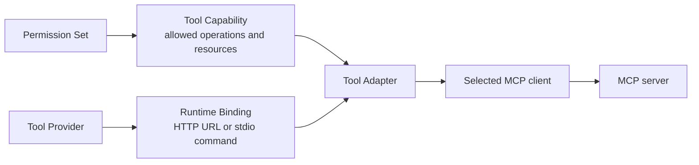
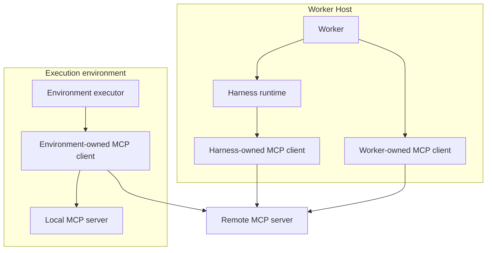

# Route MCP tools to the right client

Choose which process connects to each MCP server for a **Task**, one accepted request or
assignment, and configure a harness or **Worker**, the code that completes a Task, to use that
route. A **harness** connects a Worker to an agent system such as Codex or Claude Code. Use this
guide when a server is private, needs a credential kept out of the harness, or must
run next to the Task workspace.

An **MCP server** exposes tools. An **MCP client** opens and owns one connection to that server.
The process that owns the client controls where credentials live, which network can reach the
server, and how long the connection survives. A **Worker Host** is the machine or sandbox where a
Worker runs. Its **Worklet** connects it to the **Control Plane**, the SuperTag service that
schedules work. See the [glossary](../reference/glossary.md) for other terms.

The client choice is separate from permission. A **Tag** is a persistent AI actor with its own
responsibilities and permissions. A Tag's **Permission Set** decides which operations and resources
a Task may use. The Worker then decides how a compatible harness reaches the server for each **Task
Attempt**, one execution or retry of the Task. Moving a client never expands what the Task may do,
so one authorization model covers local harnesses, split execution, hosted agent services, and
private MCP servers.



## Before you start

- A Worker with a harness, and a Permission Set that allows the tool. See
  [Workers](workers.md) and [Context and permissions](../concepts/context-and-permissions.md).
- The MCP server's HTTP URL or stdio command, and any credential it needs.
- For custom code, `supertag-ai` installed in the Worker project.

## 1. Choose where the client runs

SuperTag names three client locations:

| Client location | What owns the connection | Useful when |
| --- | --- | --- |
| `harness-runtime` | Codex, Claude Code, OpenCode, or a hosted harness service | The harness can reach the server and safely hold its Task-scoped connection details |
| `worker-host` | The SuperTag Worker | The Worker must enforce policy or keep a credential out of the harness process |
| `execution-environment` | A sandbox-side executor or MCP bridge | The server is local to, or reachable only from, the environment where tools execute |

An HTTP server may be public, private, tunneled, or local. Its URL does not decide which client
owns the connection. A stdio server is different: the client launches the server process, so its
command, environment variables, and credentials must exist at the selected client location.



The client location is an execution decision, not a new SuperTag resource.

## 2. Check what your harness supports

| Harness | Harness runtime client | Worker Host client | Execution environment client |
| --- | --- | --- | --- |
| Claude Code (local runtime) | HTTP and stdio by default | HTTP for selected tools | HTTP and stdio for selected tools |
| Codex exec | HTTP and stdio | — | — |
| Codex app-server | HTTP and stdio by default | HTTP for selected tools | HTTP and stdio for selected tools |
| OpenCode | HTTP coordination tools | — | — |

- **Codex app-server** uses the Worker-owned client for manager-only HTTP coordination and the
  execution environment client for manager-only stdio servers by default. The Worker publishes only
  the allowed tool schemas to the root thread and handles each structured call through the selected
  client. Those server connections and credentials never enter Codex's process-wide MCP
  configuration.
- **Claude Code and OpenCode** use a Worker-local HTTP policy proxy when a harness-owned client
  needs manager coordination. Only the root receives that proxy configuration. Native children do
  not receive its server definition or credential.
- **Claude Code** exposes forwarded tools through its root SDK tool interface. Its native children
  receive neither the forwarded server definitions nor their credentials, and a root-only tool hook
  rejects child calls. This route requires a local Claude runtime. Ordinary local execution keeps
  Claude's native workspace tools.

## 3. Declare the paths a custom harness supports

A harness integration advertises the client locations and transports it can drive through
`HarnessCapabilities.mcpClients`. Give `McpToolAdapter` the client location it is configuring:

```ts
import { McpToolAdapter, type HarnessCapabilities } from "supertag-ai/worker";

const mcpClients = [
  { client: "harness-runtime", transports: ["mcp-http", "mcp-stdio"] },
] satisfies NonNullable<HarnessCapabilities["mcpClients"]>;

const adapter = new McpToolAdapter("harness-runtime");
const server = adapter.adapt(toolInput);
```

The Tool Adapter records the selected client in the launch plan. A required path the harness does
not support fails before the harness starts.

## 4. Connect from the Worker when it must own the client

Use the same resolved Tool Input with `connectWorkerMcpClient`:

```ts
import { connectWorkerMcpClient } from "supertag-ai/worker";

const connection = await connectWorkerMcpClient(toolInput);
try {
  const result = await connection.callTool("search_documents", { collection: "docs" });
} finally {
  await connection.close();
}
```

The connection exposes only allowed server tools and checks the resource arguments again before
each call. The built-in Worker client currently supports HTTP MCP. A stdio binding requires a
client that can launch and supervise its server process at the selected location.

## 5. Connect from the execution environment when the server lives there

For an environment-owned HTTP or stdio client, use `connectExecutionEnvironmentMcpClient`:

```ts
import { connectExecutionEnvironmentMcpClient } from "supertag-ai/worker";

const connection = await connectExecutionEnvironmentMcpClient(environment, toolInput);
```

The execution environment must provide supervised streaming process input and output. The helper
starts a small bridge in that environment.
For stdio it launches the server; for HTTP it connects from the environment's network. The bridge
owns the MCP session and returns allowed schemas and results over supervised process streams.

## 6. Select a client per Tool Input

Claude Code and Codex app-server accept a `selectMcpClient` option. They use the helper from step 5
when it returns `execution-environment`:

```ts
import type { McpClientPlacement, ToolInput } from "supertag-ai/worker";

const harnessOptions = {
  selectMcpClient: (input: ToolInput): McpClientPlacement =>
    input.binding.name === "private_documents"
      ? "execution-environment"
      : "harness-runtime",
};
```

The selector does not change the Permission Set, Tool Capability, or server binding. For Codex, use
`executionMode: "app-server"`. Manager-only Codex tools must use a Worker or execution-environment
client. HTTP routes add the server hostname to the selected environment's network requirements;
reachability and network enforcement still depend on its provider.

## Check that it worked

Run a Task that uses the tool, then list its events:

```sh
supertag events task TASK_ID
```

The `runtime-inputs.resolved` event records the selected client location, server name, and
transport under `manifest.harness.provenance.mcpClients`. This record contains no credentials, so
it stays useful after recovery.

## Log in to an OAuth MCP server

Some MCP servers, such as Notion's, sign you in through a browser instead of a static token. On a
local deployment, declare the server under a **host service**, a `host` entry that connects its machine as a Worker
Host, in `~/.supertag/supertag.yaml` with
`auth: { oauth: true }`:

```yaml
services:
  laptop:
    type: host
    harnesses: [claude-code, codex]
    mcp:
      sentry: { url: https://mcp.sentry.dev/mcp, auth: { bearer: { env: SENTRY_TOKEN } } }
      notion: { url: https://mcp.notion.com/mcp, auth: { oauth: true } }
```

Log in once on the host:

```sh
supertag mcp login notion
```

The command prints the authorization URL and tries to open your browser. After you approve,
SuperTag stores the tokens in this host's credential store and refreshes them itself. The harness
and its shell never see them. Until you log in, `supertag up` refuses to start this host service.

Check every server's state with `supertag mcp list`. It never prints a credential:

```text
SERVICE  SERVER  URL                         AUTH         STATE
laptop   sentry  https://mcp.sentry.dev/mcp  bearer       ready
laptop   notion  https://mcp.notion.com/mcp  oauth login  logged in
```

A remote host often has no browser. Run the login on a machine that has one, with `--export`:

```sh
supertag mcp login notion --export
```

It stores nothing and prints a JSON value once. Store that value as the secret
`NOTION_MCP_REFRESH_TOKEN` on the remote host, and declare the server there with
`auth: { oauth: { refreshToken: { env: NOTION_MCP_REFRESH_TOKEN } } }`.

A login lapses when the authorization server refuses a refresh. Tasks that need `notion` then stay
queued instead of failing. `supertag describe objective` says "Held until MCP server notion is
logged in on its Worker Host". The operator inbox shows the item under "Needs you"; list such
items with `supertag list inbox --kind mcp-login`. Run `supertag mcp login notion` again. The host
offers `notion` again at its next connection to the Control Plane, and the Task runs. To reconnect
now, restart the host with `supertag up`.

See [MCP OAuth login](../reference/supertag-yaml.md#mcp-oauth-login) for the exact flow, the
token endpoint rules, and placement labels.

## Rules

### Policy before connecting

For each Task Attempt, the order is:

1. The Control Plane records the Task's permission snapshot.
2. A Tool Provider resolves a Tool Capability and a Runtime Binding inside the Worker Host.
3. The harness integration selects one client location it truthfully supports.
4. SuperTag places any required policy boundary where every call must cross it.
5. The selected client connects and exposes only the allowed tool names.
6. Tool calls become normalized Task events without storing raw credentials or complete tool
   output.

- The Runtime Binding contains connection material, not authority.
- An allowlist sent to an MCP server does not replace the Tool Capability.
- For tools of an external **collaboration surface**, a work tool such as Slack or GitHub, SuperTag must be able to check the operation and target repository,
  channel, chat, or team before forwarding a call. If it cannot enforce that resource boundary at
  the selected client path, it rejects the required tool.
- Tools of a host service's MCP servers follow the same order. A Permission Set grants them as
  `{ target: mcp, action: "server/tool" }`, and the Worker's policy proxy checks each call; see
  [MCP server tools](../reference/iam.md#mcp-server-tools).
- The policy proxy adds each such server's `auth` headers itself, and the harness never sees them.
  On 401 or 403 it fetches the credential again and retries once. When the server redirects to
  another origin, the proxy drops every `auth` header before following; see
  [host MCP servers](../reference/supertag-yaml.md#mcp-server-authentication).
- Each policy proxy listens on loopback and answers only requests that carry its own bearer
  secret. The Worker creates that secret for one Task Attempt and gives it only to that Task Attempt's
  harness configuration, so another local process or Task cannot use the Task's grants or
  credentials. The secret is not an upstream credential.
- An OpenCode run ignores the repository's `opencode.json` and `.opencode/` configuration, so a
  repository cannot add MCP servers outside the Task's grants.

### Credentials and lifecycle

The component that owns the client also owns its live connection and resolved credentials:

- HTTP credentials use runtime headers or the transport's authorization flow.
- stdio credentials use the launched server's environment, never command-line arguments.
- Secrets stay in the Worker Host unless an explicitly selected route requires staging them into a
  trusted harness runtime or execution environment.
- A host MCP credential comes from a variable or a file on the Worker Host. The Worker Host reads
  a file credential again for each Task Attempt and never sends it to the Control Plane or a
  sandbox. See [MCP server authentication](../reference/supertag-yaml.md#mcp-server-authentication).
- One Task Attempt owns the client session. Cleanup closes the connection and any policy proxy.
- The environment HTTP client supports Streamable HTTP JSON and SSE responses, session headers,
  and session deletion. It does not follow redirects, negotiate interactive OAuth, or use the
  older HTTP+SSE transport. Supply already resolved credentials through runtime headers.
- A timeout, cancellation, broken connection, or protocol failure ends the environment client.
- Cleanup gives the stdio server a bounded shutdown window, then terminates its process group.
  The execution provider remains responsible for termination after host or network failure.

See [credential storage](../reference/credential-storage.md) for where each kind of credential
lives.

### Recover without repeating a write

A call whose response was lost has an unknown outcome; follow
[reliable external actions](../reference/action-effects.md) before sending the write again. For
example, a document server might save a note and then lose its HTTP response. Read the note or use
the server's operation-status API first.

- Calls are never automatically replayed. Reconnecting to the server does not undo the first call.
- Each recovery boundary restores something different:

  | Interrupted connection or process | What recovery means |
  | --- | --- |
  | Worklet connection to the Control Plane | A surviving Worker can reconnect and report stored Task Attempt events. This does not repeat the MCP call. |
  | MCP client connection to its server | A new connection may restore reachability. It cannot establish whether an earlier write took effect. |
  | Shared execution service | Its journal keeps known operation receipts and marks unfinished actions uncertain after a restart. A receipt for starting an MCP bridge is not a receipt for each tool call inside it. |
  | Native harness process | Restoring service connectivity does not restore the lost native session. Recovery depends on the harness's supported session state and the Task's stored state. |

- A Task Attempt closes the MCP clients it owns. For stdio, that includes the server process it
  launched. For HTTP, it does not mean stopping the shared server or another Task Attempt's client.
- Revoking shared execution access prevents further use of that access and requests termination of
  its processes. It cannot reverse a write already accepted by an external MCP server.
- HTTP session deletion has a bounded wait. An expired session, or a server that does not support
  explicit deletion, is handled according to the protocol. Other deletion failures remain cleanup
  uncertainty, even if the local client or sandbox-side bridge has stopped. A clean process exit is
  never reported as proof that the remote session closed.

## How hosted agent platforms fit

A provider-side MCP connector is a `harness-runtime` client from SuperTag's point of view: the
hosted harness owns the MCP session. A private-network tunnel changes how that client reaches an
HTTP server; it does not create another client location. A custom or function tool that your
application handles is equivalent to a Worker-owned client when the application forwards the call
to MCP.

A self-hosted executor can instead own the client. This helps when an MCP server has no public
endpoint, when its stdio process must share the Task workspace, or when credentials must remain in
the execution environment. The harness still receives tool definitions and results, while the
environment owns server reachability and process isolation.

This model follows the protocol's
[host-client-server architecture](https://modelcontextprotocol.io/specification/2025-06-18/architecture)
and the same separation visible in hosted agent systems. OpenAI's
[Agents API architecture](https://developers.openai.com/api/docs/guides/agents-api/architecture)
distinguishes its hosted harness, application server, and optional environment, with remote MCP on
the harness side and local MCP on the self-hosted executor. Anthropic's
[self-hosted sandbox model](https://platform.claude.com/docs/en/managed-agents/self-hosted-sandboxes)
treats sandbox placement and private MCP connectivity as independent choices, and can wrap a
private MCP server as application-handled custom tools. Those patterns map to SuperTag's three
client locations without adding provider-specific resources.

## If something goes wrong

- **The Task fails before the harness starts.** The harness does not support the required client
  location or transport. Check the table in [step 2](#2-check-what-your-harness-supports) or choose
  another location.
- **A collaboration surface tool is rejected.** SuperTag cannot enforce its resource boundary on the selected
  path. See [Policy before connecting](#policy-before-connecting) and
  [Worker-side collaboration surface tools](../surfaces/worker-tools.md).
- **A write's result is unknown after a failure.** Do not repeat it blindly. See
  [reliable external actions](../reference/action-effects.md).
- **Other Task failures.** See [troubleshooting](troubleshooting.md).

## Next

- [Worker-side collaboration surface tools](../surfaces/worker-tools.md) for built-in provider configuration
- [harness runtime integration](harness-runtime.md) for adapter contracts
- [Shared execution](shared-execution.md) for runtime and execution placement
