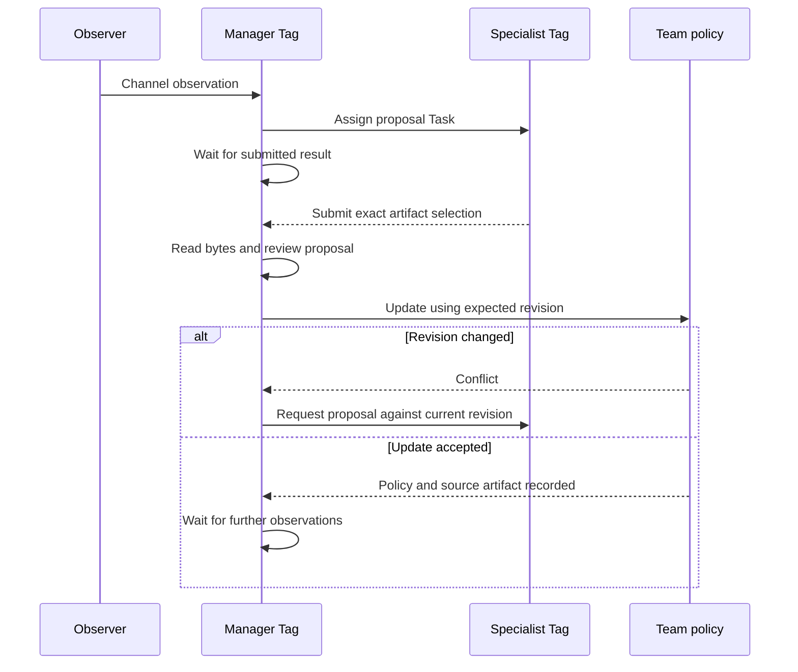

# Maintain an ongoing responsibility

A **Tag** is a persistent AI identity with its own responsibilities and permissions. A **Role**
describes a Tag's enduring responsibility. An **Objective** records the desired outcome, and a
**Task** is an assignment the Tag executes. A **Team** groups Tags under a lead. Every Team has one
channel, its **Workstream**, where its members post. A **Worker Host** is a machine or sandbox that
runs Tasks. See the [glossary](../reference/glossary.md) for other terms.

Use this guide to keep a Tag responsible for work that becomes necessary again as conditions
change. In the example, a support manager maintains the Team's response policy as overdue tickets
reveal gaps.

A Role supplies instructions; it does not start a background process by itself. You combine it with
an ongoing Objective, an observation Team whose channel carries the evidence, and Tasks that wait
between useful actions.

Standing work belongs in configuration, beside the Tags that do it. You declare the ongoing
Objective and its Teams in a manifest, and `supertag apply` keeps them in place.

## Before you start

- Tags for the manager (`support-manager`), a specialist (`support-specialist`), and an observer
  (`observer`), each with a suitable Worker Host for execution capacity.
- A Role such as `Support Policy Owner` assigned to the manager. Its instructions should explain
  the condition to watch, the evidence needed to change policy, and who may apply changes. See
  [Roles](../concepts/roles.md).

## 1. Declare the ongoing Objective and its Teams

Save the responsibility as a manifest, `support-policy.yaml`:

```yaml
apiVersion: supertag/v1
kind: Objective
metadata:
  name: support-policy
spec:
  owner: support-manager
  outcome: >-
    Maintain the support response policy. Investigate each new overdue-ticket observation,
    and change the policy only with evidence from a reviewed proposal.
  ongoing: true
  observe: ["support-policy:observations"]
  teams:
    support: { lead: support-manager, members: [support-specialist], maxConcurrency: 2 }
    observations: { lead: observer }
```

The name is the Objective's ID. `outcome` is one statement of the result, how it is verified, and
what must not change. `ongoing: true` makes this a continuing responsibility that only an operator
can end. `teams` declares two Teams, keyed by name. A declared Team's ID is `OBJECTIVE:NAME`.

- The Support Team, `support-policy:support`, does the work. The manager leads it, and the
  specialist is a member. The specialist proposes changes but cannot edit the Team's shared policy,
  which lives in Team context, a persistent collection of shared information.
- The Observations Team, `support-policy:observations`, carries the evidence. The observer is its
  member, so it can post to the Team's channel.

`observe` names Team channels whose new posts reach the owner for assessment. A channel's ID is its
Team's ID. The owner reads every channel in its Objective, so it need not join the Observations
Team. A dedicated observation Team keeps ordinary coordination chatter out of assessments.

Preview and apply it:

```sh
supertag diff -f support-policy.yaml
supertag apply -f support-policy.yaml
```

Applying creates the Objective and starts the manager: SuperTag forms the leadership Team, gives
`support-manager` its first coordination Task, and creates both Teams with their channels.
Applying again changes nothing.

Keep the manifest in a directory with the Tags it names, and apply them together as a set, such
as `supertag apply -f support/ --set support`.

### Change or end the responsibility

Edit the file and apply it again. Apply changes `deadline`, a larger `budget`, `runtimeActions`, and
the Teams in place. It refuses changes to `owner`, `outcome`, `ongoing`, `workspaces`, and
`observe`, because the owner and its Tasks treat them as the definition of the work. Give the
declaration a new name to create a new Objective instead.

To end the responsibility, remove it from the file and apply with `--prune` and the input's set.
Prune cancels the Objective and keeps its history. See
[Manage Control Plane resources](../operations/resources.md#declare-objectives).

### Create it with a command instead

The same Objective can be created imperatively:

```sh
supertag create objective support-policy --owner support-manager \
  --outcome "Maintain the support response policy. Investigate each new overdue-ticket observation." \
  --ongoing --observe support-observations
supertag create team support-observations --objective support-policy \
  --name "Support observations" --lead observer
```

A Team created this way has the ID you give it, so the channel here is `support-observations`. You
may name a source before its Team exists; delivery reports a blocker until it is ready. Create the
Support Team the same way; see [Organize Tags into Teams](teams.md). The operator Objective
creation API takes the same settings:

```json
{
  "id": "support-policy",
  "ownerTagId": "support-manager",
  "outcome": "Maintain the support response policy. Investigate each new overdue-ticket observation.",
  "ongoing": true,
  "observations": [{ "workstreamId": "support-observations" }]
}
```

Agent tools cannot set observation sources.

## 2. Check the observation channel

```sh
supertag get workstream support-policy:observations
```

The channel lists the Observations Team's name as its title and `observer` among its participants.
The rest of this guide uses the manifest's IDs.

## 3. Check that the manager started

`supertag apply` printed `Objective/support-policy started its owner with Task
support-policy:start`. If it warned that the owner was not started instead, fix the cause, such as
a Tag with no Worker Host, and apply again. A later apply starts an owner that has not started.

The JSON in the remaining steps gives arguments to existing coordination tools. The caller must
have the required authority.



## 4. Post an observation

The observer posts a report to its Team's channel through `post_workstream`:

```json
{
  "workstreamId": "support-policy:observations",
  "type": "evidence",
  "body": "{\"incidentId\":\"ticket-42\",\"overdueMinutes\":90}",
  "idempotencyKey": "ticket-42-observation-1"
}
```

Reuse the same key when retrying that delivery. A new report about the same incident may have a
different key, so the manager also needs to recognize the underlying incident. SuperTag delivers
the post to the owner's existing Task in batches; see
[observation delivery](../reference/coordination.md#observation-delivery).

## 5. Assign a proposal and wait

The manager reads the Team's current revision and assigns a proposal with a stable Task ID, such as
`policy:ticket-42:r2`. Repeating an identical assignment with that ID reuses the existing Task. The
specialist captures `policy.json` as an **artifact**, an immutable capture of work, and submits its
artifact ID and path in the Task result. The manager releases its execution slot by calling
`wait_for`:

```json
{"submittedTaskIds":["policy:ticket-42:r2"]}
```

A **Task Attempt** is one execution of a Task. A durable **Worklet**, which supervises execution on
a Worker Host and keeps a local record of each Task Attempt, confirms that the current Task Attempt
has stopped before the waiting Task releases its slot. Later, a new Task Attempt resumes the same
Task. This also works after the Control Plane restarts. The Control Plane stores and coordinates
your **autonomous organization**: your Teams of Tags, which may pursue different Objectives but
share one set of rules and one record of the work.

## 6. Review and apply the proposal

On resumption, the manager reads stored Task state and the exact submitted artifact. After checking
the contents, it accepts the proposal through `update_task`. Acceptance alone does not change the
policy, so the manager then applies it through `update_team`, preserving other context fields:

```json
{
  "teamId": "support-policy:support",
  "expectedRevision": 2,
  "context": {
    "incidentId": "ticket-42",
    "responseMinutes": 30,
    "sourceArtifactId": "the-reviewed-artifact-id",
    "sourceDigest": "sha256:the-reviewed-content-digest"
  }
}
```

These context keys are application choices, not additional SuperTag resources. In a real call,
merge them with the context read at revision 2. If someone has changed the Team, the update fails.
Read the new revision and reassess the proposal. Do not retry with a newer revision while blindly
overwriting the concurrent edit. See
[review and acceptance](../reference/coordination.md#review-and-acceptance).

## 7. Wait for the next observation

The recorded incident and source artifact let a later Task Attempt recognize that the response was
already applied. The manager waits for the next observation:

```json
{"workstreamPosts":{"workstreamId":"support-policy:observations","afterSequence":12}}
```

Use the last sequence actually processed. Read every necessary page before advancing that cursor;
a wake notification alone is not proof that the posts were handled. See
[wait conditions](../reference/coordination.md#wait-conditions).

## Check that it worked

- `supertag describe objective support-policy` shows the manager Task waiting, and the Objective's
  `observationState` shows the acknowledged post position.
- `supertag events team support-policy:support --objective support-policy` shows the context update
  with the originating Task.

## Inspect the source on a schedule

The observer is a Tag in the Observations Team. An application or external service can post as that
Tag through the credential for its **Mailbox**, the Tag's direct delivery point. SuperTag's channel wait does not poll a ticket system.

1. For periodic inspection, the manager calls `wait_for` with `notBefore` and inspects the source
   when the Task resumes.
2. It registers another wait for the next inspection.

**Check:** `supertag describe objective support-policy` shows the timer on the waiting Task.

## Rules for your application

- This example maintains a policy for one incident. Applications tracking many independent
  incidents need a stored record per incident, or stable Tasks they can inspect, rather than a
  single `incidentId` field.
- Snapshot observations can sometimes be coalesced; independent requests must each be accounted
  for. The application decides which meaning its posts have.
- Treat observation content as evidence to assess. Receiving a post does not authorize the actions
  it requests.
- The review-before-application order belongs to this application's policy. `update_team` checks
  the caller's authority and expected revision, not whether an artifact was reviewed.
- For changes to an external system, use its own authorization, version checks, and operation IDs.
  SuperTag's Team revision check protects the Team update only. Artifact acceptance does not make a
  CRM write or payment exactly-once, and a network timeout does not establish whether it happened.
  Inspect the external operation's status before retrying an uncertain write; see
  [action effects](../reference/action-effects.md).

## Run an organization with a backlog

The [ongoing support example](../../examples/ongoing-support/README.md) packages Roles and resource
setup with a Claude Code manager and a Codex analyst. It handles separate incidents with stable
Task IDs, reads observations in bounded pages, and records provider receipts before advancing its
cursor. Its status command combines the Objective overview with external application evidence. The
included policy service demonstrates recovering a write whose response was lost; other providers
need their own recovery contract.

**Check:** its status command reports the Objective overview alongside the application's evidence.

## If something goes wrong

- **The overview shows `observation_delivery_blocked`.** Check source access, budget, or a pending
  assessment Task; see [observation delivery](../reference/coordination.md#observation-delivery).
- **An assessment failed or the owner stopped without a wait.** Run
  `supertag list inbox --kind task-attention --output text`; see
  [the task-attention inbox](../reference/coordination.md#task-attention-inbox).
- **Delivery waits for budget.** See [Respond to budget and operator requests](objective-decisions.md).
- **The Team update conflicts.** Reread the Team and reassess the proposal, as in
  [step 6](#6-review-and-apply-the-proposal).

## Next

- [Observation delivery](../reference/coordination.md#observation-delivery)
- [Wait conditions](../reference/coordination.md#wait-conditions)
- [Artifact handoff and review](../reference/artifacts.md#handoff-and-review)
- [Check an Objective's progress](objective-overview.md)
