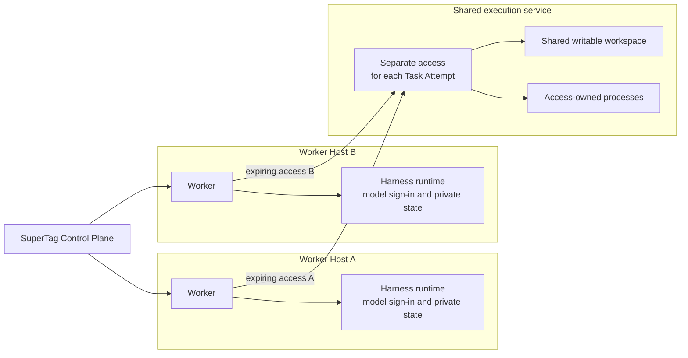
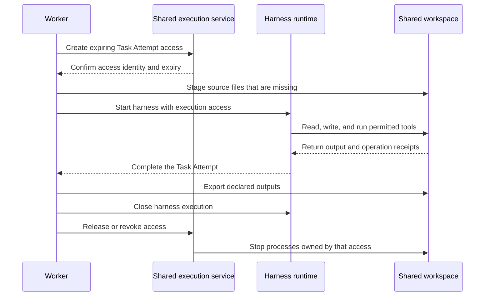
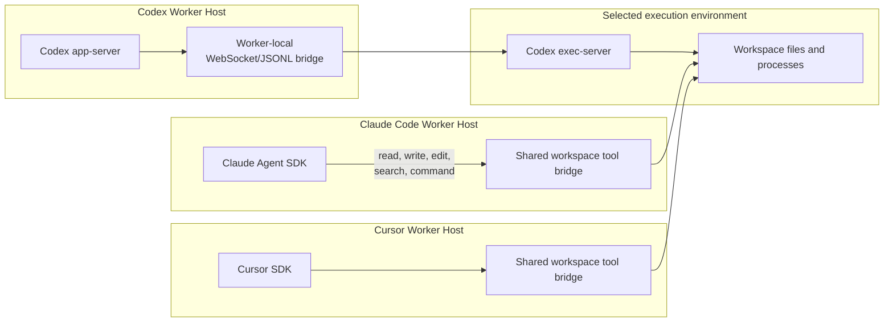

# Share an execution environment

Connect several **Workers**, the code that runs SuperTag assignments, to one shared execution
service, so they can use the same datasets, build state, or writable workspace while each keeps its
own model sign-in. Use this guide when a custom
Worker should run workspace tools somewhere other than its harness.

- A Worker runs an assignment, called a **Task**. Each execution of that Task is a
  **Task Attempt**.
- A **harness**, such as Claude Code or Codex, supplies the agent loop a Worker uses.
- A **harness runtime** hosts a harness and keeps its model credentials and private state.
- An **execution environment** supplies the files and processes used by workspace tools.
- A **Worker Host** is the machine or sandbox where a Worker runs. Its **Worklet** connects it to
  the **Control Plane**, the SuperTag service that stores and schedules work.
- A **Worker Profile** is a saved, versioned recipe for running a Worker.
- A **Tag** is a persistent AI identity with its own responsibilities and permissions.
- Tags work in Teams under a lead. Together, your Teams of Tags make up an **autonomous
  organization**: Teams may pursue different goals but share one Control Plane, its rules, and
  its record of the work.

See the [glossary](../reference/glossary.md) for other terms. For a complete application, see the
[two-manager shared organization example](../../examples/shared-organization/README.md). It uses
native Claude Code and Codex sign-ins to build and independently review one result in Docker.

## Before you start

- A custom Worker built with the `supertag-ai` package. See
  [Build a custom Worker or harness](custom-workers.md).
- A running shared execution service and its admin token in `SUPERTAG_EXECUTION_ADMIN_TOKEN` on
  each Worker Host. [Expose the shared service through gRPC](#expose-the-shared-service-through-grpc)
  shows how to start one.
- A harness that supports split execution: the built-in Claude Code or Cursor harness, or Codex in
  app-server mode. Host services with `environment` refuse OpenCode at startup.
- For Codex, an execution image with a Codex CLI binary that supports `exec-server` and exactly
  matches the Worker Host's app-server version. It needs no Codex sign-in or provider key.

## 1. Configure the runtime, execution provider, and profile

SuperTag can place the harness runtime and execution environment on one host, or give a harness
local runtime access and remote execution access. The experimental shared-execution provider
implements the second arrangement:

```ts
import { SharedExecutionEnvironmentProvider } from "supertag-ai/environments/shared-execution";
import { LocalHarnessRuntimeProvider } from "supertag-ai/worker";

const runtime = new LocalHarnessRuntimeProvider();
const execution = new SharedExecutionEnvironmentProvider({
  baseUrl: "https://executor.example.com",
  adminToken: process.env.SUPERTAG_EXECUTION_ADMIN_TOKEN!,
  environmentId: "research-workspace",
});

const profile = {
  ref: { id: "distributed-research", revision: "1" },
  workerType: "custom",
  harness: { provider: "custom-split-harness" },
  runtime: { provider: runtime.id, lifetime: { scope: "attempt" } },
  execution: { provider: execution.id, lifetime: { scope: "attempt" } },
};
```

Several Workers can connect to one execution service while receiving separate, expiring bearer
access for each Task Attempt. Harness model credentials stay on each Worker Host.

## 2. Register the providers in the Worker

Register `runtime` in `createWorker({ harnessRuntimes: [...] })` and `execution` in
`createWorker({ environments: [...] })`.

A split-capable harness must advertise `splitExecution: true` and send every workspace file and
process operation through the `execution` access passed to `Harness.start`. The SDK rejects the
profile before provisioning when the harness does not make that claim.

## 3. Use a built-in harness

For Claude Code, pass the runtime and execution environment to the Worker:

```ts
import { createClaudeCodeWorker } from "supertag-ai/harnesses/claude-code";

const worker = createClaudeCodeWorker({
  workspace: "/path/to/local/source",
  harnessRuntime: runtime,
  executionEnvironment: execution,
});
```

For Codex, select app-server mode and use an execution image that contains the same Codex CLI
version as the Worker Host:

```ts
import { createCodexWorker } from "supertag-ai/harnesses/codex";

const codexWorker = createCodexWorker({
  workspace: "/workspace/repository",
  executionMode: "app-server",
  harnessRuntime: runtime,
  executionEnvironment: execution,
  execServerCommand: "codex",
});
```

The selected environment must support bounded streaming output and interactive process input.
SuperTag verifies the app-server and exec-server CLI versions before starting the Codex thread.

## Check that it worked

After a Task runs, inspect it:

```sh
supertag describe task TASK_ID
```

The view shows the selected execution environment and its per-Task Attempt access. SuperTag
reconstructs this placement from durable events, even after Control Plane or Store recovery.

The Runtime Input Manifest records both environment access IDs, guarantees, and credential-free
provider provenance. Shared execution provenance identifies the environment incarnation,
per-Task Attempt access, and expiry without its bearer token. The harness provenance records the
exec-server version, session, bridge, and selected execution environment.

## Choose HTTP or gRPC

This section is optional. A **transport** carries requests and results between a Worker and the
execution service. The shared provider uses HTTP by default. The optional gRPC adapter is experimental: use it to evaluate
the protocol foundation in an HTTP/2 deployment. Both transports reach the same workspace, access
checks, and stored operation receipts. Broad gRPC adoption is deferred.

### Configure the provider for gRPC

For a gRPC endpoint, configure the provider on each Worker Host:

```ts
import { readFile } from "node:fs/promises";
import { SharedExecutionEnvironmentProvider } from "supertag-ai/environments/shared-execution";

const execution = new SharedExecutionEnvironmentProvider({
  baseUrl: "https://executor.example.com:7443",
  transport: "grpc",
  adminToken: process.env.SUPERTAG_EXECUTION_ADMIN_TOKEN!,
  environmentId: "research-workspace",
  // Omit tlsCa when the endpoint uses a publicly trusted certificate.
  tlsCa: await readFile("/etc/supertag/executor-ca.pem", "utf8"),
});
```

The URL must identify the gRPC listener, and its hostname must match the server certificate. TLS
is required outside loopback. The provider never switches to HTTP after a failed gRPC request.
Selecting a transport does not change MCP server connections, the Worklet's connection to the
Control Plane, or local execution.

### Expose the shared service through gRPC

The execution service owns the workspace and a **journal**: stored access records, operation
receipts, and process output. Start one service owner and add a gRPC listener to it. Do not start
separate owners against the same journal.

```ts
import { readFile } from "node:fs/promises";
import {
  startSharedExecutionGrpcServer,
  startSharedExecutionServer,
} from "supertag-ai/environments/shared-execution";

const service = await startSharedExecutionServer({
  environmentId: "research-workspace",
  rootDirectory: "/srv/workspace",
  statePath: "/srv/supertag-state/execution.json",
  adminToken: process.env.SUPERTAG_EXECUTION_ADMIN_TOKEN!,
  // Keep the owner's HTTP listener on loopback.
  host: "127.0.0.1",
  // In a Linux container, provision a separate workload user with these IDs.
  processUid: 1000,
  processGid: 1000,
});

const grpc = await startSharedExecutionGrpcServer({
  service,
  host: "0.0.0.0",
  port: 7443,
  tls: {
    key: await readFile("/etc/supertag/executor-key.pem"),
    cert: await readFile("/etc/supertag/executor-cert.pem"),
  },
});
```

Run this example in a service container that can start processes as the workload user. Keep the
journal, TLS key, and service credentials outside the writable workspace. Mount persistent storage
for both the workspace and journal when they must survive a container replacement. The listener
supports gRPC over HTTP/2; it does not expose gRPC-Web or the Connect protocol.

## Optional: Declare stronger guarantees

An operator can configure stronger `guarantees` on `SharedExecutionEnvironmentProvider` when the
deployed service actually enforces them:

```ts
const execution = new SharedExecutionEnvironmentProvider({
  baseUrl: "https://executor.example.com",
  adminToken: process.env.SUPERTAG_EXECUTION_ADMIN_TOKEN!,
  environmentId: "research-workspace",
  guarantees: {
    filesystemIsolation: "sandbox",
    networkPolicy: "enforced",
    processTreeTermination: true,
    scopedHttp: false,
  },
});
```

These values are operator assertions about the deployment; the client cannot derive them from a
remote URL. Codex `sandboxMode: "external"` disables Codex's own nested operating-system sandbox
and therefore requires those reported guarantees for restricted execution, plus admitted
`files:write` access. Keep Codex's native sandbox when the shared service cannot establish that
boundary.

## Optional: Deploy on a sandbox provider

The shared service can run on a container or sandbox provider that exposes the selected
transport, preserves its workspace and journal for the intended lifetime, and runs workloads under
a Unix identity separate from the service. HTTP uses an HTTPS endpoint; gRPC requires an HTTP/2
endpoint that carries gRPC traffic.

E2B and Modal also have native execution adapters. Those adapters and the shared service are
separate deployment choices: a provider can host the shared service, or a Worker can use its
native adapter directly. Both choices keep execution placement separate from the harness runtime.
See [Run a Worker in Modal sandboxes](modal-workers.md).

Durable Control Plane events preserve the chosen environment, incarnation, per-Task Attempt access,
asserted guarantees, cleanup evidence, and applied execution limits. An environment
**incarnation** identifies one lifetime of the environment; replacing it invalidates access issued
for the previous lifetime.

## How the pieces connect



The Workers share files and execution capacity. They do not share model credentials, harness
conversations, private state, or Task Attempt access tokens.

Each Task Attempt follows the same access lifecycle:



Releasing one access leaves the shared workspace and other accesses running. The shared service
persists operation receipts so a repeated operation with the same ID and input can return its
existing result.

### Built-in harness paths

The built-in harnesses reach the execution environment in different ways:



**Claude Code and Cursor on host services.** Setting `environment` to e2b or Modal keeps
these harnesses on the Worker Host. Only read, write, edit, glob, grep, ls, and foreground
commands run in the sandbox. Model credentials and native Session state stay on the host;
provider keys never enter sandbox files, environment variables, or processes through the bridge.
Split Claude Code uses the Worker Host's Claude sign-in or environment credential; neither enters
the sandbox.
The image needs `python3` and POSIX shell tools, plus your project's command dependencies.
You do not install Claude Code or Cursor in it.

A **Permission Set** selects allowed actions. Write and edit require `files:write`; commands
require `commands:execute` and `files:write`. The bridge checks permissions on every call,
refuses file paths outside the workspace, including escaping symbolic links, and bounds output.
Configured read-only roots restrict the bridge's file tools only. A Task with
`commands:execute` can change those files inside its own sandbox.
Commands run in the provider's sandbox. A service with `environment` refuses
`allow-unsandboxed-commands` at startup. Commands run in the foreground; cancellation and
cleanup stop the bridge's remote processes.

| Harness | Available in split mode | What changes |
| --- | --- | --- |
| Claude Code | Bridged workspace tools, allowed MCP tools, native resume, and Skills | Native local file and Bash tools, web/browser tools, background Bash, `BashOutput`, `KillShell`, and `NotebookEdit` are disabled. Subagents receive the same native tool deny list. Skills are staged on the host; their commands use the bridge. |
| Cursor | Bridged workspace tools and allowed SDK custom tools | No built-in tools, including web tools and subagents. No background commands. `local.cwd` is an empty host directory, so repository rules do not load automatically. Cursor's own sandbox provides no useful workspace boundary; the remote provider enforces it. |

Cursor's native-tool exclusion depends on the SDK honoring its `tools: ["mcp"]` allowlist and
`disallowedTools` denylist. The SDK has no per-call approval, and Cursor's sandbox does not
confine reads. See [Cursor SDK tools](https://cursor.com/docs/sdk/typescript.md) and
[Cursor run modes](https://cursor.com/docs/agent/security/run-modes.md).

Claude's native resume uses state kept on the host across Task Attempts. Cursor also keeps its
native Session state on the host. Supply needed repository instructions explicitly as Task
context for Cursor. See [Worker reference](../reference/worker.md#cursor) for continuity details.
Colocated SDK configurations still preserve their native tool behavior.

**Codex.** Codex also preserves its native workspace behavior when its runtime and tools are
colocated. Host services with `environment` select app-server mode automatically: SuperTag keeps
app-server, the native thread, and the user's subscription authentication on the Worker Host,
then starts the official Codex exec-server in the sandbox. Codex's native file and command tools
act there. The image needs a matching Codex CLI binary for `exec-server`, but no model credential.
An application that supplies explicit `exec` mode with a host environment stops Worklet startup;
omit the mode or select `app-server`. Host services have no mode field in `supertag.yaml`.

**OpenCode.** A host service with `environment` refuses OpenCode at startup because its model
provider key would have to enter the sandbox. Use Claude Code, Codex, or Cursor for remote
execution, or remove `environment` to run OpenCode locally.

### MCP placement

MCP placement is independent from workspace placement. An MCP client may stay in each harness
runtime, run in its Worker Host, or run beside a private server in the shared execution
environment. The selected harness must explicitly support that client path.

- For Claude Code and Cursor host services with `environment`, SuperTag coordination and
  **collaboration surface** MCP clients, for external tools such as Slack or GitHub, stay on the
  Worker Host. Workspace stdio servers can still run beside sandbox files; see
  [Workspace MCP servers](../reference/worker.md#workspace-mcp-servers-in-a-remote-sandbox).
- Codex app-server keeps manager-only HTTP coordination in its Worker Host and can place selected
  HTTP or stdio MCP clients in the shared execution environment. Model credentials, collaboration surface
  credentials, and shared workspace access therefore remain separate choices.
- When an MCP client runs inside the execution environment, Codex app-server exposes the admitted
  schema as a root-thread dynamic tool. A supervised environment process owns the HTTP or stdio MCP
  session, server process, and environment-scoped credentials.
- Claude Code can use the same environment-owned MCP clients through `selectMcpClient`. Its root
  receives the admitted tool schemas; native children do not receive those server connections.

See [Route MCP tools](mcp-tools.md) for placement options, credentials, the routing contract,
supported combinations, and failure behavior.

## Guarantees

- The service stores hashes of access tokens, never their plaintext values.
- Access is bound to one Tag, Task, Task Attempt, environment incarnation, and expiry.
- Reusing an operation ID with the same input returns its existing receipt; different input is
  rejected.
- Process output is bounded, persisted, and replayed with a cursor.
- Releasing or revoking access terminates only process groups owned by that access.
- One service-wide process limit applies across all connected Workers.
- Commands receive a small safe environment allowlist. In the Docker image they also run under a
  separate Unix user, so the service admin token and service process environment are not inherited
  or readable through `/proc`.

Limits of this first provider:

- It deliberately reports no filesystem isolation and no enforced network policy by default.
- All admitted accesses share one writable root.
- It can copy a local `file:` source into missing workspace paths; later accesses leave existing
  shared files intact.
- It supports bounded output and interactive process input, which Codex exec-server needs.
- It rejects read-only mounts because it cannot enforce them, along with secret bindings and
  restricted network plans.
- The admin token remains a Worker-side provisioning credential; it must not enter model context or
  the execution process environment.

## Handle interruptions

These rules are specific to the shared execution service. For how SuperTag treats an interrupted
Task Attempt in general, see
[Scheduling and interrupted execution](../reference/scheduling-and-recovery.md#leases-and-unknown-outcomes).

- An operation ID identifies one requested file or process action. Retrying with the same ID and
  input returns its stored receipt; changing the input is rejected. The provider preserves that ID
  during a transport retry.
- A timeout or lost reply does not establish that the action failed or that it is safe to start a
  replacement.
- The gRPC provider reconnects interrupted output streams from their last received sequence
  number. A sequence gap or a cursor beyond the journal is an error.
- Disconnecting a client, reaching an RPC deadline, or closing the gRPC listener leaves accepted
  processes running. Use a process signal, release the Task Attempt's access, or revoke it to request
  termination.
- Closing the service owner stops its processes. After an unexpected service restart, unfinished
  journal entries become `uncertain`; the service does not replay their actions. Retain that
  uncertainty when deciding whether to retry work.
- Changing the environment incarnation also invalidates the old accesses.
- A process can outlive a crashed service. The recovered journal does not prove that process
  stopped or give the replacement service control of it. Confirm termination through the sandbox
  or host before starting conflicting replacement work; retain the workspace and operation evidence
  needed to inspect any completed side effects.
- Expired or revoked access cannot perform more work, but its credential can still release that
  same access. Release remains idempotent: retrying after a lost acknowledgement does not reopen
  access or affect another Task Attempt.
- The provider reports a failed release instead of treating a second cleanup call as success
  without an acknowledgement.
- The provider's reconnects are scoped to its live process handles. They do not restore a crashed
  Worker or a lost harness session. In particular, losing the Codex exec-server bridge still fails
  that Task Attempt; output replay does not make a native harness session resumable.

## If something goes wrong

- **The SDK rejects the Worker Profile before provisioning.** The harness does not advertise
  `splitExecution: true`; see [step 2](#2-register-the-providers-in-the-worker).
- **A Codex Task Attempt fails before its thread starts.** The app-server and exec-server CLI versions
  differ. A mismatch or a lost exec-server connection fails the Task Attempt without falling back to
  local tool execution.
- **Codex external sandbox mode is refused.** The provider does not report the required
  guarantees; see [Declare stronger guarantees](#optional-declare-stronger-guarantees).
- **An action's result is unclear after a disconnect.** See
  [Handle interruptions](#handle-interruptions).

## Next

- [Route MCP tools](mcp-tools.md) to place MCP clients.
- [Run a Worker in Modal sandboxes](modal-workers.md) for a native sandbox adapter.
- [Worker reference](../reference/worker.md) for the harness runtime and execution environment
  contracts.
- [Connect securely through gRPC](workers.md#connect-securely-through-grpc) for the separate
  Worklet connection.
