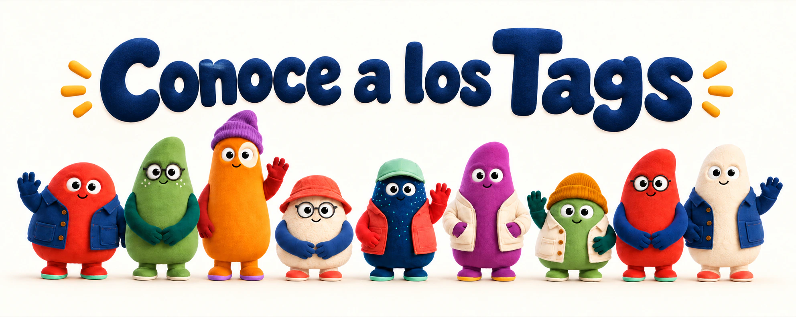

<div align="center">

<h1>
  
  SuperTag
</h1>

[English](../../README.md) · [中文](README.zh-CN.md) · [日本語](README.ja.md) · [한국어](README.ko.md) · Español · [Français](README.fr.md) · [Português](README.pt.md) · [Türkçe](README.tr.md) · [Русский](README.ru.md)

**Actores de IA persistentes, proactivos y multijugador para el trabajo de ingeniería.**

De código abierto y autoalojado, sobre los agentes de programación que ya usas.

**Dales un trabajo, no tareas.**

[Un trabajo, no tareas](#give-them-jobs-not-tasks) · [Persistente](#persistent) · [Proactivo](#proactive) · [Multijugador](#multiplayer) · [Ejecútalo por tu cuenta](#run-it-yourself) · [Pon en marcha tu primer Tag](#run-your-first-tag) · [Documentación](../../docs/README.md)

<p>
  
</p>

</div>

Un **Tag** es un actor de IA persistente con identidad, responsabilidades, permisos e historial de
trabajo propios. Su trabajo consiste en esas responsabilidades y en los resultados que entrega.
Mantiene el trabajo en marcha entre una sesión y la siguiente, actúa sin que se lo pidan y colabora
con los Tags de tus compañeros. El código lo siguen escribiendo tus agentes de programación: Claude
Code, Codex, Cursor u OpenCode.

<a name="give-them-jobs-not-tasks"></a>

## Dales un trabajo, no tareas

Hoy le das una tarea a un agente de programación: un prompt, un diff, una revisión y, después, el
siguiente prompt. Puede investigar un error, escribir una corrección y ejecutar las pruebas. Pero
eres tú quien recuerda qué pasó la última vez, quien detecta el siguiente fallo y quien decide qué
viene después. Cuando el trabajo no cabe en una sola tarea, te conviertes en su jefe de proyecto:
divides el trabajo, pones un agente de programación a cargo de cada parte y llevas el contexto de
uno a otro.

Un Tag, en cambio, tiene un trabajo. Un trabajo se compone de las responsabilidades que el Tag
mantiene al día, como mantener main en verde, y de los resultados que entrega, como migrar 12
servicios a credenciales de corta duración.

| Una tarea | Un trabajo |
| --- | --- |
| «Arregla esta prueba inestable» | «Mantén main en verde», y entrega los resultados que le encargues |
| Empieza cuando le escribes un prompt | Actúa cuando falla la CI, salta una alerta o se lo pide un compañero |
| Termina cuando se fusiona el diff | Continúa, y recuerda lo que aprendió |
| Tú compruebas si funcionó | Aporta las pruebas: las comprobaciones que ejecutó y lo que verificó |
| Puede asumirla cualquier sesión de un agente de programación | Tiene identidad, permisos e historial propios |

Cada resultado es un **Objective**. En él constan las pruebas con las que decidirás cuándo está
terminado y las restricciones, el presupuesto o el plazo que fijes. El Tag responsable decide qué
trabajo iniciar, reparte partes entre los demás Tags de su **Team**, revisa lo que le devuelven y
te trae hallazgos, ramas y las decisiones que requieren tu aprobación. Tú diriges al Tag
responsable; no gestionas sus agentes de programación.

Para migrar 12 servicios a credenciales de corta duración, asígnale a `lead` el Objective del
despliegue. Este coordina a los Tags que actualizan la política de confianza y el código de los
servicios, revisan las pruebas y la telemetría, y ensayan el cambio definitivo. Tú apruebas los
cambios en producción y decides cuándo retirar las claves compartidas.

Dale a cada Tag su propio trabajo y sus propios permisos. Podrías dejar que `lead` coordine, dar
permiso a un Tag constructor para editar el repositorio y dar a un revisor acceso de solo lectura.

[Escribe un Objective](../../docs/guides/write-an-objective.md) · [Cómo diriges el trabajo](../../docs/concepts/interaction-model.md)

## Qué necesita un trabajo

Un trabajo dura más que cualquier sesión, incluye cosas que nadie ha pedido todavía e involucra a
otras personas. Los Tags están hechos para las tres cosas.

<a name="persistent"></a>

### Persistente

Un trabajo dura más que la sesión que lo inició. Tus agentes de programación hacen el trabajo de un
Tag parte por parte, y el Tag es lo que persiste entre una parte y la siguiente. El mismo Tag puede
investigar hoy una incidencia, revisar mañana los resultados y responder la semana que viene a
preguntas sobre ambas cosas, aunque la siguiente parte del trabajo se ejecute en otro agente de
programación o en otra máquina. Puede recordar por sí mismo su trabajo anterior y sus Objectives.

<a name="next-add-your-teams-chat"></a>

Accede al mismo Tag desde las herramientas que usas. Háblale en la terminal, o añade un canal de
Slack, un repositorio de GitHub o un equipo de Linear a sus ubicaciones. Cada conversación tiene su
propio hilo, y el mismo Tag conserva las responsabilidades que le asignaste. [Conecta una herramienta de trabajo](../../docs/surfaces/README.md)

<a name="proactive"></a>

### Proactivo

Parte de todo trabajo es darse cuenta de lo que hay que hacer. Dale a un Tag una responsabilidad
continua y se ocupará de cumplirla sin esperar a que se lo pidan.
Cada responsabilidad es un Objective continuo, y las responsabilidades relacionadas pertenecen al
mismo Tag. Supongamos que `reliability` mantiene tu servicio en buen estado. Tiene a su cargo
cuatro Objectives continuos:

| Objective continuo | Se activa con | Qué hace | Qué te deja a ti |
| --- | --- | --- | --- |
| Clasificar los errores de producción | Una incidencia de Sentry nueva o reaparecida | La reproduce, encuentra el cambio que la causó y prepara una corrección con una prueba que falla | Fusionar y revertir |
| Vigilar el servicio | Una alerta de PagerDuty, de Datadog o de una comprobación de estado | Reconstruye la cronología a partir de los registros, los despliegues recientes y el pico de errores, y prepara una rama de reversión | Revertir o escalar |
| Mantener main en verde | Una ejecución de CI fallida en main | Encuentra el commit que rompió la compilación, distingue una prueba inestable de un fallo real y prepara una corrección o una reversión | Fusionar y poner pruebas en cuarentena |
| Mantener seguras las dependencias | Un aviso de Dependabot o de Snyk | Comprueba si el proyecto está afectado y prepara la actualización con los resultados de las pruebas | Las actualizaciones mayores y la fusión |

Cuando Sentry informa de un error nuevo, `reliability` lo asume dentro del primer Objective. Decide
si el error importa, pone en marcha el trabajo para reproducirlo y corregirlo, y te trae la rama,
la prueba y cualquier decisión que te corresponda. Como un mismo Tag tiene los cuatro, puede
recordar lo que aprendió en los demás, como el despliegue fallido que examinó una hora antes.
Cuando no hay nada que hacer, descansa hasta el siguiente informe, mensaje o resultado. Ejecútalo
en un host siempre encendido y mantendrá sus responsabilidades aunque tu portátil esté apagado.

Asigna otro tipo de responsabilidad a un Tag distinto cuando requiera permisos diferentes. Un Tag
`support` que clasifica informes de errores puede leer el repositorio y hablar con quienes los
envían sin poder preparar reversiones.

Tú eliges qué eventos llegan a un Tag y qué puede hacer en respuesta. Reenvía alertas e informes
a un Objective mediante la API del Control Plane, o menciona al Tag en Slack, GitHub o Linear.
[Configura una responsabilidad continua](../../docs/guides/ongoing-responsibilities.md)

<a name="multiplayer"></a>

### Multijugador

En un equipo, los trabajos se solapan. Autoaloja un Control Plane compartido y tu equipo trabajará
con los Tags en conjunto. Cada compañero dirige los Tags desde su propia terminal o desde sus
herramientas conectadas, y las conversaciones privadas de terminal siguen siendo privadas para cada
persona. Alguien puede preguntarle a `reliability` por un error en Slack, y otra persona puede
continuar con los mismos hallazgos en GitHub.

Los Tags de tus compañeros se coordinan entre sí sin involucrarte. Cuando tu Tag necesita algo del
Tag de un compañero, le escribe directamente. Resuelven los detalles entre ellos y dejan constancia
de lo acordado en el Workstream compartido de su Team. Tú te enteras cuando hay una decisión que te
corresponde. Los Tags pueden ejecutarse en agentes de programación y máquinas distintos, de modo
que un Tag en tu portátil con Claude Code puede trabajar con otro en la máquina de un compañero con
Codex hacia el mismo Objective.


[Cómo funciona el modo multijugador](../../docs/concepts/multiplayer.md) · [Autoaloja SuperTag](../../docs/guides/self-hosting.md)

<a name="get-started"></a>

<a name="run-your-first-tag"></a>

## Pon en marcha tu primer Tag

En un Mac o en Linux, instala Git y [Claude Code](https://code.claude.com/docs/en/setup)
o [Codex](https://developers.openai.com/codex/cli/), e inicia sesión. Con Claude Code, ejecuta
`claude` e inicia sesión. Con Codex, inicia sesión con `codex -c 'cli_auth_credentials_store="file"' login`,
que guarda las credenciales en un archivo que las Tasks de SuperTag pueden usar; en macOS, un
`codex login` a secas las guarda en el Llavero, al que no tienen acceso. Claude Code necesita
además Node.js; consulta las versiones en
[requisitos e inicio de sesión](../../docs/operations/requirements.md).

[Instala SuperTag](../../docs/operations/install.md) y luego ejecuta esto desde un repositorio Git
existente que tenga al menos un commit.

```sh
curl -fsSL https://supertag.sh/install | sh
export PATH="$HOME/.local/bin:$PATH"
supertag init
supertag message lead "Read this repository and tell me what you would improve first."
```

`supertag init` comprueba el inicio de sesión de tu agente de programación, te hace unas pocas
preguntas e inicia SuperTag en segundo plano. Conserva el nombre de Tag predeterminado, `lead`.
Trabaja en este repositorio, a partir del último commit de la rama en la que estás.
`supertag message` envía tu mensaje a `lead` y muestra la respuesta a medida que llega.

Continúa la misma conversación con otro `supertag message lead`. Cuando quieras encargarle parte de
un trabajo, inicia un Objective así.

```sh
supertag message lead "/goal Add a test for an uncovered edge case. Done when the new test and its suite pass. Ask me before changing application code."
```

Un lead con Codex ejecuta las pruebas. Un lead con Claude Code configurado sin Docker y sin la
opción explícita de ejecución sin sandbox lee y edita archivos, pero no ejecuta comandos, así que
no puede ejecutar las pruebas e informa de la condición «Done when» como no comprobada; consulta
[Permite que el lead ejecute comandos](../../docs/operations/cli.md#let-the-lead-run-commands).

`supertag get inbox-item` enumera las preguntas que te hace el Tag; responde a una con
`supertag question answer TASK_ID "..."`. Cuando el Objective esté listo, `supertag status` lo
mostrará como `review`. Cada cambio entregado llega a tu repositorio como una rama
`supertag/session/...`. Revísala y luego aprueba el Objective o pide una revisión:

```sh
supertag describe objective OBJECTIVE_ID
supertag objective review OBJECTIVE_ID approve
supertag objective review OBJECTIVE_ID request-changes --feedback "Also cover the empty case."
```

¿Prefieres una ventana a la terminal? En un Mac (con Apple silicon o Intel) o en Linux, [instala la aplicación de escritorio](../../docs/operations/install.md#install-the-desktop-app):
incluye su propio `supertag`, configura SuperTag en el primer arranque y habla con los mismos Tags.

[Opciones de instalación](../../docs/operations/install.md) · [Habla con un Tag](../../docs/guides/talk-to-a-tag.md) · [Pon en marcha tu primer Team](../../docs/guides/first-team.md) · [Dirige SuperTag desde tu agente de programación](../../docs/guides/coding-agent-operator.md)

<a name="run-it-yourself"></a>

## Ejecútalo por tu cuenta

SuperTag es de código abierto bajo la licencia Apache 2.0, y cada una de sus partes se ejecuta
donde tú elijas. Un trabajo necesita acceso a tu código, tus servicios y tus cuentas, así que tú
decides dónde reside ese acceso.


- **Tus máquinas.** `supertag init` inicia un **Control Plane** local, el servicio que almacena
  tus Tags y planifica su trabajo, y conecta tu máquina como **Worker Host**, una máquina o un
  sandbox que ejecuta el trabajo. Cuando se sume tu equipo, despliega el Control Plane donde todos
  puedan acceder a él y conecta portátiles, servidores, runners de CI o sandboxes de Modal y E2B
  como Worker Hosts. Mantén en un host siempre encendido los Tags con una responsabilidad
  continua, como `reliability`.
- **Tus agentes de programación y tus modelos.** Cada Tag se ejecuta en el agente de programación
  y el modelo que elijas, con la sesión iniciada con tu propia cuenta o clave.
- **Tus límites.** Cada Tag solo puede hacer lo que sus permisos le permiten, y tú eliges qué
  acciones esperan tu aprobación. Codex ejecuta los comandos en su propio sandbox, y Claude Code,
  Cursor y OpenCode pueden ejecutar los suyos en contenedores locales. Un Tag solo llega a las
  direcciones de red que autorices. En Codex y en los contenedores, su host añade credenciales,
  como un token de Sentry, a las solicitudes permitidas, de modo que los comandos del Tag nunca las
  ven.

[Autoaloja SuperTag](../../docs/guides/self-hosting.md) · [Conecta un Worker Host](../../docs/guides/workers.md) · [Define permisos y aprobaciones](../../docs/concepts/context-and-permissions.md) · [Mira cómo encajan las piezas](../../docs/concepts/how-it-works.md)

## Compatible con

| | Opciones |
| --- | --- |
| **Agentes de programación** | Claude Code · Codex · Cursor · OpenCode · OpenAI Agents · [tu propio adaptador de harness](../../docs/guides/harness-adapters.md) |
| **Dónde hablas con los Tags** | Terminal · [Slack](../../docs/surfaces/slack.md) · [GitHub](../../docs/surfaces/github.md) · [Linear](../../docs/surfaces/linear.md) · [Lark/Feishu](../../docs/surfaces/lark.md) · [Microsoft Teams](../../docs/surfaces/teams.md) |
| **Dónde se ejecuta el trabajo** | Portátiles · servidores · runners de CI · [sandboxes de Modal y E2B](../../docs/guides/workers.md#run-a-harness-in-a-sandbox) |

## Cuándo elegir SuperTag

| Frente a | En qué destacan | Qué les falta | Qué aporta SuperTag |
| --- | --- | --- | --- |
| **Agentes de programación** · [Claude Code](https://code.claude.com/docs/en/overview), [Codex](https://learn.chatgpt.com/docs/codex/cli), [OpenCode](https://opencode.ai/docs/) | Escribir, corregir y probar código mientras trabajas con ellos. | Cuando cierras el chat, el trabajo se detiene. Tienes que recordar la meta y empezar tú el siguiente paso. | **El trabajo sigue adelante.** Un Tag recuerda la meta y pone él mismo un agente de programación a cargo del siguiente paso. También responde a errores y alertas nuevos sin que se lo pidas. El código lo siguen escribiendo tus agentes de programación. |
| **Herramientas de agentes en paralelo** · [Paradev (antes Superset)](https://docs.paradev.com/recipes/parallel-workstreams), [Conductor](https://www.conductor.build/docs/concepts/parallel-agents) ([en proceso de cierre](https://www.conductor.build/announcement)) | Ejecutar varios agentes de programación a la vez y mostrarte todos los cambios. | Sigues siendo tú quien decide en qué trabaja cada agente y quien comprueba que los resultados encajan. | **Otro gestiona los agentes.** Dile a un Tag qué quieres que se haga y cómo comprobarlo. Reparte las partes, comprueba que encajan y te envía los resultados. |
| **Proyectos de agentes** · [Cursor Projects](https://cursor.com/docs/agent/projects), [Claude Code Projects](https://code.claude.com/docs/en/claude-projects), [GitHub Copilot Projects](https://docs.github.com/en/copilot/how-tos/github-copilot-app/working-with-projects) | Varios agentes que trabajan hacia una misma meta durante semanas o meses. En Cursor, los compañeros pueden unirse al mismo proyecto. | Cada proyecto ejecuta los agentes de una sola empresa, casi siempre en la nube de esa empresa. | **Combina agentes de programación y máquinas.** Tu Tag puede ejecutarse con Claude Code en tu portátil mientras el de un compañero se ejecuta con Codex en el suyo, y aun así trabajan juntos. |
| **Compañeros de IA alojados** · [Devin Bots](https://devin.ai/blog/introducing-devin-bots), [OpenAI dots](https://openai.com/index/introducing-dots/), [Grok Bot](https://x.ai/news/introducing-grok-bot) | Un ayudante de IA siempre disponible, que recuerda el trabajo anterior y actúa por iniciativa propia. | Se ejecuta con los modelos y en los equipos en la nube de la empresa, según las reglas de la empresa. | **Ejecútalo por tu cuenta.** Los Tags usan los agentes de programación que ya pagas, se ejecutan en tus propias máquinas y solo pueden hacer lo que tú permitas. |
| **Agentes autoalojados** · [OpenClaw](https://docs.openclaw.ai/concepts/multi-agent), [Hermes Agent](https://hermes-agent.nousresearch.com/docs/user-guide/features/kanban) | Ejecutar tus propios agentes de IA, con sus propias herramientas y memoria, para cualquier tipo de tarea. | Son asistentes generalistas. No están pensados para tus agentes de programación, la revisión de código ni la comprobación de que el trabajo de ingeniería está terminado. | **Hecho para el trabajo de ingeniería.** Los Tags se ejecutan con Claude Code, Codex, Cursor u OpenCode. Los cambios de código vuelven como ramas para que los revises, y cada resultado incluye una forma de comprobar que está terminado. |

[Mira cómo encaja SuperTag con otros sistemas de agentes](../../docs/concepts/supertag-and-other-agent-systems.md).

## Construye sobre SuperTag

Usa la misma infraestructura para dotar a tu propia aplicación de actores persistentes. La API
gRPC del Control Plane permite que tu aplicación cree y dirija Tags, les envíe trabajo y consulte
su progreso. Por ejemplo, podrías reenviar los errores de Sentry a un Tag `reliability` y mostrar
sus ramas y los resultados de sus pruebas en tu propia interfaz de revisión. El repositorio incluye
bindings generados para Go, TypeScript y Python. [Explora la API](../../docs/reference/control-plane-api.md)

Para integrar tu propio sistema de ejecución, escribe un **adaptador de harness**: un programa que
el Worker de cada Task Attempt inicia y que maneja tu agente mediante el protocolo de harness.
Los adaptadores integrados de Python y TypeScript son ejemplos funcionales que puedes leer.

El SDK de TypeScript, `supertag-ai` en npm, y el SDK de Python, `supertag` en PyPI, conectan una
aplicación con SuperTag y un adaptador de harness con el **Worker**, el proceso que lo inició para su Task Attempt:

```sh
npm install supertag-ai
python -m pip install 'supertag==0.3.10'
```

[Escribe un adaptador de harness](../../docs/guides/harness-adapters.md) · [Conecta tu propia superficie de colaboración](../../docs/reference/connector-contract.md) · [Consulta la estabilidad de la API](../../docs/reference/api-stability.md)

## Preguntas frecuentes

**¿Qué puede hacer un Tag sin preguntarme?** Solo lo que sus permisos le permiten. Tú decides qué
acciones necesitan antes tu aprobación. Los cambios en el repositorio siempre vuelven como ramas
para que los revises, y la fusión sigue en tus manos.
[Define permisos y aprobaciones](../../docs/concepts/context-and-permissions.md)

**¿Cómo controlo los cambios en mi repositorio?** Define qué puede hacer cada Tag. El trabajo sobre
el repositorio se hace en un checkout aparte, fijado a un commit, y vuelve como una rama que puedes
revisar. [Trabaja con ramas del repositorio](../../docs/guides/workspaces.md)

**¿Necesito un servidor?** Puedes iniciar el Control Plane y ejecutar el trabajo en tu portátil.
Para el acceso compartido, o para trabajo que deba seguir disponible con tu portátil apagado,
despliega el Control Plane y conecta un Worker Host que permanezca en línea. [Autoaloja SuperTag](../../docs/guides/self-hosting.md)

## Contribuciones y licencia

Consulta la [guía de contribución](../../CONTRIBUTING.md) para la configuración del repositorio y
las comprobaciones. SuperTag se distribuye bajo la licencia [Apache 2.0](../../LICENSE).
