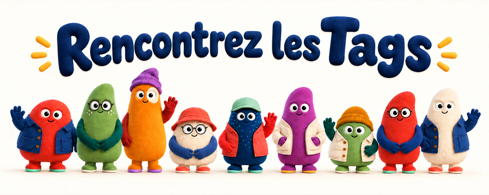

<div align="center">

<h1>
  
  SuperTag
</h1>

[English](../../README.md) · [中文](README.zh-CN.md) · [日本語](README.ja.md) · [한국어](README.ko.md) · [Español](README.es.md) · Français · [Português](README.pt.md) · [Türkçe](README.tr.md) · [Русский](README.ru.md)

**Une infrastructure ouverte pour des acteurs IA persistants, proactifs et multijoueurs.**

Faites tourner vos propres Devin Bots, OpenAI dots ou Grok Bot, pour l'ingénierie, le marketing,
les ventes ou n'importe quelle équipe. Auto-hébergé, sur les agents de code et les modèles que vous utilisez déjà.

<p>
  
</p>

**Confiez-leur des missions, pas des tâches.**

[Des missions, pas des tâches](#give-them-jobs-not-tasks) · [Persistant](#persistent) · [Proactif](#proactive) · [Multijoueur](#multiplayer) · [Une organisation d'ingénierie](#an-engineering-organization) · [Lancer votre premier Tag](#run-your-first-tag) · [Chez vous](#run-it-yourself) · [Construire le vôtre](#build-your-own) · [Documentation](../../docs/README.md)

</div>

SuperTag est une infrastructure ouverte pour des agents IA toujours actifs. SuperTag appelle chacun
d'eux un **Tag** : un acteur IA persistant, proactif et multijoueur, doté de sa propre identité, de
ses responsabilités, de ses permissions et de son historique de travail. Il poursuit le travail
d'une session à l'autre, agit sans qu'on le lui demande et collabore avec votre équipe et avec
d'autres Tags. Vous confiez une mission à un Tag, et Claude Code, Codex, Cursor ou OpenCode réalise
le travail morceau par morceau. Le Tag est ce qui persiste entre deux morceaux.

Ce que vous pouvez faire tourner dessus :

- **L'ingénierie, prête à l'emploi.** Une seule commande met un Tag au travail dans votre dépôt, et
  la même configuration peut grandir jusqu'à former toute une organisation d'ingénierie.
  [Lancer votre premier Tag](#run-your-first-tag) · [Exemple d'organisation d'ingénierie](../../examples/engineering-org/)
- **Le marketing, les ventes, le support ou toute autre fonction.** Choisissez les Roles, les
  outils et les événements de la fonction, et la même infrastructure la fait tourner.
  [Construire une organisation marketing](../../docs/guides/build-your-own.md) · [Exemple marketing](../../examples/marketing-org/)
- **Votre propre produit.** Construisez votre propre alternative à Devin Bots, OpenAI dots ou Grok
  Bot sur l'API de SuperTag. [Construire le vôtre](#build-your-own)

Cette page suit un exemple, l'ingénierie, de l'idée jusqu'à une organisation en marche : à quoi sert
un Tag, ce que l'infrastructure lui apporte, comment commencer avec un seul Tag et comment
l'ensemble tourne. Elle se termine sur la façon de construire le vôtre.

<a name="give-them-jobs-not-tasks"></a>

## Confiez-leur des missions, pas des tâches

SuperTag existe pour une seule idée : un acteur IA doit tenir une mission, pas seulement exécuter des tâches.

Aujourd'hui, vous confiez une tâche à un agent de code : un prompt, un diff, une revue, puis le
prompt suivant. Il sait enquêter sur un bug, écrire un correctif et lancer les tests. Mais c'est
vous qui vous souvenez de ce qui s'est passé la dernière fois, qui repérez l'échec suivant et qui
décidez de la suite. Dès que le travail dépasse une seule tâche, vous en devenez le chef de
projet : vous le découpez, vous lancez un agent de code sur chaque morceau et vous faites passer le
contexte de l'un à l'autre.

Un Tag, lui, a une mission. Une mission se compose des responsabilités que le Tag assume dans la
durée, par exemple garder main au vert, et des résultats qu'il livre, par exemple faire passer
12 services à des identifiants à courte durée de vie.

| Une tâche | Une mission |
| --- | --- |
| « Corrige ce test instable » | « Garde main au vert », et livre les résultats que vous lui demandez |
| Commence quand vous envoyez un prompt | Agit quand la CI échoue, qu'une alerte se déclenche ou qu'un collègue le sollicite |
| Se termine quand le diff est fusionné | Continue, et retient ce qu'elle a appris |
| Vous vérifiez si ça a marché | Elle apporte les preuves : les contrôles effectués et ce qui a été vérifié |
| N'importe quelle session d'agent de code peut s'en charger | A sa propre identité, ses permissions et son historique |

Chaque résultat est un **Objective**. Il consigne les preuves sur lesquelles vous vous appuierez
pour décider qu'il est atteint, ainsi que les contraintes, le budget ou l'échéance que vous fixez.
Le Tag responsable décide du travail à lancer, en confie des parties aux autres Tags de sa
**Team**, relit ce qui lui revient et vous présente ses conclusions, les branches et les décisions
qui demandent votre approbation. Vous pilotez le Tag responsable ; vous ne gérez pas ses agents de
code.

Pour faire passer 12 services à des identifiants à courte durée de vie, confiez à `lead`
l'Objective de déploiement. Il coordonne les Tags qui mettent à jour la politique de confiance et
le code des services, relisent les tests et la télémétrie, et répètent la bascule. Vous approuvez
les bascules en production et décidez du moment où retirer les clés partagées.

Donnez à chaque Tag sa propre mission et ses propres permissions. Vous pouvez par exemple laisser
`lead` coordonner, autoriser un Tag développeur à modifier le dépôt et donner à un Tag relecteur
un accès en lecture seule.

[Rédiger un Objective](../../docs/guides/write-an-objective.md) · [Comment vous dirigez le travail](../../docs/concepts/interaction-model.md)

## Ce qu'exige une mission

Tenir une mission exige trois choses de ce qui fait tourner le Tag. Une mission dure plus
longtemps qu'une session, comprend du travail que personne n'a encore demandé et implique d'autres
personnes. C'est ce que fournit l'infrastructure de SuperTag, quelle que soit la mission.

<a name="persistent"></a>

### Persistant

Une mission survit à la session qui l'a lancée. Vos agents de code réalisent le travail d'un Tag
morceau par morceau, et c'est le Tag qui persiste entre deux morceaux. Le même Tag peut enquêter
sur le problème du jour, examiner les résultats le lendemain et répondre à des questions sur les
deux la semaine suivante, même si le morceau suivant s'exécute sur un autre agent de code ou une
autre machine. Il retrouve de lui-même ses travaux et ses Objectives antérieurs.

<a name="next-add-your-teams-chat"></a>

Retrouvez le même Tag depuis les outils que vous utilisez. Parlez-lui dans le terminal, ou ajoutez
à ses emplacements un canal Slack, un dépôt GitHub ou une équipe Linear. Chaque conversation a son
propre fil, et le même Tag conserve les responsabilités que vous lui avez confiées. [Connecter un outil de travail](../../docs/surfaces/README.md)

<a name="proactive"></a>

### Proactif

Toute mission consiste aussi à repérer ce qu'il y a à faire. Confiez à un Tag une responsabilité
permanente, et il s'emploie à l'assumer sans attendre qu'on le lui demande.
Chaque responsabilité est un Objective permanent, et les responsabilités liées reviennent au même Tag.
Supposons que `reliability` veille à la santé de votre service. Il porte quatre Objectives permanents :

| Objective permanent | Se réveille sur | Ce qu'il fait | Ce qui vous revient |
| --- | --- | --- | --- |
| Trier les erreurs de production | Une erreur Sentry nouvelle ou en régression | La reproduit, identifie le changement en cause et prépare un correctif accompagné d'un test en échec | Fusionner et revenir en arrière |
| Surveiller le service | Une alerte PagerDuty, Datadog ou de contrôle de santé | Reconstitue la chronologie à partir des logs, des déploiements récents et du pic d'erreurs, et prépare une branche de revert | Revenir en arrière ou escalader |
| Garder main au vert | Un échec de la CI sur main | Trouve le commit fautif, distingue un test instable d'un véritable échec et prépare un correctif ou un revert | Fusionner et mettre des tests en quarantaine |
| Garder des dépendances sûres | Un avis de sécurité Dependabot ou Snyk | Vérifie si le projet est concerné et prépare la mise à niveau, résultats de tests à l'appui | Les montées de version majeures et la fusion |

Quand Sentry signale une nouvelle erreur, `reliability` s'en saisit au titre du premier Objective.
Il juge si l'erreur compte, lance le travail pour la reproduire et la corriger, puis vous apporte
la branche, le test et toute décision qui vous appartient. Comme un seul Tag porte les quatre, il
peut se rappeler ce qu'il a appris dans le cadre des autres, par exemple le déploiement défaillant
qu'il a examiné une heure plus tôt. Quand il n'y a rien à faire, il se met en veille jusqu'au
prochain signalement, message ou résultat. Faites-le tourner sur un hôte toujours allumé, et il
assume ses responsabilités même quand votre ordinateur portable est éteint.

Confiez un autre type de responsabilité à un autre Tag lorsqu'elle demande des permissions
différentes. Un Tag `support` qui trie les rapports de bugs peut lire le dépôt et échanger avec
leurs auteurs sans pouvoir préparer de reverts.

Vous choisissez les événements qui parviennent à un Tag et ce qu'il a le droit de faire en
réponse. Transmettez alertes et signalements à un Objective via l'API du Control Plane, ou
mentionnez le Tag dans Slack, GitHub ou Linear.
[Mettre en place une responsabilité permanente](../../docs/guides/ongoing-responsibilities.md)

<a name="multiplayer"></a>

### Multijoueur

Dans une équipe, les missions se recoupent. Auto-hébergez un Control Plane partagé, et votre
équipe travaille avec les Tags en commun. Chacun dirige des Tags depuis son propre terminal ou ses
outils connectés, et les conversations privées du terminal restent privées. Une personne peut
interroger `reliability` sur une erreur dans Slack, et une autre reprendre les mêmes conclusions
sur GitHub.

Les Tags de vos collègues se coordonnent entre eux sans vous solliciter. Quand votre Tag a besoin
de quelque chose de la part du Tag d'un collègue, il lui écrit directement. Ils règlent les
détails entre eux et consignent ce qu'ils ont convenu dans le Workstream partagé de leur Team.
Vous n'en entendez parler que lorsqu'une décision vous revient. Les Tags peuvent tourner sur des
agents de code et des machines différents : un Tag sur votre ordinateur portable, sous Claude
Code, peut ainsi travailler au même Objective qu'un Tag sur la machine d'un collègue, sous Codex.


[Comment fonctionne le multijoueur](../../docs/concepts/multiplayer.md) · [Auto-héberger SuperTag](../../docs/guides/self-hosting.md)

<a name="an-engineering-organization"></a>

## Une organisation d'ingénierie

Réunissez la persistance, le travail proactif et le travail en équipe, et un seul SuperTag
auto-hébergé peut faire tourner une organisation d'ingénierie autonome, avec ses propres
fonctions, équipes et responsabilités, que vous dirigez comme si vous en étiez le responsable.

Vous décrivez l'organisation dans la configuration, comme vous dessineriez un organigramme :

```text
you
 └─ lead                     takes your outcomes, splits them across teams, reports with evidence
     ├─ platform team        platform-lead, infra-builder              on Codex, on a server
     ├─ product team         product-lead, web-builder, api-builder     on Claude Code, on laptops
     ├─ reliability          reliability, support                      always on
     ├─ release              release-manager                            ships when you approve
     └─ shared specialists   reviewer, security-reviewer, verifier
```

- **Un Role pour chaque fonction.** Chaque Role porte ses instructions, ses standards, ses modèles
  et ses permissions. Les développeurs modifient le code et exécutent des commandes, les relecteurs
  ne font que lire, et le responsable des releases ne peut rien livrer sans votre approbation.
- **Une équipe pour chaque sous-fonction.** Chaque équipe a son propre Workstream. Les chefs
  d'équipe s'écrivent entre eux et règlent les détails sans vous.
- **Des résultats qui descendent l'organisation.** Confiez au lead un résultat, avec un budget et
  une échéance. Il répartit le travail entre les équipes, chaque équipe livre sa part avec une
  relecture et une exécution complète des tests, et le lead vous rapporte les preuves.
- **Des responsabilités qui ne s'arrêtent jamais.** La fiabilité réagit d'elle-même à chaque
  nouvelle erreur et à chaque build en échec, la sécurité relit chaque modification qui touche
  aux identifiants, et le responsable des releases prépare une release chaque semaine.
- **Vous décidez où les humains restent dans la boucle.** Des approbations pour les fusions, les
  releases, les budgets et toute action de votre choix. Tout le reste, l'organisation s'en charge.

SuperTag maintient chaque Tag en marche, fait respecter les limites de chaque Role, consigne qui a
fait quoi et pourquoi, et vous donne une seule boîte de réception pour les décisions qui vous
reviennent.
[Mettre en place une organisation d'ingénierie autonome](../../docs/guides/engineering-organization.md) · [Le modèle d'organisation, en termes de management](../../docs/concepts/organization.md)

<a name="get-started"></a>

<a name="run-your-first-tag"></a>

## Lancer votre premier Tag

Une organisation comme celle-là commence par un seul Tag. Le moyen le plus rapide de voir
l'infrastructure à l'œuvre est d'en lancer un dans votre propre dépôt, sur votre propre machine.

Sur Mac ou Linux, installez Git et [Claude Code](https://code.claude.com/docs/en/setup)
ou [Codex](https://developers.openai.com/codex/cli/), puis connectez-vous. Pour Claude Code,
lancez `claude` et connectez-vous. Pour Codex, connectez-vous avec
`codex -c 'cli_auth_credentials_store="file"' login`, qui enregistre la connexion dans un fichier
que les Tasks de SuperTag peuvent utiliser ; sous macOS, un simple `codex login` la range dans le
Trousseau, auquel elles n'ont pas accès. Claude Code a aussi besoin de Node.js ; voir
[prérequis et connexion](../../docs/operations/requirements.md) pour les versions.

[Installez SuperTag](../../docs/operations/install.md), puis exécutez ceci depuis un dépôt Git
existant comptant au moins un commit.

```sh
curl -fsSL https://supertag.sh/install | sh
export PATH="$HOME/.local/bin:$PATH"
supertag init
supertag message lead "Read this repository and tell me what you would improve first."
```

`supertag init` vérifie la connexion de votre agent de code, pose quelques questions et démarre
SuperTag en arrière-plan. Gardez le nom de Tag par défaut, `lead`. Il travaille dans ce dépôt, à
partir du dernier commit de la branche actuellement extraite. `supertag message` envoie votre
message à `lead` et affiche la réponse au fil de son arrivée.

Poursuivez la même conversation avec un nouveau `supertag message lead`. Quand vous êtes prêt à
lui confier une partie d'une mission, démarrez un Objective comme ceci.

```sh
supertag message lead "/goal Add a test for an uncovered edge case. Done when the new test and its suite pass. Ask me before changing application code."
```

Un lead sous Codex lance les tests. Un lead sous Claude Code configuré sans Docker ni l'option
explicite d'exécution hors sandbox lit et modifie les fichiers mais n'exécute aucune commande ; il
ne peut donc pas lancer les tests et signale la condition « Done when » comme non vérifiée. Voir
[Autoriser le lead à exécuter des commandes](../../docs/operations/cli.md#let-the-lead-run-commands).

`supertag get inbox-item` liste les questions que le Tag vous pose ; répondez à l'une d'elles avec
`supertag question answer TASK_ID "..."`. Quand l'Objective est prêt, `supertag status` l'affiche
à l'état `review`. Chaque changement livré arrive dans votre dépôt sous la forme d'une branche
`supertag/session/...`. Relisez-la, puis approuvez l'Objective ou demandez une révision :

```sh
supertag describe objective OBJECTIVE_ID
supertag objective review OBJECTIVE_ID approve
supertag objective review OBJECTIVE_ID request-changes --feedback "Also cover the empty case."
```

Vous préférez une fenêtre au terminal ? Sur Mac (Apple silicon ou Intel) ou Linux, [installez l'application de bureau](../../docs/operations/install.md#install-the-desktop-app) :
elle embarque son propre `supertag`, configure SuperTag au premier lancement et s'adresse aux mêmes Tags.

[Options d'installation](../../docs/operations/install.md) · [Parler à un Tag](../../docs/guides/talk-to-a-tag.md) · [Lancer votre première Team](../../docs/guides/first-team.md) · [Diriger SuperTag depuis votre agent de code](../../docs/guides/coding-agent-operator.md)

<a name="run-it-yourself"></a>

## Chez vous, sous votre contrôle

`supertag init` vient de démarrer toute l'infrastructure sur votre machine. Elle est open source
sous licence Apache 2.0, et chacun de ses composants s'exécute là où vous le décidez. Une mission a
besoin d'accéder à votre code, à vos services et à vos comptes : c'est donc vous qui décidez où
réside cet accès. Commencez seul sur une machine, puis partagez un Control Plane avec votre
équipe ; les composants restent les mêmes.


- **Vos machines.** `supertag init` démarre un **Control Plane** local, le service qui stocke vos
  Tags et planifie leur travail, et connecte votre ordinateur en tant que **Worker Host**, une
  machine ou une sandbox qui exécute le travail. Quand votre équipe vous rejoint, déployez le
  Control Plane là où tout le monde peut y accéder, et connectez des ordinateurs portables, des
  serveurs, des runners de CI ou des VM cloud comme Worker Hosts. Gardez sur un
  hôte toujours allumé un Tag chargé d'une responsabilité permanente, comme `reliability`.
- **Vos agents de code et vos modèles.** Chaque Tag s'exécute sur l'agent de code et le modèle de
  votre choix, connecté avec votre propre compte ou votre propre clé. Les modèles à poids ouverts
  comme GLM, Kimi et DeepSeek [tournent via OpenCode](../../docs/guides/open-models.md).
- **Vos limites.** Chaque Tag ne peut faire que ce que ses permissions autorisent, et vous
  choisissez les actions qui attendent votre approbation. Codex exécute les commandes dans sa
  propre sandbox ; Claude Code, Cursor et OpenCode peuvent exécuter les leurs dans des conteneurs
  locaux. Un Tag n'atteint que les adresses réseau que vous autorisez. Sous Codex et dans les
  conteneurs, son hôte ajoute aux requêtes autorisées des identifiants tels qu'un jeton Sentry :
  les commandes du Tag ne les voient donc jamais.

[Auto-héberger SuperTag](../../docs/guides/self-hosting.md) · [Connecter un Worker Host](../../docs/guides/workers.md) · [Définir permissions et approbations](../../docs/concepts/context-and-permissions.md) · [Voir comment les composants s'articulent](../../docs/concepts/how-it-works.md)

<a name="build-your-own"></a>

## Construire le vôtre

Rien de ce qui précède n'est propre à l'ingénierie. Le même Control Plane et les mêmes Worker
Hosts, ainsi que les mêmes Tags, Roles, Teams, Objectives, permissions, mémoire, plannings et
approbations, fonctionnent pour n'importe quelle fonction de votre organisation. Choisissez les
Roles, les outils et les événements de la fonction, et la même infrastructure la fait tourner : une
organisation marketing qui transforme chaque release en textes de lancement et rend compte des
chiffres chaque semaine, ou encore les ventes, le support client, les opérations financières, le
recrutement ou la recherche.
[Construire votre propre organisation : le marketing](../../docs/guides/build-your-own.md) · [Exemple marketing](../../examples/marketing-org/)

SuperTag est aussi la base d'un produit bien à vous, par exemple votre propre alternative à Devin
Bots, OpenAI dots ou Grok Bot. Ajoutez votre propre interface par-dessus : L'API gRPC du Control Plane
permet à votre application de créer et de diriger des Tags, de leur envoyer du travail et de
suivre leur avancement, avec des bindings générés pour Go, TypeScript et Python fournis dans le
dépôt. [Explorer l'API](../../docs/reference/control-plane-api.md)
Pour faire tourner un autre système d'agents en dessous, écrivez un **adaptateur de harness** ;
les adaptateurs Python et TypeScript intégrés sont des exemples fonctionnels. Le SDK TypeScript,
`supertag-ai` sur npm, et le SDK Python, `supertag` sur PyPI, relient votre application ou votre
adaptateur à SuperTag :

```sh
npm install supertag-ai
python -m pip install 'supertag==0.3.16'
```

[Écrire un adaptateur de harness](../../docs/guides/harness-adapters.md) · [Connecter votre propre surface de collaboration](../../docs/reference/connector-contract.md) · [Vérifier la stabilité de l'API](../../docs/reference/api-stability.md)

## Compatible avec

| | Options |
| --- | --- |
| **Agents de code** | Claude Code · Codex · Cursor · OpenCode · OpenAI Agents · [votre propre adaptateur de harness](../../docs/guides/harness-adapters.md) |
| **Où parler aux Tags** | Terminal · [Slack](../../docs/surfaces/slack.md) · [GitHub](../../docs/surfaces/github.md) · [Linear](../../docs/surfaces/linear.md) · [Lark/Feishu](../../docs/surfaces/lark.md) · [Microsoft Teams](../../docs/surfaces/teams.md) |
| **Où s'exécute le travail** | Ordinateurs portables · serveurs · runners de CI · VM cloud · [sandboxes Modal et E2B](../../docs/guides/workers.md#run-a-harness-in-a-sandbox) pour les tâches courtes |

## Quand choisir SuperTag

| Par rapport à | Points forts | Ce qui manque | Ce qu'apporte SuperTag |
| --- | --- | --- | --- |
| **Coéquipiers IA hébergés** · [Devin Bots](https://devin.ai/blog/introducing-devin-bots), [OpenAI dots](https://openai.com/index/introducing-dots/), [Grok Bot](https://x.ai/news/introducing-grok-bot) | Un assistant IA toujours disponible, qui se souvient du travail passé et agit de lui-même. | Il tourne sur les modèles et les machines cloud de l'éditeur, selon les règles de l'éditeur. | **Chez vous, sous votre contrôle, ou construit par vous.** Les Tags utilisent les agents de code que vous payez déjà, tournent sur vos propres machines et ne peuvent faire que ce que vous autorisez. Ou construisez votre propre version sur la même infrastructure. |
| **Agents auto-hébergés** · [OpenClaw](https://docs.openclaw.ai/concepts/multi-agent), [Hermes Agent](https://hermes-agent.nousresearch.com/docs/user-guide/features/kanban) | Faire tourner vos propres agents IA, avec leurs outils et leur mémoire, pour tout type de tâche. | Ce sont des assistants personnels. Ils ne sont pas conçus autour d'équipes dotées de rôles, de résultats partagés, de revues et d'approbations. | **Conçu pour les équipes et les organisations.** Les Tags ont des Roles, travaillent en Teams, portent des résultats qui s'accompagnent de preuves et n'agissent que dans les limites des permissions et des approbations que vous fixez. |
| **Plateformes d'agents** · [Claude Managed Agents](https://platform.claude.com/docs/en/managed-agents/overview), [OpenAI Agents API](https://developers.openai.com/api/docs/guides/agents-api/overview) | Faire tourner les agents que vous construisez sous forme de service géré, avec des sessions et des sandboxes hébergées. | Chacune fait tourner les modèles d'un seul éditeur, avec la boucle de l'agent sur les serveurs de cet éditeur. C'est toujours à vous de concevoir l'identité, les équipes et les responsabilités. | **Ouvert, et indépendant de tout éditeur.** SuperTag tourne sur vos machines avec Claude Code, Codex, Cursor et OpenCode, et vous fournit des acteurs, des Roles, des Teams et des résultats prêts à configurer. |
| **Agents de code** · [Claude Code](https://code.claude.com/docs/en/overview), [Codex](https://learn.chatgpt.com/docs/codex/cli), [OpenCode](https://opencode.ai/docs/) | Écrire, corriger et tester du code pendant que vous travaillez avec eux. | Quand vous fermez la conversation, le travail s'arrête. C'est à vous de garder le but en tête et de lancer l'étape suivante. | **Le travail continue.** Un Tag garde le but en tête et met lui-même un agent de code sur l'étape suivante. Il réagit aussi aux nouvelles erreurs et alertes sans que vous le demandiez. Ce sont toujours vos agents de code qui écrivent le code. |
| **Outils d'agents en parallèle** · [Paradev (anciennement Superset)](https://docs.paradev.com/recipes/parallel-workstreams), [Conductor](https://www.conductor.build/docs/concepts/parallel-agents) ([en cours d'arrêt](https://www.conductor.build/announcement)) | Faire tourner plusieurs agents de code à la fois et vous montrer tous les changements. | C'est encore vous qui décidez sur quoi travaille chaque agent et qui vérifiez que les résultats s'assemblent. | **Quelqu'un d'autre gère les agents.** Dites à un Tag ce que vous voulez obtenir et comment le vérifier. Il répartit les morceaux, vérifie qu'ils s'assemblent et vous envoie les résultats. |
| **Projets d'agents** · [Cursor Projects](https://cursor.com/docs/agent/projects), [Claude Code Projects](https://code.claude.com/docs/en/claude-projects), [GitHub Copilot Projects](https://docs.github.com/en/copilot/how-tos/github-copilot-app/working-with-projects) | Plusieurs agents qui poursuivent un même but pendant des semaines ou des mois. Dans Cursor, vos collègues peuvent rejoindre le même projet. | Chaque projet fait tourner les agents d'un seul éditeur, le plus souvent sur le cloud de cet éditeur. | **Mélangez agents de code et machines.** Votre Tag peut tourner sous Claude Code sur votre ordinateur portable pendant que celui d'un collègue tourne sous Codex sur le sien, et ils travaillent quand même ensemble. |

[Voir comment SuperTag s'articule avec les autres systèmes d'agents](../../docs/concepts/supertag-and-other-agent-systems.md).

## FAQ

**Que peut faire un Tag sans me demander ?** Uniquement ce que ses permissions autorisent. Vous
décidez quelles actions exigent d'abord votre approbation. Les modifications du dépôt reviennent
toujours sous forme de branches à relire, et la fusion reste entre vos mains.
[Définir permissions et approbations](../../docs/concepts/context-and-permissions.md)

**Comment garder la main sur les modifications de mon dépôt ?** Définissez ce que chaque Tag a le
droit de faire. Le travail sur le dépôt se fait dans une copie de travail distincte, épinglée sur
un commit, et revient sous la forme d'une branche que vous pouvez relire.
[Travailler avec les branches du dépôt](../../docs/guides/workspaces.md)

**Ai-je besoin d'un serveur ?** Vous pouvez démarrer le Control Plane et exécuter le travail sur
votre ordinateur portable. Pour un accès partagé, ou pour un travail qui doit rester disponible
quand votre ordinateur portable est éteint, déployez le Control Plane et connectez un Worker Host
qui reste en ligne. [Auto-héberger SuperTag](../../docs/guides/self-hosting.md)

**SuperTag ne sert-il qu'au travail d'ingénierie ?** Non. Les Tags fournis, les exemples et la
livraison par branche Git commencent par le travail d'ingénierie, mais l'infrastructure convient
à n'importe quelle fonction. Vous pouvez y faire tourner le marketing, les ventes ou le support,
comme dans [Construire le vôtre](#build-your-own).

## Contribuer et licence

Consultez le [guide de contribution](../../CONTRIBUTING.md) pour la mise en place du dépôt et les
vérifications. SuperTag est distribué sous licence [Apache 2.0](../../LICENSE).
