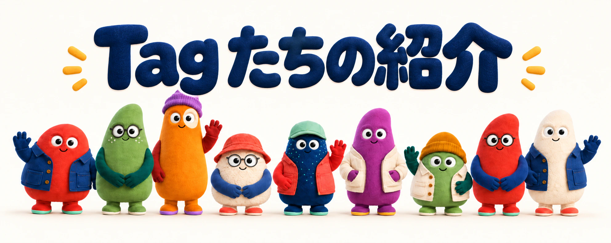
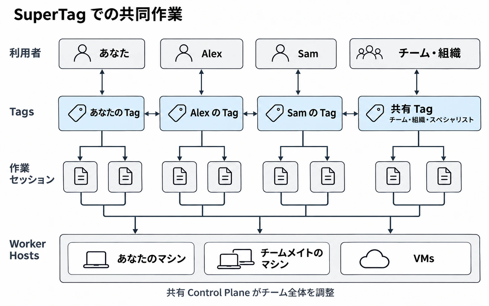

<div align="center">

<h1>
   SuperTag
</h1>

[English](../../README.md) · [中文](README.zh-CN.md) · 日本語 · [한국어](README.ko.md) · [Español](README.es.md) · [Français](README.fr.md) · [Português](README.pt.md) · [Türkçe](README.tr.md) · [Русский](README.ru.md)

**永続的・能動的・マルチプレイヤーの AI アクターのための、オープンなインフラ。**

あなた専用の Devin Bots、OpenAI dots、Grok Bot を、エンジニアリング、マーケティング、営業、どんなチームのためにも動かせます。セルフホストで、いつものコーディングエージェントとモデルの上で動きます。

<p>
  
</p>

**タスクではなく、仕事を任せよう。**

[タスクではなく仕事を](#give-them-jobs-not-tasks) · [永続的](#persistent) · [能動的](#proactive) · [マルチプレイヤー](#multiplayer) · [エンジニアリング組織](#an-engineering-organization) · [最初の Tag を動かす](#run-your-first-tag) · [自分で運用する](#run-it-yourself) · [独自に構築する](#build-your-own) · [ドキュメント](../../docs/README.md)

</div>

SuperTag は、常時稼働する AI エージェントのためのオープンなインフラです。SuperTag では、その 1 つひとつを **Tag** と呼びます。Tag は、固有のアイデンティティ、責務、権限、作業履歴を持つ、永続的・能動的・マルチプレイヤーの AI アクターです。セッションをまたいで作業を続け、頼まれなくても自ら動き、あなたのチームやほかの Tag と一緒に働きます。Tag に仕事を任せると、Claude Code、Codex、Cursor、OpenCode がその作業を 1 つずつこなします。その合間も存在し続けるのが Tag です。

この上で動かせるものは次のとおりです。

- **すぐに使えるエンジニアリング。** 1 つのコマンドで Tag がリポジトリで働き始め、同じ構成がそのままエンジニアリング組織全体へと育ちます。[最初の Tag を動かす](#run-your-first-tag) · [エンジニアリング組織の例](../../examples/engineering-org/)
- **マーケティング、営業、サポート、そのほかあらゆる部門。** その部門に合った Role、ツール、イベントを選べば、同じインフラがその部門を動かします。[マーケティング組織を構築する](../../docs/guides/build-your-own.md) · [マーケティングの例](../../examples/marketing-org/)
- **あなた自身の製品。** SuperTag の API の上に、Devin Bots、OpenAI dots、Grok Bot に代わる独自の製品を構築できます。[独自に構築する](#build-your-own)

このページでは、エンジニアリングを例に、アイデアから実際に動く組織までをたどります。Tag は何のためにあるのか、インフラが Tag に何を与えるのか、まず 1 つの Tag からどう始めるのか、そしてどう運用するのかを順に説明し、最後に独自に構築する方法を紹介します。

<a name="give-them-jobs-not-tasks"></a>

## タスクではなく、仕事を任せよう

SuperTag は 1 つの考えのためにあります。AI アクターは、タスクを受けるだけでなく、仕事を担うべきだという考えです。

いま、コーディングエージェントに渡しているのはタスクです。プロンプトを書き、差分を受け取り、レビューして、また次のプロンプトを書く。エージェントはバグを調査し、修正を書き、テストを実行できます。しかし、前回何が起きたかを覚えておき、次の失敗に気づき、次に何をするかを決めるのはあなたです。作業が 1 つのタスクに収まらなくなると、あなたがプロジェクトマネージャーになります。作業を分割し、それぞれにコーディングエージェントを立ち上げ、エージェント間でコンテキストを受け渡すことになるのです。

Tag が持つのはタスクではなく仕事です。仕事は、main をグリーンに保つといった Tag が担い続ける責務と、12 個のサービスを短命な認証情報へ移行するといった Tag が届ける成果から成ります。

| タスク | 仕事 |
| --- | --- |
| 「この不安定なテストを直して」 | 「main をグリーンに保つ」。加えて、任された成果を届ける |
| プロンプトを送ると始まる | CI の失敗、アラートの発火、チームメイトからの依頼をきっかけに動く |
| 差分がマージされたら終わる | 継続し、学んだことを覚えている |
| うまくいったかはあなたが確かめる | 実行したチェックと検証した内容を、証拠として持ってくる |
| どのコーディングエージェントのセッションでも引き受けられる | 固有のアイデンティティ、権限、履歴を持つ |

成果の 1 つひとつが **Objective** です。Objective には、完了を判断するための証拠と、あなたが設定した制約、予算、期限が記録されます。担当の Tag は、どの作業を始めるかを決め、自分の **Team** のほかの Tag に作業を割り振り、戻ってきた結果をレビューし、調査結果、ブランチ、そしてあなたの承認が必要な判断を届けます。あなたが舵を取る相手は担当の Tag であり、その配下のコーディングエージェントを管理する必要はありません。

12 個のサービスを短命な認証情報へ移行するなら、ロールアウトの Objective を `lead` に渡します。この Tag は、信頼ポリシーとサービスコードを更新する Tag、テストとテレメトリをレビューする Tag、切り替えのリハーサルを行う Tag を取りまとめます。あなたは本番環境の切り替えを承認し、共有キーをいつ廃止するかを決めます。

Tag ごとに、それぞれの仕事と権限を与えましょう。たとえば、`lead` には調整を任せ、ビルダーにはリポジトリの編集権限を、レビュアーには読み取り専用のアクセスを与える、といった構成が可能です。

[Objective を書く](../../docs/guides/write-an-objective.md) · [作業の指示のしかた](../../docs/concepts/interaction-model.md)

## 仕事に必要なもの

仕事を担うには、Tag を動かす仕組みに 3 つのことが求められます。仕事は 1 回のセッションでは終わらず、まだ誰も頼んでいない作業を含み、ほかの人も関わります。仕事が何であれ、この 3 つを提供するのが SuperTag のインフラです。

<a name="persistent"></a>

### 永続的

仕事は、それを始めたセッションよりも長く続きます。Tag の作業はコーディングエージェントが 1 つずつこなし、その合間も存在し続けるのが Tag です。同じ Tag が今日は問題を調査し、明日はその結果をレビューし、来週にはその両方についての質問に答えられます。次の作業が別のコーディングエージェントや別のマシンで実行されても変わりません。過去の作業や Objective も、Tag 自身が思い出せます。

<a name="next-add-your-teams-chat"></a>

普段使っているツールから、同じ Tag に話しかけられます。ターミナルで会話するほか、Slack チャンネル、GitHub リポジトリ、Linear チームを Tag のロケーションに追加できます。会話ごとにスレッドは分かれますが、割り当てた責務は同じ Tag が担い続けます。[業務ツールを接続する](../../docs/surfaces/README.md)

<a name="proactive"></a>

### 能動的

やるべきことに気づくのも、仕事のうちです。Tag に継続的な責務を与えると、頼まれるのを待たずに、その責務を果たすために動きます。それぞれの責務は継続的な Objective であり、関連する責務は同じ Tag にまとめます。たとえば `reliability` がサービスを健全に保つとしましょう。この Tag は 4 つの継続的な Objective を担当します。

| 継続的な Objective | 起動のきっかけ | やること | あなたに委ねること |
| --- | --- | --- | --- |
| 本番エラーのトリアージ | Sentry の新規 issue またはリグレッション | 再現し、原因となった変更を特定して、失敗するテスト付きの修正を用意する | マージとロールバック |
| サービスの監視 | PagerDuty、Datadog、ヘルスチェックのアラート | ログ、直近のデプロイ、エラーの急増からタイムラインを組み立て、リバート用のブランチを用意する | ロールバックまたはエスカレーション |
| main をグリーンに保つ | main での CI 実行の失敗 | 原因のコミットを特定し、不安定なテストか本当の失敗かを見極めて、修正またはリバートを用意する | マージとテストの隔離 |
| 依存関係を安全に保つ | Dependabot または Snyk のアドバイザリ | プロジェクトが影響を受けるかを確認し、テスト結果を添えてアップグレードを用意する | メジャーアップグレードとマージ |

Sentry が新しいエラーを報告すると、`reliability` は 1 つ目の Objective のもとでそれを引き受けます。そのエラーが重要かどうかを判断し、再現と修正の作業を始め、ブランチとテスト、そしてあなたが下すべき判断を届けます。4 つすべてを 1 つの Tag が担っているので、1 時間前に調べた失敗デプロイのように、ほかの Objective で得た知見も思い出せます。やるべきことがなければ、次の報告、メッセージ、結果が届くまで待機します。常時稼働のホストで動かせば、ノート PC の電源が切れていても責務を果たし続けます。

必要な権限が異なる種類の責務は、別の Tag に任せましょう。バグ報告をトリアージする`support` Tag なら、リバートを用意する権限がなくても、リポジトリを読み、報告者とやり取りできます。

どのイベントを Tag に届け、それに対して何をしてよいかは、あなたが決めます。アラートや報告をControl Plane の API 経由で Objective に転送するか、Slack、GitHub、Linear で Tag にメンションしてください。[継続的な責務を設定する](../../docs/guides/ongoing-responsibilities.md)

<a name="multiplayer"></a>

### マルチプレイヤー

チームでは、仕事は互いに重なり合います。共有の Control Plane を 1 つセルフホストすれば、チーム全員で Tag と一緒に働けます。メンバーはそれぞれ自分のターミナルや接続済みのツールからTag に指示を出し、ターミナルでの非公開の会話は本人以外には見えません。ある人が Slack で`reliability` にエラーについて尋ね、別の人が GitHub で同じ調査結果の続きを追う、といったことができます。

チームメイトの Tag 同士は、あなたを介さずに連携します。あなたの Tag がチームメイトの Tag に頼みたいことがあれば、その Tag に直接メッセージを送ります。細部は Tag 同士で詰め、合意した内容をTeam 共有の Workstream に記録します。あなたに知らせが届くのは、あなたが判断すべきことがあるときです。Tag は異なるコーディングエージェントやマシンで動かせるので、あなたのノート PC で Claude Code を使う Tag と、チームメイトのマシンで Codex を使う Tag が、同じ Objective に向けて協力できます。



[マルチプレイヤーの仕組み](../../docs/concepts/multiplayer.md) · [SuperTag をセルフホストする](../../docs/guides/self-hosting.md)

<a name="an-engineering-organization"></a>

## エンジニアリング組織

永続性、能動的な作業、チームワークを組み合わせれば、セルフホストした 1 つの SuperTag で自律的なエンジニアリング組織を運営できます。その組織には独自の部門、チーム、責務があり、あなたはそのトップとして指揮をとります。

組織図を描くように、組織を設定に記述します。

```text
you
 └─ lead                     takes your outcomes, splits them across teams, reports with evidence
     ├─ platform team        platform-lead, infra-builder              on Codex, on a server
     ├─ product team         product-lead, web-builder, api-builder     on Claude Code, on laptops
     ├─ reliability          reliability, support                      always on
     ├─ release              release-manager                            ships when you approve
     └─ shared specialists   reviewer, security-reviewer, verifier
```

- **部門ごとの Role。** 各 Role は、指示、基準、モデル、権限を持ちます。ビルダーはコードを編集してコマンドを実行し、レビュアーは読み取りだけを行い、リリースマネージャーはあなたの承認なしにはリリースできません。
- **サブ部門ごとの Team。** 各 Team は自分の Workstream を持ちます。Team のリード同士がメッセージをやり取りし、あなたを介さずに細部を詰めます。
- **上から下へ流れる成果。** 予算と期限をつけた成果を lead に渡します。lead は作業を各 Team に割り振り、各 Team はレビューとテストの全件実行を経て担当分を納品し、lead が証拠をあなたに届けます。
- **終わりのない責務。** 新しいエラーや失敗したビルドには reliability が自ら対応し、認証情報に関わる変更はすべてセキュリティがレビューし、リリースマネージャーは毎週リリースを準備します。
- **人が関わる場面はあなたが決める。** マージ、リリース、予算、そしてあなたが選んだあらゆるアクションに承認を求められます。それ以外は組織が処理します。

SuperTag はすべての Tag を動かし続け、各 Role の制限を守らせ、だれが何をなぜ行ったかを記録し、あなたが下すべき判断を 1 つの受信箱にまとめます。
[自律的なエンジニアリング組織を立ち上げる](../../docs/guides/engineering-organization.md)

<a name="get-started"></a>

<a name="run-your-first-tag"></a>

## 最初の Tag を動かす

そうした組織も、始まりは 1 つの Tag です。インフラが動く様子をいちばん早く確かめるには、あなた自身のマシンで、あなた自身のリポジトリを相手に Tag を 1 つ動かしてみましょう。

Mac または Linux に、Git と [Claude Code](https://code.claude.com/docs/en/setup) または[Codex](https://developers.openai.com/codex/cli/) をインストールし、サインインします。Claude Code の場合は`claude` を実行してログインします。Codex の場合は `codex -c 'cli_auth_credentials_store="file"' login` でサインインしてください。こうするとログイン情報がファイルに保存され、SuperTag の Task から利用できます。macOS で単に `codex login` を実行すると、ログイン情報は Task からは読めないキーチェーンに保存されます。Claude Code には Node.js も必要です。バージョンは[要件とサインイン](../../docs/operations/requirements.md)を参照してください。

[SuperTag をインストール](../../docs/operations/install.md)したら、コミットが 1 つ以上ある既存の Git リポジトリで次のコマンドを実行します。

```sh
curl -fsSL https://supertag.sh/install | sh
export PATH="$HOME/.local/bin:$PATH"
supertag init
supertag message lead "Read this repository and tell me what you would improve first."
```

`supertag init` は、コーディングエージェントのサインイン状態を確認し、いくつか質問をしたうえで、SuperTag をバックグラウンドで起動します。Tag 名はデフォルトの `lead` のままにしてください。この Tag は、チェックアウト中のブランチの最新コミットを起点に、このリポジトリで作業します。`supertag message` はメッセージを `lead` に送り、返信を届いた順に表示します。

同じ会話を続けるには、もう一度 `supertag message lead` を実行します。仕事の一部を任せる準備ができたら、次のように Objective を開始します。

```sh
supertag message lead "/goal Add a test for an uncovered edge case. Done when the new test and its suite pass. Ask me before changing application code."
```

Codex の lead はテストを実行します。Docker も、サンドボックスなしでの実行のオプトインも設定していない Claude Code の lead は、ファイルの読み取りと編集はできてもコマンドを実行しないため、テストを実行できず、「Done when」の条件を未確認として報告します。詳しくは[lead にコマンドを実行させる](../../docs/operations/cli.md#let-the-lead-run-commands)を参照してください。

`supertag get inbox-item` は、Tag からあなたへの質問を一覧表示します。回答するには`supertag question answer TASK_ID "..."` を使います。Objective の準備が整うと、`supertag status` に`review` と表示されます。届けられた変更はそれぞれ、`supertag/session/...` ブランチとしてあなたのリポジトリに入ります。内容をレビューしたら、Objective を承認するか、修正を依頼します。

```sh
supertag describe objective OBJECTIVE_ID
supertag objective review OBJECTIVE_ID approve
supertag objective review OBJECTIVE_ID request-changes --feedback "Also cover the empty case."
```

ターミナルよりウィンドウで操作したい場合は、Mac（Apple シリコンまたは Intel）か Linux に[デスクトップアプリをインストール](../../docs/operations/install.md#install-the-desktop-app)してください。アプリには専用の `supertag` が同梱されており、初回起動時に SuperTag をセットアップし、同じ Tag とやり取りできます。

[インストール方法](../../docs/operations/install.md) · [Tag と会話する](../../docs/guides/talk-to-a-tag.md) · [最初の Team を動かす](../../docs/guides/first-team.md) · [コーディングエージェントから SuperTag を操作する](../../docs/guides/coding-agent-operator.md)

<a name="run-it-yourself"></a>

## 自分で運用する

`supertag init` を実行した時点で、インフラ全体がすでにあなたのマシンで動き始めています。SuperTag は Apache 2.0 ライセンスのオープンソースで、すべての構成要素を好きな場所で動かせます。仕事にはあなたのコード、サービス、アカウントへのアクセスが必要です。だからこそ、そのアクセスをどこに置くかはあなたが決めます。まずは 1 台のマシンで 1 人で始め、その後 1 つの Control Plane をチームで共有しましょう。構成要素は同じです。


- **あなたのマシン。** `supertag init` はローカルの **Control Plane**（Tag を保存し、その作業をスケジュールするサービス）を起動し、あなたのコンピューターを **Worker Host**（作業を実行するマシンまたはサンドボックス）として接続します。チームが加わったら、全員がアクセスできる場所にControl Plane をデプロイし、ノート PC、サーバー、CI ランナー、クラウド VMを Worker Host として接続します。`reliability` のように継続的な責務を持つ Tag は、常時稼働のホストに置いてください。
- **あなたのコーディングエージェントとモデル。** 各 Tag は、あなたが選んだコーディングエージェントとモデルで動き、あなた自身のアカウントまたはキーでサインインします。GLM、Kimi、DeepSeek などのオープンウェイトモデルは [OpenCode を通じて動きます](../../docs/guides/open-models.md)。
- **あなたが決める制限。** 各 Tag にできるのは権限で許可されたことだけで、どのアクションにあなたの承認を必要とするかも選べます。Codex は自前のサンドボックスでコマンドを実行し、Claude Code、Cursor、OpenCode はローカルのコンテナ内で実行できます。Tag がアクセスできるのは、あなたが許可したネットワークアドレスだけです。Codex 上とコンテナ内では、Sentry のトークンなどの認証情報をホストが許可済みのリクエストに付加するため、Tag のコマンドが認証情報を目にすることはありません。

[SuperTag をセルフホストする](../../docs/guides/self-hosting.md) · [Worker Host を接続する](../../docs/guides/workers.md) · [権限と承認を設定する](../../docs/concepts/context-and-permissions.md) · [全体の仕組みを見る](../../docs/concepts/how-it-works.md)

<a name="build-your-own"></a>

## 独自に構築する

ここまでの内容は、どれもエンジニアリング専用ではありません。同じ Control Plane と Worker Host、そして同じ Tag、Role、Team、Objective、権限、メモリ、スケジュール、承認は、組織のどの部門にも使えます。その部門に合った Role、ツール、イベントを選べば、同じインフラがその部門を動かします。たとえば、リリースのたびにローンチ文案を用意し、毎週数字を報告するマーケティング組織です。営業、カスタマーサポート、財務オペレーション、採用、リサーチも同じように動かせます。
[独自の組織を構築する：マーケティング](../../docs/guides/build-your-own.md) · [マーケティングの例](../../examples/marketing-org/)

SuperTag は、Devin Bots、OpenAI dots、Grok Bot に代わる独自の製品など、あなた自身の製品の基盤にもなります。その上に独自のインターフェースを載せましょう。Control Plane の gRPC API を使えば、アプリケーションから Tag を作成して指示を出し、作業を送り、進捗を確認できます。生成済みの Go、TypeScript、Python バインディングはリポジトリに含まれています。[API を見る](../../docs/reference/control-plane-api.md)

その下で別のエージェントシステムを動かすには、**harness アダプター**を書きます。組み込みの Python アダプターと TypeScript アダプターが、そのまま動く実例です。TypeScript SDK（npm の `supertag-ai`）と Python SDK（PyPI の `supertag`）は、あなたのアプリケーションやアダプターを SuperTag に接続します。

```sh
npm install supertag-ai
python -m pip install 'supertag==0.3.16'
```

[harness アダプターを書く](../../docs/guides/harness-adapters.md) · [独自のコラボレーションサーフェスを接続する](../../docs/reference/connector-contract.md) · [API の安定性を確認する](../../docs/reference/api-stability.md)

## 対応環境

| | 選択肢 |
| --- | --- |
| **コーディングエージェント** | Claude Code · Codex · Cursor · OpenCode · OpenAI Agents · [自作の harness アダプター](../../docs/guides/harness-adapters.md) |
| **Tag と会話する場所** | ターミナル · [Slack](../../docs/surfaces/slack.md) · [GitHub](../../docs/surfaces/github.md) · [Linear](../../docs/surfaces/linear.md) · [Lark/Feishu](../../docs/surfaces/lark.md) · [Microsoft Teams](../../docs/surfaces/teams.md) |
| **作業を実行する場所** | ノート PC · サーバー · CI ランナー · クラウド VM · [Modal と E2B のサンドボックス](../../docs/guides/workers.md#run-a-harness-in-a-sandbox)（短時間の作業向け） |

## SuperTag を選ぶべきとき

| 比較対象 | 得意なこと | 足りないもの | SuperTag が加えるもの |
| --- | --- | --- | --- |
| **ホスト型の AI チームメイト** · [Devin Bots](https://devin.ai/blog/introducing-devin-bots)、[OpenAI dots](https://openai.com/index/introducing-dots/)、[Grok Bot](https://x.ai/news/introducing-grok-bot) | いつでも使えて、過去の作業を覚えており、自律的に動く AI アシスタント。 | 提供元のモデルとクラウド上のコンピューターで、提供元のルールに従って動きます。 | **自分で運用できる。独自に構築もできる。** Tag は、すでに契約しているコーディングエージェントを使い、あなた自身のマシンで動き、あなたが許可したことしかできません。同じインフラの上に、独自のバージョンを構築することもできます。 |
| **セルフホスト型エージェント** · [OpenClaw](https://docs.openclaw.ai/concepts/multi-agent)、[Hermes Agent](https://hermes-agent.nousresearch.com/docs/user-guide/features/kanban) | 独自のツールとメモリを備えた AI エージェントを自分で運用し、あらゆる種類のタスクをこなすこと。 | 個人向けのアシスタントです。役割、共有された成果、レビュー、承認を備えたチームを軸に作られてはいません。 | **チームと組織のために作られている。** Tag は Role を持ち、Team で働き、証拠を伴う成果を担い、あなたが設定した権限と承認の範囲内でのみ動きます。 |
| **エージェントプラットフォーム** · [Claude Managed Agents](https://platform.claude.com/docs/en/managed-agents/overview)、[OpenAI Agents API](https://developers.openai.com/api/docs/guides/agents-api/overview) | 自分で構築したエージェントを、ホスト型のセッションとサンドボックスを備えたマネージドサービスとして動かすこと。 | どれも 1 社のモデルで動き、エージェントループはその会社のサーバー上で実行されます。アイデンティティ、チーム、責務は、やはり自分で設計する必要があります。 | **オープンで、特定のベンダーに縛られない。** SuperTag はあなたのマシン上で、Claude Code、Codex、Cursor、OpenCode をまたいで動き、すぐに設定できるアクター、Role、Team、成果を提供します。 |
| **コーディングエージェント** · [Claude Code](https://code.claude.com/docs/en/overview)、[Codex](https://learn.chatgpt.com/docs/codex/cli)、[OpenCode](https://opencode.ai/docs/) | 一緒に作業しながら、コードを書き、直し、テストすること。 | チャットを閉じると作業が止まります。目標を覚えておき、次のステップを始めるのはあなたです。 | **作業が止まらない。** Tag は目標を覚えていて、次のステップに自らコーディングエージェントを割り当てます。新しいエラーやアラートにも、頼まれなくても対応します。コードを書くのは、これまでどおりあなたのコーディングエージェントです。 |
| **並列エージェントツール** · [Paradev（旧 Superset）](https://docs.paradev.com/recipes/parallel-workstreams)、[Conductor](https://www.conductor.build/docs/concepts/parallel-agents)（[提供終了予定](https://www.conductor.build/announcement)） | 複数のコーディングエージェントを同時に動かし、すべての変更を見せること。 | 各エージェントに何をさせるかを決め、結果が噛み合うかを確かめるのは、やはりあなたです。 | **エージェントの管理を任せられる。** やってほしいことと、その確認方法を Tag に伝えるだけです。Tag が作業を割り振り、噛み合うかを確かめ、結果をあなたに届けます。 |
| **エージェントプロジェクト** · [Cursor Projects](https://cursor.com/docs/agent/projects)、[Claude Code Projects](https://code.claude.com/docs/en/claude-projects)、[GitHub Copilot Projects](https://docs.github.com/en/copilot/how-tos/github-copilot-app/working-with-projects) | 複数のエージェントが、数週間から数か月かけて 1 つの目標に取り組むこと。Cursor では、チームメイトが同じプロジェクトに参加できます。 | 各プロジェクトで動くのは 1 社のエージェントだけで、ほとんどはその会社のクラウド上で実行されます。 | **コーディングエージェントもマシンも自由に組み合わせる。** あなたの Tag はあなたのノート PC の Claude Code で、チームメイトの Tag は相手のノート PC の Codex で動かしても、問題なく連携できます。 |

[SuperTag とほかのエージェントシステムとの関係を見る](../../docs/concepts/supertag-and-other-agent-systems.md)。

## FAQ

**Tag は、私に確認せずに何ができますか？** 権限で許可されたことだけです。どのアクションに事前の承認が必要かは、あなたが決めます。リポジトリへの変更は必ずレビュー用のブランチとして届き、マージするのはあなたです。[権限と承認を設定する](../../docs/concepts/context-and-permissions.md)

**リポジトリへの変更は、どうやって管理しますか？** Tag ごとに、許可する操作を設定します。リポジトリでの作業は、コミットを固定した別のチェックアウトで行われ、レビューできるブランチとして届きます。[リポジトリのブランチを扱う](../../docs/guides/workspaces.md)

**サーバーは必要ですか？** Control Plane の起動も作業の実行も、ノート PC だけで行えます。共有して使う場合や、ノート PC の電源が切れていても作業を続けたい場合は、Control Plane をデプロイし、常時オンラインの Worker Host を接続してください。[SuperTag をセルフホストする](../../docs/guides/self-hosting.md)

**SuperTag はエンジニアリングの仕事専用ですか？** いいえ。同梱の Tag、例、git ブランチによる納品はエンジニアリングの仕事から始まりますが、インフラはどの部門にも使えます。[独自に構築する](#build-your-own)のように、マーケティング、営業、サポートをその上で運営できます。

## コントリビューションとライセンス

リポジトリのセットアップとチェックについては、[コントリビューターガイド](../../CONTRIBUTING.md)を参照してください。SuperTag は[Apache 2.0](../../LICENSE) ライセンスで提供されています。
