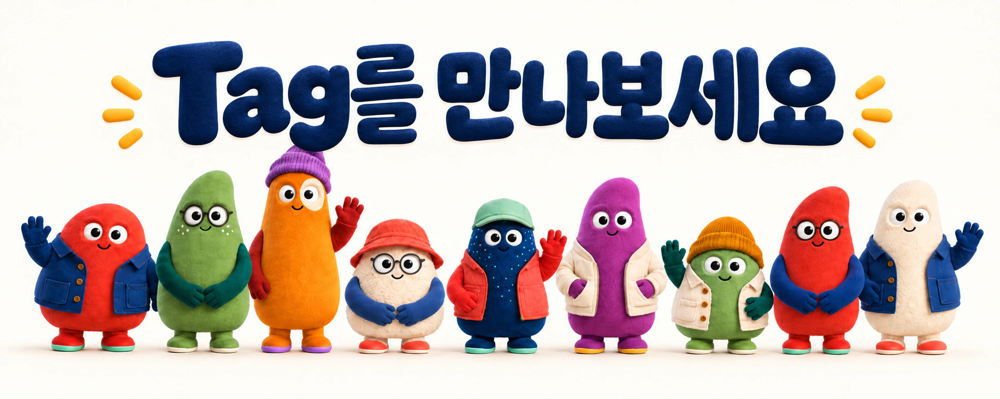
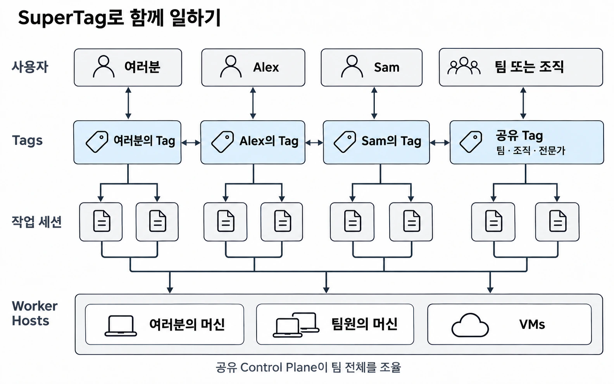
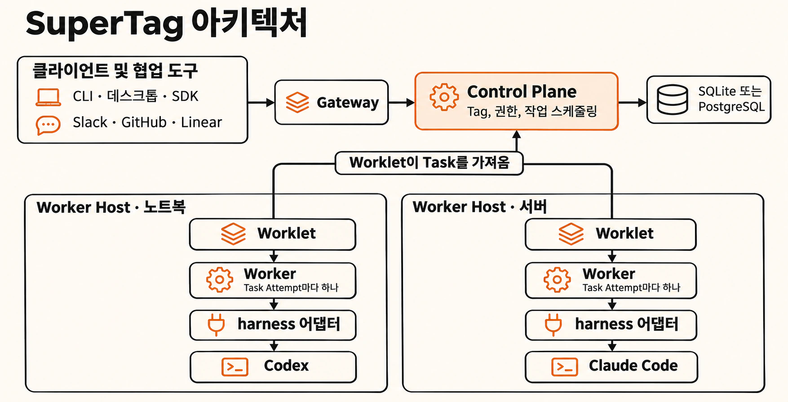

<div align="center">

<h1>
  
  SuperTag
</h1>

[English](../../README.md) · [中文](README.zh-CN.md) · [日本語](README.ja.md) · 한국어 · [Español](README.es.md) · [Français](README.fr.md) · [Português](README.pt.md) · [Türkçe](README.tr.md) · [Русский](README.ru.md)

**엔지니어링 업무를 위한, 지속적이고 능동적인 멀티플레이어 AI 액터.**

오픈 소스이며 셀프 호스팅 방식으로, 이미 쓰고 있는 코딩 에이전트 위에서 동작합니다.

**작업이 아니라 직무를 맡기세요.**

[작업이 아닌 직무](#give-them-jobs-not-tasks) · [지속성](#persistent) · [능동성](#proactive) · [멀티플레이어](#multiplayer) · [직접 운영하기](#run-it-yourself) · [첫 Tag 실행하기](#run-your-first-tag) · [문서](../../docs/README.md)

<p>
  
</p>

</div>

**Tag**는 고유한 정체성, 책임, 권한, 작업 이력을 가진 지속적인 AI 액터입니다. Tag의 직무는 그 책임과
Tag가 내놓는 성과로 이루어집니다. Tag는 세션과 세션 사이에도 일을 이어 가고, 시키지 않아도 움직이며,
팀 동료의 Tag와 함께 일합니다. 코드는 여전히 Claude Code, Codex, Cursor, OpenCode 같은 여러분의 코딩
에이전트가 작성합니다.

<a name="give-them-jobs-not-tasks"></a>

## 작업이 아니라 직무를 맡기세요

지금은 코딩 에이전트에게 작업을 줍니다. 프롬프트, diff, 리뷰, 그리고 다음 프롬프트로 이어지는 식입니다.
에이전트는 버그를 조사하고 수정 코드를 작성하고 테스트를 실행할 수 있습니다. 하지만 지난번에 무슨 일이
있었는지 기억하고, 다음 실패를 알아차리고, 다음에 무엇을 할지 정하는 것은 여러분입니다. 일이 작업 하나를
넘어서면 여러분이 그 일의 프로젝트 매니저가 됩니다. 일을 쪼개고, 조각마다 코딩 에이전트를 띄우고, 그
사이에서 맥락을 직접 옮겨야 합니다.

Tag에게는 작업 대신 직무가 있습니다. 직무는 main을 항상 통과 상태로 유지하는 것처럼 Tag가 계속 지는
책임과, 서비스 12개를 단기 자격 증명으로 전환하는 것처럼 Tag가 내놓는 성과로 이루어집니다.

| 작업 | 직무 |
| --- | --- |
| "이 불안정한 테스트를 고쳐 줘" | "main을 항상 통과 상태로 유지해 줘", 그리고 맡긴 성과를 내는 것 |
| 프롬프트를 보내면 시작됩니다 | CI가 실패하거나, 알림이 울리거나, 동료가 요청하면 움직입니다 |
| diff가 병합되면 끝납니다 | 계속 이어지며, 배운 것을 기억합니다 |
| 제대로 됐는지 직접 확인해야 합니다 | 실행한 검사와 검증한 내용을 증거로 가져옵니다 |
| 어떤 코딩 에이전트 세션이든 맡을 수 있습니다 | 고유한 정체성, 권한, 이력이 있습니다 |

각 성과는 하나의 **Objective**입니다. Objective에는 완료 여부를 판단할 때 쓸 증거와, 여러분이 정한 제약
조건, 예산, 기한이 기록됩니다. Objective를 맡은 Tag는 어떤 일을 시작할지 정하고, 일부를 자기 **Team**의
다른 Tag에게 넘기고, 돌아온 결과를 리뷰한 뒤, 조사 결과와 브랜치, 그리고 승인이 필요한 결정을 여러분에게
가져옵니다. 여러분은 담당 Tag의 방향만 잡아 주면 되고, 그 Tag의 코딩 에이전트를 관리할 필요는 없습니다.

서비스 12개를 단기 자격 증명으로 전환하려면 `lead`에게 롤아웃 Objective를 맡기세요. 그러면 신뢰 정책과
서비스 코드를 수정하는 Tag, 테스트와 텔레메트리를 리뷰하는 Tag, 전환을 미리 연습하는 Tag를 조율합니다.
여러분은 프로덕션 전환을 승인하고, 공유 키를 언제 폐기할지 결정합니다.

Tag마다 고유한 직무와 권한을 주세요. 예를 들어 `lead`에게는 조율을 맡기고, 빌더에게는 저장소 편집
권한을, 리뷰어에게는 읽기 전용 접근 권한을 줄 수 있습니다.

[Objective 작성하기](../../docs/guides/write-an-objective.md) · [일을 지시하는 방법](../../docs/concepts/interaction-model.md)

## 직무에 필요한 것

직무는 세션 하나보다 오래 이어지고, 아직 아무도 요청하지 않은 일까지 포함하며, 다른 사람들과 얽혀 있습니다.
Tag는 이 세 가지 모두를 위해 만들어졌습니다.

<a name="persistent"></a>

### 지속성

직무는 그것을 시작한 세션보다 오래 이어집니다. 코딩 에이전트는 Tag의 일을 한 번에 한 조각씩 처리하고,
그 조각들 사이에서 유지되는 것이 Tag입니다. 같은 Tag가 오늘은 이슈를 조사하고, 내일은 그 결과를 리뷰하고,
다음 주에는 두 일에 관한 질문에 답할 수 있습니다. 다음 조각이 다른 코딩 에이전트나 다른 머신에서 실행되더라도
마찬가지입니다. Tag는 이전에 한 일과 Objective를 스스로 떠올릴 수 있습니다.

<a name="next-add-your-teams-chat"></a>

평소 쓰는 도구에서 같은 Tag를 만나세요. 터미널에서 대화하거나, Slack 채널, GitHub 저장소, Linear 팀을
Tag의 활동 위치에 추가하면 됩니다. 대화마다 별도의 스레드가 있고, 같은 Tag가 여러분이 맡긴 책임을 그대로
이어 갑니다. [업무 도구 연결하기](../../docs/surfaces/README.md)

<a name="proactive"></a>

### 능동성

해야 할 일을 알아차리는 것도 모든 직무의 일부입니다. Tag에게 상시 책임을 맡기면, 요청을 기다리지 않고
그 책임을 다하려고 움직입니다.
책임 하나하나는 상시 Objective이고, 서로 관련된 책임은 같은 Tag에 속합니다.
`reliability`가 서비스를 건강하게 유지한다고 해 봅시다. 이 Tag는 상시 Objective 네 개를 맡습니다.

| 상시 Objective | 깨어나는 계기 | 하는 일 | 여러분에게 남기는 일 |
| --- | --- | --- | --- |
| 프로덕션 오류 분류 | 새로 생겼거나 재발한 Sentry 이슈 | 오류를 재현하고, 원인이 된 변경을 찾아, 실패하는 테스트와 함께 수정안을 준비합니다 | 병합과 롤백 |
| 서비스 감시 | PagerDuty, Datadog 또는 헬스 체크 알림 | 로그, 최근 배포, 오류 급증을 바탕으로 타임라인을 만들고 되돌리기 브랜치를 준비합니다 | 롤백 또는 에스컬레이션 |
| main을 통과 상태로 유지 | main에서 실패한 CI 실행 | 문제를 일으킨 커밋을 찾고, 불안정한 테스트와 실제 실패를 가려내어, 수정안이나 되돌리기를 준비합니다 | 병합과 테스트 격리 |
| 의존성을 안전하게 유지 | Dependabot 또는 Snyk 보안 권고 | 프로젝트가 영향을 받는지 확인하고 테스트 결과와 함께 업그레이드를 준비합니다 | 메이저 업그레이드와 병합 |

Sentry가 새 오류를 보고하면 `reliability`가 첫 번째 Objective 아래에서 이를 맡습니다. 그 오류가 중요한지
판단하고, 재현과 수정 작업을 시작한 뒤, 브랜치와 테스트, 그리고 여러분이 내려야 할 결정을 가져옵니다.
한 Tag가 네 가지를 모두 맡고 있으므로, 한 시간 전에 살펴본 실패한 배포처럼 다른 Objective에서 알게 된
것도 떠올릴 수 있습니다. 할 일이 없으면 다음 보고, 메시지, 결과가 올 때까지 쉽니다. 상시 가동되는
호스트에서 실행하면 노트북이 꺼져 있어도 책임을 계속 이어 갑니다.

성격이 다른 책임에 다른 권한이 필요하다면 별도의 Tag에게 맡기세요. 버그 리포트를 분류하는
`support` Tag는 되돌리기를 준비할 권한 없이도 저장소를 읽고 제보자와 대화할 수 있습니다.

어떤 이벤트가 Tag에 전달되고 Tag가 그에 대응해 무엇을 할 수 있는지는 여러분이 정합니다. Control Plane
API로 알림과 보고를 Objective에 전달하거나, Slack, GitHub, Linear에서 Tag를 멘션하세요.
[상시 책임 설정하기](../../docs/guides/ongoing-responsibilities.md)

<a name="multiplayer"></a>

### 멀티플레이어

팀에서는 직무가 서로 겹칩니다. 공유 Control Plane 하나를 셀프 호스팅하면 팀 전체가 Tag와 함께
일할 수 있습니다. 팀원은 각자 자기 터미널이나 연결된 도구에서 Tag에게 일을 지시하고, 비공개 터미널 대화는
당사자만 볼 수 있습니다. 한 사람이 Slack에서 `reliability`에게 오류에 대해 물어보면, 다른 사람이 GitHub에서
같은 조사 결과를 이어받아 후속 질문을 할 수 있습니다.

동료들의 Tag는 여러분을 거치지 않고 서로 조율합니다. 여러분의 Tag가 동료의 Tag에게 필요한 것이 있으면
그 Tag에게 직접 메시지를 보냅니다. 세부 사항은 Tag끼리 정리하고, 합의한 내용은 Team의 공유 Workstream에
기록합니다. 여러분에게는 직접 결정해야 할 일이 생겼을 때만 알림이 옵니다. Tag는 서로 다른 코딩 에이전트와
머신에서 실행될 수 있으므로, 여러분의 노트북에서 Claude Code로 동작하는 Tag가 동료의 머신에서 Codex로
동작하는 Tag와 같은 Objective를 향해 함께 일할 수 있습니다.



[멀티플레이어의 동작 방식](../../docs/concepts/multiplayer.md) · [SuperTag 셀프 호스팅하기](../../docs/guides/self-hosting.md)

<a name="get-started"></a>

<a name="run-your-first-tag"></a>

## 첫 Tag 실행하기

Mac이나 Linux에 Git과 [Claude Code](https://code.claude.com/docs/en/setup)
또는 [Codex](https://developers.openai.com/codex/cli/)를 설치하고 로그인하세요. Claude Code는
`claude`를 실행해 로그인합니다. Codex는 `codex -c 'cli_auth_credentials_store="file"' login`으로
로그인하세요. 이렇게 하면 로그인 정보가 SuperTag의 Task가 사용할 수 있는 파일에 저장됩니다. macOS에서 그냥
`codex login`을 실행하면 로그인 정보가 키체인에 저장되어 Task가 사용할 수 없습니다. Claude Code에는 Node.js도
필요합니다. 버전은 [요구 사항과 로그인](../../docs/operations/requirements.md)을 참고하세요.

[SuperTag를 설치](../../docs/operations/install.md)한 다음, 커밋이 하나 이상 있는 기존 Git 저장소에서
아래 명령을 실행하세요.

```sh
curl -fsSL https://supertag.sh/install | sh
export PATH="$HOME/.local/bin:$PATH"
supertag init
supertag message lead "Read this repository and tell me what you would improve first."
```

`supertag init`은 코딩 에이전트의 로그인 상태를 확인하고, 몇 가지 질문을 한 뒤, SuperTag를 백그라운드에서
시작합니다. Tag 이름은 기본값인 `lead`를 그대로 두세요. 이 Tag는 현재 체크아웃한 브랜치의 최신 커밋에서
출발해 이 저장소에서 일합니다. `supertag message`는 여러분의 메시지를 `lead`에게 보내고, 답장이 도착하는
대로 출력합니다.

`supertag message lead`를 다시 실행하면 같은 대화를 이어 갈 수 있습니다. 직무의 일부를 맡길 준비가 되면
다음과 같이 Objective를 시작하세요.

```sh
supertag message lead "/goal Add a test for an uncovered edge case. Done when the new test and its suite pass. Ask me before changing application code."
```

Codex 기반 lead는 테스트를 실행합니다. Docker나 샌드박스 없는 실행에 대한 옵트인 없이 설정한 Claude Code
기반 lead는 파일을 읽고 편집하지만 명령은 실행하지 않으므로, 테스트를 실행하지 못하고
"Done when" 조건을 미확인으로 보고합니다.
[lead가 명령을 실행하게 하기](../../docs/operations/cli.md#let-the-lead-run-commands)를 참고하세요.

`supertag get inbox-item`은 Tag가 여러분에게 한 질문을 나열합니다. 질문에는
`supertag question answer TASK_ID "..."`로 답하세요. Objective가 준비되면 `supertag status`에
`review`로 표시됩니다. 전달된 변경 사항은 각각 `supertag/session/...` 브랜치로 여러분의 저장소에
도착합니다. 브랜치를 리뷰한 다음 Objective를 승인하거나 수정을 요청하세요.

```sh
supertag describe objective OBJECTIVE_ID
supertag objective review OBJECTIVE_ID approve
supertag objective review OBJECTIVE_ID request-changes --feedback "Also cover the empty case."
```

터미널보다 창이 편한가요? Mac(Apple 실리콘 또는 Intel)이나 Linux에서 [데스크톱 앱을 설치](../../docs/operations/install.md#install-the-desktop-app)하세요.
앱에는 `supertag`가 내장되어 있고, 처음 실행할 때 SuperTag를 설정하며, 같은 Tag들과 대화합니다.

[설치 옵션](../../docs/operations/install.md) · [Tag와 대화하기](../../docs/guides/talk-to-a-tag.md) · [첫 Team 실행하기](../../docs/guides/first-team.md) · [코딩 에이전트에서 SuperTag 다루기](../../docs/guides/coding-agent-operator.md)

<a name="run-it-yourself"></a>

## 직접 운영하기

SuperTag는 Apache 2.0 라이선스의 오픈 소스이며, 모든 구성 요소가 여러분이 고른 곳에서 실행됩니다. 직무에는
여러분의 코드, 서비스, 계정에 대한 접근 권한이 필요하므로, 그 권한을 어디에 둘지는 여러분이 결정합니다.



- **여러분의 머신.** `supertag init`은 로컬 **Control Plane**, 즉 Tag를 저장하고 그 작업을 스케줄링하는
  서비스를 시작하고, 여러분의 컴퓨터를 **Worker Host**, 즉 작업을 실행하는 머신이나 샌드박스로 연결합니다.
  팀이 합류하면 Control Plane을 모두가 접근할 수 있는 곳에 배포하고, 노트북, 서버, CI 러너, Modal 및 E2B
  샌드박스를 Worker Host로 연결하세요. `reliability`처럼 상시 책임을 맡은 Tag는 상시 가동되는 호스트에
  두세요.
- **여러분의 코딩 에이전트와 모델.** 각 Tag는 여러분이 고른 코딩 에이전트와 모델에서 실행되며, 여러분의
  계정이나 키로 로그인합니다.
- **여러분이 정한 한계.** 각 Tag는 권한이 허용하는 일만 할 수 있고, 어떤 동작이 승인을 기다려야 하는지는
  여러분이 정합니다. Codex는 자체 샌드박스에서 명령을 실행하고, Claude Code, Cursor, OpenCode는 로컬
  컨테이너에서 명령을 실행할 수 있습니다. Tag는 여러분이 허용한 네트워크 주소에만 접근합니다. Codex와
  컨테이너에서는 호스트가 Sentry 토큰 같은 자격 증명을 허용된 요청에 덧붙이므로, Tag의 명령은 자격 증명을
  볼 수 없습니다.

[SuperTag 셀프 호스팅하기](../../docs/guides/self-hosting.md) · [Worker Host 연결하기](../../docs/guides/workers.md) · [권한과 승인 설정하기](../../docs/concepts/context-and-permissions.md) · [구성 요소가 맞물리는 방식 보기](../../docs/concepts/how-it-works.md)

## 함께 쓸 수 있는 도구

| | 선택지 |
| --- | --- |
| **코딩 에이전트** | Claude Code · Codex · Cursor · OpenCode · OpenAI Agents · [직접 만든 harness 어댑터](../../docs/guides/harness-adapters.md) |
| **Tag와 대화하는 곳** | 터미널 · [Slack](../../docs/surfaces/slack.md) · [GitHub](../../docs/surfaces/github.md) · [Linear](../../docs/surfaces/linear.md) · [Lark/Feishu](../../docs/surfaces/lark.md) · [Microsoft Teams](../../docs/surfaces/teams.md) |
| **작업이 실행되는 곳** | 노트북 · 서버 · CI 러너 · [Modal 및 E2B 샌드박스](../../docs/guides/workers.md#run-a-harness-in-a-sandbox) |

## SuperTag를 선택해야 할 때

| 비교 대상 | 잘하는 것 | 부족한 것 | SuperTag가 더하는 것 |
| --- | --- | --- | --- |
| **코딩 에이전트** · [Claude Code](https://code.claude.com/docs/en/overview), [Codex](https://learn.chatgpt.com/docs/codex/cli), [OpenCode](https://opencode.ai/docs/) | 함께 작업하는 동안 코드를 작성하고, 고치고, 테스트합니다. | 채팅을 닫으면 일이 멈춥니다. 목표를 기억하고 다음 단계를 시작하는 것은 여러분 몫입니다. | **일이 계속 이어집니다.** Tag가 목표를 기억하고 다음 단계에 코딩 에이전트를 직접 투입합니다. 새 오류와 알림에도 요청 없이 대응합니다. 코드는 여전히 여러분의 코딩 에이전트가 작성합니다. |
| **병렬 에이전트 도구** · [Paradev(구 Superset)](https://docs.paradev.com/recipes/parallel-workstreams), [Conductor](https://www.conductor.build/docs/concepts/parallel-agents) ([서비스 종료 예정](https://www.conductor.build/announcement)) | 여러 코딩 에이전트를 동시에 실행하고 모든 변경 사항을 보여 줍니다. | 에이전트마다 무슨 일을 할지 정하고 결과가 서로 맞물리는지 확인하는 것은 여전히 여러분입니다. | **에이전트 관리를 대신 맡습니다.** 원하는 결과와 확인 방법만 Tag에게 알려 주세요. Tag가 일을 나눠 맡기고, 서로 맞는지 확인한 뒤, 결과를 보내 줍니다. |
| **에이전트 프로젝트** · [Cursor Projects](https://cursor.com/docs/agent/projects), [Claude Code Projects](https://code.claude.com/docs/en/claude-projects), [GitHub Copilot Projects](https://docs.github.com/en/copilot/how-tos/github-copilot-app/working-with-projects) | 여러 에이전트가 몇 주에서 몇 달에 걸쳐 하나의 목표를 향해 일합니다. Cursor에서는 팀원이 같은 프로젝트에 참여할 수 있습니다. | 프로젝트마다 한 회사의 에이전트만, 그것도 대부분 그 회사의 클라우드에서 실행됩니다. | **코딩 에이전트와 머신을 섞어 쓰세요.** 여러분의 Tag는 여러분 노트북의 Claude Code에서, 동료의 Tag는 동료 노트북의 Codex에서 실행되어도 함께 일할 수 있습니다. |
| **호스팅형 AI 팀원** · [Devin Bots](https://devin.ai/blog/introducing-devin-bots), [OpenAI dots](https://openai.com/index/introducing-dots/), [Grok Bot](https://x.ai/news/introducing-grok-bot) | 항상 대기하고, 지난 작업을 기억하며, 스스로 움직이는 AI 도우미입니다. | 제공 회사의 모델과 클라우드 컴퓨터에서, 그 회사의 규칙에 따라 실행됩니다. | **직접 운영하세요.** Tag는 이미 비용을 내고 있는 코딩 에이전트를 사용하고, 여러분의 머신에서 실행되며, 여러분이 허용한 일만 할 수 있습니다. |
| **셀프 호스팅 에이전트** · [OpenClaw](https://docs.openclaw.ai/concepts/multi-agent), [Hermes Agent](https://hermes-agent.nousresearch.com/docs/user-guide/features/kanban) | 자체 도구와 메모리를 갖춘 AI 에이전트를 직접 운영하며, 어떤 종류의 작업에든 쓸 수 있습니다. | 범용 어시스턴트입니다. 여러분의 코딩 에이전트나 코드 리뷰, 엔지니어링 작업의 완료 여부 확인을 중심으로 만들어지지 않았습니다. | **엔지니어링 업무를 위해 만들었습니다.** Tag는 Claude Code, Codex, Cursor, OpenCode에서 실행됩니다. 코드 변경은 리뷰할 수 있는 브랜치로 돌아오고, 성과마다 완료 여부를 확인할 방법이 함께 제공됩니다. |

[SuperTag가 다른 에이전트 시스템과 어떻게 어울리는지 알아보기](../../docs/concepts/supertag-and-other-agent-systems.md).

## SuperTag 위에 구축하기

같은 인프라를 사용해 여러분의 애플리케이션에 지속적인 액터를 넣을 수 있습니다. Control Plane의 gRPC API를
쓰면 애플리케이션에서 Tag를 만들고 지시하고, 일을 보내고, 진행 상황을 살펴볼 수 있습니다. 예를 들어 Sentry
오류를 `reliability` Tag에 전달하고, 그 Tag의 브랜치와 테스트 결과를 자체 리뷰 인터페이스에 표시할 수
있습니다. 생성된 Go, TypeScript, Python 바인딩이 저장소에 포함되어 있습니다.
[API 살펴보기](../../docs/reference/control-plane-api.md)

자체 실행 시스템을 연결하려면 **harness 어댑터**를 작성하세요. 각 Task Attempt의 Worker가 시작하는
프로그램으로, harness 프로토콜을 통해 여러분의 에이전트를 구동합니다.
기본 제공되는 Python 및 TypeScript 어댑터는 참고할 수 있는 실제 동작 예제입니다.

TypeScript SDK(npm의 `supertag-ai`)와 Python SDK(PyPI의 `supertag`)는 애플리케이션을 SuperTag에,
harness 어댑터를 **Worker**, 즉 Task Attempt를 위해 그 어댑터를 시작한 프로세스에 연결합니다.

```sh
npm install supertag-ai
python -m pip install 'supertag==0.3.10'
```

[harness 어댑터 작성하기](../../docs/guides/harness-adapters.md) · [자체 협업 서피스 연결하기](../../docs/reference/connector-contract.md) · [API 안정성 확인하기](../../docs/reference/api-stability.md)

## 자주 묻는 질문

**Tag는 나에게 묻지 않고 무엇을 할 수 있나요?** 권한이 허용하는 일만 할 수 있습니다. 어떤 동작에 사전
승인이 필요한지는 여러분이 정합니다. 저장소 변경은 항상 리뷰할 수 있는 브랜치로 돌아오며, 병합은
여러분의 몫으로 남습니다.
[권한과 승인 설정하기](../../docs/concepts/context-and-permissions.md)

**내 저장소의 변경을 어떻게 통제하나요?** Tag마다 할 수 있는 일을 정하세요. 저장소 작업은 특정 커밋에 고정된
별도의 체크아웃에서 이루어지고, 리뷰할 수 있는 브랜치로 돌아옵니다.
[저장소 브랜치로 작업하기](../../docs/guides/workspaces.md)

**서버가 필요한가요?** 노트북에서 Control Plane을 시작하고 작업을 실행할 수 있습니다. 여럿이 함께 쓰거나
노트북이 꺼져 있어도 일이 계속되어야 한다면, Control Plane을 배포하고 항상 온라인 상태인 Worker Host를
연결하세요. [SuperTag 셀프 호스팅하기](../../docs/guides/self-hosting.md)

## 기여와 라이선스

저장소 설정과 검사 방법은 [기여자 가이드](../../CONTRIBUTING.md)를 참고하세요. SuperTag는
[Apache 2.0](../../LICENSE) 라이선스로 배포됩니다.
