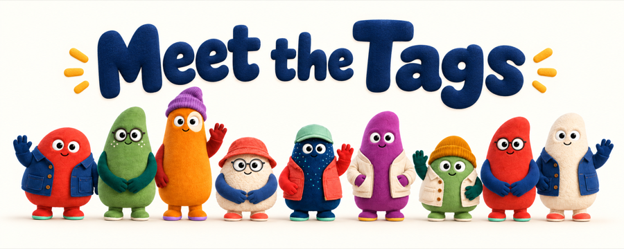

<div align="center">

<h1>
  
  SuperTag
</h1>

[English](../../README.md) · [中文](README.zh-CN.md) · [日本語](README.ja.md) · [한국어](README.ko.md) · [Español](README.es.md) · [Français](README.fr.md) · Português · [Türkçe](README.tr.md) · [Русский](README.ru.md)

**Atores de IA persistentes, proativos e multiplayer para o trabalho de engenharia.**

Open source e auto-hospedado, sobre os agentes de código que você já usa.

**Dê a eles um cargo, não tarefas.**

[Cargos, não tarefas](#give-them-jobs-not-tasks) · [Persistente](#persistent) · [Proativo](#proactive) · [Multiplayer](#multiplayer) · [Execute você mesmo](#run-it-yourself) · [Execute sua primeira Tag](#run-your-first-tag) · [Documentação](../../docs/README.md)

<p>
  
</p>

</div>

Uma **Tag** é um ator de IA persistente, com identidade, responsabilidades, permissões e histórico
de trabalho próprios. O cargo dela é formado por essas responsabilidades e pelos resultados que
entrega. Ela mantém o trabalho andando entre uma sessão e outra, age sem que ninguém peça e
trabalha com as Tags dos seus colegas. Quem escreve o código continuam sendo os seus agentes de
código: Claude Code, Codex, Cursor ou OpenCode.

<a name="give-them-jobs-not-tasks"></a>

## Dê a eles um cargo, não tarefas

Hoje você dá uma tarefa a um agente de código: um prompt, um diff, uma revisão e, depois, o próximo
prompt. Ele consegue investigar um bug, escrever a correção e rodar os testes. Mas é você quem
lembra o que aconteceu da última vez, percebe a próxima falha e decide o que vem a seguir. Quando o
trabalho é maior que uma tarefa, você vira o gerente de projeto: divide o trabalho, coloca um
agente de código em cada parte e leva o contexto de um para o outro.

Uma Tag, em vez disso, tem um cargo. Um cargo é formado pelas responsabilidades que a Tag mantém,
como manter a main verde, e pelos resultados que ela entrega, como migrar 12 serviços para
credenciais de curta duração.

| Uma tarefa | Um cargo |
| --- | --- |
| "Corrija este teste instável" | "Mantenha a main verde", além de entregar os resultados que você pedir |
| Começa quando você envia o prompt | Age quando o CI falha, um alerta dispara ou um colega pede |
| Termina quando o diff é mesclado | Continua, e lembra o que aprendeu |
| Você confere se funcionou | Ela traz as evidências: as verificações que rodou e o que confirmou |
| Qualquer sessão de agente de código pode assumi-la | Tem identidade, permissões e histórico próprios |

Cada resultado é um **Objective**. Ele registra as evidências que você vai usar para decidir quando
está pronto, além de quaisquer restrições, orçamento ou prazo que você definir. A Tag responsável
decide que trabalho iniciar, distribui partes dele entre as outras Tags do seu **Team**, revisa o
que volta e traz para você as conclusões, as branches e as decisões que dependem da sua aprovação.
Você orienta a Tag responsável; não precisa gerenciar os agentes de código dela.

Para migrar 12 serviços para credenciais de curta duração, entregue a `lead` o Objective da
migração. Ela coordena Tags que atualizam a política de confiança e o código dos serviços, revisam
testes e telemetria e ensaiam a virada. Você aprova as viradas em produção e decide quando
aposentar as chaves compartilhadas.

Dê a cada Tag um cargo e permissões próprios. Você pode deixar a coordenação com `lead`, dar a uma
Tag de desenvolvimento permissão para editar o repositório e dar a uma Tag de revisão acesso
somente leitura.

[Escreva um Objective](../../docs/guides/write-an-objective.md) · [Como você direciona o trabalho](../../docs/concepts/interaction-model.md)

## O que um cargo exige

Um cargo dura mais do que qualquer sessão, inclui trabalho que ninguém pediu ainda e envolve
outras pessoas. As Tags foram feitas para as três coisas.

<a name="persistent"></a>

### Persistente

Um cargo dura mais do que a sessão que o iniciou. Seus agentes de código fazem o trabalho de uma
Tag uma parte de cada vez, e a Tag é o que persiste entre as partes. A mesma Tag pode investigar o
problema de hoje, revisar os resultados amanhã e responder a perguntas sobre os dois na semana que
vem, mesmo que a próxima parte do trabalho rode em outro agente de código ou em outra máquina. Ela
consegue recuperar sozinha seus trabalhos e Objectives anteriores.

<a name="next-add-your-teams-chat"></a>

Fale com a mesma Tag a partir das ferramentas que você já usa. Converse com ela no terminal ou
adicione um canal do Slack, um repositório do GitHub ou uma equipe do Linear aos locais dela. Cada
conversa tem sua própria thread, e a mesma Tag mantém as responsabilidades que você atribuiu a ela.
[Conecte uma ferramenta de trabalho](../../docs/surfaces/README.md)

<a name="proactive"></a>

### Proativo

Faz parte de qualquer cargo perceber o que precisa ser feito. Dê a uma Tag uma responsabilidade
contínua, e ela trabalha para cumpri-la sem esperar que alguém peça.
Cada responsabilidade é um Objective contínuo, e responsabilidades relacionadas ficam com a mesma
Tag. Digamos que `reliability` mantenha seu serviço saudável. Ela é responsável por quatro
Objectives contínuos:

| Objective contínuo | Desperta com | Faz | Deixa para você |
| --- | --- | --- | --- |
| Triar erros de produção | Um erro novo ou reincidente no Sentry | Reproduz o erro, encontra a alteração que o causou e prepara uma correção com um teste que falha | Fazer o merge e o rollback |
| Monitorar o serviço | Um alerta do PagerDuty, do Datadog ou de um health check | Monta uma linha do tempo com os logs, os deploys recentes e o pico de erros, e prepara uma branch de revert | Fazer o rollback ou escalar |
| Manter a main verde | Uma execução de CI que falhou na main | Encontra o commit que quebrou o build, distingue um teste instável de uma falha real e prepara uma correção ou um revert | Fazer o merge e colocar testes em quarentena |
| Manter as dependências seguras | Um aviso de segurança do Dependabot ou do Snyk | Verifica se o projeto é afetado e prepara a atualização com os resultados dos testes | Atualizações de versão principal e o merge |

Quando o Sentry reporta um erro novo, `reliability` o assume dentro do primeiro Objective. Ela
decide se o erro importa, inicia o trabalho para reproduzi-lo e corrigi-lo e traz para você a
branch, o teste e qualquer decisão que caiba a você. Como uma única Tag cuida dos quatro, ela
consegue lembrar o que aprendeu nos outros, como o deploy com falha que analisou uma hora antes.
Quando não há nada a fazer, ela descansa até o próximo aviso, mensagem ou resultado. Execute-a em
um host sempre ligado, e ela mantém suas responsabilidades mesmo com o seu laptop desligado.

Dê um tipo diferente de responsabilidade a outra Tag quando ele exigir permissões diferentes. Uma
Tag `support` que faz a triagem de relatos de bugs pode ler o repositório e conversar com quem os
relatou sem poder preparar reverts.

Você escolhe quais eventos chegam a uma Tag e o que ela pode fazer em resposta. Encaminhe alertas
e avisos para um Objective pela API do Control Plane, ou mencione a Tag no Slack, no GitHub ou no
Linear.
[Configure uma responsabilidade contínua](../../docs/guides/ongoing-responsibilities.md)

<a name="multiplayer"></a>

### Multiplayer

Em uma equipe, os cargos se sobrepõem. Hospede você mesmo um Control Plane compartilhado, e sua
equipe passa a trabalhar com as Tags em conjunto. Cada colega direciona
Tags a partir do próprio terminal ou das ferramentas conectadas, e as conversas privadas no
terminal continuam privadas para cada pessoa. Uma pessoa pode perguntar a `reliability` sobre um
erro no Slack, e outra pode dar continuidade às mesmas conclusões no GitHub.

As Tags dos seus colegas se coordenam entre si sem envolver você. Quando a sua Tag precisa de algo
da Tag de um colega, ela manda uma mensagem diretamente para essa Tag. Elas acertam os detalhes
entre si e registram o que combinaram no Workstream compartilhado do Team. Você fica sabendo
quando a decisão é sua. As Tags podem rodar em agentes de código e máquinas diferentes: uma Tag no
seu laptop, com Claude Code, pode trabalhar com outra na máquina de um colega, com Codex, rumo ao
mesmo Objective.


[Como o multiplayer funciona](../../docs/concepts/multiplayer.md) · [Hospede o SuperTag você mesmo](../../docs/guides/self-hosting.md)

<a name="get-started"></a>

<a name="run-your-first-tag"></a>

## Execute sua primeira Tag

Em um Mac ou no Linux, instale o Git e o [Claude Code](https://code.claude.com/docs/en/setup)
ou o [Codex](https://developers.openai.com/codex/cli/), e faça login nele. No Claude Code, execute
`claude` e entre na sua conta. No Codex, faça login com `codex -c 'cli_auth_credentials_store="file"' login`,
que guarda o login em um arquivo que as Tasks do SuperTag conseguem usar; um `codex login` simples
no macOS o guarda no Keychain, que elas não conseguem acessar. O Claude Code também precisa do
Node.js; veja as versões em [requisitos e login](../../docs/operations/requirements.md).

[Instale o SuperTag](../../docs/operations/install.md) e, em seguida, execute isto a partir de um
repositório Git existente com pelo menos um commit.

```sh
curl -fsSL https://supertag.sh/install | sh
export PATH="$HOME/.local/bin:$PATH"
supertag init
supertag message lead "Read this repository and tell me what you would improve first."
```

`supertag init` verifica o login do seu agente de código, faz algumas perguntas e inicia o
SuperTag em segundo plano. Mantenha o nome padrão da Tag, `lead`. Ela trabalha neste repositório,
a partir do commit mais recente da branch em que você está. `supertag message` envia sua mensagem
para `lead` e exibe a resposta conforme ela chega.

Continue a mesma conversa com outro `supertag message lead`. Quando quiser entregar a ela parte de
um cargo, inicie um Objective assim.

```sh
supertag message lead "/goal Add a test for an uncovered edge case. Done when the new test and its suite pass. Ask me before changing application code."
```

Uma lead que usa o Codex roda os testes. Uma lead que usa o Claude Code, configurada sem Docker e
sem a opção explícita de rodar fora de sandbox, lê e edita arquivos, mas não executa comandos; por
isso, ela informa essa condição como não verificada. Veja
[Permita que a lead execute comandos](../../docs/operations/cli.md#let-the-lead-run-commands).

`supertag get inbox-item` lista as perguntas que a Tag faz a você; responda a uma delas com
`supertag question answer TASK_ID "..."`. Quando o Objective estiver pronto, `supertag status` o
mostra como `review`. Cada alteração entregue chega ao seu
repositório como uma branch `supertag/session/...`. Revise-a e, então, aprove o Objective ou peça
uma revisão:

```sh
supertag describe objective OBJECTIVE_ID
supertag objective review OBJECTIVE_ID approve
supertag objective review OBJECTIVE_ID request-changes --feedback "Also cover the empty case."
```

Prefere uma janela ao terminal? Em um Mac (Apple silicon ou Intel) ou no Linux, [instale o aplicativo desktop](../../docs/operations/install.md#install-the-desktop-app):
ele traz seu próprio `supertag`, configura o SuperTag na primeira abertura e conversa com as mesmas Tags.

[Opções de instalação](../../docs/operations/install.md) · [Converse com uma Tag](../../docs/guides/talk-to-a-tag.md) · [Execute seu primeiro Team](../../docs/guides/first-team.md) · [Direcione o SuperTag a partir do seu agente de código](../../docs/guides/coding-agent-operator.md)

<a name="run-it-yourself"></a>

## Execute você mesmo

O SuperTag é open source sob a licença Apache 2.0, e cada parte dele roda onde você escolher. Um
cargo precisa de acesso ao seu código, aos seus serviços e às suas contas; por isso, é você quem
decide onde esse acesso fica.


- **Suas máquinas.** `supertag init` inicia um **Control Plane** local, o serviço que armazena
  suas Tags e agenda o trabalho delas, e conecta seu computador como um **Worker Host**, uma
  máquina ou sandbox que executa o trabalho. Quando sua equipe entrar, implante o Control Plane
  onde todos consigam acessá-lo e conecte laptops, servidores, runners de CI ou sandboxes do Modal
  e do E2B como Worker Hosts. Mantenha em um host sempre ligado as Tags com responsabilidade
  contínua, como `reliability`.
- **Seus agentes de código e modelos.** Cada Tag roda no agente de código e no modelo que você
  escolher, autenticada com a sua própria conta ou chave.
- **Seus limites.** Cada Tag só pode fazer o que suas permissões autorizam, e você escolhe quais
  ações aguardam a sua aprovação. O Codex executa comandos em seu próprio sandbox, e o Claude Code,
  o Cursor e o OpenCode podem executar os deles em contêineres locais. Uma Tag só alcança os
  endereços de rede que você liberar. No Codex e em contêineres, o host da Tag adiciona
  credenciais, como um token do Sentry, às requisições permitidas, de modo que os comandos da Tag
  nunca as veem.

[Hospede o SuperTag você mesmo](../../docs/guides/self-hosting.md) · [Conecte um Worker Host](../../docs/guides/workers.md) · [Defina permissões e aprovações](../../docs/concepts/context-and-permissions.md) · [Veja como as partes se encaixam](../../docs/concepts/how-it-works.md)

## Funciona com

| | Opções |
| --- | --- |
| **Agentes de código** | Claude Code · Codex · Cursor · OpenCode · OpenAI Agents · [seu próprio adaptador de harness](../../docs/guides/harness-adapters.md) |
| **Onde você conversa com as Tags** | Terminal · [Slack](../../docs/surfaces/slack.md) · [GitHub](../../docs/surfaces/github.md) · [Linear](../../docs/surfaces/linear.md) · [Lark/Feishu](../../docs/surfaces/lark.md) · [Microsoft Teams](../../docs/surfaces/teams.md) |
| **Onde o trabalho roda** | Laptops · servidores · runners de CI · [sandboxes do Modal e do E2B](../../docs/guides/workers.md#run-a-harness-in-a-sandbox) |

## Quando escolher o SuperTag

| Em comparação com | No que são bons | O que falta | O que o SuperTag acrescenta |
| --- | --- | --- | --- |
| **Agentes de código** · [Claude Code](https://code.claude.com/docs/en/overview), [Codex](https://learn.chatgpt.com/docs/codex/cli), [OpenCode](https://opencode.ai/docs/) | Escrever, corrigir e testar código enquanto você trabalha com eles. | Quando você fecha o chat, o trabalho para. Cabe a você lembrar o objetivo e iniciar o próximo passo. | **O trabalho continua.** Uma Tag lembra o objetivo e coloca, ela mesma, um agente de código no próximo passo. Também reage a novos erros e alertas sem que você peça. Quem escreve o código continuam sendo os seus agentes de código. |
| **Ferramentas de agentes em paralelo** · [Paradev (antigo Superset)](https://docs.paradev.com/recipes/parallel-workstreams), [Conductor](https://www.conductor.build/docs/concepts/parallel-agents) ([sendo descontinuado](https://www.conductor.build/announcement)) | Rodar vários agentes de código ao mesmo tempo e mostrar a você todas as alterações. | Ainda é você quem decide no que cada agente trabalha e confere se os resultados se encaixam. | **Alguém gerencia os agentes por você.** Diga a uma Tag o que você quer pronto e como verificar. Ela distribui as partes, confere se elas se encaixam e envia os resultados a você. |
| **Projetos de agentes** · [Cursor Projects](https://cursor.com/docs/agent/projects), [Claude Code Projects](https://code.claude.com/docs/en/claude-projects), [GitHub Copilot Projects](https://docs.github.com/en/copilot/how-tos/github-copilot-app/working-with-projects) | Vários agentes trabalhando rumo a um mesmo objetivo por semanas ou meses. No Cursor, colegas podem entrar no mesmo projeto. | Cada projeto roda os agentes de uma única empresa, quase sempre na nuvem dessa empresa. | **Misture agentes de código e máquinas.** Sua Tag pode rodar no Claude Code no seu laptop enquanto a de um colega roda no Codex no dele, e mesmo assim elas trabalham juntas. |
| **Colegas de IA hospedados** · [Devin Bots](https://devin.ai/blog/introducing-devin-bots), [OpenAI dots](https://openai.com/index/introducing-dots/), [Grok Bot](https://x.ai/news/introducing-grok-bot) | Um assistente de IA sempre disponível, que lembra trabalhos anteriores e age por conta própria. | Ele roda nos modelos e nos computadores em nuvem da empresa, segundo as regras dela. | **Execute você mesmo.** As Tags usam os agentes de código pelos quais você já paga, rodam nas suas próprias máquinas e só podem fazer o que você permitir. |
| **Agentes auto-hospedados** · [OpenClaw](https://docs.openclaw.ai/concepts/multi-agent), [Hermes Agent](https://hermes-agent.nousresearch.com/docs/user-guide/features/kanban) | Rodar seus próprios agentes de IA, com ferramentas e memória próprias, para qualquer tipo de tarefa. | São assistentes de uso geral. Não foram construídos em torno dos seus agentes de código, da revisão de código nem da verificação de que o trabalho de engenharia foi concluído. | **Feito para o trabalho de engenharia.** As Tags rodam no Claude Code, no Codex, no Cursor ou no OpenCode. As alterações de código voltam como branches para a sua revisão, e cada resultado vem com uma forma de verificar que está pronto. |

[Veja como o SuperTag se encaixa com outros sistemas de agentes](../../docs/concepts/supertag-and-other-agent-systems.md).

## Construa sobre o SuperTag

Use a mesma infraestrutura para dar atores persistentes à sua própria aplicação. A API gRPC do
Control Plane permite que sua aplicação crie e direcione Tags, envie trabalho a elas e acompanhe
o progresso. Por exemplo, você pode encaminhar erros do Sentry para uma Tag `reliability` e exibir
as branches e os resultados de testes dela na sua própria interface de revisão. Os bindings
gerados para Go, TypeScript e Python acompanham o repositório. [Explore a API](../../docs/reference/control-plane-api.md)

Para trazer seu próprio sistema de execução, escreva um **adaptador de harness**: um programa que
o Worker de cada Task Attempt inicia e que conduz seu agente pelo protocolo de harness.
Os adaptadores de Python e TypeScript que já vêm incluídos servem de exemplos funcionais para
consulta.

O SDK de TypeScript, `supertag-ai` no npm, e o SDK de Python, `supertag` no PyPI, conectam uma
aplicação ao SuperTag e um adaptador de harness ao **Worker**, o processo que o iniciou para a sua Task Attempt:

```sh
npm install supertag-ai
python -m pip install 'supertag==0.3.10'
```

[Escreva um adaptador de harness](../../docs/guides/harness-adapters.md) · [Conecte sua própria superfície de colaboração](../../docs/reference/connector-contract.md) · [Confira a estabilidade da API](../../docs/reference/api-stability.md)

## Perguntas frequentes

**O que uma Tag pode fazer sem me perguntar?** Somente o que as permissões dela autorizam. Você
decide quais ações precisam da sua aprovação antes. As alterações no repositório sempre voltam como
branches para você revisar, e o merge continua com você.
[Defina permissões e aprovações](../../docs/concepts/context-and-permissions.md)

**Como eu controlo as alterações no meu repositório?** Defina o que cada Tag tem permissão para
fazer. O trabalho no repositório acontece em um checkout separado, fixado em um commit, e volta
como uma branch que você pode revisar.
[Trabalhe com branches do repositório](../../docs/guides/workspaces.md)

**Preciso de um servidor?** Você pode iniciar o Control Plane e executar o trabalho no seu laptop.
Para acesso compartilhado, ou para trabalho que deve continuar disponível com o laptop desligado,
implante o Control Plane e conecte um Worker Host que fique online. [Hospede o SuperTag você mesmo](../../docs/guides/self-hosting.md)

## Contribuição e licença

Veja o [guia de contribuição](../../CONTRIBUTING.md) para a configuração do repositório e as
verificações. O SuperTag é licenciado sob a [Apache 2.0](../../LICENSE).
