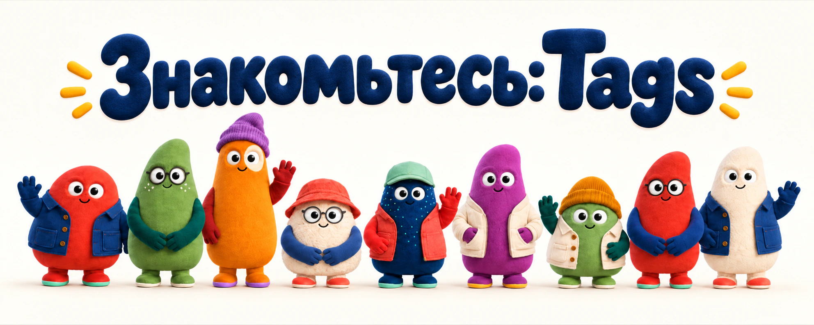

<div align="center">

<h1>
  
  SuperTag
</h1>

[English](../../README.md) · [中文](README.zh-CN.md) · [日本語](README.ja.md) · [한국어](README.ko.md) · [Español](README.es.md) · [Français](README.fr.md) · [Português](README.pt.md) · [Türkçe](README.tr.md) · Русский

**Долгоживущие, проактивные, многопользовательские ИИ-акторы для инженерной работы.**

Открытый код и собственный хостинг — поверх кодинг-агентов, которыми вы уже пользуетесь.

**Поручайте им работу, а не задачи.**

[Работа, а не задачи](#give-them-jobs-not-tasks) · [Долгоживущие](#persistent) · [Проактивные](#proactive) · [Многопользовательские](#multiplayer) · [Всё на вашей стороне](#run-it-yourself) · [Запустите первый Tag](#run-your-first-tag) · [Документация](../../docs/README.md)

<p>
  
</p>

</div>

**Tag** — это долгоживущий ИИ-актор со своей идентичностью, обязанностями, правами и историей
работы. Его работа складывается из этих обязанностей и результатов, которых он добивается. Он
продолжает дело между сессиями, действует, не дожидаясь просьбы, и взаимодействует с Tags ваших
коллег. Код по-прежнему пишут ваши кодинг-агенты: Claude Code, Codex, Cursor или OpenCode.

<a name="give-them-jobs-not-tasks"></a>

## Поручайте им работу, а не задачи

Сегодня вы даёте кодинг-агенту задачу: промпт, дифф, ревью, затем следующий промпт. Он может
разобраться в баге, написать исправление и прогнать тесты. Но помнить, что было в прошлый раз,
замечать следующий сбой и решать, что делать дальше, приходится вам. А когда работа не
укладывается в одну задачу, вы становитесь её менеджером проекта: делите работу на части,
запускаете кодинг-агента на каждую и переносите контекст от одного к другому.

У Tag вместо этого есть работа. Она состоит из обязанностей, которые Tag выполняет постоянно
(например, держать main зелёным), и результатов, которых он добивается (например, перевести 12
сервисов на короткоживущие учётные данные).

| Задача | Работа |
| --- | --- |
| «Почини этот нестабильный тест» | «Держи main зелёным» плюс результаты, которые вы от него ждёте |
| Начинается, когда вы отправляете промпт | Действует, когда падает CI, срабатывает алерт или обращается коллега |
| Заканчивается, когда дифф влит | Продолжается и помнит, чему научилась |
| Вы сами проверяете, получилось ли | Приносит доказательства: какие проверки запускались и что подтверждено |
| Её может взять любая сессия кодинг-агента | Имеет собственную идентичность, права и историю |

Каждый результат — это **Objective**. В нём записано, по каким доказательствам вы решите, что он
достигнут, а также заданные вами ограничения, бюджет и срок. Tag-владелец решает, какую работу
начать, раздаёт её части другим Tags своей **Team**, проверяет то, что они вернули, и приносит вам
выводы, ветки и решения, которым нужно ваше одобрение. Вы направляете Tag-владельца, а не
управляете его кодинг-агентами.

Чтобы перевести 12 сервисов на короткоживущие учётные данные, поручите Tag `lead` Objective на
эту миграцию. Он координирует Tags, которые обновляют политики доверия и код сервисов, проверяют
тесты и телеметрию и репетируют переключение. Вы одобряете переключения в продакшене и решаете,
когда отозвать общие ключи.

Дайте каждому Tag свою работу и свои права. Например, `lead` может координировать, исполнитель —
получить право изменять репозиторий, а ревьюер — доступ только на чтение.

[Как написать Objective](../../docs/guides/write-an-objective.md) · [Как вы направляете работу](../../docs/concepts/interaction-model.md)

## Что нужно для работы

Работа длится дольше любой отдельной сессии, включает дела, о которых ещё никто не просил, и
затрагивает других людей. Tags рассчитаны на всё это.

<a name="persistent"></a>

### Долгоживущие

Работа переживает сессию, в которой началась. Ваши кодинг-агенты выполняют работу Tag по частям,
а сам Tag — то, что сохраняется между этими частями. Один и тот же Tag может сегодня разобраться
в проблеме, завтра проверить результаты, а через неделю ответить на вопросы и о том, и о другом —
даже если следующая часть работы выполняется на другом кодинг-агенте или другой машине. Свою
прежнюю работу и Objectives он вспоминает сам.

<a name="next-add-your-teams-chat"></a>

Обращайтесь к одному и тому же Tag из привычных инструментов. Пишите ему в терминале или добавьте
в его площадки канал Slack, репозиторий GitHub или команду Linear. У каждого разговора свой тред,
а Tag остаётся тем же и сохраняет порученные ему обязанности. [Подключите рабочий инструмент](../../docs/surfaces/README.md)

<a name="proactive"></a>

### Проактивные

Часть любой работы — замечать, что нужно сделать. Поручите Tag постоянную обязанность, и он будет
выполнять её, не дожидаясь просьбы.
Каждая обязанность — это бессрочный Objective, а связанные обязанности принадлежат одному Tag.
Допустим, `reliability` следит за здоровьем вашего сервиса. У него четыре бессрочных Objective:

| Бессрочный Objective | Что его будит | Что делает | Что оставляет вам |
| --- | --- | --- | --- |
| Разбирать ошибки в продакшене | Новая или вернувшаяся ошибка в Sentry | Воспроизводит её, находит вызвавшее её изменение и готовит исправление с падающим тестом | Слияние и откат |
| Следить за сервисом | Алерт PagerDuty, Datadog или проверки работоспособности | Собирает хронологию по логам, недавним деплоям и всплеску ошибок и готовит ветку с откатом | Откат или эскалацию |
| Держать main зелёным | Упавший запуск CI на main | Находит коммит, сломавший сборку, отличает нестабильный тест от настоящего сбоя и готовит исправление или откат | Слияние и вывод тестов в карантин |
| Следить за безопасностью зависимостей | Уведомление Dependabot или Snyk | Проверяет, затронут ли проект, и готовит обновление с результатами тестов | Мажорные обновления и слияние |

Когда Sentry сообщает о новой ошибке, `reliability` берётся за неё в рамках первого Objective. Он
решает, важна ли ошибка, запускает работу по её воспроизведению и исправлению и приносит вам
ветку, тест и те решения, которые остаются за вами. Поскольку все четыре Objective ведёт один
Tag, он может вспомнить то, что узнал в рамках остальных, — например, неудачный деплой, который
разбирал часом раньше. Когда делать нечего, он отдыхает до следующего отчёта, сообщения или
результата. Запустите его на постоянно работающем хосте, и он продолжит выполнять обязанности,
пока ваш ноутбук выключен.

Обязанность другого рода, которой нужны другие права, поручите другому Tag. Tag `support`,
который разбирает сообщения о багах, может читать репозиторий и общаться с их авторами, но
готовить откаты не может.

Вы выбираете, какие события доходят до Tag и что ему разрешено делать в ответ. Пересылайте алерты
и отчёты в Objective через API Control Plane или упомяните Tag в Slack, GitHub или Linear.
[Настройте постоянную обязанность](../../docs/guides/ongoing-responsibilities.md)

<a name="multiplayer"></a>

### Многопользовательские

В команде зоны ответственности пересекаются. Разверните у себя один общий Control Plane, и вся
команда будет работать с Tags вместе. Каждый участник направляет
Tags из своего терминала или подключённых инструментов, а личные разговоры в терминале остаются
личными. Один человек может спросить `reliability` об ошибке в Slack, а другой — продолжить
обсуждение тех же выводов на GitHub.

Tags ваших коллег договариваются между собой без вашего участия. Когда вашему Tag что-то нужно от
Tag коллеги, он пишет ему напрямую. Они сами согласуют детали и записывают договорённости в общий
Workstream своей Team. Вы узнаёте об этом, когда решение остаётся за вами. Tags могут работать на
разных кодинг-агентах и машинах, поэтому
Tag на вашем ноутбуке с Claude Code может идти к одному Objective вместе с Tag на машине коллеги
с Codex.


[Как устроена совместная работа](../../docs/concepts/multiplayer.md) · [Разверните SuperTag у себя](../../docs/guides/self-hosting.md)

<a name="get-started"></a>

<a name="run-your-first-tag"></a>

## Запустите первый Tag

На Mac или Linux установите Git и [Claude Code](https://code.claude.com/docs/en/setup)
или [Codex](https://developers.openai.com/codex/cli/) и войдите в аккаунт. Для Claude Code
запустите `claude` и авторизуйтесь. Для Codex войдите командой `codex -c 'cli_auth_credentials_store="file"' login`:
она сохраняет данные входа в файле, доступном для Tasks SuperTag, тогда как обычный `codex login`
на macOS кладёт их в Keychain, куда им доступа нет. Для Claude Code нужен ещё и Node.js; версии
указаны в разделе [требования и вход](../../docs/operations/requirements.md).

[Установите SuperTag](../../docs/operations/install.md), затем выполните эти команды в существующем
Git-репозитории, где есть хотя бы один коммит.

```sh
curl -fsSL https://supertag.sh/install | sh
export PATH="$HOME/.local/bin:$PATH"
supertag init
supertag message lead "Read this repository and tell me what you would improve first."
```

`supertag init` проверяет вход в вашем кодинг-агенте, задаёт несколько вопросов и запускает
SuperTag в фоне. Оставьте имя Tag по умолчанию — `lead`. Он работает в этом репозитории, начиная
с последнего коммита текущей ветки. `supertag message` отправляет ваше сообщение Tag
`lead` и выводит ответ по мере поступления.

Чтобы продолжить тот же разговор, снова вызовите `supertag message lead`. Когда будете готовы
доверить ему часть работы, создайте Objective, например так.

```sh
supertag message lead "/goal Add a test for an uncovered edge case. Done when the new test and its suite pass. Ask me before changing application code."
```

Lead на Codex запускает тесты. Lead на Claude Code, настроенный без Docker и без явного согласия
на работу вне песочницы, читает и правит файлы, но команд не выполняет, поэтому не может
запустить тесты и отмечает условие «Done when» как непроверенное; см.
[Как разрешить lead выполнять команды](../../docs/operations/cli.md#let-the-lead-run-commands).

`supertag get inbox-item` показывает вопросы, которые Tag задаёт вам; ответить на вопрос можно
командой `supertag question answer TASK_ID "..."`. Когда Objective готов, `supertag status`
показывает его в состоянии `review`. Каждое готовое изменение попадает в ваш
репозиторий в виде ветки `supertag/session/...`. Просмотрите её, а затем одобрите Objective или
попросите доработать:

```sh
supertag describe objective OBJECTIVE_ID
supertag objective review OBJECTIVE_ID approve
supertag objective review OBJECTIVE_ID request-changes --feedback "Also cover the empty case."
```

Окно удобнее терминала? На Mac (Apple silicon или Intel) или Linux [установите десктопное приложение](../../docs/operations/install.md#install-the-desktop-app):
в него встроен собственный `supertag`, оно настраивает SuperTag при первом запуске и работает с теми же Tags.

[Варианты установки](../../docs/operations/install.md) · [Как общаться с Tag](../../docs/guides/talk-to-a-tag.md) · [Запустите первую Team](../../docs/guides/first-team.md) · [Управляйте SuperTag из своего кодинг-агента](../../docs/guides/coding-agent-operator.md)

<a name="run-it-yourself"></a>

## Всё на вашей стороне

SuperTag — открытый проект под лицензией Apache 2.0, и каждая его часть работает там, где вы
решите. Для работы нужен доступ к вашему коду, сервисам и аккаунтам, поэтому вы сами
определяете, где этот доступ находится.


- **Ваши машины.** `supertag init` запускает локальный **Control Plane** — сервис, который хранит
  ваши Tags и планирует их работу, — и подключает ваш компьютер как **Worker Host**, то есть
  машину или песочницу, где выполняется работа. Когда присоединится команда, разверните
  Control Plane там, где он доступен всем, и подключите как Worker Host ноутбуки, серверы,
  CI-раннеры или песочницы Modal и E2B. Tag с постоянной обязанностью, например `reliability`, держите на
  постоянно работающем хосте.
- **Ваши кодинг-агенты и модели.** Каждый Tag работает на выбранных вами кодинг-агенте и модели,
  со входом под вашим аккаунтом или ключом.
- **Ваши границы.** Каждый Tag может делать только то, что разрешают его права, и вы выбираете,
  какие действия ждут вашего одобрения. Codex выполняет команды в собственной песочнице, а
  Claude Code, Cursor и OpenCode могут выполнять свои в локальных контейнерах. Tag обращается
  только к тем сетевым адресам, которые вы разрешили. На Codex и в контейнерах учётные данные, например
  токен Sentry, добавляет к разрешённым запросам хост, так что команды Tag их никогда не видят.

[Разверните SuperTag у себя](../../docs/guides/self-hosting.md) · [Подключите Worker Host](../../docs/guides/workers.md) · [Настройте права и одобрения](../../docs/concepts/context-and-permissions.md) · [Как части связаны между собой](../../docs/concepts/how-it-works.md)

## С чем работает

| | Варианты |
| --- | --- |
| **Кодинг-агенты** | Claude Code · Codex · Cursor · OpenCode · OpenAI Agents · [ваш собственный harness-адаптер](../../docs/guides/harness-adapters.md) |
| **Где вы общаетесь с Tags** | Терминал · [Slack](../../docs/surfaces/slack.md) · [GitHub](../../docs/surfaces/github.md) · [Linear](../../docs/surfaces/linear.md) · [Lark/Feishu](../../docs/surfaces/lark.md) · [Microsoft Teams](../../docs/surfaces/teams.md) |
| **Где выполняется работа** | Ноутбуки · серверы · CI-раннеры · [песочницы Modal и E2B](../../docs/guides/workers.md#run-a-harness-in-a-sandbox) |

## Когда выбирать SuperTag

| С чем сравниваем | В чём сильны | Чего не хватает | Что добавляет SuperTag |
| --- | --- | --- | --- |
| **Кодинг-агенты** · [Claude Code](https://code.claude.com/docs/en/overview), [Codex](https://learn.chatgpt.com/docs/codex/cli), [OpenCode](https://opencode.ai/docs/) | Пишут, исправляют и тестируют код, пока вы с ними работаете. | Закрыли чат — работа остановилась. Помнить цель и запускать следующий шаг приходится вам. | **Работа не останавливается.** Tag помнит цель и сам ставит кодинг-агента на следующий шаг. Он также реагирует на новые ошибки и алерты без вашей просьбы. Код по-прежнему пишут ваши кодинг-агенты. |
| **Инструменты для параллельных агентов** · [Paradev (бывший Superset)](https://docs.paradev.com/recipes/parallel-workstreams), [Conductor](https://www.conductor.build/docs/concepts/parallel-agents) ([сворачивается](https://www.conductor.build/announcement)) | Запускают несколько кодинг-агентов одновременно и показывают вам все изменения. | Вы по-прежнему решаете, чем занят каждый агент, и проверяете, что результаты согласуются между собой. | **Агентами управляет кто-то другой.** Скажите Tag, что нужно сделать и как это проверить. Он раздаст части, убедится, что они согласуются, и пришлёт вам результаты. |
| **Агентные проекты** · [Cursor Projects](https://cursor.com/docs/agent/projects), [Claude Code Projects](https://code.claude.com/docs/en/claude-projects), [GitHub Copilot Projects](https://docs.github.com/en/copilot/how-tos/github-copilot-app/working-with-projects) | Несколько агентов неделями или месяцами идут к одной цели. В Cursor к проекту могут подключаться коллеги. | В каждом проекте работают агенты одной компании, в основном в её же облаке. | **Сочетайте разных кодинг-агентов и разные машины.** Ваш Tag может работать на Claude Code на вашем ноутбуке, а Tag коллеги — на Codex на его машине, и они всё равно работают вместе. |
| **Облачные ИИ-коллеги** · [Devin Bots](https://devin.ai/blog/introducing-devin-bots), [OpenAI dots](https://openai.com/index/introducing-dots/), [Grok Bot](https://x.ai/news/introducing-grok-bot) | ИИ-помощник, который всегда на связи, помнит прошлую работу и действует самостоятельно. | Работает на моделях и облачных машинах компании-поставщика и по её правилам. | **Всё на вашей стороне.** Tags используют кодинг-агентов, за которых вы уже платите, работают на ваших машинах и могут делать только то, что вы разрешили. |
| **Агенты на собственном хостинге** · [OpenClaw](https://docs.openclaw.ai/concepts/multi-agent), [Hermes Agent](https://hermes-agent.nousresearch.com/docs/user-guide/features/kanban) | Позволяют запускать собственных ИИ-агентов со своими инструментами и памятью для любых задач. | Это ассистенты общего назначения. Они не строятся вокруг ваших кодинг-агентов, код-ревью и проверки того, что инженерная работа выполнена. | **Созданы для инженерной работы.** Tags работают на Claude Code, Codex, Cursor или OpenCode. Изменения кода возвращаются ветками вам на ревью, а к каждому результату прилагается способ проверить, что он достигнут. |

[Как SuperTag соотносится с другими агентными системами](../../docs/concepts/supertag-and-other-agent-systems.md).

## Стройте на SuperTag

Та же инфраструктура даст долгоживущих акторов вашему собственному приложению. Через gRPC API
Control Plane приложение может создавать Tags и направлять их, отправлять им работу и следить за
её ходом. Например, можно пересылать ошибки Sentry Tag `reliability` и показывать его ветки и
результаты тестов в собственном интерфейсе ревью. Сгенерированные привязки для Go, TypeScript и
Python поставляются вместе с репозиторием. [Изучите API](../../docs/reference/control-plane-api.md)

Чтобы подключить собственную систему выполнения, напишите **harness-адаптер** — программу,
которую запускает Worker каждого Task Attempt и которая управляет вашим агентом по
harness-протоколу. Встроенные адаптеры на Python и TypeScript — рабочие примеры, которые стоит
прочитать.

TypeScript SDK (`supertag-ai` в npm) и Python SDK (`supertag` в PyPI) связывают приложение с
SuperTag, а harness-адаптер — с **Worker**, процессом, который запустил его для своего Task Attempt:

```sh
npm install supertag-ai
python -m pip install 'supertag==0.3.12'
```

[Напишите harness-адаптер](../../docs/guides/harness-adapters.md) · [Подключите собственную площадку для совместной работы](../../docs/reference/connector-contract.md) · [Проверьте стабильность API](../../docs/reference/api-stability.md)

## Частые вопросы

**Что Tag может делать, не спрашивая меня?** Только то, что разрешают его права. Вы решаете,
какие действия требуют вашего предварительного одобрения. Изменения в репозитории всегда
возвращаются ветками вам на ревью, а слияние остаётся за вами.
[Настройте права и одобрения](../../docs/concepts/context-and-permissions.md)

**Как контролировать изменения в моём репозитории?** Задайте, что разрешено каждому Tag. Работа с
репозиторием идёт в отдельной рабочей копии, закреплённой на конкретном коммите, и возвращается
веткой, которую вы можете просмотреть.
[Работа с ветками репозитория](../../docs/guides/workspaces.md)

**Нужен ли мне сервер?** Запустить Control Plane и выполнять работу можно на ноутбуке. Для общего
доступа или работы, которая должна продолжаться при выключенном ноутбуке, разверните Control Plane
и подключите Worker Host, который всегда в сети. [Разверните SuperTag у себя](../../docs/guides/self-hosting.md)

## Участие в разработке и лицензия

Настройка репозитория и проверки описаны в [руководстве для контрибьюторов](../../CONTRIBUTING.md).
SuperTag распространяется под лицензией [Apache 2.0](../../LICENSE).
