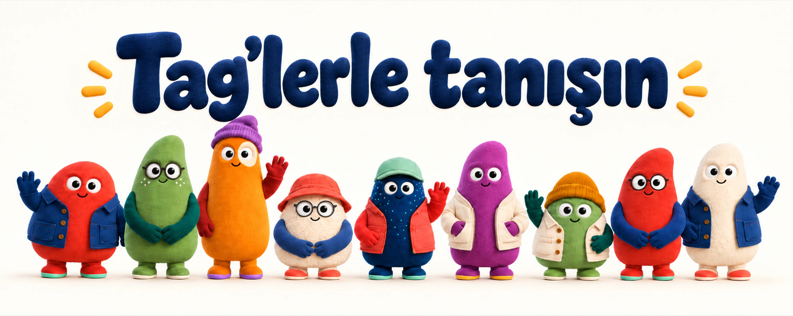

<div align="center">

<h1>
  
  SuperTag
</h1>

[English](../../README.md) · [中文](README.zh-CN.md) · [日本語](README.ja.md) · [한국어](README.ko.md) · [Español](README.es.md) · [Français](README.fr.md) · [Português](README.pt.md) · Türkçe · [Русский](README.ru.md)

**Mühendislik işleri için kalıcı, proaktif, çok kullanıcılı yapay zekâ aktörleri.**

Açık kaynak, kendi altyapınızda, zaten kullandığınız kodlama ajanlarının üzerinde çalışır.

**Onlara görev değil, iş verin.**

[Görev değil, iş](#give-them-jobs-not-tasks) · [Kalıcı](#persistent) · [Proaktif](#proactive) · [Çok kullanıcılı](#multiplayer) · [Kendiniz çalıştırın](#run-it-yourself) · [İlk Tag'inizi çalıştırın](#run-your-first-tag) · [Dokümantasyon](../../docs/README.md)

<p>
  
</p>

</div>

Bir **Tag**; kendi kimliği, sorumlulukları, izinleri ve iş geçmişi olan kalıcı bir yapay zekâ
aktörüdür. İşi, bu sorumluluklardan ve ortaya koyduğu sonuçlardan oluşur. Oturumlar arasında işi
sürdürür, kimse istemeden harekete geçer ve ekip arkadaşlarınızın Tag'leriyle birlikte çalışır.
Kodu yine kodlama ajanlarınız yazar: Claude Code, Codex, Cursor veya OpenCode.

<a name="give-them-jobs-not-tasks"></a>

## Onlara görev değil, iş verin

Bugün bir kodlama ajanına görev veriyorsunuz: bir istem, bir diff, bir inceleme, ardından sıradaki
istem. Ajan bir hatayı araştırabilir, düzeltmeyi yazabilir, testleri çalıştırabilir. Ama geçen
sefer ne olduğunu hatırlayan, bir sonraki arızayı fark eden ve sırada ne olacağına karar veren
sizsiniz. İş tek bir görevi aştığında da proje yöneticisine dönüşürsünüz: işi parçalara böler, her
parça için bir kodlama ajanı başlatır, bağlamı aralarında siz taşırsınız.

Tag'in ise bir işi vardır. İş, Tag'in sürdürdüğü sorumluluklardan (örneğin main'i yeşil tutmak)
ve ortaya koyduğu sonuçlardan (örneğin 12 servisi kısa ömürlü kimlik bilgilerine geçirmek) oluşur.

| Görev | İş |
| --- | --- |
| "Bu kararsız testi düzelt" | "main'i yeşil tut" ve verdiğiniz sonuçları teslim et |
| Siz istem yazınca başlar | CI başarısız olduğunda, bir alarm çaldığında veya bir ekip arkadaşı istediğinde harekete geçer |
| Diff birleştirilince biter | Sürer ve öğrendiklerini hatırlar |
| İşe yarayıp yaramadığını siz kontrol edersiniz | Kanıtı kendisi getirir: çalıştırdığı kontroller ve doğruladıkları |
| Herhangi bir kodlama ajanı oturumu üstlenebilir | Kendi kimliği, izinleri ve geçmişi vardır |

Her sonuç bir **Objective**'dir. Bittiğine karar verirken bakacağınız kanıtı ve koyduğunuz
kısıtları, bütçeyi veya son tarihi kaydeder. Sahibi olan Tag hangi işin başlatılacağına karar
verir, parçaları **Team**'indeki diğer Tag'lere dağıtır, geri geleni inceler ve size bulguları,
dalları ve onayınızı bekleyen kararları getirir. Siz sahibi olan Tag'i yönlendirirsiniz; onun
kodlama ajanlarını yönetmezsiniz.

12 servisi kısa ömürlü kimlik bilgilerine geçirmek için geçiş Objective'ini `lead`'e verin. O da
güven politikasını ve servis kodunu güncelleyen, testleri ve telemetriyi inceleyen, geçişin
provasını yapan Tag'leri koordine eder. Üretim geçişlerini siz onaylar, paylaşılan anahtarların ne
zaman emekliye ayrılacağına siz karar verirsiniz.

Her Tag'e kendi işini ve izinlerini verin. Örneğin koordinasyonu `lead`'e bırakabilir, bir
geliştirici Tag'e depoyu düzenleme izni, bir inceleyici Tag'e ise salt okunur erişim
verebilirsiniz.

[Objective yazın](../../docs/guides/write-an-objective.md) · [İşi nasıl yönlendirirsiniz](../../docs/concepts/interaction-model.md)

## Bir iş neye ihtiyaç duyar

Bir iş tek bir oturumdan uzun sürer, henüz kimsenin istemediği işleri de kapsar ve başka insanları
içerir. Tag'ler bu üçü için tasarlandı.

<a name="persistent"></a>

### Kalıcı

Bir iş, onu başlatan oturumdan uzun yaşar. Kodlama ajanlarınız bir Tag'in işini parça parça yapar;
parçalar arasında kalıcı olan ise Tag'dir. Aynı Tag bugünkü sorunu araştırabilir, yarın sonuçları
inceleyebilir ve gelecek hafta ikisi hakkındaki soruları yanıtlayabilir; sıradaki parça başka bir
kodlama ajanında veya makinede çalışsa bile. Önceki işlerini ve Objective'lerini kendiliğinden
hatırlar.

<a name="next-add-your-teams-chat"></a>

Aynı Tag'e kullandığınız araçlardan ulaşın. Onunla terminalde konuşun ya da konumlarına bir Slack
kanalı, GitHub deposu veya Linear ekibi ekleyin. Her konuşmanın kendi akışı olur ve aynı Tag ona
verdiğiniz sorumlulukları taşımayı sürdürür. [Bir iş aracı bağlayın](../../docs/surfaces/README.md)

<a name="proactive"></a>

### Proaktif

Her işin bir parçası, yapılması gerekeni fark etmektir. Bir Tag'e süregelen bir sorumluluk verin;
kendisine söylenmesini beklemeden onu yerine getirmek için çalışır.
Her sorumluluk süregelen bir Objective'dir ve birbiriyle ilişkili sorumluluklar aynı Tag'e aittir.
Diyelim ki `reliability` servisinizi sağlıklı tutuyor. Dört süregelen Objective'in sahibidir:

| Süregelen Objective | Ne zaman uyanır | Ne yapar | Size ne bırakır |
| --- | --- | --- | --- |
| Üretim hatalarını önceliklendir | Yeni veya yeniden ortaya çıkan bir Sentry sorunu | Hatayı yeniden üretir, ona yol açan değişikliği bulur ve başarısız olan bir testle birlikte bir düzeltme hazırlar | Birleştirme ve geri alma |
| Servisi izle | Bir PagerDuty, Datadog veya sağlık kontrolü alarmı | Günlüklerden, son dağıtımlardan ve hata artışından bir zaman çizelgesi çıkarır ve bir geri alma dalı hazırlar | Geri alma veya üst seviyeye taşıma |
| main'i yeşil tut | main üzerinde başarısız bir CI çalıştırması | Bozan commit'i bulur, kararsız testi gerçek hatadan ayırır ve bir düzeltme ya da geri alma hazırlar | Birleştirme ve testleri karantinaya alma |
| Bağımlılıkları güvenli tut | Bir Dependabot veya Snyk uyarısı | Projenin etkilenip etkilenmediğini kontrol eder ve yükseltmeyi test sonuçlarıyla birlikte hazırlar | Ana sürüm yükseltmeleri ve birleştirme |

Sentry yeni bir hata bildirdiğinde `reliability` onu ilk Objective kapsamında ele alır. Hatanın
önemli olup olmadığına karar verir, yeniden üretmek ve düzeltmek için iş başlatır; size dalı,
testi ve vermeniz gereken kararları getirir. Dördü de tek bir Tag'de olduğu için, diğerleri
kapsamında öğrendiklerini de hatırlayabilir; örneğin bir saat önce baktığı başarısız dağıtımı.
Yapılacak bir şey olmadığında bir sonraki bildirime, mesaja veya sonuca kadar bekler. Onu sürekli
açık bir host üzerinde çalıştırırsanız, dizüstü bilgisayarınız kapalıyken de sorumluluklarını
sürdürür.

Farklı izinler gerektiren farklı türde bir sorumluluğu başka bir Tag'e verin. Hata raporlarını
önceliklendiren bir `support` Tag'i, geri alma hazırlama yetkisi olmadan depoyu okuyabilir ve
raporu gönderenlerle konuşabilir.

Bir Tag'e hangi olayların ulaşacağını ve karşılığında ne yapabileceğini siz seçersiniz. Alarmları
ve raporları Control Plane API üzerinden bir Objective'e iletin ya da Slack, GitHub veya Linear'da
Tag'den bahsedin.
[Süregelen bir sorumluluk tanımlayın](../../docs/guides/ongoing-responsibilities.md)

<a name="multiplayer"></a>

### Çok kullanıcılı

Bir ekipteki işler kesişir. Ortak bir Control Plane'i kendi altyapınızda barındırın; ekibiniz
Tag'lerle birlikte çalışsın. Her ekip üyesi Tag'leri kendi terminalinden veya bağlı araçlarından
yönlendirir; özel terminal konuşmaları da kişiye özel kalır. Biri `reliability`'ye Slack'te bir
hatayı sorabilir, bir başkası aynı bulguların üzerinden GitHub'da devam edebilir.

Ekip arkadaşlarınızın Tag'leri sizi araya sokmadan kendi aralarında koordine olur. Tag'inizin bir
ekip arkadaşınızın Tag'inden bir şeye ihtiyacı olduğunda ona doğrudan mesaj atar. Ayrıntıları
aralarında hallederler ve vardıkları anlaşmayı Team'lerinin ortak Workstream'ine kaydederler. Karar
size düştüğünde haberiniz olur. Tag'ler farklı kodlama ajanlarında ve makinelerde çalışabilir;
böylece dizüstü bilgisayarınızda Claude Code ile çalışan bir Tag, bir ekip arkadaşınızın
makinesinde Codex ile çalışan bir Tag'le aynı Objective için birlikte çalışabilir.


[Çok kullanıcılı çalışma nasıl işler](../../docs/concepts/multiplayer.md) · [SuperTag'i kendi altyapınızda barındırın](../../docs/guides/self-hosting.md)

<a name="get-started"></a>

<a name="run-your-first-tag"></a>

## İlk Tag'inizi çalıştırın

Mac veya Linux'ta Git'i ve [Claude Code](https://code.claude.com/docs/en/setup)
ya da [Codex](https://developers.openai.com/codex/cli/) kurun ve oturum açın. Claude Code için
`claude` komutunu çalıştırıp giriş yapın. Codex için
`codex -c 'cli_auth_credentials_store="file"' login` ile oturum açın; bu komut oturum bilgisini
SuperTag'in Task'lerinin kullanabileceği bir dosyada tutar. macOS'te düz bir `codex login` ise
bilgiyi Task'lerin erişemediği Keychain'de saklar. Claude Code ayrıca Node.js gerektirir; sürümler
için [gereksinimler ve oturum açma](../../docs/operations/requirements.md) sayfasına bakın.

[SuperTag'i kurun](../../docs/operations/install.md), ardından aşağıdakileri en az bir commit'i
olan mevcut bir Git deposunda çalıştırın.

```sh
curl -fsSL https://supertag.sh/install | sh
export PATH="$HOME/.local/bin:$PATH"
supertag init
supertag message lead "Read this repository and tell me what you would improve first."
```

`supertag init` kodlama ajanınızdaki oturumu kontrol eder, birkaç soru sorar ve SuperTag'i arka
planda başlatır. Varsayılan Tag adını, yani `lead`'i değiştirmeyin. Tag bu depoda, o an üzerinde
olduğunuz dalın son commit'inden başlayarak çalışır. `supertag message` mesajınızı `lead`'e
gönderir ve yanıtı geldikçe ekrana yazar.

Aynı konuşmayı yeni bir `supertag message lead` ile sürdürün. Ona bir işin bir parçasını vermeye
hazır olduğunuzda şöyle bir Objective başlatın.

```sh
supertag message lead "/goal Add a test for an uncovered edge case. Done when the new test and its suite pass. Ask me before changing application code."
```

Codex kullanan bir lead testleri çalıştırır. Docker olmadan ve sandbox'sız çalışma açıkça
etkinleştirilmeden kurulmuş, Claude Code kullanan bir lead ise dosyaları okur ve düzenler ama komut
çalıştırmaz; bu yüzden testleri çalıştıramaz ve
"Done when" koşulunu doğrulanmamış olarak bildirir. Bkz.
[lead'in komut çalıştırmasına izin verin](../../docs/operations/cli.md#let-the-lead-run-commands).

`supertag get inbox-item`, Tag'in size sorduğu soruları listeler; birini
`supertag question answer TASK_ID "..."` ile yanıtlayın. Objective hazır olduğunda `supertag status`
onu `review` olarak gösterir. Teslim edilen her değişiklik deponuza bir `supertag/session/...` dalı
olarak gelir. İnceleyin, ardından Objective'i onaylayın ya da düzeltme isteyin:

```sh
supertag describe objective OBJECTIVE_ID
supertag objective review OBJECTIVE_ID approve
supertag objective review OBJECTIVE_ID request-changes --feedback "Also cover the empty case."
```

Terminal yerine pencere mi tercih edersiniz? Mac (Apple silicon veya Intel) ya da Linux'ta [masaüstü uygulamasını kurun](../../docs/operations/install.md#install-the-desktop-app):
kendi `supertag` kopyasıyla gelir, ilk açılışta SuperTag'i kurar ve aynı Tag'lerle konuşur.

[Kurulum seçenekleri](../../docs/operations/install.md) · [Bir Tag'le konuşun](../../docs/guides/talk-to-a-tag.md) · [İlk Team'inizi çalıştırın](../../docs/guides/first-team.md) · [SuperTag'i kodlama ajanınızdan yönetin](../../docs/guides/coding-agent-operator.md)

<a name="run-it-yourself"></a>

## Kendiniz çalıştırın

SuperTag, Apache 2.0 lisanslı açık kaynak bir projedir ve her parçası sizin seçtiğiniz yerde
çalışır. Bir iş kodunuza, servislerinize ve hesaplarınıza erişim gerektirir; bu erişimin nerede
duracağına da siz karar verirsiniz.


- **Sizin makineleriniz.** `supertag init`, Tag'lerinizi saklayan ve işlerini zamanlayan servis
  olan yerel bir **Control Plane** başlatır ve bilgisayarınızı bir **Worker Host** olarak, yani işi
  çalıştıran bir makine veya sandbox olarak bağlar. Ekibiniz katıldığında Control Plane'i herkesin
  ulaşabileceği bir yere kurun; dizüstü bilgisayarları, sunucuları, CI runner'larını veya Modal ve
  E2B sandbox'larını Worker Host olarak bağlayın. `reliability` gibi süregelen bir sorumluluğu olan
  Tag'leri sürekli açık bir host üzerinde tutun.
- **Sizin kodlama ajanlarınız ve modelleriniz.** Her Tag, seçtiğiniz kodlama ajanında ve modelde,
  kendi hesabınızla veya anahtarınızla oturum açmış olarak çalışır.
- **Sizin sınırlarınız.** Her Tag yalnızca izinlerinin elverdiğini yapabilir; hangi eylemlerin
  onayınızı bekleyeceğini de siz seçersiniz. Codex komutları kendi sandbox'ında çalıştırır; Claude
  Code, Cursor ve OpenCode ise kendi komutlarını yerel konteynerlerde çalıştırabilir. Bir Tag
  yalnızca izin verdiğiniz ağ adreslerine ulaşır. Codex'te ve konteynerlerde, Sentry token'ı gibi
  kimlik bilgilerini izin verilen isteklere Tag'in host'u ekler; böylece Tag'in komutları bunları
  hiç görmez.

[SuperTag'i kendi altyapınızda barındırın](../../docs/guides/self-hosting.md) · [Bir Worker Host bağlayın](../../docs/guides/workers.md) · [İzinleri ve onayları ayarlayın](../../docs/concepts/context-and-permissions.md) · [Parçaların nasıl bir araya geldiğini görün](../../docs/concepts/how-it-works.md)

## Birlikte çalıştığı araçlar

| | Seçenekler |
| --- | --- |
| **Kodlama ajanları** | Claude Code · Codex · Cursor · OpenCode · OpenAI Agents · [kendi harness adaptörünüz](../../docs/guides/harness-adapters.md) |
| **Tag'lerle konuştuğunuz yerler** | Terminal · [Slack](../../docs/surfaces/slack.md) · [GitHub](../../docs/surfaces/github.md) · [Linear](../../docs/surfaces/linear.md) · [Lark/Feishu](../../docs/surfaces/lark.md) · [Microsoft Teams](../../docs/surfaces/teams.md) |
| **İşin çalıştığı yerler** | Dizüstü bilgisayarlar · sunucular · CI runner'ları · [Modal ve E2B sandbox'ları](../../docs/guides/workers.md#run-a-harness-in-a-sandbox) |

## SuperTag ne zaman tercih edilmeli

| Karşılaştırılan | Güçlü yanı | Eksik olan | SuperTag ne katar |
| --- | --- | --- | --- |
| **Kodlama ajanları** · [Claude Code](https://code.claude.com/docs/en/overview), [Codex](https://learn.chatgpt.com/docs/codex/cli), [OpenCode](https://opencode.ai/docs/) | Siz onlarla çalışırken kod yazmak, düzeltmek ve test etmek. | Sohbeti kapattığınızda iş durur. Hedefi hatırlamak ve sonraki adımı başlatmak size kalır. | **İş devam eder.** Tag hedefi hatırlar ve sonraki adıma bir kodlama ajanını kendisi koyar. Yeni hatalara ve alarmlara da siz istemeden karşılık verir. Kodu yine kodlama ajanlarınız yazar. |
| **Paralel ajan araçları** · [Paradev (eski adıyla Superset)](https://docs.paradev.com/recipes/parallel-workstreams), [Conductor](https://www.conductor.build/docs/concepts/parallel-agents) ([kapanıyor](https://www.conductor.build/announcement)) | Birkaç kodlama ajanını aynı anda çalıştırmak ve tüm değişiklikleri size göstermek. | Her ajanın ne üzerinde çalışacağına yine siz karar verir, sonuçların birbirine uyduğunu yine siz kontrol edersiniz. | **Ajanları başkası yönetir.** Bir Tag'e ne yapılmasını istediğinizi ve bunun nasıl doğrulanacağını söyleyin. Parçaları dağıtır, birbirine uyduklarını kontrol eder ve sonuçları size gönderir. |
| **Ajan projeleri** · [Cursor Projects](https://cursor.com/docs/agent/projects), [Claude Code Projects](https://code.claude.com/docs/en/claude-projects), [GitHub Copilot Projects](https://docs.github.com/en/copilot/how-tos/github-copilot-app/working-with-projects) | Birkaç ajanın haftalar veya aylar boyunca tek bir hedef için çalışması. Cursor'da ekip arkadaşları aynı projeye katılabilir. | Her proje tek bir şirketin ajanlarını, çoğunlukla da o şirketin bulutunda çalıştırır. | **Kodlama ajanlarını ve makineleri karıştırın.** Sizin Tag'iniz dizüstü bilgisayarınızda Claude Code ile, ekip arkadaşınızınki kendi bilgisayarında Codex ile çalışabilir ve yine de birlikte çalışırlar. |
| **Barındırılan yapay zekâ ekip arkadaşları** · [Devin Bots](https://devin.ai/blog/introducing-devin-bots), [OpenAI dots](https://openai.com/index/introducing-dots/), [Grok Bot](https://x.ai/news/introducing-grok-bot) | Her zaman ulaşılabilen, geçmiş işleri hatırlayan ve kendiliğinden harekete geçen bir yapay zekâ yardımcısı. | Şirketin modellerinde ve bulut bilgisayarlarında, şirketin kurallarıyla çalışır. | **Kendiniz çalıştırın.** Tag'ler zaten parasını ödediğiniz kodlama ajanlarını kullanır, kendi makinelerinizde çalışır ve yalnızca izin verdiğinizi yapabilir. |
| **Kendi altyapınızda barındırılan ajanlar** · [OpenClaw](https://docs.openclaw.ai/concepts/multi-agent), [Hermes Agent](https://hermes-agent.nousresearch.com/docs/user-guide/features/kanban) | Kendi araçları ve belleği olan yapay zekâ ajanlarınızı her türlü görev için kendiniz çalıştırmak. | Genel amaçlı asistanlardır. Kodlama ajanlarınızın, kod incelemesinin veya mühendislik işinin bittiğini doğrulamanın etrafında kurulmamışlardır. | **Mühendislik işi için tasarlandı.** Tag'ler Claude Code, Codex, Cursor veya OpenCode üzerinde çalışır. Kod değişiklikleri incelemeniz için dal olarak gelir ve her sonucun bittiğini doğrulamanın bir yolu vardır. |

[SuperTag'in diğer ajan sistemleriyle nasıl bir arada durduğunu görün](../../docs/concepts/supertag-and-other-agent-systems.md).

## SuperTag üzerine geliştirin

Aynı altyapıyı kullanarak kendi uygulamanıza kalıcı aktörler kazandırın. Control Plane'in gRPC
API'si sayesinde uygulamanız Tag'ler oluşturup yönlendirebilir, onlara iş gönderebilir ve
ilerlemelerini izleyebilir. Örneğin Sentry hatalarını bir `reliability` Tag'ine iletip onun
dallarını ve test sonuçlarını kendi inceleme arayüzünüzde gösterebilirsiniz. Üretilmiş Go,
TypeScript ve Python bağlamaları depoyla birlikte gelir. [API'yi keşfedin](../../docs/reference/control-plane-api.md)

Kendi yürütme sisteminizi getirmek için bir **harness adaptörü** yazın: her Task Attempt'in
Worker'ının başlattığı ve ajanınızı harness protokolü üzerinden süren bir program.
Yerleşik Python ve TypeScript adaptörleri, okuyabileceğiniz çalışan örneklerdir.

npm'deki `supertag-ai` adlı TypeScript SDK'sı ve PyPI'deki `supertag` adlı Python SDK'sı, bir
uygulamayı SuperTag'e, bir harness adaptörünü de **Worker**'a, yani onu Task Attempt'i için başlatan sürece bağlar:

```sh
npm install supertag-ai
python -m pip install 'supertag==0.3.11'
```

[Bir harness adaptörü yazın](../../docs/guides/harness-adapters.md) · [Kendi iş birliği yüzeyinizi bağlayın](../../docs/reference/connector-contract.md) · [API kararlılığını kontrol edin](../../docs/reference/api-stability.md)

## SSS

**Bir Tag bana sormadan neler yapabilir?** Yalnızca izinlerinin elverdiğini. Hangi eylemlerin önce
onayınızı gerektirdiğine siz karar verirsiniz. Depo değişiklikleri her zaman incelemeniz için dal
olarak gelir; birleştirme sizde kalır.
[İzinleri ve onayları ayarlayın](../../docs/concepts/context-and-permissions.md)

**Depomdaki değişiklikleri nasıl denetlerim?** Her Tag'in neye izinli olduğunu belirleyin. Depo
işi, belirli bir commit'e sabitlenmiş ayrı bir checkout'ta yapılır ve inceleyebileceğiniz bir dal
olarak geri gelir.
[Depo dallarıyla çalışın](../../docs/guides/workspaces.md)

**Bir sunucuya ihtiyacım var mı?** Control Plane'i dizüstü bilgisayarınızda başlatıp işi de orada
çalıştırabilirsiniz. Ortak erişim için ya da dizüstü bilgisayarınız kapalıyken de sürmesi gereken
işler için Control Plane'i bir sunucuya kurun ve çevrimiçi kalan bir Worker Host bağlayın.
[SuperTag'i kendi altyapınızda barındırın](../../docs/guides/self-hosting.md)

## Katkı ve lisans

Depo kurulumu ve kontroller için [katkı rehberine](../../CONTRIBUTING.md) bakın. SuperTag,
[Apache 2.0](../../LICENSE) ile lisanslanmıştır.
