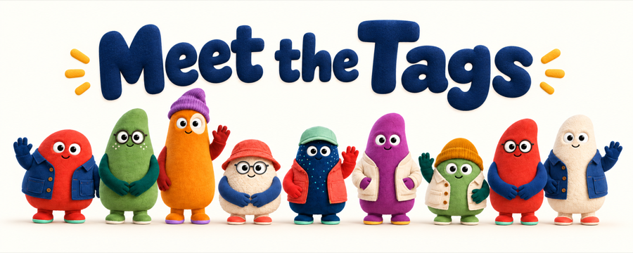
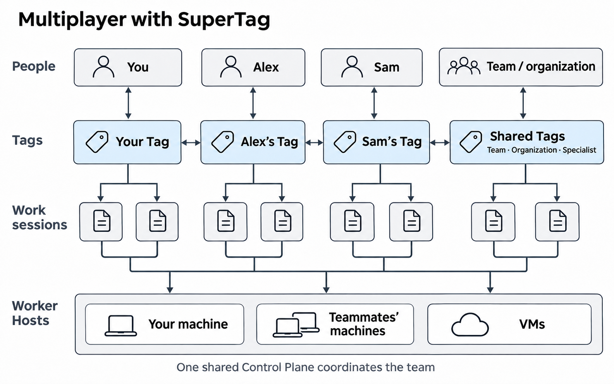
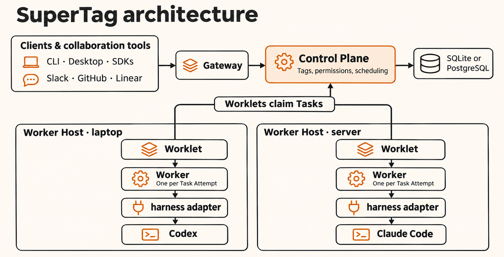

<div align="center">

<h1>
  
  SuperTag
</h1>

[English](../../README.md) · 中文 · [日本語](README.ja.md) · [한국어](README.ko.md) · [Español](README.es.md) · [Français](README.fr.md) · [Português](README.pt.md) · [Türkçe](README.tr.md) · [Русский](README.ru.md)

**为工程工作而生的 AI 行动者：持久在岗、主动做事、多人协作。**

开源、可自托管，直接运行在你已经在用的编程智能体之上。

**给它们岗位，而不是任务。**

[岗位，而非任务](#give-them-jobs-not-tasks) · [持久](#persistent) · [主动](#proactive) · [多人协作](#multiplayer) · [自己运行](#run-it-yourself) · [运行你的第一个 Tag](#run-your-first-tag) · [文档](../../docs/README.md)

<p>
  
</p>

</div>

**Tag** 是持久存在的 AI 行动者，有自己的身份、职责、权限和工作记录。它的岗位由这些职责和它交付的成果构成。它让工作在会话之间延续下去，不用你开口就会行动，还能与队友的 Tag 协作。代码仍然由你的编程智能体来写：Claude Code、Codex、Cursor 或 OpenCode。

<a name="give-them-jobs-not-tasks"></a>

## 给它们岗位，而不是任务

现在，你交给编程智能体的是一个个任务：写提示词，看 diff，做评审，再写下一条提示词。它能排查 bug、写出修复、运行测试。但记住上次发生了什么的是你，发现下一次失败的是你，决定接下来做什么的还是你。一旦工作超出单个任务的范围，你就成了它的项目经理：拆分工作，为每一块启动一个编程智能体，再在它们之间来回传递上下文。

Tag 拥有的则是一个岗位。岗位由两部分构成：Tag 持续承担的职责，比如保持 main 分支全绿；以及它要交付的成果，比如把 12 个服务迁移到短期凭证。

| 任务 | 岗位 |
| --- | --- |
| “修好这个不稳定的测试” | “保持 main 分支全绿”，并交付你指定的成果 |
| 你发出提示词时才开始 | CI 失败、告警触发或队友提出请求时就会行动 |
| diff 合并后就结束 | 持续进行，并记住学到的东西 |
| 由你来检查是否奏效 | 它自带证据：运行了哪些检查，验证了什么 |
| 任何一个编程智能体会话都能接手 | 有自己的身份、权限和历史 |

每项成果都是一个 **Objective**。它记录了你用来判断是否完成的证据，以及你设定的约束、预算或截止日期。负责它的 Tag 决定启动哪些工作，把各部分分派给所在 **Team** 中的其他 Tag，评审交回来的结果，再把发现、分支和需要你批准的决定带给你。你只需要为负责的 Tag 把握方向，不必管理它的编程智能体。

要把 12 个服务迁移到短期凭证，就把这个上线 Objective 交给 `lead`。它会协调多个 Tag：有的更新信任策略和服务代码，有的评审测试和遥测数据，有的演练切换。生产环境的切换由你批准，共享密钥何时停用也由你决定。

给每个 Tag 分配各自的岗位和权限。比如让 `lead` 负责协调，给构建者编辑仓库的权限，只给评审者只读权限。

[编写 Objective](../../docs/guides/write-an-objective.md) · [如何指挥工作](../../docs/concepts/interaction-model.md)

## 岗位需要什么

岗位比任何一次会话都持久，包含还没有人提出的工作，也牵涉到其他人。Tag 正是为这三点而设计的。

<a name="persistent"></a>

### 持久

岗位不会随着开启它的会话一起结束。你的编程智能体一次完成 Tag 的一部分工作，而在各部分之间持续存在的是 Tag。同一个 Tag 可以今天排查问题，明天评审结果，下周再回答有关这两件事的问题，即使下一部分工作换了一个编程智能体或一台机器来运行。它能自行回忆起之前的工作和 Objective。

<a name="next-add-your-teams-chat"></a>

在你常用的工具里都能找到同一个 Tag。你可以在终端里和它对话，也可以把 Slack 频道、GitHub 仓库或 Linear 团队加入它的位置。每段对话有各自的线程，而同一个 Tag 始终承担着你交给它的职责。[连接工作工具](../../docs/surfaces/README.md)

<a name="proactive"></a>

### 主动

每个岗位都有一部分工作是发现哪些事需要做。给 Tag 一项持续性的职责，它就会主动履行，不必等人开口。每项职责都是一个持续性的 Objective，相关的职责归同一个 Tag。假设 `reliability` 负责让你的服务保持健康，它名下有四个持续性的 Objective：

| 持续性 Objective | 触发条件 | 它做什么 | 留给你决定 |
| --- | --- | --- | --- |
| 分诊生产环境错误 | Sentry 出现新问题或问题复发 | 复现问题，找出引发它的变更，并准备好修复和一个能复现失败的测试 | 合并与回滚 |
| 监控服务 | PagerDuty、Datadog 或健康检查发出告警 | 根据日志、近期部署和错误激增情况梳理出时间线，并准备好回退分支 | 回滚或升级处理 |
| 保持 main 分支全绿 | main 上的 CI 运行失败 | 找出导致失败的提交，分辨是测试不稳定还是真的出了问题，并准备好修复或回退 | 合并与隔离测试 |
| 保持依赖安全 | Dependabot 或 Snyk 发布安全公告 | 检查项目是否受影响，并准备好升级和测试结果 | 大版本升级与合并 |

当 Sentry 报告一个新错误时，`reliability` 会在第一个 Objective 下接手处理。它判断这个错误是否要紧，启动复现和修复工作，然后把分支、测试以及该由你做的决定带给你。四个 Objective 都由同一个 Tag 承担，所以它能想起在其他 Objective 下了解到的情况，比如一小时前查看过的那次失败部署。无事可做时，它会休息，直到下一份报告、下一条消息或下一个结果到来。把它运行在一台始终在线的主机上，即使你的笔记本关机，它也照样履行职责。

如果另一类职责需要不同的权限，就把它交给另一个 Tag。负责分诊 bug 报告的 `support` Tag 可以读取仓库、与报告者沟通，却无权准备回退。

哪些事件能送达 Tag、它可以如何响应，都由你来定。你可以通过 Control Plane API 把告警和报告转发给某个 Objective，也可以在 Slack、GitHub 或 Linear 中提及这个 Tag。[设置持续性职责](../../docs/guides/ongoing-responsibilities.md)

<a name="multiplayer"></a>

### 多人协作

团队里的岗位会相互交叠。自托管一个共享的 Control Plane，整个团队就能一起使用 Tag。每位队友都从自己的终端或已连接的工具中指挥 Tag，终端里的私人对话只有本人可见。一个人可以在 Slack 里向 `reliability` 询问某个错误，另一个人可以在 GitHub 上就同一批发现继续跟进。

队友们的 Tag 会彼此协调，不需要你参与。当你的 Tag 需要队友的 Tag 提供些什么时，它会直接给那个 Tag 发消息。它们自行商定细节，并把达成的一致记录在所属 Team 共享的 Workstream 中。只有当某个决定该由你来做时，你才会收到通知。这些 Tag 可以运行在不同的编程智能体和机器上，所以你笔记本上运行 Claude Code 的 Tag，可以和队友机器上运行 Codex 的 Tag 为同一个 Objective 协作。



[多人协作的工作原理](../../docs/concepts/multiplayer.md) · [自托管 SuperTag](../../docs/guides/self-hosting.md)

<a name="get-started"></a>

<a name="run-your-first-tag"></a>

## 运行你的第一个 Tag

在 Mac 或 Linux 上安装 Git 以及 [Claude Code](https://code.claude.com/docs/en/setup) 或 [Codex](https://developers.openai.com/codex/cli/)，并完成登录。使用 Claude Code 时，运行 `claude` 并登录。使用 Codex 时，用 `codex -c 'cli_auth_credentials_store="file"' login` 登录，这样登录信息会保存在文件里，SuperTag 的 Task 可以读取；在 macOS 上直接运行 `codex login` 会把它存进钥匙串，Task 就读不到了。Claude Code 还需要 Node.js，版本要求见[环境要求与登录](../../docs/operations/requirements.md)。

[安装 SuperTag](../../docs/operations/install.md)，然后在一个至少有一次提交的现有 Git 仓库中运行以下命令。

```sh
curl -fsSL https://supertag.sh/install | sh
export PATH="$HOME/.local/bin:$PATH"
supertag init
supertag message lead "Read this repository and tell me what you would improve first."
```

`supertag init` 会检查编程智能体的登录状态，问你几个问题，然后在后台启动 SuperTag。Tag 名称保留默认的 `lead` 即可。它在这个仓库中工作，以你当前检出分支的最新提交为起点。`supertag message` 把你的消息发给 `lead`，并在回复到达时实时打印出来。

再运行一次 `supertag message lead`，就可以在同一段对话里继续交流。等你准备好把岗位的一部分交给它时，可以这样启动一个 Objective。

```sh
supertag message lead "/goal Add a test for an uncovered edge case. Done when the new test and its suite pass. Ask me before changing application code."
```

运行在 Codex 上的 lead 会运行这些测试。运行在 Claude Code 上的 lead 如果在设置时既没有启用 Docker，也没有选择启用无沙箱模式，就只能读取和编辑文件，不能运行命令，因此它会把这项条件报告为未检查；参见[让 lead 运行命令](../../docs/operations/cli.md#let-the-lead-run-commands)。

`supertag get inbox-item` 会列出 Tag 向你提出的问题，用 `supertag question answer TASK_ID "..."` 回答其中一个。Objective 准备就绪后，`supertag status` 会把它显示为 `review`。每一项交付的变更都会以 `supertag/session/...` 分支的形式出现在你的仓库中。评审之后，批准这个 Objective 或要求修改：

```sh
supertag describe objective OBJECTIVE_ID
supertag objective review OBJECTIVE_ID approve
supertag objective review OBJECTIVE_ID request-changes --feedback "Also cover the empty case."
```

比起终端更喜欢图形界面？在 Mac（Apple 芯片或 Intel）或 Linux 上，可以[安装桌面应用](../../docs/operations/install.md#install-the-desktop-app)：它自带 `supertag`，首次启动时会自动完成 SuperTag 的设置，并且连接的是同一批 Tag。

[安装选项](../../docs/operations/install.md) · [与 Tag 对话](../../docs/guides/talk-to-a-tag.md) · [运行你的第一个 Team](../../docs/guides/first-team.md) · [从编程智能体中指挥 SuperTag](../../docs/guides/coding-agent-operator.md)

<a name="run-it-yourself"></a>

## 自己运行

SuperTag 以 Apache 2.0 许可证开源，它的每个部分都运行在你选定的地方。岗位需要访问你的代码、服务和账号，所以这些访问权限放在哪里，由你决定。



- **你的机器**：`supertag init` 会启动一个本地 **Control Plane**，也就是存储 Tag 并调度其工作的服务，同时把你的电脑接入为 **Worker Host**，也就是实际运行工作的机器或沙箱。团队加入后，把 Control Plane 部署到所有人都能访问的地方，再把笔记本、服务器、CI 运行器或 Modal 和 E2B 沙箱接入为 Worker Host。像 `reliability` 这样承担持续性职责的 Tag，应放在始终在线的主机上。
- **你的编程智能体和模型**：每个 Tag 都运行在你选定的编程智能体和模型上，用你自己的账号或密钥登录。
- **你的边界**：每个 Tag 只能做权限允许的事，哪些操作需要等你批准也由你来选。Codex 在它自带的沙箱中运行命令，Claude Code、Cursor 和 OpenCode 可以在本地容器中运行命令。Tag 只能访问你允许的网络地址。在 Codex 上和容器中，凭证（例如 Sentry 令牌）由 Tag 所在的主机添加到获准的请求里，Tag 运行的命令始终看不到它们。

[自托管 SuperTag](../../docs/guides/self-hosting.md) · [连接 Worker Host](../../docs/guides/workers.md) · [设置权限与审批](../../docs/concepts/context-and-permissions.md) · [了解各部分如何协同工作](../../docs/concepts/how-it-works.md)

## 支持的工具与环境

| | 选项 |
| --- | --- |
| **编程智能体** | Claude Code · Codex · Cursor · OpenCode · OpenAI Agents · [你自己的 harness 适配器](../../docs/guides/harness-adapters.md) |
| **与 Tag 对话的地方** | 终端 · [Slack](../../docs/surfaces/slack.md) · [GitHub](../../docs/surfaces/github.md) · [Linear](../../docs/surfaces/linear.md) · [Lark/飞书](../../docs/surfaces/lark.md) · [Microsoft Teams](../../docs/surfaces/teams.md) |
| **工作运行的地方** | 笔记本 · 服务器 · CI 运行器 · [Modal 和 E2B 沙箱](../../docs/guides/workers.md#run-a-harness-in-a-sandbox) |

## 何时选择 SuperTag

| 对比对象 | 擅长什么 | 缺少什么 | SuperTag 补上了什么 |
| --- | --- | --- | --- |
| **编程智能体** · [Claude Code](https://code.claude.com/docs/en/overview)、[Codex](https://learn.chatgpt.com/docs/codex/cli)、[OpenCode](https://opencode.ai/docs/) | 在你与它们一起工作时编写、修复和测试代码。 | 对话一关，工作就停了。目标得靠你自己记着，下一步也得由你自己启动。 | **工作不会中断。** Tag 会记住目标，并自行安排编程智能体去做下一步。出现新的错误和告警时，不用你开口它也会响应。代码仍然由你的编程智能体来写。 |
| **并行智能体工具** · [Paradev（原 Superset）](https://docs.paradev.com/recipes/parallel-workstreams)、[Conductor](https://www.conductor.build/docs/concepts/parallel-agents)（[正在逐步停止运营](https://www.conductor.build/announcement)） | 同时运行多个编程智能体，并把所有变更展示给你。 | 每个智能体做什么仍然由你决定，各项结果能否拼到一起也要由你检查。 | **管理智能体的事有人代劳。** 告诉 Tag 你想完成什么、如何验收。它会分派各个部分，检查它们能否拼到一起，再把结果发给你。 |
| **智能体项目** · [Cursor Projects](https://cursor.com/docs/agent/projects)、[Claude Code Projects](https://code.claude.com/docs/en/claude-projects)、[GitHub Copilot Projects](https://docs.github.com/en/copilot/how-tos/github-copilot-app/working-with-projects) | 多个智能体在数周或数月里朝同一个目标努力。在 Cursor 中，队友可以加入同一个项目。 | 每个项目只能运行某一家公司的智能体，而且大多运行在这家公司的云上。 | **混用不同的编程智能体和机器。** 你的 Tag 可以在你的笔记本上运行 Claude Code，队友的 Tag 在他们的笔记本上运行 Codex，两者照样能协作。 |
| **托管式 AI 队友** · [Devin Bots](https://devin.ai/blog/introducing-devin-bots)、[OpenAI dots](https://openai.com/index/introducing-dots/)、[Grok Bot](https://x.ai/news/introducing-grok-bot) | 随时待命的 AI 助手，记得过去的工作，还能自主行动。 | 它用的是厂商的模型和云端机器，规则也由厂商说了算。 | **自己运行。** Tag 使用你已经付费的编程智能体，运行在你自己的机器上，并且只能做你允许的事。 |
| **自托管智能体** · [OpenClaw](https://docs.openclaw.ai/concepts/multi-agent)、[Hermes Agent](https://hermes-agent.nousresearch.com/docs/user-guide/features/kanban) | 运行你自己的 AI 智能体，它们有各自的工具和记忆，可以处理任何类型的任务。 | 它们是通用助手，并不是围绕你的编程智能体、代码评审或工程工作的完成验证而构建的。 | **为工程工作而构建。** Tag 运行在 Claude Code、Codex、Cursor 或 OpenCode 上。代码变更以分支的形式交回给你评审，每项成果都附带验证其是否完成的方法。 |

[了解 SuperTag 与其他智能体系统的关系](../../docs/concepts/supertag-and-other-agent-systems.md)。

## 基于 SuperTag 构建

你可以用同一套基础设施，为自己的应用提供持久存在的行动者。通过 Control Plane 的 gRPC API，你的应用可以创建和指挥 Tag、给它们派发工作，并查看进展。例如，你可以把 Sentry 错误转发给 `reliability` Tag，再把它的分支和测试结果展示在你自己的评审界面中。仓库中附带了自动生成的 Go、TypeScript 和 Python 绑定。[探索 API](../../docs/reference/control-plane-api.md)

如果想接入你自己的执行系统，可以编写一个 **harness 适配器**：这是一个由每个 Task Attempt 的 Worker 启动的程序，它通过 harness 协议驱动你的智能体。内置的 Python 和 TypeScript 适配器就是可供阅读的可用示例。

TypeScript SDK（npm 上的 `supertag-ai`）和 Python SDK（PyPI 上的 `supertag`）用来把应用连接到 SuperTag，把 harness 适配器连接到 **Worker**，也就是为某个 Task Attempt 启动该适配器的进程：

```sh
npm install supertag-ai
python -m pip install 'supertag==0.3.10'
```

[编写 harness 适配器](../../docs/guides/harness-adapters.md) · [接入你自己的协作界面](../../docs/reference/connector-contract.md) · [查看 API 稳定性](../../docs/reference/api-stability.md)

## 常见问题

**Tag 不经我同意能做什么？** 只能做权限允许的事。哪些操作需要先经你批准，由你决定。对仓库的变更始终以分支的形式交回给你评审，合并始终由你来做。[设置权限与审批](../../docs/concepts/context-and-permissions.md)

**如何控制对我的仓库的变更？** 设定每个 Tag 可以做什么。仓库工作在一个固定到特定提交的独立检出中进行，并以分支的形式交回，供你评审。[使用仓库分支](../../docs/guides/workspaces.md)

**我需要服务器吗？** 你可以在笔记本上启动 Control Plane 并运行工作。如果需要多人共享访问，或者希望笔记本关机后工作仍然可用，就部署 Control Plane，并连接一台保持在线的 Worker Host。[自托管 SuperTag](../../docs/guides/self-hosting.md)

## 贡献与许可证

仓库设置和检查方法参见[贡献者指南](../../CONTRIBUTING.md)。SuperTag 采用 [Apache 2.0](../../LICENSE) 许可证。
