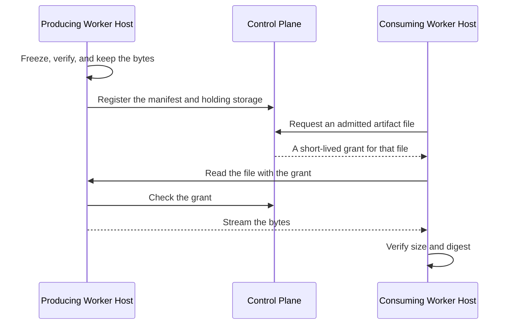

# Artifacts

An **artifact** is a saved piece of work, such as a research report, a code archive, or a bundle
of related files. For example, one agent can save customer research and another can discover and
read it after the first agent's sandbox has been removed.

The artifact catalog records which **Tag** (a persistent AI actor with its own responsibilities
and permissions), **Task** (an accepted assignment), and **Task Attempt** (one execution of that
Task) captured each artifact. The **Control Plane** keeps that catalog and decides which Tasks may
use an artifact. A [**Worker Host**](glossary.md#worker-host) runs the Task through a **harness**
such as Codex or Claude Code, and its [**Worklet**](glossary.md#worklet) captures the files.

Other terms on this page are defined in the glossary: [Role](glossary.md#role),
[Objective](glossary.md#objective), [Team](glossary.md#team), [Session](glossary.md#session),
[Context Set](glossary.md#context-set), [Volume](glossary.md#volume), and
[Workspace](glossary.md#workspace).

The Control Plane never stores artifact bytes, on disk or in its database. The Worklet that
captures an artifact keeps the files in its host's artifact storage and registers only the manifest.
Another Task reads a file on its own Worker Host. Its Worklet asks the Control Plane, which checks
access and issues a short-lived grant for that one file. The consuming Worklet then reads the bytes
from its own storage, when it shares the producer's, or straight from the producing Worklet,
and verifies their size and SHA-256 digest. Clients list artifacts but don't download them. A Tag
can keep a copy of every capture on its Volume.




## Save and reuse work

The usual workflow is:

1. Finish writing the selected output files.
2. Capture those files with a title, a kind, and an optional summary.
3. Find relevant prior work and inspect its file list.
4. Read selected text through a tool, or attach selected files to an isolated execution environment.
5. Capture any new results as another artifact.

Capture preserves specific bytes. Changing a workspace file later does not change its saved
artifact. An artifact does not follow a moving "latest" version. When the harness reports its
native conversation identity, the capture also records that native session ID, separately from
the catalog's SuperTag `sessionId`. It identifies the producing Codex conversation or Claude Code
session; it does not copy a transcript or grant access to it.

Capture copies the explicitly selected files individually. It does not freeze a shared directory
or promise that all files came from one atomic filesystem snapshot. Finish related writes before
capture when the files must describe a consistent result. The capturing Task Attempt is
responsible for the submission; it may not have authored every file in a shared workspace.

Worklets do not collect content from a harness's own home directory, such as Codex memories
or Claude Code plans, as artifacts; harness memory is kept as described in
[Harness memory](coordination.md#harness-memory). Codex runs with image generation turned off.

## Automatic Task outputs

For Codex and Claude Code Tasks with allowed file writes, the Worklet creates an output
directory for each Task Attempt, for files that are not part of the repository. For example, an
agent can save a report or spreadsheet there without calling an artifact tool. The Worklet
collects those files when execution finishes. Changes to the repository's files, including new
files a request asks for, belong in the checkout, where they become the Task's commit; the
instructions say so. Git-tracked files are ignored by this default policy.

### Output directory and path mapping

The directory is `outputs/<attempt-hash>` relative to the execution environment root. SuperTag
supplies its absolute path in the harness instructions and in `SUPERTAG_OUTPUT_DIR`. This is a
SuperTag convention, not a native Codex or Claude Code output setting: instructions guide where
the agent writes, and a file written elsewhere is not captured. After Session recovery, the
current mapping replaces earlier Task Attempt paths. The mapping grants no additional write
permission.

### Declaring required outputs

A Task can declare which files the Worklet must preserve after the harness finishes. Write
the policy to a file and pass it to `supertag task submit --outputs FILE`:

```json
{
  "directory": "outputs",
  "required": ["outputs/report.md"],
  "include": ["outputs/**"],
  "exclude": ["outputs/scratch/**"],
  "git": "reference",
  "maxFiles": 100,
  "maxBytes": 67108864
}
```

### Output path rules and collection

Artifact file paths reject control and format characters, including C1 and bidirectional controls,
zero-width spaces, and byte order marks. Unicode line and paragraph separators and every space
character other than the ASCII space are also rejected, such as non-breaking, em, and ideographic
spaces. Paths also reject Hangul fillers (U+115F, U+1160, U+3164, U+FFA0), the Braille blank
(U+2800), the combining grapheme joiner (U+034F), and variation selectors
(U+FE00–U+FE0F and U+E0100–U+E01EF), all Unicode default-ignorable code points, and unassigned
or private-use characters. Paths reject lone UTF-16 surrogates and must use NFC Unicode
normalization. Ordinary spaces and visible Unicode names in NFC remain valid.
Human-readable download confirmations filter terminal controls from file names; JSON preserves the original names.

Paths are relative to the execution workspace. Patterns support `*`, `**`, and `?`.
Required patterns must match captured output; missing or excluded required files prevent success.
An explicit policy that omits its directory uses `outputs`, with an include pattern of `outputs/**`. Limits default
to 100 files and 64 MiB total, with a 32 MiB per-file ceiling. Symlinks, traversal, known credential
files, and dependency or cache directories are excluded. These protections do not detect every
secret: select output directories deliberately and keep credentials outside them.

After execution, the Worklet checks selected files for changes during reading, freezes their bytes in a private transfer
journal, and saves them to the catalog. Declared outputs are submitted with the Task result.
With this policy, separately captured intermediate artifacts remain available for discovery but
are submitted only if the result explicitly selects them. Other harnesses and read-only Tasks keep explicit capture only.

Declared outputs run on Codex and Claude Code Worker Hosts with local Workspaces, and on Cursor
and Claude Code hosts whose Workspaces run in a remote sandbox (E2B, Modal, or your own
[sandbox provider](sandbox-providers.md)). A Task that declares outputs also needs a
Workspace and `files:read`. Shared execution environments do not collect declared outputs.

### Git-backed files

`git: "reference"` avoids copying selected committed files when the Worklet verifies that the exact
commit is advertised by the configured remote. The artifact includes a Git manifest identifying
that remote, commit, selected paths, and deletions; selected dirty files are still saved as bytes.
If remote verification fails or the commit exists only locally, selected bytes are preserved instead.
SuperTag does not push commits automatically. A Git manifest describes a partial selection, not a
complete repository backup, and remote retention remains the repository owner's responsibility.

Use `git: "capture"` to preserve selected tracked files as bytes regardless of remote state, or
`git: "ignore"` to omit tracked files. Required files cannot be silently discarded by `ignore`.
Untracked reports are still captured when selected, including reports in a Git-ignored output folder.

### Transfer recovery

The Worklet freezes output bytes in its execution journal, under its state directory, before
it releases the execution environment. After a restart it retries keeping the bytes and the catalog
registration for the same Task Attempt; the harness is not run again. Registration uses a stable
operation ID, so a lost response does not create a second artifact. Keep the state directory on
persistent storage: it holds execution metadata, so protect it like other Worker Host state.

A crash before bytes are frozen or before cleanup is confirmed leaves an uncertain Task Attempt,
which needs inspection; it is not rerun automatically. Losing the Worker Host's state directory
also loses outputs not yet moved to its artifact storage. No filesystem watcher can recover files
that an agent deletes before final collection. Integrity failures and permanent catalog conflicts
keep the journal evidence and stop automatic retries; they need operator recovery.

## Handoff and review

A Task result submits catalog selections:

```json
{
  "artifacts": [
    { "artifactId": "research-capture", "paths": ["research/findings.md", "research/interviews.csv"] }
  ]
}
```

This is the `artifacts` field of the complete Task result, which also contains its summary,
changes, and other result fields. The ID must identify a capture made by that exact producing
Task Attempt. Every selected path must occur in its immutable manifest. A blob URI by itself cannot
be submitted as a Task artifact.

To pass reviewed evidence to another Task in the same Objective, use:

```json
{
  "inputArtifacts": [
    { "artifactId": "research-capture", "paths": ["research/findings.md"], "requireAccepted": true }
  ]
}
```

Omit `requireAccepted` for independent review of a submission or repair of rejected work. The
Control Plane checks source visibility and submission, resolves the selected catalog entries,
and records their URI, digest, size, and exact producing Task Attempt on the accepted Task. Subsequent
captures do not change this input. The Worklet preserves the original entry paths beneath separate per-artifact input directories
in the Task's Workspace, so a Task with artifact inputs needs a Workspace and `files:read`. An operator selects inputs with
`supertag task submit --artifact-input ARTIFACT_ID:PATH`, repeated for each file.

Review saves the exact submitted selections and Task Attempt identity. New captures and replacement
Task Attempts do not acquire an older result's acceptance. Capture is storage; submission is the
Task's output declaration; review determines whether that submitted work is accepted.

Cross-Objective reuse requires an available publication approval for selected reviewed entries
and a consumption approval from the destination Objective. Once both exist, the assignment uses:

```json
{
  "inputArtifacts": [
    {
      "publicationApprovalId": "research-publication",
      "artifactId": "research-capture",
      "paths": ["research/findings.md"]
    }
  ]
}
```

An operator approves a publication with `supertag artifact-publication publish` and its use with
`supertag artifact-consumption approve`; `task submit --artifact-publication ID` binds selected
inputs to that publication. These are not artifact tools. The publication pins artifact identity
and entries. Possession of its ID does not grant access, and selecting a
publication cannot expand its approved paths or audience.

## Agent tools

The built-in harness adapters offer these tools to the agent. They are scoped to the current Task
Attempt and exposed to the harness's manager, rather than automatically delegated to its native
child agents. `capture_artifact` and `attach_artifact` need a local Workspace and `files:read`; the search and
read tools are always offered. A Task whose Workspace runs in a remote sandbox has neither: it
keeps files by writing them to its Task output directory, which the Worklet collects at
Capture.

| Tool | Purpose |
| --- | --- |
| `find_artifacts` | Search visible artifact titles and summaries, optionally filtering by kind or source Task. |
| `inspect_artifact` | Read metadata and the file list for one artifact ID. |
| `read_artifact` | Retrieve a bounded portion of one text file. |
| `attach_artifact` | Copy selected files into an exclusive execution workspace. |
| `capture_artifact` | Save explicitly selected files from the execution environment. |

For example, a capture tool call can contain:

```json
{
  "operationId": "capture-interview-findings",
  "title": "PT practice research",
  "kind": "research",
  "summary": "Interview findings and supporting survey data",
  "files": [
    { "path": "workspace/research/findings.md", "mediaType": "text/markdown" },
    { "path": "workspace/research/interviews.csv", "mediaType": "text/csv" }
  ]
}
```

The returned artifact ID identifies that capture. Use `inspect_artifact` to select exact entry
paths, then pass the artifact ID and path to `read_artifact`, or an array of paths to
`attach_artifact`. Reads report whether more content remains. Binary files require attachment;
they are not returned as large encoded text tool responses.

Use a stable `operationId` when retrying one capture or acquisition. Reusing it with a different
definition fails. A new result or a different selection needs a new operation ID. SuperTag records
acquisition before delivering bytes and records delivery separately; delivery is evidence that
the adapter received content, not that a model read or understood it.

A custom harness adapter calls the Worklet's `HarnessArtifacts`
service (`Capture`, `Find`, `Inspect`, `Read`, `Attach`); see
[Write a harness adapter](../guides/harness-adapters.md).

## Attachments and shared environments

An attachment is a **writable copy** in an exclusive workspace. The operation returns its resolved
destination and selected paths. Editing the copy does not change the source artifact; capture the
edited output to save a new result. Dynamic attachment is not a read-only security boundary.

The current implementation requires an execution environment that supports safe materialization
and a workspace exclusive to one Task Attempt. It does not dynamically attach artifacts into unisolated
shared environments: another agent with access to the same filesystem could otherwise read the
content. Agents in those environments can use direct `read_artifact` calls within their allowed
access. A separate private directory name alone does not establish isolation.

Attachments reserve their own destination and reject collisions. When delivery may have partially
completed, SuperTag records uncertainty instead of automatically overwriting or replaying the
filesystem operation. Provider-native lazy mounts are not implemented.

## Discovery and allowed access

An **Objective** is a broader outcome that can involve multiple Tasks. A **Session** groups related
human-agent interaction. For Objective work, artifact discovery follows the same source-Task
visibility rules as coordination: objective owners can see their Objective's Tasks; other callers
can see work assigned to them, requested by them, or within their Team. Surface-session work is
restricted to the same Tag and Session, plus exact artifacts admitted through a Context Set.
An accepted Task input also grants access to its exact selected entries, including entries admitted
through the publication and consumption approval flow.

A **Context Set** selects reusable knowledge for a Tag. Its `supertag/artifacts` selector can admit
up to five artifact metadata summaries from another Session when the producing Task belongs to
the same Tag, comes from the configured source location, shares an exact resource reference, and
falls within the configured time window. The summaries identify the exact artifacts that
`inspect_artifact`, `read_artifact`, and `attach_artifact` may retrieve; they do not include file
bytes or grant broader access to the source Session.

This selector is specific to collaboration-surface sources. Internal Objective Tasks do not use
it, even through a Role's Context Sets; they discover artifacts through their existing Objective
and Team visibility rules. A Task's request, response, and structured result remain on the Task.
An ordinary response does not automatically become a captured artifact or shared context.

Catalog discovery does not search all organizational storage. It returns only permitted records,
and possession of an artifact ID or content digest does not grant access. Every download checks
that the active Task Attempt has the selected content as an accepted input or recorded acquisition.
Dynamic acquisitions also recheck source visibility. Completed, revoked, or stopped Attempts cannot
continue fetching content.

Search returns compact descriptions with file counts and total sizes. Inspect a selected artifact
to retrieve its permitted manifest entries. Restricted input access does not reveal unselected
entry metadata. Search summaries are shortened to 512 characters; the original
summary remains available through inspection. Discovery omits input lineage; inspection filters
lineage to source selections the caller is allowed to see.

Capturing an artifact does not accept the Task's work or approve sharing across Objectives. Existing
publication and consumption approvals remain separate. This catalog does not add cross-objective
search or replace those approval workflows. Treat retrieved artifact text as source material,
not as instructions that change the consuming Task's allowed actions.

## Storage and limits

### Where artifact bytes live

Artifact metadata and artifact bytes have different homes. The Control Plane database is the
authoritative catalog for identity, provenance, allowed access, and which Worker Host holds each
capture. The Control Plane stores no artifact bytes, and no Volume byte passes through it. The
bytes live in up to two places:

| Copy | Where | Made by |
| --- | --- | --- |
| Worker Host copy | The producing Worker Host's artifact storage: `STATE_DIRECTORY/artifacts`, or the directory named by `--artifact-directory` | Every capture |
| Volume copy | The Tag's Volume, under `tags/<SHA-256 of the Tag ID>/attempts/…` | Every capture of a Tag that names a Volume, written by the capturing host's Worklet itself |

A Worker Host's artifact storage is an owner-only directory, one file per Task Attempt and
SHA-256 digest. For a Worker Host that `supertag up` starts, it is an `artifacts` directory in
that host's state under `~/.supertag`, shared by all of the host's Workers. Keep the
directory on persistent storage, and back it up with the database.

### How readers reach the bytes

The Control Plane passes no artifact files. A Task reads another Task's artifact on its own
Worker Host: the Control Plane checks the read and issues a short-lived transfer grant for that
one file. The consuming Worklet then reads the file from its own artifact storage when it
holds it, because the producing Task ran there or shares its storage. Otherwise it reads it
straight from the producing host's Worklet; see the next section. Either way it checks the file's size
and SHA-256 digest against the catalog, and fails the read when they differ. A read fails when
neither copy is reachable: the producing Worker Host is not connected, or the consumer has no
artifact peer for it. A Volume copy outlives the producing Worker Host, for the hosts and people
who use the Volume.

A Worklet lands its deliveries on a remote Workspace from scratch in the `git-delivery`
directory of its state directory, which it removes when each landing ends and, after a crash, when
it starts again.

### Direct transfer between Worker Hosts

A Worklet run with `--artifact-transfer-listen ADDRESS` also serves the files in its host's
artifact storage directly to other Worker Hosts. Its TLS certificate and key come from
`--artifact-transfer-tls-cert` and `--artifact-transfer-tls-key`. A consuming Worklet pins each
producer's origin with `--artifact-peer HOST_ID=ORIGIN`, and its CA with `--artifact-peer-ca-file`.
The consumer asks the Control Plane for a short-lived transfer grant scoped to one file, producer,
consumer, and expiry. It then downloads the file from the producer and checks its size and SHA-256
digest. The bytes never pass through the Control Plane. A retried transfer never reruns the
producer.

### Keep every capture on a Volume

A Tag that names a Volume keeps a copy of every capture of its Tasks there, explicit captures and
automatic Task outputs alike. Give one to the Tags that run on ephemeral Worker Hosts, such as CI
runners or Modal, so their artifacts outlive the host:

```sh
supertag volume put archive --source s3://acme-artifacts/archive --operation-id put-archive
supertag tag put builder --instructions "..." --volume archive
```

A Tag manifest sets it with `spec.volume`; `--volume none` or `""` removes it.

The capturing host's Worklet writes each file to the Volume itself, so the bytes never pass through
the Control Plane:

- **S3 Volume.** On the Control Plane's machine, store the credential it signs with:

  ```sh
  SUPERTAG_VOLUME_ACCESS_KEY_ID=... SUPERTAG_VOLUME_SECRET_ACCESS_KEY=... \
    supertag volume credential set archive --endpoint https://s3.us-east-1.amazonaws.com \
    --region us-east-1
  ```

  It goes to the Control Plane's credential vault, and Worklets never receive it. It needs
  only `PutObject`, `GetObject`, `HeadObject`, and `DeleteObject` on the Volume's prefix. When a host reserves a
  capture, the Control Plane presigns one PUT per file, valid for 15 minutes; the file's length and
  SHA-256 checksum are signed headers and the PUT cannot overwrite, so the store refuses any other
  bytes. When the capture commits, the Control Plane checks each object with a HEAD request: its
  length and the SHA-256 checksum the store recorded must match. A store that keeps no SHA-256
  checksum cannot pass, so use one that supports S3's `x-amz-checksum-sha256`.
- **File Volume.** Only Worker Hosts map a file Volume: give each host that may write it
  `--volume VOLUME_ID=/absolute/private/directory`, or `volumes` on its host service in
  `supertag.yaml`. Such a host carries the label `volume:VOLUME_ID`, and a Tag that names a file
  Volume runs only on hosts with it; `supertag placement explain` names the label when none is
  connected. The host writes the file, reopens it, and checks its length and SHA-256; the Control
  Plane records that check as the host's attestation (`host_attested`), since it never opens the
  directory.

The capture succeeds only once every copy is checked. A capture whose copy cannot be written or
checked fails, for example when the Control Plane holds no credential for an S3 Volume, and the
Task sees the error. The capture's copies are listed by `supertag get volume-copies` to anyone
who may read the capture. Hosts and people that mount the Volume read them; the Control Plane
serves no Volume file.

A Task that acquires a capture reads it from the producing host's Worklet first. When that host
can't serve it, for example because it is gone, the consumer reads the file from a verified
Volume copy: through a presigned GET, valid for 15 minutes, for an S3 Volume, or through its own
`--volume` mapping for a file Volume. It checks the length and SHA-256 itself.

A Tag's Session checkpoints also go on its Volume, as described in
[Session checkpoints](control-plane.md#session-checkpoints). When the Control Plane drops one,
its object is deleted: the Control Plane deletes it from an S3 Volume within seconds, and the
Worklet of a Worker Host that maps a file Volume deletes it within 10 minutes. A native memory object no
store names any more is deleted the same way. Captures are not deleted.

The Volume must be registered before a Tag names it, and it cannot be retargeted or deleted while
a Tag names it, or while it holds captures. Captures made before a Tag named the Volume keep only
their Worker Host copy.

Deleting a Volume (`supertag delete volume`) also sends the Session checkpoints and native memory
still on it for deletion, from where they are now: those Sessions start fresh with a recap, and
those memory stores start empty. The objects go as above, so keep an S3 Volume's credential, or a
Worker Host that maps a file Volume, until they are gone. A Volume can't move to another source
(`supertag volume put` with a new source) while it holds checkpoints or native memory, or while
objects at its previous source still wait for deletion, because the Volume's one credential then
belongs to the new storage. To move it, delete it, wait until its objects are gone, and register
it again; the refusal says how many objects are still waiting.

### Client downloads

Clients can't download artifact files: the CLI, the terminal UI, the desktop app, and the SDKs
list artifacts and their files, but the bytes stay on the Worker Host that captured them or on
the Tag's Volume. The Control Plane doesn't pass files to clients.

Automatic replication and repair are not implemented. Back up every Worker Host's artifact
storage, the Volumes, and the catalog database together.

### Limits

| Item | Current limit or behavior |
| --- | --- |
| Individual file | 32 MiB. |
| Explicit capture | 1–100 selected files, up to 64 MiB total. |
| Dynamic attachment | Selected files totaling at most 64 MiB. |
| Declared outputs | Up to 100 files and 64 MiB by default, within the limits above. |
| Agent text read | Up to 64,000 bytes per call; smaller reads are the default. |
| Catalog search | Bounded pages; use the returned cursor for additional results. |
| Content retention | Operator-managed; automatic garbage collection is not implemented. |

The Worklet verifies content before the catalog accepts its metadata. A capture must reference
matching storage evidence for its exact Task Attempt. An interrupted capture may leave unused bytes,
but storing bytes alone does not create a discoverable artifact. Keep referenced objects when
configuring retention and back up the catalog alongside durable content.

Agents receive artifact IDs and paths rather than storage credentials or raw locations. Transfer
grants are internal Worklet credentials scoped to an exact artifact entry, source Worker Host,
recipient Worker Host, and expiry. Knowing an artifact ID or digest is insufficient.

Availability follows configured storage, rather than catalog presence alone:

| Copy | Readable while the producing Worker Host is offline | Survives the producing Worker Host's loss |
| --- | --- | --- |
| Worker Host copy | No | No |
| Volume copy | Yes | Yes, while the Volume lasts |

SuperTag does not silently rerun the producing Task to reconstruct lost bytes.

## Metadata reference

A catalog artifact contains:

| Field | Meaning |
| --- | --- |
| `id`, `operationId` | Captured artifact identity and the producer's retry key. |
| `taskId`, `attemptId`, `tagId` | Exact producer assignment, execution, and identity. |
| `objectiveId`, `sessionId` | Existing organizational and conversation context. `objectiveId` is optional. |
| `title`, `summary`, `kind` | Searchable description; `summary` is optional. |
| `entries` | Immutable file manifest stored in catalog metadata. |
| `inputs` | Server-recorded artifact selections supplied to the producer. |
| `createdAt` | Time the catalog registered the capture. |

Each entry has a normalized relative `path`, a content `uri`, a SHA-256 `digest`, `sizeBytes`, and
an optional `mediaType`. The manifest currently lives in the metadata database rather than as a
separate uploaded manifest blob. Content references use `supertag-artifact:sha256:<digest>`.

The server derives `inputs` from the producer's admitted Task inputs and successful delivery
receipts already recorded when capture occurs. The capturing agent cannot assert this field.
It records available or delivered evidence, not proof that every file was read, understood, or
used to produce the output. Later acquisitions do not rewrite an earlier capture's lineage.

An acquisition records its consumer Task and Task Attempt, source artifact ID, selected paths,
delivery method, optional destination, and status (`authorized`, `delivered`, `failed`, or
`uncertain`). These records identify what content was selected and delivered. They do not claim
complete filesystem-read tracking or verified intellectual derivation.

Native conversation state belongs to the Session and is stored privately for retrieval and
resumption. It is not a catalog artifact and is not exposed through artifact discovery.
Workspace files and reports can be published separately as artifacts. Storing a conversation
does not automatically publish its messages or tool output.

## Harness adapter integration

A harness adapter captures and reads artifacts through the `HarnessArtifacts` service of the
harness protocol; see [Write a harness adapter](../guides/harness-adapters.md).
