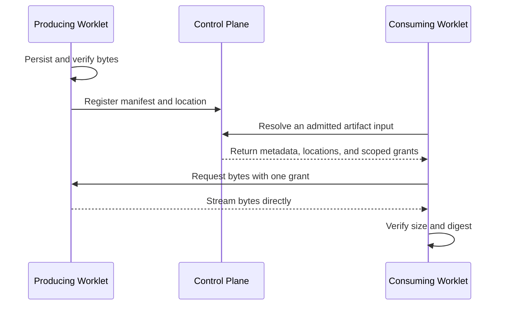

# Artifacts

An **artifact** is a saved piece of work, such as a research report, a code archive, or a bundle
of related files. For example, one agent can save customer research and another can discover and
read it after the first agent's sandbox has been removed.

The artifact catalog records which **Tag** (a persistent AI identity with its own responsibilities
and permissions), **Task** (an accepted assignment), and **Task Attempt** (one execution of that
Task) captured each artifact. The **Control Plane** keeps that catalog and decides which Tasks may
use an artifact; it never stores or carries the bytes. A **Worklet** supervises a [Worker
Host](glossary.md#worker-host), stores those bytes on it, and serves them directly. A **Worker**
runs the Task, optionally through a **harness** such as Codex or Claude Code.

Other terms on this page are defined in the glossary: [Role](glossary.md#role),
[Objective](glossary.md#objective), [Team](glossary.md#team), [Session](glossary.md#session),
[Context Set](glossary.md#context-set), [host service](glossary.md#host-service),
[Auth Key](glossary.md#auth-key), [Volume](glossary.md#volume), and
[Workspace](glossary.md#workspace).

Artifact bytes live on Worker Hosts. Each Worklet stores the artifacts its Tasks capture on its own
Worker Host and transfers them directly to other authorized Worklets. The Control Plane keeps only
the catalog: identity, provenance, access rules, and which Worker Hosts hold each copy. It never
receives, relays, or stores artifact bytes, so a copy held only on an ephemeral Worker Host is lost
if that host stops.



The Control Plane participates in discovery and authorization, then leaves the byte-transfer path.
Once the consumer has a valid grant and location, a temporary Control Plane outage does not need to
interrupt that transfer.

## Save and reuse work

The usual workflow is:

1. Finish writing the selected output files.
2. Capture those files with a title, a kind, and an optional summary.
3. Find relevant prior work and inspect its file list.
4. Read selected text through a tool, or attach selected files to an isolated execution environment.
5. Capture any new results as another artifact.

Capture preserves specific bytes. Changing a workspace file later does not change its saved
artifact. Identical bytes share content-addressed storage within a producing Task Attempt on a Volume.
Different Task Attempts have separate Volume keys and producer records. An artifact does not follow
a moving "latest" version.

When the harness reports its native conversation identity, the Worker also attaches
`harnessSession`, for example `{"harnessId":"codex","id":"native-conversation-id"}` or
`{"harnessId":"claude-code","id":"native-session-id"}`. This identifies the producing agent's
Codex conversation or Claude Code session, separately from the catalog's SuperTag `sessionId`.
Discovery and inspection return this metadata. It is omitted if the native identity is not yet
available when the capture metadata is recorded. The reference does not copy a transcript or
grant access to it.

Capture copies the explicitly selected files individually. It does not freeze a shared directory
or promise that all files came from one atomic filesystem snapshot. Finish related writes before
capture when the files must describe a consistent result. The capturing Attempt is responsible
for the submission; it may not have authored every file in a shared workspace.

## Automatic harness content

Codex and Claude Code can create useful content in their own home directories, such as a
visualization or a project memory. Built-in Workers save new or changed content from selected
locations automatically when connected to the artifact catalog. Repository changes are outside
this collection; Git remains responsible for those changes.

| Harness | Selected home content | Submitted with the Task result |
| --- | --- | --- |
| Codex | `memories/` | Yes; eligible for explicit restoration |
| Codex | `generated_images/`, `visualizations/` | Yes |
| Codex | `skills/`, excluding `.system/` | No |
| Claude Code | `projects/*/memory/`, `agent-memory/` | Yes; eligible for explicit restoration |
| Claude Code | `plans/`, `usage-data/report*.html` | Yes |
| Claude Code | `skills/`, `commands/`, `agents/`, `workflows/` | No |

Paths are relative to the harness home. SuperTag sets `CODEX_HOME` to `.codex` and
`CLAUDE_CONFIG_DIR` to `.claude-config` inside the isolated harness runtime. When the harness and
workspace run on different hosts, collection reads the harness runtime. Credentials, session
transcripts, caches, and worktrees are not selected by these defaults.

Before starting the harness, the Worker records a baseline. After normal completion it compares
selected content and saves changed bundles, including unchanged supporting files within a changed
bundle. Unchanged installed skills are not attributed to the Attempt. Codex visualizations are
bundled by their `YYYY/MM/DD/session` directory; skills and Claude agent memories are bundled by
name. Capabilities remain discoverable catalog artifacts rather than Task outputs. Memory is
included in the Task result so a later Task can select its exact artifact ID and paths.

When a later Task admits one of those memory selections through `inputArtifacts`, the Worker
restores it to the matching Codex or Claude Code home before the harness starts. It removes that
entry from ordinary workspace attachments, records delivery through the catalog, and establishes
the new collection baseline after restoration. Unchanged restored memory therefore produces no
new artifact. If the harness changes it, SuperTag captures a new immutable artifact whose input
lineage identifies the exact prior version.

Restoration is explicit and harness-specific. SuperTag does not choose a moving “latest” memory,
merge concurrent descendants, restore Claude memory into Codex, or restore authored skills by
default. Two Tasks can safely create divergent descendants because neither overwrites its parent;
a Controller must select the version used by subsequent work.

This requires an Attempt-exclusive runtime with file enumeration and binary reads. Collection is
bounded to 100 selected files, 64 MiB total, and 32 MiB per file, including baseline enumeration.
Files must finish writing before collection. Capture does not enable optional harness features,
wait for background memory generation, recover content deleted before collection, or publish
deletions as tombstones. Failed or interrupted execution before final collection does not guarantee
capture. Once frozen, bundles use the transfer recovery described below.

SDK applications can override `artifactSources` on `CodexHarness`, `createCodexWorker`,
`ClaudeCodeHarness`, or `createClaudeCodeWorker`; an empty array disables home collection. A replacement
list selects directories relative to the runtime root. For example, an integrator can explicitly
opt into Claude tool-result files:

```ts
artifactSources: [{
  id: "claude-tool-results",
  directory: ".claude-config/projects",
  include: ["*/*/tool-results/**"],
  category: "tool-result",
  bundleDepth: 2,
  submit: false,
  restore: false,
}]
```

Custom selection replaces the defaults. Select only intended output locations; tool results can
contain sensitive material. A source with `restore: true` must also use `submit: true`, ensuring a
later Task can explicitly select the immutable result. This feature is separate from explicit
workspace output policies and agent-requested captures, which remain available when deliberately
configured.

## Automatic Task outputs

For Codex and Claude Code Tasks with allowed file writes, the built-in Worker creates an
Attempt-specific deliverables directory when connected to the artifact catalog and using a
supported Attempt-exclusive execution environment. For example, an agent can save a report or
spreadsheet there without calling an artifact tool. The Worker collects those files when execution
finishes. Git-tracked files are ignored by this default policy; repository code changes stay in Git.

### Output directory and path mapping

The directory is `outputs/<attempt-hash>` relative to the execution environment root.
Codex and Claude Code receive a mapping to the current absolute output directory. When a Task
explicitly selects `outputs` as its directory, `outputs/report.json` is relative to the execution
root, which can differ from the repository's working directory. Agents should use the mapped absolute path with native file tools, or select
the output directory as their shell working directory. After Session recovery, the current mapping
replaces earlier Attempt paths. SuperTag still validates required outputs; it does not silently
move files written to another location. Required paths outside the configured output directory
remain relative to the execution root. The mapping does not grant additional write permission;
an unwritable destination must be reported rather than silently changed.

SuperTag supplies the resolved execution path in harness instructions and `SUPERTAG_OUTPUT_DIR`.
This is a SuperTag convention, not a native Codex or Claude Code output setting. Instructions guide
where the agent writes; they cannot redirect arbitrary writes. Native memories and other selected
harness files continue to use their separate collectors. A file written elsewhere is not captured
by this deliverables policy.

### Declaring required outputs

A Task can declare which files the Worker must preserve after the harness finishes. For example,
this execution requirement overrides the default directory and requires a report without relying
on the agent to call `capture_artifact`:

```json
{
  "execution": {
    "outputs": {
      "directory": "outputs",
      "required": ["outputs/report.md"],
      "include": ["outputs/**"],
      "exclude": ["outputs/scratch/**"],
      "git": "reference",
      "maxFiles": 100,
      "maxBytes": 67108864
    }
  }
}
```

### Output path rules and collection

Artifact file paths reject control and format characters, including C1 and bidirectional controls,
zero-width spaces, and byte order marks. Unicode line and paragraph separators and every space
character other than the ASCII space are also rejected, such as non-breaking, em, and ideographic
spaces. Paths also reject Hangul fillers (U+115F, U+1160, U+3164, U+FFA0), the Braille blank
(U+2800), the combining grapheme joiner (U+034F), and variation selectors
(U+FE00–U+FE0F and U+E0100–U+E01EF), all Unicode default-ignorable code points, and unassigned
or private-use characters. Paths reject lone UTF-16 surrogates and must use NFC Unicode
normalization. Ordinary spaces and visible Unicode names in NFC remain valid.
Human-readable download confirmations filter terminal controls from file names; JSON preserves the original names.

Paths are relative to the execution workspace. Patterns support `*`, `**`, and `?`.
Required patterns must match captured output; missing or excluded required files prevent success.
An explicit policy that omits its directory uses `outputs`, with an include pattern of `outputs/**`. Limits default
to 100 files and 64 MiB total, with a 32 MiB per-file ceiling. Symlinks, traversal, known credential
files, and dependency or cache directories are excluded. These protections do not detect every
secret: select output directories deliberately and keep credentials outside them.

The Worker supplies output instructions and `SUPERTAG_OUTPUT_DIR` to the harness. After execution,
it checks selected files for changes during reading, freezes their bytes in a private transfer
journal, and saves them to the catalog. Declared outputs are submitted with the Task result.
With this policy, separately captured intermediate artifacts remain available for discovery but
are submitted only if the result explicitly selects them. Other harnesses, read-only Tasks, and
Tasks without supported storage or execution capacity retain explicit-capture behavior unless
an output policy is requested.

Automatic capture currently requires a built-in Worker with an Attempt-exclusive local, E2B,
or Modal execution environment and a Control Plane artifact connection. Shared execution services
and custom providers must implement the output-file contract before advertising support. Scheduling
rejects unsupported profiles. Custom Worker implementations can support the same policy through the
language-neutral Task execution contract.

### Git-backed files

`git: "reference"` avoids copying selected committed files when the Worker verifies that the exact
commit is advertised by the configured remote. The artifact includes a Git manifest identifying
that remote, commit, selected paths, and deletions; selected dirty files are still saved as bytes.
If remote verification fails or the commit exists only locally, selected bytes are preserved instead.
SuperTag does not push commits automatically. A Git manifest describes a partial selection, not a
complete repository backup, and remote retention remains the repository owner's responsibility.

Use `git: "capture"` to preserve selected tracked files as bytes regardless of remote state, or
`git: "ignore"` to omit tracked files. Required files cannot be silently discarded by `ignore`.
Untracked reports are still captured when selected, including reports in a Git-ignored output folder.

### Transfer recovery

The Worker freezes output bytes before releasing the execution environment. Once cleanup is
confirmed, a durable Worklet can retry local storage and catalog publication for the same Attempt,
including after a Worker process restart. The harness is not run again. Catalog publication uses
a stable operation ID so a lost response does not create a second artifact. Publication also
registers the Worklet's verified local copy. A consumer then resolves an
authorized location through the Control Plane and transfers bytes directly from the serving
Worklet; retrying that transfer does not rerun the producer.

The transfer journal lives under the Worker host's `SUPERTAG_STATE_DIR` (by default
`~/.supertag/output-transfers`); SDK applications can set `outputJournalDirectory`. Keep this
private directory on persistent storage. It contains execution metadata and connection credentials,
so protect it like other Worker state. The journal is removed after the durable Worklet records
completion. Direct Worker SDK consumers must acknowledge finalized outputs themselves.

A crash before bytes are frozen or before cleanup is confirmed remains an uncertain Attempt,
requiring inspection; it is not automatically rerun. Losing the Worker Host's journal disk also
loses outputs that have not reached artifact storage. Losing the only authoritative host copy
makes the artifact unavailable even though its catalog record and provenance remain. The Control
Plane keeps no copy, so keep the Worker Host's state directory on persistent storage when work must
survive a restart. No filesystem watcher can recover files that an agent deletes before final
collection.

If local staging fails, the Worker stops its processes, removes its temporary execution directory,
and stops accepting further execution until inspected. Integrity failures and permanent catalog
conflicts retain journal evidence and stop automatic transfer retries. These cases require operator
recovery.

## Handoff and review

A Task result submits catalog selections:

```json
{
  "artifacts": [
    { "artifactId": "research-capture", "paths": ["research/findings.md", "research/interviews.csv"] }
  ]
}
```

Assignment results store these selections at `result.taskResult.artifacts`; top-level
`result.artifacts` is not an assignment artifact submission. The direct Store API accepts a
complete Task result and wraps it internally for artifact validation.

This is the `artifacts` field of the complete Task result, which also contains its summary,
changes, and other result fields. The ID must identify a capture made by that exact producing
Attempt. Every selected path must occur in its immutable manifest. A blob URI by itself cannot
be submitted as a Task artifact.

To pass reviewed evidence to another Task in the same Objective, use:

```json
{
  "inputArtifacts": [
    { "artifactId": "research-capture", "paths": ["research/findings.md"], "requireAccepted": true }
  ]
}
```

Omit `requireAccepted` for independent review of a submission or repair of rejected work. The
Control Plane checks source visibility and submission, resolves the selected catalog entries,
and records their URI, digest, size, and exact producing Attempt on the accepted Task. Subsequent
captures do not change this input. Built-in Codex and Claude Code harnesses preserve the original
entry paths beneath separate per-artifact input directories.

Review saves the exact submitted selections and Attempt identity. New captures and replacement
Attempts do not acquire an older result's acceptance. Capture is storage; submission is the
Task's output declaration; review determines whether that submitted work is accepted.

Cross-Objective reuse requires an available publication approval for selected reviewed entries
and a consumption approval from the destination Objective. Once both exist, the assignment uses:

```json
{
  "inputArtifacts": [
    {
      "publicationApprovalId": "research-publication",
      "artifactId": "research-capture",
      "paths": ["research/findings.md"]
    }
  ]
}
```

These approval operations are exposed by the storage SDK (`approveArtifactPublication` and
`approveArtifactConsumption`); they are not artifact tools or new CLI commands. The publication
pins artifact identity and entries. Possession of its ID does not grant access, and selecting a
publication cannot expand its approved paths or audience.

## Agent tools

Workers supply these tools to harnesses that support a Worker-owned tool client. They are scoped
to the current Attempt and exposed to the harness's manager, rather than automatically delegated
to its native child agents.

| Tool | Purpose |
| --- | --- |
| `find_artifacts` | Search visible artifact titles and summaries, optionally filtering by kind or source Task. |
| `inspect_artifact` | Read metadata and the file list for one artifact ID. |
| `read_artifact` | Retrieve a bounded portion of one text file. |
| `attach_artifact` | Copy selected files into an exclusive execution workspace. |
| `capture_artifact` | Save explicitly selected files from the execution environment. |

For example, a capture tool call can contain:

```json
{
  "operationId": "capture-interview-findings",
  "title": "PT practice research",
  "kind": "research",
  "summary": "Interview findings and supporting survey data",
  "files": [
    { "path": "workspace/research/findings.md", "mediaType": "text/markdown" },
    { "path": "workspace/research/interviews.csv", "mediaType": "text/csv" }
  ]
}
```

The returned artifact ID identifies that capture. Use `inspect_artifact` to select exact entry
paths, then pass the artifact ID and path to `read_artifact`, or an array of paths to
`attach_artifact`. Reads report whether more content remains. Binary files require attachment;
they are not returned as large encoded text tool responses.

Use a stable `operationId` when retrying one capture or acquisition. Reusing it with a different
definition fails. A new result or a different selection needs a new operation ID. SuperTag records
acquisition before delivering bytes and records delivery separately; delivery is evidence that
the adapter received content, not that a model read or understood it.

Codex in app-server mode and Claude Code provide Worker-owned tool clients. OpenCode's current adapter accepts Control
Plane coordination over HTTP MCP and does not support these Worker-local artifact tools. An
explicitly supplied unsupported binding fails before execution. Ordinary declared-file export and
preselected artifact inputs still use the Worker storage path. A custom harness must advertise
and implement the `worker-local` transport through its Worker-host client to receive these tools.
See [custom Workers](../guides/custom-workers.md) for the surrounding execution contracts.

## Attachments and shared environments

An attachment is a **writable copy** in an exclusive workspace. The operation returns its resolved
destination and selected paths. Editing the copy does not change the source artifact; capture the
edited output to save a new result. Dynamic attachment is not a read-only security boundary.

The current implementation requires an execution environment that supports safe materialization
and an Attempt-exclusive workspace. It does not dynamically attach artifacts into unisolated
shared environments: another agent with access to the same filesystem could otherwise read the
content. Agents in those environments can use direct `read_artifact` calls within their allowed
access. A separate private directory name alone does not establish isolation.

Attachments reserve their own destination and reject collisions. When delivery may have partially
completed, SuperTag records uncertainty instead of automatically overwriting or replaying the
filesystem operation. Provider-native lazy mounts are not implemented.

## Discovery and allowed access

An **Objective** is a broader outcome that can involve multiple Tasks. A **Session** groups related
human-agent interaction. For Objective work, artifact discovery follows the same source-Task
visibility rules as coordination: objective owners can see their Objective's Tasks; other callers
can see work assigned to them, requested by them, or within their Team. Surface-session work is
restricted to the same Tag and Session, plus exact artifacts admitted through a Context Set.
An accepted Task input also grants access to its exact selected entries, including entries admitted
through the publication and consumption approval flow.

A **Context Set** selects reusable knowledge for a Tag. Its `supertag/artifacts` selector can admit
up to five artifact metadata summaries from another Session when the producing Task belongs to
the same Tag, comes from the configured source location, shares an exact resource reference, and
falls within the configured time window. The summaries identify the exact artifacts that
`inspect_artifact`, `read_artifact`, and `attach_artifact` may retrieve; they do not include file
bytes or grant broader access to the source Session.

This selector is specific to collaboration-surface sources. Internal Objective Tasks do not use
it, even through a Role's Context Sets; they discover artifacts through their existing Objective
and Team visibility rules. A Task's request, response, and structured result remain on the Task.
An ordinary response does not automatically become a captured artifact or shared context.

Catalog discovery does not search all organizational storage. It returns only permitted records,
and possession of an artifact ID or content digest does not grant access. Every download checks
that the active Attempt has the selected content as an accepted input or recorded acquisition.
Dynamic acquisitions also recheck source visibility. Completed, revoked, or stopped Attempts cannot
continue fetching content.

Search returns compact descriptions with file counts and total sizes. Inspect a selected artifact
to retrieve its permitted manifest entries. Restricted input access does not reveal unselected
entry metadata. Search summaries are shortened to 512 characters; the original
summary remains available through inspection. Discovery omits input lineage; inspection filters
lineage to source selections the caller is allowed to see.

Capturing an artifact does not accept the Task's work or approve sharing across Objectives. Existing
publication and consumption approvals remain separate. This catalog does not add cross-objective
search or replace those approval workflows. Treat retrieved artifact text as source material,
not as instructions that change the consuming Task's allowed actions.

## Storage and limits

### Where artifact bytes live

Artifact metadata and artifact bytes have different homes. The Control Plane database is the
authoritative catalog for identity, provenance, allowed access, and known storage locations.
Worker Hosts hold the immutable bytes; the Control Plane never stores them. The catalog may know
several copies of one content digest without creating several artifacts.

Every Worklet, including the host services that `supertag up` starts, stores the bytes its Tasks
capture beneath its Worker Host's `SUPERTAG_STATE_DIR/artifacts` (by default
`~/.supertag/artifacts` on that Worker Host). A default loopback Worklet advertises no transfer
endpoint to other machines. With a configured reachable endpoint, it advertises that endpoint and
verified inventory to the Control Plane. A consuming Worklet resolves a permitted location and a
short-lived transfer grant, then downloads directly from the serving Worklet. The serving Worklet
verifies the grant locally and the consumer verifies the size and SHA-256 digest before making the
copy available. Artifact bytes never pass through the Control Plane.

A Worker Host with an artifact Volume stores its copies on that Volume instead. Each file is its own
object at `attempts/<attemptId>/sha256/HEX`, where `HEX` is the file's SHA-256 digest.
The catalog derives the key from the authenticated producing Task Attempt. It checks that this
Task Attempt ran on the reporting host, and that the host advertises the named artifact Volume.
The copy record is the enrolled host's report, not an independent check of the stored bytes.
A different Task Attempt cannot claim that key, even when it reports the same digest.
Consumers and operator downloads resolve only the producing Task Attempt's key. The Volume's
credential stays on the host, mapped through `volume-credentials`. See [artifact Volume](supertag-yaml.md#artifact-volume).

### How consumers reach a copy

A consumer resolves its copy in this order:

1. The Control Plane checks that the consuming Task Attempt was given the artifact. It looks up no
   copy before this check passes.
2. A Volume copy location goes only to a consuming host that advertises that artifact Volume or
   its credential mapping. The host reads exactly the recorded key with its own
   credential and checks the size and digest. A Volume read needs no transfer grant.
3. Otherwise the consumer downloads directly from the serving host under a transfer grant.
4. With no usable copy, the request fails. The error names the Worker Hosts and Volumes that hold
   the artifact and says a shared artifact Volume would make it reachable.

### Shared Volume access and trust

Workspace mount protection also sends every known file artifact Volume's name and source path
to hosts executing Tasks with Workspace mounts, even when they do not map that artifact Volume.
These entries carry no credential. The host needs the paths to reject a requested mount that
resolves through a local symbolic link into another host's artifact Volume. The Control Plane
cannot resolve those local links. This dispatch metadata is separate from copy locations returned
after an artifact grant check.

SuperTag Workers check the catalog before fetching another host's copy from a shared Volume.
This check does not restrict direct filesystem or bucket access. Sharing a Volume means trusting
every host mapped to it with all of its contents, including artifacts its Tasks were not granted.
Path checks cannot identify the same network share mounted at different, unrelated paths.
Writers with direct access to that share can still plant symbolic links; directory checks do not
make the share an isolation boundary against concurrent writers. A host's artifact Volume label
can cause Workspace mount refusals, but supplies no filesystem access or credential.
See [local credential access](../concepts/persistence.md#credentials-and-local-access).

### Upload receipts on shared Volumes

A Worklet registers only its own verified uploads from a shared artifact Volume. It keeps upload
receipts in its private state directory so it can register them again after restarting. It never
adopts another host's files by listing the shared Volume. If those receipts are lost, the catalog's
Volume copies remain available to consumers with a mapping for that Volume.
Each Task Attempt's Volume key has one producing host. Downloads, listings, and durability checks
use only that host's records. Sharing a Volume alone does not make a host a holder.

### Operator downloads

`supertag download artifact` follows the same order from the operator's machine. It reads a Volume
copy with that machine's own `volume-credentials`, then tries the serving host under a one-minute
grant scoped to that file and operator. It writes the file only when the size and digest match,
and never overwrites an existing file. When neither is reachable, it writes nothing and reports
which hosts and Volumes hold the file.

For a local installation, host services started by `supertag up` serve artifacts on loopback.
For example, an operator on the same laptop can download an artifact from that laptop's host
service. The Control Plane offers this endpoint only when its listener and configured public URL
are loopback and both the operator's request and the serving host's current connection reach it over loopback.
It uses the existing coordination URL, or its listening URL when none is configured.
It checks socket addresses and host connection generation; forwarded headers and advertised
host labels do not qualify. A public URL behind a same-server reverse proxy disables these
local endpoints, even when the proxy connects over loopback. Wildcard listeners (`0.0.0.0` or `::`)
also disable them, even when their default connection URL uses `127.0.0.1`.
Eligible listeners include `127.0.0.0/8`, `::1`, IPv4-mapped loopback addresses, and plain `localhost`.
Eligible destinations use a literal loopback IP or plain `localhost`. IPv4-mapped and
IPv4-compatible loopback addresses follow the same checks. Other localhost aliases, including
`*.localhost`, are withheld even for local peers. Unspecified addresses such as
`0.0.0.0`, `::`, and `::ffff:0:0` are never offered as download destinations.

Deleting a Volume or changing its source is refused while artifact copies from enrolled Worker
Hosts are recorded on it, even when those hosts are disconnected. The API returns a conflict
with the count; deletion dry runs and prune plans report the same refusal. Keep that Volume and
source available for existing artifacts, and create a new Volume for future artifacts. Updating
its credential name remains allowed. To retire the copies, revoke their hosts' credentials with
`supertag revoke worker-host-credential HOST`. Copies attributed only to removed hosts no longer
block deletion or source changes.

Automatic replication and repair between Worker Hosts are not implemented. Back up every required
host copy, artifact Volume, and the catalog database. A copy held only on a Worker Host is lost
with that host unless its state directory is persistent.

### Limits

| Item | Current limit or behavior |
| --- | --- |
| Individual file | 32 MiB. |
| Explicit capture | 1–100 selected files, up to 64 MiB total. |
| Dynamic attachment | Selected files totaling at most 64 MiB. |
| Declared harness outputs | Up to 20 files per plan. |
| Agent text read | Up to 64,000 bytes per call; smaller reads are the default. |
| Catalog search | Bounded pages; use the returned cursor for additional results. |
| Content retention | Operator-managed; automatic garbage collection is not implemented. |

The Worker verifies content before the catalog accepts its metadata. A capture must reference
matching storage evidence for its exact Attempt. An interrupted capture may leave unused bytes,
but storing bytes alone does not create a discoverable artifact. Keep referenced objects when
configuring retention and back up the catalog alongside durable content.

Agents receive artifact IDs and paths rather than storage credentials or raw locations. Transfer
grants are internal Worklet credentials scoped to an exact artifact entry, source Worker Host,
recipient Worker Host, and expiry. Knowing an artifact ID or digest is insufficient. Direct Worklet
transfers remain bounded.

Availability follows configured storage, rather than catalog presence alone:

| Storage commitment | Survives producing Worker exit | Survives Worklet restart | Survives host or disk loss |
| --- | --- | --- | --- |
| One persistent Worklet copy | Yes | Yes | No |
| A copy on an artifact Volume | Yes | Yes | Yes, while the Volume lasts |
| Several independent Worklet copies | Yes | Yes | While at least one verified copy remains |

A cache is an expendable copy and does not satisfy a durable storage commitment. A location from
an old or disconnected Worklet generation is not returned as available; a newer inventory can
supersede its earlier advertisement. Consumers try another authorized location when one exists.
SuperTag does not silently rerun the producing Task to reconstruct lost bytes.

### Where describe task places a file

`supertag describe task` lists, under `Storage:`, where each output and artifact of the Task
was recorded. It reads the evidence for each file from its producing Worker Host:

| Place | Evidence | Shown as |
| --- | --- | --- |
| Worker Host | The producing Task Attempt has an upload receipt, with retained host inventory or no recorded Volume copy. | `Worker Host H (persistent)` or `Worker Host H (ephemeral)` |
| Removed Worker Host | A copy advertised by a host that was later removed. | `Worker Host H (removed; its copy is gone)` |
| Volume | The catalog records an available copy on an existing Volume and a matching upload receipt for the producing Task Attempt. | `Volume NAME` |

The Control Plane is never a place: it holds no artifact bytes. Copies of the same bytes
recorded by an unrelated host do not count toward this artifact. The producing host can hold
a local copy and a recorded Volume copy.

These locations are historical catalog evidence, not live checks. Receipts and retained
inventory can outlast deleted host storage, including after a Worklet disconnects. An enrolled
host appearing here does not guarantee that its bytes still exist. A download checks availability
and verifies the digest. Removing a host marks its recorded local copy as gone.

Listings and downloads use only copies recorded by the Worker Host that produced the artifact.
Another host holding identical bytes is not a serving location for that artifact. A withdrawn
advertisement doesn't count. Listings require an upload receipt for the producing Task Attempt;
advertising a digest alone does not establish a copy of that artifact. A Worklet that fetches a
copy checks its digest.

An artifact has an ephemeral storage warning when its producing Worker Host joined with an
ephemeral Auth Key and some file has no accepted Volume upload. The Control Plane uses that
host's enrollment and the producing Task Attempt's identity. Omitting or withdrawing inventory
does not clear the warning: the bytes may already be unavailable. A Volume claim without a
matching upload receipt, a deleted Volume, or another host's copy cannot clear it either.
Receipts remain reports from the producing host; they are not independent checks of stored bytes.
See [storage durability](resource-model.md#storage-durability).

## Metadata reference

A catalog artifact contains:

| Field | Meaning |
| --- | --- |
| `id`, `operationId` | Captured artifact identity and the producer's retry key. |
| `taskId`, `attemptId`, `tagId` | Exact producer assignment, execution, and identity. |
| `objectiveId`, `sessionId` | Existing organizational and conversation context. `objectiveId` is optional. |
| `title`, `summary`, `kind` | Searchable description; `summary` is optional. |
| `entries` | Immutable file manifest stored in catalog metadata. |
| `inputs` | Server-recorded artifact selections supplied to the producer. |
| `createdAt` | Time the catalog registered the capture. |

Each entry has a normalized relative `path`, a content `uri`, a SHA-256 `digest`, `sizeBytes`, and
an optional `mediaType`. The manifest currently lives in the metadata database rather than as a
separate uploaded manifest blob. Content references use `supertag-artifact:sha256:<digest>`.

The server derives `inputs` from the producer's admitted Task inputs and successful delivery
receipts already recorded when capture occurs. The capturing agent cannot assert this field.
It records available or delivered evidence, not proof that every file was read, understood, or
used to produce the output. Later acquisitions do not rewrite an earlier capture's lineage.

An acquisition records its consumer Task and Attempt, source artifact ID, selected paths,
delivery method, optional destination, and status (`authorized`, `delivered`, `failed`, or
`uncertain`). These records identify what content was selected and delivered. They do not claim
complete filesystem-read tracking or verified intellectual derivation.

Native conversation state belongs to the Session and is stored privately for retrieval and
resumption. It is not a catalog artifact and is not exposed through artifact discovery.
Workspace files and reports can be published separately as artifacts. Storing a conversation
does not automatically publish its messages or tool output.

## Custom Worker integration

A custom Worker can use `ArtifactClient` from `supertag-ai/worker`, or implement the same HTTP
contract in another language. A Worker is the application executing a Task; its execution
credential identifies the exact active Attempt. Keep that credential in the Worker process,
outside model inputs. Reuse the Attempt's configured Control Plane URL.

### Artifact stores

Configure a Worker's `artifactStore` to export declared harness outputs; see
[Preserve generated files](../guides/custom-workers.md#preserve-generated-files) for the steps.

- The Control Plane stores no artifact bytes, so a Worker without an `artifactStore` captures no
  artifacts.
- A Worklet uses `WorkletArtifactStore` for local-first reads and writes and runs a
  `WorkletArtifactTransferServer` over its copies. The copies live in a `FileArtifactStore`
  directory by default; pass `copies` instead of `directory` to keep them elsewhere, such as an
  `S3ArtifactStore` on a Volume's bucket with explicit `credentials`. Any `ArtifactCopies`
  implementation works: it streams, lists its inventory, discards a damaged copy, and reports a
  missing copy with the error code `ENOENT`. Its `publish` callback
  registers the updated local inventory and posts `/internal/v1/artifacts/catalog/upload`, while its
  `resolve` callback posts `/internal/v1/artifacts/catalog/resolve-transfer` to request authorized
  locations for an allowed input. Other Worklets then stream the bytes directly from its
  `/v1/artifacts/` endpoint; neither callback exposes a transfer grant to the harness.
- `S3ArtifactStore` is the cloud backend. Without `credentials` or `client`, it uses the AWS
  default credential chain.
- `ArtifactStore` lets integrators supply other blob providers. Adapters use
  `supertag-artifact:sha256:<hex>` URIs and matching `sha256:<hex>` digests. References identify
  content; they do not grant access to arbitrary storage.

Store rules:

- The `artifactStore` factory runs once per Attempt, keeping its credential separate from harness
  inputs.
- Copies are content-addressed and idempotent; the receiving Worklet verifies SHA-256. Redirects
  are refused, and transient transport failures have bounded retries. Use HTTPS when Workers connect
  over untrusted networks.
- Downloads require an active Objective Task Attempt and must match the input references frozen
  at admission; knowing a digest does not grant access.
- Completed or revoked Attempts cannot fetch data. The exact Attempt completing its Objective can
  still export its final files before it settles. A registered wait closes artifact access.
- Retain referenced content for as long as Tasks may need it.

### gRPC catalog

A Worker can inject `GrpcArtifactCatalogClient` from `supertag-ai/transport` through
`ArtifactClient.catalogTransport`, or provide the `artifactCatalogTransport` factory when creating
a Worker. `supertag.artifact.v1.ArtifactCatalogService` exposes `Find`, `Inspect`, `Capture`,
`Acquire`, `Settle`, `RecordUpload`, and `ResolveTransfer`. `ArtifactHostService` exposes
`RegisterCopies`, `GetTransferKey`, and `GetArtifactVolume`. `GetArtifactVolume` takes
`workerHostId` and the Volume `name`, authenticates that host, and returns `name`, `source`, and
`credential` (the credential name, never its value) for its configured artifact Volume. These
services share the Worklet gRPC listener and contain metadata only. Catalog calls use the execution
credential; inventory calls use a Worker Host credential. Requests need a deadline of at most 60 seconds and are bounded to 256 KiB. The
TypeScript client uses 30 seconds and does not automatically retry uncertain transport failures.
HTTP remains available for compatible clients. An expired execution credential fails the call with
`Unauthenticated`; the client does not renew it.

### HTTP catalog

The HTTP form exposes the same catalog operations. Send JSON with `Authorization: Bearer <execution credential>` to these internal endpoints:

| POST endpoint under `/internal/v1/artifacts/catalog/` | Request | Result |
| --- | --- | --- |
| `find` | Optional `query`, `kind`, `taskId`, `limit` (1–50), `cursor`. | Compact `artifacts` and optional `nextCursor`. The server determines the permitted scope. |
| `inspect` | `artifactId`. | Permitted `artifact` metadata, entries, and visible input lineage. |
| `capture` | `operationId`, `title`, optional `summary`, `kind`, `entries`. | Immutable `artifact`. Producer identity and input lineage come from server state. |
| `acquire` | `operationId`, `artifactId`, `paths`, `delivery` (`read` or `materialize`), optional materialization `destination`. | `artifact` and the durable `acquisition`. |
| `settle` | Acquisition `id` and `status` (`delivered`, `failed`, or `uncertain`). | Updated `acquisition`. |

Store the bytes on the Worker Host first, then record a metadata-only upload receipt for the
caller's Attempt with `POST /internal/v1/artifacts/catalog/upload`. Capture requires a matching
receipt for every entry. To read an input after acquisition, resolve a location and download from
the serving Worklet, as [Distributed transfers](#distributed-transfers) describes; only selected
entries or original accepted Task inputs are available. The Control Plane has no endpoint that
accepts or returns artifact bytes.

Reusing an operation ID with the same capture or acquisition definition returns its existing
record. Reusing it with different content or selection returns HTTP 409. Repeating metadata
requests is distinct from replaying a filesystem write: a custom environment must preserve
no-overwrite protection and report uncertain materialization outcomes instead of guessing.

The catalog limits JSON request bodies to 256 KiB. HTTP 401 indicates unavailable execution
authority; 404 hides absent or inaccessible artifacts. No endpoint accepts a caller-selected
producer identity or raw cloud credential.

### Submit artifacts with a result

Custom Workers submit `{artifactId, paths}` after successful capture. The TypeScript Worker does
this automatically for dynamic captures and declared outputs. Byte-only standalone exports can
emit `artifact.created` events, but cannot submit uncataloged bytes as Task artifacts. The Python
SDK provides `ArtifactSelection` and preserves attachment identity and provenance; automatic
TypeScript capture and materialization behavior is not supplied by the Python runtime.

### Distributed transfers

Worklets using HTTP use these metadata endpoints:

- `GET /internal/v1/artifacts/volume?name=NAME` authenticates with a Worker Host bearer credential
  and `x-supertag-worker-host-id`. It returns `name`, `source`, and `credential` (the credential name)
  for the host's configured artifact Volume; another Volume is refused.
- `GET /internal/v1/artifacts/transfer-key` returns the Control Plane's transfer-verification key.
- `PUT /internal/v1/artifacts/worklet-copies` authenticates the Worker Host and registers a
  bounded, revisioned batch of verified copies with its advertised transfer base URL.
- `POST /internal/v1/artifacts/catalog/upload` authenticates the producing Attempt and records its
  metadata-only upload receipt after the copy is durable. Its body has `digest`, `sizeBytes`, and
  optional `volume` (the Volume name). Volume receipts must also include `volumeSource`, the exact
  catalog source used for that write. The internal gRPC `RecordUpload` request carries the same
  fields. With `volume`, the producing host must be configured to store artifacts there. The catalog
  checks the source under the same database lock as the copy insert. A changed source returns
  HTTP 409 without recording the upload receipt or copy. The host clears its cached Volume lookup;
  a retry must resolve the current source and write there before claiming a copy. The catalog records
  the copy at `attempts/<attemptId>/sha256/HEX` beneath its source. It derives `attemptId` from the
  authenticated Task Attempt and verifies that Task Attempt's host. `HEX` comes from the digest.
  Success returns HTTP 204 with no JSON body.
- `POST /internal/v1/artifacts/catalog/resolve-transfer` authenticates the consuming Attempt and
  returns the exact admitted entry, currently available locations, and a separate short-lived
  bearer grant for each location.

These requests contain metadata only. If the consuming host reconnects after dispatch, transfer
resolution returns HTTP 409 because its connection generation no longer matches the Task Attempt.
The built-in Worker fails that Task Attempt, and its Objective Task settles as failed rather than
retrying automatically. Retry the Task after the host connection is stable.

The consumer then sends `GET /v1/artifacts/<hex-sha256>` directly to a selected Worklet with that
location's bearer grant. The serving Worklet verifies the Ed25519 signature, expiry, source Host,
and digest without a Control Plane round trip. Keep grants out of logs: each remains usable for its
exact signed content until it expires. The consumer rejects redirects and verifies the declared
size and digest while atomically saving the stream.

### Protocol requirement

Coordinated execution requires Worklet protocol 18.
