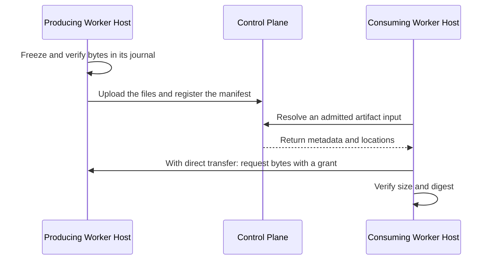

# Artifacts

An **artifact** is a saved piece of work, such as a research report, a code archive, or a bundle
of related files. For example, one agent can save customer research and another can discover and
read it after the first agent's sandbox has been removed.

The artifact catalog records which **Tag** (a persistent AI actor with its own responsibilities
and permissions), **Task** (an accepted assignment), and **Task Attempt** (one execution of that
Task) captured each artifact. The **Control Plane** keeps that catalog and decides which Tasks may
use an artifact. A [**Worker Host**](glossary.md#worker-host) runs the Task through a **harness**
such as Codex or Claude Code and captures the files.

Other terms on this page are defined in the glossary: [Role](glossary.md#role),
[Objective](glossary.md#objective), [Team](glossary.md#team), [Session](glossary.md#session),
[Context Set](glossary.md#context-set), [Volume](glossary.md#volume), and
[Workspace](glossary.md#workspace).

The catalog lives in the Control Plane's database; the bytes never do. A capture streams each file
to the Control Plane's private transfer directory, stored by SHA-256 digest. A Worker Host with
direct transfer configured also keeps its own copy and serves it to other Worker Hosts. An
operator can copy a file to a Volume for a copy that outlives both.



## Save and reuse work

The usual workflow is:

1. Finish writing the selected output files.
2. Capture those files with a title, a kind, and an optional summary.
3. Find relevant prior work and inspect its file list.
4. Read selected text through a tool, or attach selected files to an isolated execution environment.
5. Capture any new results as another artifact.

Capture preserves specific bytes. Changing a workspace file later does not change its saved
artifact. An artifact does not follow a moving "latest" version. When the harness reports its
native conversation identity, the capture also records that native session ID, separately from
the catalog's SuperTag `sessionId`. It identifies the producing Codex conversation or Claude Code
session; it does not copy a transcript or grant access to it.

Capture copies the explicitly selected files individually. It does not freeze a shared directory
or promise that all files came from one atomic filesystem snapshot. Finish related writes before
capture when the files must describe a consistent result. The capturing Task Attempt is
responsible for the submission; it may not have authored every file in a shared workspace.

Worker Hosts do not collect content from a harness's own home directory, such as Codex memories
or Claude Code plans. Codex runs with its memories and image generation turned off.

## Automatic Task outputs

For Codex and Claude Code Tasks with allowed file writes, the Worker Host creates a deliverables
directory for each Task Attempt. For example, an agent can save a report or spreadsheet there
without calling an artifact tool. The Worker Host collects those files when execution finishes.
Git-tracked files are ignored by this default policy; repository code changes stay in Git.

### Output directory and path mapping

The directory is `outputs/<attempt-hash>` relative to the execution environment root. SuperTag
supplies its absolute path in the harness instructions and in `SUPERTAG_OUTPUT_DIR`. This is a
SuperTag convention, not a native Codex or Claude Code output setting: instructions guide where
the agent writes, and a file written elsewhere is not captured. After Session recovery, the
current mapping replaces earlier Task Attempt paths. The mapping grants no additional write
permission.

### Declaring required outputs

A Task can declare which files the Worker Host must preserve after the harness finishes. Write
the policy to a file and pass it to `supertag task submit --outputs FILE`:

```json
{
  "directory": "outputs",
  "required": ["outputs/report.md"],
  "include": ["outputs/**"],
  "exclude": ["outputs/scratch/**"],
  "git": "reference",
  "maxFiles": 100,
  "maxBytes": 67108864
}
```

### Output path rules and collection

Artifact file paths reject control and format characters, including C1 and bidirectional controls,
zero-width spaces, and byte order marks. Unicode line and paragraph separators and every space
character other than the ASCII space are also rejected, such as non-breaking, em, and ideographic
spaces. Paths also reject Hangul fillers (U+115F, U+1160, U+3164, U+FFA0), the Braille blank
(U+2800), the combining grapheme joiner (U+034F), and variation selectors
(U+FE00–U+FE0F and U+E0100–U+E01EF), all Unicode default-ignorable code points, and unassigned
or private-use characters. Paths reject lone UTF-16 surrogates and must use NFC Unicode
normalization. Ordinary spaces and visible Unicode names in NFC remain valid.
Human-readable download confirmations filter terminal controls from file names; JSON preserves the original names.

Paths are relative to the execution workspace. Patterns support `*`, `**`, and `?`.
Required patterns must match captured output; missing or excluded required files prevent success.
An explicit policy that omits its directory uses `outputs`, with an include pattern of `outputs/**`. Limits default
to 100 files and 64 MiB total, with a 32 MiB per-file ceiling. Symlinks, traversal, known credential
files, and dependency or cache directories are excluded. These protections do not detect every
secret: select output directories deliberately and keep credentials outside them.

After execution, the Worker Host checks selected files for changes during reading, freezes their bytes in a private transfer
journal, and saves them to the catalog. Declared outputs are submitted with the Task result.
With this policy, separately captured intermediate artifacts remain available for discovery but
are submitted only if the result explicitly selects them. Other harnesses and read-only Tasks keep explicit capture only.

Remote E2B and Modal Workspaces and shared execution environments do not collect declared outputs.

### Git-backed files

`git: "reference"` avoids copying selected committed files when the Worker Host verifies that the exact
commit is advertised by the configured remote. The artifact includes a Git manifest identifying
that remote, commit, selected paths, and deletions; selected dirty files are still saved as bytes.
If remote verification fails or the commit exists only locally, selected bytes are preserved instead.
SuperTag does not push commits automatically. A Git manifest describes a partial selection, not a
complete repository backup, and remote retention remains the repository owner's responsibility.

Use `git: "capture"` to preserve selected tracked files as bytes regardless of remote state, or
`git: "ignore"` to omit tracked files. Required files cannot be silently discarded by `ignore`.
Untracked reports are still captured when selected, including reports in a Git-ignored output folder.

### Transfer recovery

The Worker Host freezes output bytes in its execution journal, under its state directory, before
it releases the execution environment. After a restart it retries the upload and catalog
registration for the same Task Attempt; the harness is not run again. Registration uses a stable
operation ID, so a lost response does not create a second artifact. Keep the state directory on
persistent storage: it holds execution metadata, so protect it like other Worker Host state.

A crash before bytes are frozen or before cleanup is confirmed leaves an uncertain Task Attempt,
which needs inspection; it is not rerun automatically. Losing the Worker Host's state directory
also loses outputs that have not reached the Control Plane. No filesystem watcher can recover files
that an agent deletes before final collection. Integrity failures and permanent catalog conflicts
keep the journal evidence and stop automatic retries; they need operator recovery.

## Handoff and review

A Task result submits catalog selections:

```json
{
  "artifacts": [
    { "artifactId": "research-capture", "paths": ["research/findings.md", "research/interviews.csv"] }
  ]
}
```

This is the `artifacts` field of the complete Task result, which also contains its summary,
changes, and other result fields. The ID must identify a capture made by that exact producing
Task Attempt. Every selected path must occur in its immutable manifest. A blob URI by itself cannot
be submitted as a Task artifact.

To pass reviewed evidence to another Task in the same Objective, use:

```json
{
  "inputArtifacts": [
    { "artifactId": "research-capture", "paths": ["research/findings.md"], "requireAccepted": true }
  ]
}
```

Omit `requireAccepted` for independent review of a submission or repair of rejected work. The
Control Plane checks source visibility and submission, resolves the selected catalog entries,
and records their URI, digest, size, and exact producing Task Attempt on the accepted Task. Subsequent
captures do not change this input. Built-in Codex and Claude Code adapters preserve the original
entry paths beneath separate per-artifact input directories. An operator selects inputs with
`supertag task submit --artifact-input ARTIFACT_ID:PATH`, repeated for each file.

Review saves the exact submitted selections and Task Attempt identity. New captures and replacement
Task Attempts do not acquire an older result's acceptance. Capture is storage; submission is the
Task's output declaration; review determines whether that submitted work is accepted.

Cross-Objective reuse requires an available publication approval for selected reviewed entries
and a consumption approval from the destination Objective. Once both exist, the assignment uses:

```json
{
  "inputArtifacts": [
    {
      "publicationApprovalId": "research-publication",
      "artifactId": "research-capture",
      "paths": ["research/findings.md"]
    }
  ]
}
```

An operator approves a publication with `supertag artifact-publication publish` and its use with
`supertag artifact-consumption approve`; `task submit --artifact-publication ID` binds selected
inputs to that publication. These are not artifact tools. The publication pins artifact identity
and entries. Possession of its ID does not grant access, and selecting a
publication cannot expand its approved paths or audience.

## Agent tools

The built-in Codex and Claude Code adapters offer these tools to the agent. They are scoped to the
current Task Attempt and exposed to the harness's manager, rather than automatically delegated to
its native child agents.

| Tool | Purpose |
| --- | --- |
| `find_artifacts` | Search visible artifact titles and summaries, optionally filtering by kind or source Task. |
| `inspect_artifact` | Read metadata and the file list for one artifact ID. |
| `read_artifact` | Retrieve a bounded portion of one text file. |
| `attach_artifact` | Copy selected files into an exclusive execution workspace. |
| `capture_artifact` | Save explicitly selected files from the execution environment. |

For example, a capture tool call can contain:

```json
{
  "operationId": "capture-interview-findings",
  "title": "PT practice research",
  "kind": "research",
  "summary": "Interview findings and supporting survey data",
  "files": [
    { "path": "workspace/research/findings.md", "mediaType": "text/markdown" },
    { "path": "workspace/research/interviews.csv", "mediaType": "text/csv" }
  ]
}
```

The returned artifact ID identifies that capture. Use `inspect_artifact` to select exact entry
paths, then pass the artifact ID and path to `read_artifact`, or an array of paths to
`attach_artifact`. Reads report whether more content remains. Binary files require attachment;
they are not returned as large encoded text tool responses.

Use a stable `operationId` when retrying one capture or acquisition. Reusing it with a different
definition fails. A new result or a different selection needs a new operation ID. SuperTag records
acquisition before delivering bytes and records delivery separately; delivery is evidence that
the adapter received content, not that a model read or understood it.

OpenCode and Cursor Tasks do not receive these tools; declared outputs and preselected artifact
inputs still work for them. A custom harness adapter calls the Worker Host's `HarnessArtifacts`
service (`Capture`, `Find`, `Inspect`, `Read`, `Attach`); see
[Write a harness adapter](../guides/harness-adapters.md).

## Attachments and shared environments

An attachment is a **writable copy** in an exclusive workspace. The operation returns its resolved
destination and selected paths. Editing the copy does not change the source artifact; capture the
edited output to save a new result. Dynamic attachment is not a read-only security boundary.

The current implementation requires an execution environment that supports safe materialization
and a workspace exclusive to one Task Attempt. It does not dynamically attach artifacts into unisolated
shared environments: another agent with access to the same filesystem could otherwise read the
content. Agents in those environments can use direct `read_artifact` calls within their allowed
access. A separate private directory name alone does not establish isolation.

Attachments reserve their own destination and reject collisions. When delivery may have partially
completed, SuperTag records uncertainty instead of automatically overwriting or replaying the
filesystem operation. Provider-native lazy mounts are not implemented.

## Discovery and allowed access

An **Objective** is a broader outcome that can involve multiple Tasks. A **Session** groups related
human-agent interaction. For Objective work, artifact discovery follows the same source-Task
visibility rules as coordination: objective owners can see their Objective's Tasks; other callers
can see work assigned to them, requested by them, or within their Team. Surface-session work is
restricted to the same Tag and Session, plus exact artifacts admitted through a Context Set.
An accepted Task input also grants access to its exact selected entries, including entries admitted
through the publication and consumption approval flow.

A **Context Set** selects reusable knowledge for a Tag. Its `supertag/artifacts` selector can admit
up to five artifact metadata summaries from another Session when the producing Task belongs to
the same Tag, comes from the configured source location, shares an exact resource reference, and
falls within the configured time window. The summaries identify the exact artifacts that
`inspect_artifact`, `read_artifact`, and `attach_artifact` may retrieve; they do not include file
bytes or grant broader access to the source Session.

This selector is specific to collaboration-surface sources. Internal Objective Tasks do not use
it, even through a Role's Context Sets; they discover artifacts through their existing Objective
and Team visibility rules. A Task's request, response, and structured result remain on the Task.
An ordinary response does not automatically become a captured artifact or shared context.

Catalog discovery does not search all organizational storage. It returns only permitted records,
and possession of an artifact ID or content digest does not grant access. Every download checks
that the active Task Attempt has the selected content as an accepted input or recorded acquisition.
Dynamic acquisitions also recheck source visibility. Completed, revoked, or stopped Attempts cannot
continue fetching content.

Search returns compact descriptions with file counts and total sizes. Inspect a selected artifact
to retrieve its permitted manifest entries. Restricted input access does not reveal unselected
entry metadata. Search summaries are shortened to 512 characters; the original
summary remains available through inspection. Discovery omits input lineage; inspection filters
lineage to source selections the caller is allowed to see.

Capturing an artifact does not accept the Task's work or approve sharing across Objectives. Existing
publication and consumption approvals remain separate. This catalog does not add cross-objective
search or replace those approval workflows. Treat retrieved artifact text as source material,
not as instructions that change the consuming Task's allowed actions.

## Storage and limits

### Where artifact bytes live

Artifact metadata and artifact bytes have different homes. The Control Plane database is the
authoritative catalog for identity, provenance, allowed access, and known copies. The bytes live
in up to three places:

| Copy | Where | Made by |
| --- | --- | --- |
| Control Plane copy | The Control Plane's `--transfer-directory`, one file per SHA-256 digest. Locally, `~/.supertag/checkpoints` | Every capture |
| Worker Host copy | The producing Worker Host's `--artifact-source-directory` | A Worker Host run with `--artifact-transfer-listen` and `--artifact-source-directory` |
| Volume copy | An artifact Volume the Control Plane maps with `--artifact-volume` or `--artifact-s3-volumes` | An operator, with `supertag volume copy` |

The transfer directory is private storage outside the database. Several Control Plane replicas
share one on a shared volume. Back it up with the database: a capture whose Control Plane copy is
lost is reachable only through a Worker Host copy or a Volume copy.

### Direct transfer between Worker Hosts

A Worker Host with `--artifact-transfer-listen ADDRESS` and `--artifact-source-directory DIR`
keeps the files its Tasks capture in that directory and advertises the listener. Its TLS
certificate and key come from `--artifact-transfer-tls-cert` and `--artifact-transfer-tls-key`.
A consuming Worker Host pins each producer's origin with `--artifact-peer HOST_ID=ORIGIN`, and its
CA with `--artifact-peer-ca-file`. The consumer asks the Control Plane for a short-lived transfer
grant scoped to one file, producer, consumer, and expiry, then downloads the file from the
producer and checks its size and SHA-256 digest. A retried transfer never reruns the producer.

### Volume copies

An artifact Volume holds copies that outlive the Control Plane's transfer directory and every
Worker Host. The Control Plane owner consents to each Volume's storage when starting it:
`--artifact-volume VOLUME_ID=/absolute/private/directory` for a directory, or a JSON file passed to
`--artifact-s3-volumes` that maps each `s3://` Volume to its endpoint, region, and the environment
variables that hold its keys. Register the Volume, then copy one file:

```sh
supertag volume put archive --source s3://acme-artifacts/archive --operation-id put-archive
supertag volume copy archive ARTIFACT_ID --path research/findings.md --expected-revision 1 \
  --operation-id copy-findings
supertag get volume-copy
supertag volume download COPY_ID --output findings.md
```

`volume download` reads the copy back and verifies it, even after the transfer directory is lost.
When its own copy is missing, the Control Plane also serves artifact downloads from a recorded
Volume copy. `supertag delete volume` is refused while reserved or verified copies depend on the
Volume.

### Operator downloads

`supertag artifact download ARTIFACT_ID --path PATH --output FILE` writes one file only when its size
and digest match, and never overwrites an existing file. When neither the Control Plane copy nor a
Volume copy is available, it writes nothing and reports that the source is unavailable.

Automatic replication and repair are not implemented. Back up the transfer directory, every
required Worker Host copy, artifact Volumes, and the catalog database together.

### Limits

| Item | Current limit or behavior |
| --- | --- |
| Individual file | 32 MiB. |
| Explicit capture | 1–100 selected files, up to 64 MiB total. |
| Dynamic attachment | Selected files totaling at most 64 MiB. |
| Declared outputs | Up to 100 files and 64 MiB by default, within the limits above. |
| Agent text read | Up to 64,000 bytes per call; smaller reads are the default. |
| Catalog search | Bounded pages; use the returned cursor for additional results. |
| Content retention | Operator-managed; automatic garbage collection is not implemented. |

The Worker Host verifies content before the catalog accepts its metadata. A capture must reference
matching storage evidence for its exact Task Attempt. An interrupted capture may leave unused bytes,
but storing bytes alone does not create a discoverable artifact. Keep referenced objects when
configuring retention and back up the catalog alongside durable content.

Agents receive artifact IDs and paths rather than storage credentials or raw locations. Transfer
grants are internal Worker Host credentials scoped to an exact artifact entry, source Worker Host,
recipient Worker Host, and expiry. Knowing an artifact ID or digest is insufficient.

Availability follows configured storage, rather than catalog presence alone:

| Copy | Survives the producing Worker Host's loss | Survives loss of the transfer directory |
| --- | --- | --- |
| Control Plane copy | Yes | No |
| Worker Host copy | No | Yes, while that host's disk lasts |
| Volume copy | Yes | Yes, while the Volume lasts |

SuperTag does not silently rerun the producing Task to reconstruct lost bytes.

## Metadata reference

A catalog artifact contains:

| Field | Meaning |
| --- | --- |
| `id`, `operationId` | Captured artifact identity and the producer's retry key. |
| `taskId`, `attemptId`, `tagId` | Exact producer assignment, execution, and identity. |
| `objectiveId`, `sessionId` | Existing organizational and conversation context. `objectiveId` is optional. |
| `title`, `summary`, `kind` | Searchable description; `summary` is optional. |
| `entries` | Immutable file manifest stored in catalog metadata. |
| `inputs` | Server-recorded artifact selections supplied to the producer. |
| `createdAt` | Time the catalog registered the capture. |

Each entry has a normalized relative `path`, a content `uri`, a SHA-256 `digest`, `sizeBytes`, and
an optional `mediaType`. The manifest currently lives in the metadata database rather than as a
separate uploaded manifest blob. Content references use `supertag-artifact:sha256:<digest>`.

The server derives `inputs` from the producer's admitted Task inputs and successful delivery
receipts already recorded when capture occurs. The capturing agent cannot assert this field.
It records available or delivered evidence, not proof that every file was read, understood, or
used to produce the output. Later acquisitions do not rewrite an earlier capture's lineage.

An acquisition records its consumer Task and Task Attempt, source artifact ID, selected paths,
delivery method, optional destination, and status (`authorized`, `delivered`, `failed`, or
`uncertain`). These records identify what content was selected and delivered. They do not claim
complete filesystem-read tracking or verified intellectual derivation.

Native conversation state belongs to the Session and is stored privately for retrieval and
resumption. It is not a catalog artifact and is not exposed through artifact discovery.
Workspace files and reports can be published separately as artifacts. Storing a conversation
does not automatically publish its messages or tool output.

## Harness adapter integration

A harness adapter captures and reads artifacts through the `HarnessArtifacts` service of the
harness protocol; see [Write a harness adapter](../guides/harness-adapters.md).
