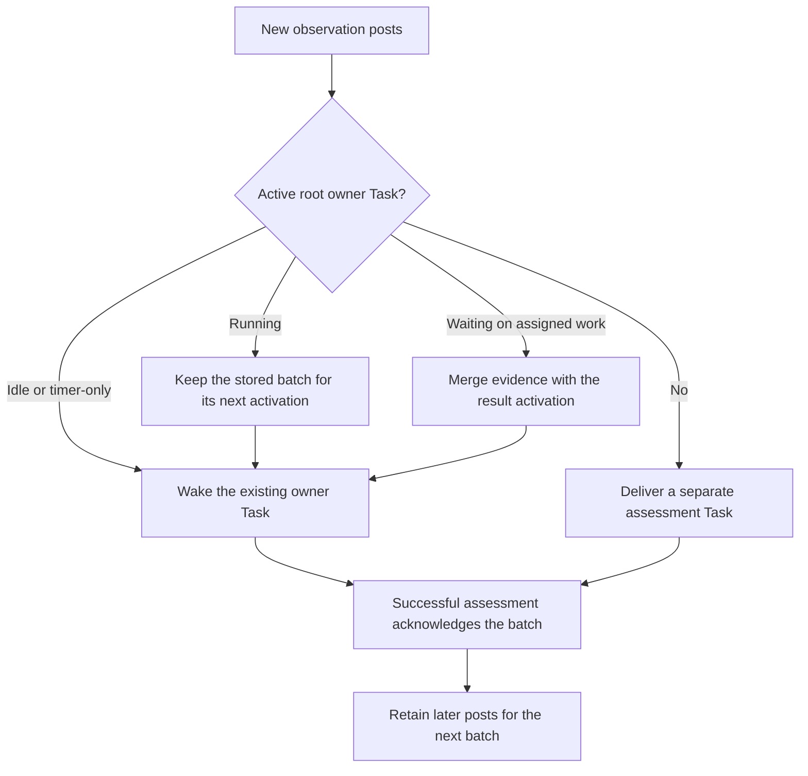

# Objective coordination reference

This page collects the rules, limits, and edge cases behind SuperTag's [Objective](glossary.md#objective) guides.

An **Objective** is an outcome owned by a Tag, a **Tag** is a persistent AI identity with its own
responsibilities and permissions, a **Task** is one assignment toward the outcome, and a **Team**
groups Tags under a lead. See the [glossary](glossary.md) for other terms. For step-by-step
procedures, start with [Coordinate Tasks toward an Objective](../guides/objective-coordination.md),
[Define and complete an Objective](../guides/objectives.md), [Organize Tags into
Teams](../guides/teams.md), [Maintain an ongoing
responsibility](../guides/ongoing-responsibilities.md), [Check an Objective's
progress](../guides/objective-overview.md), and [Respond to budget and operator
requests](../guides/objective-decisions.md).

Other terms on this page are defined in the glossary: [Role](glossary.md#role),
[Workstream](glossary.md#workstream), [Mailbox](glossary.md#mailbox),
[Task Attempt](glossary.md#task-attempt), [Session](glossary.md#session),
[Permission Set](glossary.md#permission-set), [Control Plane](glossary.md#control-plane),
[Gateway](glossary.md#gateway), [Surface Account](glossary.md#surface-account),
[Worker Host](glossary.md#worker-host), [host service](glossary.md#host-service),
[Worklet](glossary.md#worklet), [Worker Profile](glossary.md#worker-profile),
[Worker](glossary.md#worker), and [Workspace](glossary.md#workspace).

An **owner activation** is one run in which the Objective's owning Tag checks results, messages,
and next steps. SuperTag may start another activation when new work needs its attention.

## Objective creation rules

- Creation requires an outcome statement: the result, how success is verified, what must not
  change, and when to ask a person. The outcome may be up to 8,000 characters.
- The ID is caller-chosen. Through the administrative API and CLI it is optional: without one, the
  Control Plane generates it from the first three words of the outcome plus four random letters or
  digits, such as `bill-for-usage-7f3k`. Tag-authenticated creation still requires an ID, so retries
  stay idempotent.
- Creation returns `warnings`, a list of conditions that would hold the Objective's Tasks. Each is
  a sentence with the next step. They cover an owner Tag with no bound Worker Host, no bound host
  connected, a named Workspace that no bound host has checked out, a zero budget, and a passed
  deadline. Warnings never stop creation; see [Runnable](#runnable). Creation also warns about
  [runtime actions](#objective-runtime-actions) it left out or an owner with none.
- `?dryRun=true` (CLI `--dry-run`) validates exactly like creation, returns the would-be Objective
  with its warnings and `dryRun: true`, and stores nothing. An existing ID with a different
  definition still returns 409.
- `start: true` on the administrative API also starts the owner, as `start_objective` does, and
  returns `started` with the start Task's `taskId` and `teamId`. When the owner cannot start, the
  Objective is still created and `notStarted` gives the reason. `start` defaults to `false`; the
  CLI sends `true` unless given `--dry-run` or `--no-start`. Starting is idempotent: a retried
  creation, or a `start_objective` without a `taskId`, returns the existing start Task.
- The owner must be active.
- Retrying the same definition returns the existing record, including its current status. A
  different definition with the same ID returns 409.
- The outcome and owner are fixed at creation in this version. Changing the definition
  requires a new Objective ID.
- `--deadline` takes a future ISO timestamp. See [Deadlines](#deadlines) for what happens as it
  approaches and passes.
- `runtimeActions` (CLI `--runtime-action`) defaults to the owner Tag's runtime actions, and an
  explicit list only narrows them. See [Objective runtime actions](#objective-runtime-actions).
- Starting the Objective does not grant collaboration surface permissions or external writes.
- The current system does not automatically grant access to surface channels, send customer
  outreach, or provide a complete coordination dashboard. Team changes, Team channel posts, and Task
  results can be inspected through the CLI.
- An Objective created from a collaboration thread cannot grant additional collaboration surface access.
- `ongoing: true` (CLI `--ongoing`) and `observations` (CLI `--observe`) are independent choices.
  See [Completing an Objective](#completing-an-objective) and
  [Observation delivery](#observation-delivery).
- `workspaces` (CLI `--workspace`, repeatable) names up to 16 existing Workspaces. Unknown names
  are rejected. Operators may name any Workspace. The Tag-authenticated Mailbox API refuses
  `workspaces`.
- An Objective created from a collaboration thread gets the Workspaces of the Tag location the
  request arrived at, or, for a GitHub location without any, those whose `source` is its
  repository. The surface `create_objective` tool accepts an optional `workspaces` that names a
  subset; any other name returns 400. See
  [Objectives from a location](resource-model.md#objectives-from-a-location). `assign_task` accepts an optional `workspace`,
  which must be one of the Objective's. Without it, a Task uses the Objective's only Workspace;
  with several, the Task gets none. The owner's start Task uses the first. The choice, base ref, and
  Task branch are recorded at admission. See
  [Work in a repository with Workspaces](../guides/workspaces.md).

Budget fields are described in [Budgets and allocation](#budgets-and-allocation).

## Start an Objective later

`supertag start objective ID [--output json]` starts an Objective created with `--no-start`.
It calls `start_objective` with that ID, prints its new status, deadline, budget, and a command
to inspect it. `--output json` returns the structured start result. An unknown ID or an Objective
that already started produces an error.

## Statement items

A statement item is a numbered line of an Objective statement, such as `3. Fix the inbox count.`
The line starts with a number and `.` or `)`, after at most three spaces.

- `assign_task` accepts an optional `items`, such as `["1", "3"]` (CLI `--item`, repeatable). It
  names the statement items the Task serves.
- Each entry must be one of the Objective's current item numbers; otherwise `assign_task` returns
  400. A Task holds at most 50 items.
- SuperTag stores items sorted and without duplicates. An idempotent retry must repeat them.
- The Objective overview's `items` lists each statement item with an overall state and every
  visible Task that serves it. The states are `not started`, `in progress`, `in review`, and
  `done`; see [check an Objective's progress](../guides/objective-overview.md#1-read-the-overview).

For a Workspace Task, the delivered branch uses `supertag/<objective-slug>/<task-name>`.
SuperTag shortens and cleans both names for Git, omits a repeated Objective prefix and opaque
IDs from the Task name, and adds a short suffix only when the branch is already taken.
- The owner's start instruction tells owners and leads to record items on every assignment. It
  also tells them to check that every item has a Task before waiting.

## Objective runtime actions

Runtime actions, such as `files:write` and `commands:execute`, let Tasks edit files or run
commands. `runtimeActions` is the Objective's ceiling for them.

- Omitted, it defaults to the runtime actions the owner Tag's Permission Sets allow: the union
  across its active Roles. SuperTag resolves the default once, at creation, and stores it. Later
  Permission Set changes do not rewrite it. A retry that omits the field returns the stored record.
- An Objective created from a collaboration thread gets the invoking Task's runtime actions: those
  of the Tag's Roles and of the Permission Sets activated at that location. Its Tasks keep that
  location's approval requirements.
- An Objective a Tag creates through its Mailbox credential gets that Tag's own runtime actions.
  A Tag cannot name runtime actions, so it never widens what it could already use.
- An operator's explicit list only narrows. SuperTag drops any action the owner's Permission Sets
  do not allow and returns a warning naming it. Creation does not otherwise check the owner's
  grants, so a drop is a warning rather than an error.
- An owner with no runtime actions gets a creation warning that its Tasks cannot edit files or run
  commands. It does not affect [Runnable](#runnable).
- Only operators change the list afterwards, with `supertag update objective ID --runtime-action
  ACTION ...` (`runtimeActions` in the update body). The new list replaces the old one, stays
  within the owner's Permission Sets at that moment, and applies to Tasks accepted afterwards.
  Accepted Tasks keep their snapshot. Team creation and membership cannot expand the list.
- A Task receives only actions within the list and, for delegated work, within its delegating
  Task's. An inherited action keeps its approval requirement. A Task waits for approval when its
  own Permission Sets, or those of the Task, owner, or location it inherits the action from, mark
  the action `approval: required`.

## Visibility and access

- An SDK-created Objective belongs to the authenticated Tag. Operators may name another owner.
- The owner and members of the Objective's active Teams can read its outcome, criteria, status,
  and completion assessment.
- Outsiders receive 404.
- Each Team has one channel, its **Workstream**, created with the Team. Team members read and post
  to it. The owner reads every channel in its Objective, including those of shared Teams linked to
  it, and posts only where it is a member.
  Membership in one Team does not expose another Team's channel. Each post belongs to the
  Objective it was written under, so a shared Team's channel shows each Objective only its own
  posts. See [Team channel rules](mailbox.md#team-channel-rules).
- Team membership permits messages between that Team's lead and members. Across Teams, directional
  grants govern sending. Objective visibility alone grants neither permission to message nor
  permission to execute a request.
- Operators retain administrative access.
- List APIs return the most recent 100 visible records, with a maximum limit of 200.

Access to the operator overview is described under [Overview fields: Access](#access).

## Budgets and allocation

### Units and currency

- `budgetLimitMinor` (CLI `--budget-minor`) bounds organizational Task allocations. It uses
  consistent minor units chosen by the operator; `200000` represents $2,000 when using US cents.
- `budgetCurrency` (CLI `--budget-currency`) denominates those units so SuperTag can validate Task
  cost controls and provider-reported spend. It must be an uppercase three-letter currency code,
  such as `USD`, and is valid only with a budget limit.
- A budget with a currency also caps provider-reported cost across the Objective. See
  [Monetary budgets](#monetary-budgets).
- A currencyless budget remains an internal allocation. It cannot be compared with
  provider-reported money or combined with a provider monetary ceiling.
- For a monetary Task, `execution.limits.maxReportedCost.currency` must match the Objective
  currency. Its amount must be no greater than that Task's `maxCostMinor` allocation. Omitting
  `maxCostMinor` reserves zero, so only a zero provider ceiling is valid.
- A matching provider limit still applies to one Task Attempt, one execution of a Task. Objective
  `spentMinor` and `reservedMinor` remain the organizational allocation ledger. See
  [execution limits](worker.md#execution-limits) for per-Task Attempt limits.

### Reservation and charge

`maxCostMinor` reserves declared Task allocations against the Objective. The persisted reserved
and charged amounts enforce those allocations across concurrent admission. They are not a live
meter of model-provider invoices or external purchases. Do not interpret the Objective budget as a
hard billing cap on credentials available to arbitrary external tools.

The Objective keeps two amounts. `reservedMinor` holds allocations for Tasks not yet claimed.
`spentMinor` holds charged allocations. A Task is **charged** when a Worker first claims it. At that
point its whole `maxCostMinor` moves from `reservedMinor` to `spentMinor`, whatever it later uses.
Cancelling a Task before its first claim releases its reservation. Nothing is refunded after a
claim. Provider-reported cost never changes either amount.

For example, an Objective has `budgetLimitMinor` 1000 and no currency. A manager assigns a Task
with `maxCostMinor` 400. Admission checks that spent plus reserved plus 400 does not exceed 1000.
The Task reports $0.63 of provider usage. The Objective still charges 400 internal units, and 600
remain. The $0.63 appears only as provider usage, with
`objectiveCurrencyComparison: "internal_units"`.

Exhausted unallocated budget restricts new admission. Already reserved Tasks are not blocked by
that fact alone.

### Monetary budgets

A budget with a currency caps observed spend. Codex costs are estimates from token usage and model prices, so this cap can differ from provider billing. The Control Plane adds up the latest
provider-reported cost of each ordinary Task Attempt in the Objective, in the Objective's currency. The final owner limit summary uses a separate allowance. It
recomputes this total from persisted usage evidence about every 10 seconds, so it survives
restarts. The allocation checks above still apply as well.
`limitState.reportedSpend.estimatedCostAttempts` counts estimated costs across the whole
Objective, including Tasks outside the displayed page. The readable objective view labels totals
that include these estimates.

| Reported spend | Effect |
| --- | --- |
| Reaches 80% of the limit | One `objective_budget_threshold` warning |
| Reaches the limit | New Tasks and continuations are refused; running Task Attempts finish, then the Objective becomes `limited` |

Running Task Attempts keep their authority at budget exhaustion. Their eventual cost counts toward
the Objective's reported spend, even above the limit. `supertag describe objective ID` shows the
overrun. A `limited` Objective admits one small owner activation to record what was finished, what
remains open, what blocks progress, and the next useful step. This limit summary appears in the
Objective description. It does not spend from the exhausted Objective budget. A deadline has the
same summary path after its grace period and running Task Attempts have ended.

A Task Attempt that finished without reporting cost counts as unknown, not zero. The overview then
shows `budget_coverage_incomplete`, because actual spend may be higher than the reported total.

For example, an Objective has `budgetLimitMinor` 300000 and `budgetCurrency` `USD`, a $3,000 cap.
When Task Attempts have reported $2,400, the operator receives one warning. At $3,000, new work
stops while running Task Attempts finish. If they finish at $3,080, the Objective shows an $80 overrun
and status `limited`. The owner records a limit summary. Raising the limit to 400000 resumes the
Objective from that summary; moving an expired deadline does the same when the budget allows it.

### Reported usage versus allocation

Assigned budgets and observed usage are separate. Claude Code reports token usage as it works, and
its SDK connection allows up to five seconds after cancellation for a final usage report. New tool
calls are denied immediately; this cleanup interval cannot publish a result or complete the Task.
If the report does not arrive, or the connection uses an owned CLI process, usage may remain
partial. SuperTag retains that evidence and marks its coverage incomplete. Missing cost is unknown,
not zero. A provider's reported cost also does not establish what a subscription account was
billed. Check reporting coverage before comparing an
[organization](glossary.md#autonomous-organization)'s consumption with its allocation.

### Mailbox and observation delivery reservations

A fully charged Objective allocation is different from a Task that exhausted a harness execution
limit. Each Mailbox or observation delivery reserves its inherited `maxReportedCost` amount, or zero
without one.

- A zero-cost delivery is admitted even when the allocation is fully committed.
- A positive amount must fit the Objective's available amount.
- Ordinary mail that does not fit stays `pending`, not `failed`, until budget is available.
- A blocked observation delivery records `Observation delivery awaits available Objective budget`
  on the Objective.
- When observation assessment would exceed the Objective allocation, an `objective_budget` item
  appears in the operator inbox even if the owner is waiting and no Task failed. Configured Gateway
  notifications use the existing verified operator destination. The inbox reports when delivery is
  unconfigured.

### Increasing an Objective allocation

- Only an authorized operator can increase a finite limit, through `update_objective` with its
  current `expectedRevision` and a larger `budgetLimitMinor`. Agents cannot make this change.
- A stale revision is rejected. Refresh the inbox before deciding.
- The increase is audited and preserves currency. It does not automatically renew failed Task
  execution limits, restart cancelled Tasks, or complete the Objective.
- After approval, the Control Plane retries pending observation admission. It advances the
  observation position only after assessment.
- For a monetary budget, admission resumes once the new limit exceeds reported spend. Warnings
  are raised again against the new limit.
- Reported spend depends on what Harnesses report. It is not a promise about provider billing.

The HTTP rules for this update are in the
[Control Plane API reference](control-plane-api.md#objective-allocation-recovery-and-wait-explanations).
For the procedure, see [Respond to budget and operator requests](../guides/objective-decisions.md).

### Renewing an exhausted Task

When a harness confirms that a Task Attempt stopped for lack of budget, `read_task` shows
`failureKind: "budget-exhausted"` in its result and `task.budget-exhausted` in its history.

- The Task remains failed until an authorized decision. Completed Objectives and accepted results
  remain intact.
- Negotiate resources with an ordinary Mailbox message: include the Task ID, completed work,
  remaining work, and requested allocation. A Mailbox reply alone does not restart execution.
- An authorized Objective owner or Team lead other than the assignee can apply the allocation
  through `update_task`. An operator can also do so through the administrative API.
- Renewal authorizes a fresh per-Task Attempt allocation, not an increase to a lifetime counter. It may
  be smaller than the previous allocation if little work remains.
- Include every spending dimension already imposed on the Task. Renewal cannot remove an existing
  token or cost ceiling or change native-agent permissions.
- Monetary allocations must fit the Objective's available budget and currency.
- SuperTag records who renewed the allocation and the previous limits, preserving earlier Task Attempt
  reports. A repeated stale update is rejected.
- A completed Objective cannot receive renewed work. If the required outcome is already accepted,
  recording the overrun may be all that is needed.
- Native Session recovery is attempted only when a safe archive and compatible policy exist. It
  never silently restores workspace files.

### Accepting a failed Task that delivered commits

A Task Attempt can fail after its work is already committed, for example when a harness times out
while finishing its reply. The commits stay on the Task branch, so the work can still be reviewed
and merged.

When a failed Task Attempt left the Task branch ahead of its base, SuperTag records the failure as
**failed after delivering commits**:

- The Task's status stays `failed`. `read_task` shows `deliveredCommits` in its result, with the
  Task Attempt ID, `branch`, `base`, `head`, and `changedFiles`.
- The Objective overview explains the Task with kind `failed_after_delivering_commits`.
  `supertag describe objective` prints "Failed after delivering commits" under the Task, and
  `supertag watch objective` reports "failed after delivering commits".
- The delegator, meaning the requesting Objective owner or Team lead, can review the branch and
  accept it with `update_task`: `status: "accepted"`, `expectedStatus: "failed"`, and an
  `assessment`. Accepted dependents can then run, as after any accepted result.
- Only acceptance is allowed from `failed`. A failure without delivered commits still cannot be
  reviewed, and the assignee cannot accept its own delegated Task.

## Deadlines

A deadline is fixed behavior, not a setting. Its *window* runs from when an operator last set the
deadline, or from the Objective's creation, to the deadline itself.

| When | Effect |
| --- | --- |
| 24 hours before | One `objective_deadline_approaching` warning |
| A quarter of the window left | One `objective_deadline_approaching` warning |
| 1 hour before | One `objective_deadline_approaching` warning |
| At the deadline | New Tasks, continuations, waits, and wakes are refused; one `deadline_passed` notice |
| After the grace period | Running Task Attempts lose authority and stop |

A warning whose time had already passed when the deadline was set is skipped, and warnings at the
same offset count once. Each warning states the time left in readable units, such as "about 15
minutes left".

| Window | Warnings | Grace |
| --- | --- | --- |
| 2 days | 24 hours, 12 hours, and 1 hour left | 15 minutes |
| 12 hours | 3 hours and 1 hour left | 15 minutes |
| 60 minutes | 15 minutes left | 15 minutes |
| 20 minutes | 5 minutes left | 5 minutes |

The grace period is 15 minutes, capped at a quarter of the window, and never less than 1 minute.
A deadline that had already passed when it was set keeps the full 15 minutes. During the grace
period, running Task Attempts keep their authority and may finish. The owner may still complete
the Objective with evidence.

When the Control Plane ends a running Task Attempt's authority, the Task Attempt records that
cause as its failure. The cause may be the deadline, the budget, or a lost lease. The harness often
reports its own error first, such as a timeout. The recorded failure names the Control Plane's
cause instead, so `supertag describe task` shows why the Task Attempt stopped. For example, it
reads `Control Plane revoked Task Attempt authority: Objective deadline passed`. The other causes
are `Objective was cancelled`, `Objective was completed`, and `Objective budget exhausted`. A
lost lease reads `Attempt authority expired` or `Execution lease lost`. A Task Attempt that the
Control Plane recovers after a restart passes the same cause to its Worker when it cancels it.

### What the owner sees

- Every owner and Team activation's `currentWork` includes `limits.deadline`: the deadline,
  `minutesRemaining`, a readable `remaining` such as "about 15 minutes left", `graceMinutes`, and
  the `notices` already raised for this deadline. The owner's start instruction names the
  deadline, and continuations state the time left.
- Each warning, the deadline passing, and each operator move is recorded once in the owner's
  Mailbox as an already processed notice. `read_mailbox` lists it, and it never blocks completion.
- A running owner receives each notice raised since its Task Attempt started once, as
  `deadlineNotices` on its next coordination tool result.
- An owner waiting on its own root Task wakes with reason `deadline` when a warning or move arrives
  after it began waiting.

### Moving a deadline

- Only an operator can change a deadline, through `update_objective` with the current
  `expectedRevision` and a new `deadline`. The CLI form is
  `supertag update objective ID --revision N --deadline ISO`. Agents cannot make this change.
- The new deadline may replace one that already passed. Normal scheduling resumes, including owner
  continuation and any observation delivery that stopped at the deadline.
- The owner receives one notice with the old and new deadline and the time left.
- Warnings are raised again against the new deadline, with a window that starts at the move. The
  grace period is recomputed the same way. The change is audited in the Objective's resource
  history.

## Coordination tools

### Who receives the tools

Use harness-native collaboration for local subagents, intermediate discussion, and tightly coupled
work inside one execution. Only the root harness actor receives SuperTag coordination tools.
Codex native subagents are currently disabled because Codex cannot yet give them a tool set
distinct from the root harness actor's tools. Claude Code and OpenCode retain scoped local delegation.
Harness-native subagents are not Team members.

The root harness actor uses these primitives when coordination crosses a harness boundary:

| Resource | Read or communicate | Change |
| --- | --- | --- |
| Objective | `read_objective` | `update_objective` |
| Team | `read_team` | `create_team`, `update_team` |
| Task | `read_task` | `assign_task`, `update_task` |
| Mailbox | `read_mailbox`, `send_message` | |
| Team channel (Workstream) | `read_workstream`, `post_workstream` | |
| Tag | `list_tags` | `create_tag` |
| Approval request | | `request_approval`, `decide_approval` |

The Objective owner and Team leads receive `list_tags` and `request_approval`. A Tag receives `decide_approval`
only when a Permission Set names it in `approvers`. See [Approval requests](#approval-requests).

`wait_for` records wake conditions and stops the current Task Attempt. A fresh Task Attempt resumes when
one of those conditions is met; see [Wait conditions](#wait-conditions).

`escalate_task` raises the effort or switches the model of the Task the manager is working, then
continues that Task in a new Task Attempt; see [Self-escalation](#self-escalation).

### Conversation tools

A conversation turn is a Task in a conversation Session: a thread, an issue, a direct chat, or a
CLI conversation. Besides the Objective tools, it receives tools that read the Tag's other work
and hand work to [work Sessions](../concepts/tasks.md#session):

| Tool | Input | Effect |
| --- | --- | --- |
| `list_objectives` | `limit`, `offset` | Lists the open Objectives the Tag owns, with where each started |
| `read_objective` | an Objective ID | Reads any Objective the Tag owns |
| `list_sessions` | `limit`, `offset` | Lists the Tag's other Sessions this conversation may see |
| `search_sessions` | `query` (up to 200 characters), `limit` | Finds completed Tasks in those Sessions by request or result |
| `read_session` | `sessionId`, `limit`, `before` | Reads one visible Session's latest completed Tasks; `before` pages to older ones |
| `start_session` | `title` (up to 120 characters), `instruction` (up to 8,000), optional `workspace` | Starts a work Session |
| `continue_session` | `sessionId`, `message` (up to 8,000 characters) | Starts a work Session's next Task |

`limit` is at most 20. A conversation sees a Session of its Tag that is shared, or private to the
same person. Session reads return history, not instructions, and grant no authority.

A work Session's Task receives the read tools plus `ask` with `question`, up to 2,000 characters.
A report turn receives only the read tools. One conversation turn starts at most four work
Sessions. A conversation holds at most eight unfinished work Sessions, and at most four run at
once.

### Identity and preconditions

- Coordination calls are authenticated by a credential scoped to the active Task Attempt and
  Objective. Internal coordination derives the acting Tag from that Task Attempt and never accepts a
  caller-supplied identity.
- A Task cannot use that credential after its lease ends. A **lease** is the Control Plane's
  time-limited claim that one Task Attempt is running.
- `create_tag`, `create_team`, and `assign_task` create stored records rather than relying on prose
  messages to establish responsibility. `create_team` also creates the Team's channel.
- New Tags do not inherit execution profiles. Creating a Tag does not create a new Worker Host.
  A new Tag has no Roles and no bound Worker Host, so it cannot run work until an operator binds
  one. Look for an existing Tag with `list_tags` first.
- Tools that take a Tag ID also take the Tag's name: `leadTagId` and `memberTagIds` on
  `create_team` and `update_team`, `assignedTagId` on `assign_task`, and `recipientTagId` on
  `send_message`. An active Tag's ID matches first; otherwise SuperTag uses the active Tag with
  that name. Active Tag names are unique. The name `system` is reserved for system notices,
  ignoring case and surrounding whitespace.
- `update_task` changes one canonical field per call and requires `expectedStatus`. Its
  `finding` field closes one [review finding](#closing-a-finding). `update_team`
  requires `expectedRevision`. These preconditions prevent stale decisions from overwriting
  concurrent transitions.

### Read tools

- `read_task` provides full results and per-Task Attempt budget evidence for one Task.
- `read_team` includes the Team's shared context, governing Objective owner, parent and children,
  its Tasks, and permitted Team destinations. Each destination is labeled `current`, `parent`,
  `child`, or `peer` relative to the Team being read.
- `read_workstream` returns a Team channel and the posts written under the caller's Objective
  after an optional `afterSequence` cursor, up to `limit` posts. `post_workstream` posts to the
  channel of a Team the caller belongs to, under the caller's Objective, with an optional `type`,
  `to`, `references`, and `replyTo`. See
  [posts and Objectives](mailbox.md#posts-and-objectives).
- `read_objective` returns the discovery view described in
  [Discovery view for agents](#discovery-view-for-agents).
- `list_tags` returns the organization's active Tags, up to 100 per page with `limit` and
  `offset`. Each entry has the Tag's `id`, `name`, active Role names, allowed `execution`
  (`harness`, `model`, and `effort`; an absent field allows anything its hosts offer), and bound
  `workerHosts`, and `taskCounts`. The counts show running and queued Tasks for the caller's
  Objective and overall. Use them to balance assignments across idle builders. They reveal no
  other Objective's Task details. Each host has a `connectionStatus` of `connected`, `disconnected`, `revoked`, or
  `not_joined` for a host bound by name that has never joined. A Tag runs work only through a
  connected host. The result's shape is
  [tag-directory.schema.json](../../spec/tag-directory.schema.json).

```json
{
  "tags": [
    {
      "id": "e26b70d9-f444-451e-b4ec-e2a1c4f1bfca",
      "name": "reviewer",
      "roles": ["Reviewer"],
      "execution": { "harness": "codex", "model": ["gpt-6-sol"], "effort": ["low", "medium", "high"] },
      "workerHosts": [{ "id": "laptop", "connectionStatus": "connected" }],
      "taskCounts": { "objective": { "running": 0, "queued": 1 }, "overall": { "running": 1, "queued": 2 } }
    }
  ],
  "total": 1,
  "nextOffset": null
}
```

### Org Architect requests

If an Org Architect is positioned in the Objective, a manager's `create_tag` or `create_team` call
returns a pending Mailbox request instead of creating the resource. The architect applies its Role
policy in its next Task when both Tags share a Team, or in a Mailbox Task across Teams. It applies
the change through the same creation primitive and replies with a correlated generic `message`.
Across Teams, configure `message` grants in both directions. For a child-Team request, Team
membership and ancestry identify the nearest architect. With no
architect in the Objective, the ordinary owner and parent-Team-lead rules continue to apply.

### send_message addressing

`send_message` accepts a direct `recipientTagId` or `to` with one Tag, a `recipientTeamId`, or
`recipientObjectiveId`. A direct message's `type` defaults to `note` and may be `question`,
`blocker`, `evidence`, or `decision`. The body is a bounded JSON object.

- A Team address resolves to its current lead.
- An Objective address stores a message for its operator. The Objective owner can send `message`
  or `progress.updated`, with text in `body.message`. Set `needsReply: false` for a status report;
  omit it for a question that needs a decision. Storage does not require an external conversation;
  a configured Gateway can also deliver it there. An owner can store up to 100 reports per
  hour for one Objective.
- Other managers contact the owner through their permitted Mailbox routes.

```json
{
  "recipientTeamId": "payments",
  "type": "message",
  "body": {
    "request": "Support enterprise invoice creation",
    "neededBy": "Thursday",
    "evidence": ["supertag-artifact:sha256:..."]
  },
  "idempotencyKey": "enterprise-invoices-request"
}
```

Team members may message each other without a grant. Cross-Team grants constrain who can send each
message type. A message communicates
intent and evidence. It does not assign work, approve results, reorder Tasks, or expand authority.
The receiving manager uses ordinary Task and Team updates when it chooses to act.

A direct message to a teammate, or a post that names it in `to`, reaches it at once when it runs a
Task of that Team whose harness accepts input. The harness receives it labelled as Team
coordination from the sending Tag, never as operator or user text. One sender injects at most 5
items into one Task Attempt; the rest wait for the recipient's next activation digest. See
[live delivery](mailbox.md#live-delivery).

An Objective owner should ask the operator only when a decision is needed. For example, report
"Item 6 is complete in the item 3 Task" with `needsReply: false`. The report appears on the
`Latest from the owner` line in `supertag describe objective` and in `supertag watch objective`.
It does not appear under `Needs you` or in the operator decision inbox.

Pending Team-addressed messages follow a changed lead until they are admitted. After admission, the
Task owns delivery. A busy recipient processes the message when execution capacity becomes
available. Incoming messages in a started Objective can also create coordination Tasks; see
[automatic coordination Tasks](mailbox.md#automatic-coordination-tasks).

### Conversation tools

A Task in a conversation Session, such as a Slack thread or a CLI conversation, gets a different
tool set from an Objective Task. Which tools it gets depends on its turn. SuperTag refuses a
direct call to a tool the turn doesn't get, not only leaves it out of the list.

| Turn | Tools |
| --- | --- |
| A person's message | `create_objective`, `attach_objective`, the reads below, `start_objective`, `instruct_objective`, `start_session`, `continue_session` |
| Report turn: a work Session's result | Reads: `select_objective`, `read_objective`, `list_tasks`, `read_commitments`, `list_sessions`, `search_sessions`, `read_session`, `list_objectives` |
| Update turn: a work Session's progress note | The same reads, and `skip_reply` |
| Work Session Task | `ask`, `message_parent` |

- A work Session sees only its own work. It gets none of the reads, and no portfolio: the system
  message that lists the Tag's open Objectives.
- `message_parent {text}` sends the conversation a note of 1 to 2000 characters and doesn't wait.
  Each note admits one update turn, once, even across a restart. A note with the same text as one
  the work Task already sent, as a retried Task Attempt sends, admits nothing. A work Task sends
  at most 3 across all its Task Attempts; SuperTag refuses the fourth. A note that arrives after the work Task finished is dropped, so the
  update turns of a Task always come before its report.
- `skip_reply` ends an update turn without posting anything, on any collaboration surface or in
  the CLI conversation.
- `ask {question}` ends the work Session's Task waiting on the person. See
  [when a work Session needs the person](../concepts/tasks.md#when-a-work-session-needs-the-person).

## Review and acceptance

- A successful execution submits a result. It does not accept the assignment or complete the
  Objective automatically.
- To review, call `update_task` with `expectedStatus: "submitted"`, `status: "accepted"` or
  `"rejected"`, and an `assessment` supported by the actual result.
- A dependent Task becomes eligible only after its prerequisite is accepted. A queued Task whose
  dependency is `submitted` cannot run until an eligible manager reviews that dependency.
- Review records the submitted artifact selections and producing Task Attempt. A later capture or
  a replacement Task does not inherit that review.
- Ordinary conversational responses remain Task results and do not need a captured artifact.
- A Mailbox coordination Task closes as `accepted` after its recipient handles the message, and
  records that no independent review took place. It needs no review and does not block completing
  the Objective; see [closing](mailbox.md#closing).
- Approval is separate from review. An operator approves a held Task with
  `supertag approve request`, or sets its approval to `approved` through the administrative
  interface. Manager Task Attempts cannot grant human approval, and a chat message saying "approved"
  does not approve a Task.
- Acceptance records a review decision. It does not change other resources by itself: a reviewed
  proposal still needs its own update, such as `update_team`. `update_team` enforces the caller's
  authority and the expected revision; it does not require an artifact review for every context
  edit. A workflow requiring mandatory independent approval needs that check at its write boundary
  as well.

Artifact review provenance is described in [artifacts](artifacts.md#handoff-and-review).

## Review findings

A finding is one problem a reviewer reports about the work in its Task. For example, a reviewer
that finds a missing tenant check writes this line in its answer:

```text
Finding: high | The export query skips tenant scoping. | packages/export/src/query.ts:42
```

SuperTag stores each finding in the Task result, so a manager reads severities as data instead
of searching prose.

### Shape

`result.taskResult.findings` is an array of up to 50 findings:

| Field | Value |
| --- | --- |
| `id` | `F1`, `F2`, and so on, assigned by the Control Plane in result order; unique within the Task |
| `severity` | `high`, `medium`, or `low` |
| `summary` | One sentence, 1 to 500 characters |
| `location` | Optional `file:line` or another reference, 1 to 500 characters |
| `status` | `open`, `fixed`, or `accepted` |
| `reason` | Required when `status` is `accepted`, and present only then |
| `fixedBy` | The commit or Task that fixed it; required when `status` is `fixed`, and present only then |
| `closedBy` | Who closed it: `{ "tagId" }`, `{ "tagId", "taskId" }` for a re-review, or `{ "operatorId" }`; present only when closed |
| `closedAt` | When it closed; present only when closed |

Text fields are one line without control, format, line separator, paragraph separator, or
surrogate characters (Unicode categories Cc, Cf, Zl, Zp, and Cs), variation selectors, tag
characters (U+E0000 to U+E007F), or invisible operators (U+2060 to U+206F), so a finding reads in
a terminal exactly as it is stored. These categories cover bidirectional controls, zero-width
characters, and the soft hyphen. A finding has no other fields.

A re-review result can also carry `result.taskResult.fixedFindings`: up to 50 unique
`{ "taskId", "findingId" }` references to findings on earlier Tasks that it confirms fixed. See
[Closing a finding](#closing-a-finding).
The Worker shortens an oversized finding summary or location to 500 characters, ending it with
`…`, before recording the result.

### Rules

- A finding describes the Task whose result carries it. It names no Task, and a result
  that adds any other field, such as `taskId`, is refused. Only the settlement of a Task's own
  Task Attempt records its findings.
- The Control Plane records every submitted finding as `open` and assigns its `id`. It ignores
  an `id`, `status`, `reason`, `fixedBy`, `closedBy`, or `closedAt` that a Worker supplies.
- A stored result whose findings do not validate never reads as having no open findings.
  `read_task`, `supertag describe task`, and the Objective brief show that Task's findings as
  unreadable, with the reason, and still show other Tasks.
- The shipped Claude Code and Codex harnesses ask an Objective Task for one `Finding:` line per
  problem; conversation, work Session, and report turns are not asked for them:
  `Finding: <high|medium|low> | <summary> | <location>`, with the location part optional. The
  line may start with a `-`, `*`, or `+` bullet.
- Lines inside fenced code blocks are never findings, and a finding-like line inside one is
  reported as malformed, because block quotes and list items can end a fence early. A fence opens or closes only on a line
  indented at most three spaces, as in CommonMark; a fence-like line indented four spaces or a tab
  is code text and hides nothing. A fence closes only on a line of the same character, backtick or
  tilde, at least as long as the line that opened it, so a quoted example inside a longer fence
  stays quoted.
- A finding line is never dropped silently. It appears in the result's `unresolved` list as
  `Malformed finding line: ...` when it breaks the format, when another Markdown prefix such as
  `1.`, `>`, `###`, or `- [ ]` comes before `Finding:`, or when it sits inside a fence.
- A re-review confirms a fix with one `Fixed finding: <Task id> | <finding id>` line per finding.
  That label counts only at the start of a line, indented at most three spaces and optionally
  after a `-`, `*`, or `+` list marker, and never inside a fence. A label behind emphasis or in
  the middle of a line is quoted text. A `Fixed finding:` line that breaks the format appears in
  `unresolved` as `Malformed finding line: ...`.
- A custom Worker sends findings in its `result` event, each with a `severity`, a `summary`, and
  an optional `location`. The Worklet protocol refuses the event on any invalid finding or
  unknown field.

### Closing a finding

A finding stays open until someone closes it as `fixed` or `accepted`. For example, a reviewer
reports `F1` (high) and `F2` (medium) on Task `review-export`. The owner closes `F2` itself:

```json
{
  "taskId": "review-export",
  "expectedStatus": "accepted",
  "finding": { "id": "F2", "status": "fixed", "fixedBy": "4f9c2a1" }
}
```

To accept a finding instead, send `{ "id": "F2", "status": "accepted", "reason": "..." }`.
`fixedBy` names the commit or Task that fixed the finding. `expectedStatus` is the Task's current
status, and closing a finding leaves that status unchanged.

The owner cannot close `F1`, because it is high. A high finding closes in one of two ways:

- **Re-review.** The owner assigns a re-review to the Tag that reported `F1`. That Tag's result
  confirms the fix with the line `Fixed finding: review-export | F1`, which the shipped
  harnesses parse into `fixedFindings`. When a manager accepts the re-review, `F1` becomes
  `fixed`. `fixedBy` names the re-review Task, and `closedBy` names the reviewer's Tag and Task.
- **Operator.** The owner asks the operator, who closes it with the same `update_task` input
  through the administrative API, for example `supertag coordinate update_task --input
  close-finding.json`. `closedBy` names the operator. This is also the path when the reporting
  Tag is no longer available to re-review.

Rules:

- Only the Objective owner or the Task's Team lead may close a finding through `update_task`. A
  Task's assignee cannot close findings on its own result. An operator may close any finding.
- The owner or a Team lead may close a medium or low finding as `fixed` or `accepted`. A high
  finding needs an operator for either status, unless an accepted re-review fixes it.
- Each call closes one finding and changes no other Task field. A closed finding stays closed:
  closing it again is refused.
- A re-review's `fixedFindings` take effect only when a manager accepts its result through
  `update_task`. Submitting the result, and the automatic closing of the owner's own activations
  and Mailbox deliveries, closes nothing.
- On acceptance, a reference closes a finding only when all of these hold:
  - The finding is on another Task in the same Objective, and the re-review's own Tag reported
    it.
  - The Tag accepting the re-review is that Task's Objective owner or Team lead, the same
    authority that closes a finding directly. A child Team lead cannot close findings on a
    parent Team's Task this way.
  - The re-review Task was created after the result that recorded the finding was submitted, so
    a result that predates the finding cannot confirm it fixed.
- A re-review by the Objective owner, or by the Tag accepting it, closes nothing. A reference to a
  missing, foreign, or already-closed finding closes nothing.
- The accepted result records each reference's outcome in `findingClosures`: `closed`,
  `already-closed`, or `refused` with a `reason`.
- Each closure appends a `task.finding-closed` event, with the closed finding, to the Task's
  history.

### Where findings appear

- `read_task` returns `openFindings`, the open findings grouped as `high`, `medium`, and `low`,
  or `{ "unreadable": "<reason>" }` when the stored findings do not validate. The full list stays
  in `result.taskResult.findings`.
- `supertag describe task TASK_ID` prints an `Open findings` line with counts by severity, then
  one line per open finding, highest severity first. For a re-review, it lists the findings the
  result confirms fixed before acceptance, and each reference's `findingClosures` outcome after.
- The [Objective brief](#owner-wakes) lists open findings on delegated Tasks, highest severity
  first, and marks a cancelled Task's findings `(cancelled)`.

## Approval requests

An approval request records one ask for a person or a named approver. SuperTag creates one when:

| Kind | Created when |
| --- | --- |
| `surface-action` | A Worker is about to forward a collaboration surface call whose permission has `approval: required` |
| `task` | A Task is admitted with pending approval, because its manager asked or its assignee's runtime permission requires it |
| `plan` | The Objective owner or a Team lead calls `request_approval` with a list of expected actions |

Each request stores the Objective, Task, Task Attempt, requesting Tag, the actions, a `sha256`
digest of the tool arguments, a short sanitized summary, and the Permission Sets that required it.
Its status is `pending`, `approved`, `denied`, or `expired`. A pending request expires when its
Task finishes. When the Objective is completed or cancelled, every pending request expires with
the reason `Objective completed` or `Objective cancelled`.

### Matching a call to a decision

For each gated collaboration surface call, the Control Plane checks in order:

1. An approved `objective`-scope request in the same Objective covers the same Surface Account,
   scope, and action, and has not passed `validUntil`. The call runs.
2. An approved `once`-scope request for the same Task, action, and arguments digest has not been
   used. The Control Plane marks it consumed, and the call runs.
3. The latest identical request was denied. The call returns the denial reason.
4. Otherwise the Control Plane reuses an identical pending request or creates one. The call returns
   "approval pending" with the request ID.

A pending call does not run and does not hold execution capacity. The Tag can continue other
work, or call `wait_for` with `mailbox: true` and retry the same call after the decision arrives.

### Deciding

| Decider | Interface |
| --- | --- |
| Operator | `supertag list inbox --kind approval` or `supertag list approval`, then `supertag approve request ID` or `supertag deny request ID --reason TEXT` |
| Named Tag approver | `decide_approval` with `requestId`, `decision`, and optional `scope`, `validUntil`, or `reason` |

- An approval chooses `once` (the default) or `objective` scope, optionally until `validUntil`.
  A plan approval always has `objective` scope and covers every listed action.
- A denial requires a reason. Denying a `task` request cancels the held Task.
- Approving a `task` request approves the Task. Approving the Task through `update_task` also
  approves its request.
- A Tag cannot decide a request its own Task made, or the approval of a Task assigned to it.
- The decision reaches the requesting Tag as a Mailbox message whose `body.approval` holds the
  request ID, decision, scope, and reason. A Tag waiting on `mailbox` wakes when that message is
  processed.
- Pending surface-action and plan requests are batched into one notice per Objective to its
  notification destination, when one is configured. The
  [operator channel](../operations/control-plane.md#operator-channel), when configured, also
  receives requests that no Objective thread carries.

Task events record each step with the Permission Sets and decider: `approval.requested`,
`approval.granted-by-scope`, `approval.approved`, `approval.denied`, and `approval.consumed`.

The operator API mirrors the CLI:

| Request | Operation |
| --- | --- |
| `GET /api/v1/coordination/approvals?objectiveId=ID&status=pending` | List requests; `status` also accepts `approved`, `denied`, `expired`, or `all` |
| `POST /api/v1/coordination/approvals/ID/approve` | Optional body fields `scope` (`once` or `objective`) and `validUntil` |
| `POST /api/v1/coordination/approvals/ID/deny` | Body `{"reason":"TEXT"}` |

Scoped operator credentials need the `list_approvals` and `decide_approval` actions.

## Task inputs and dependencies

### Inputs versus dependencies

A dependency makes a Task wait for another Task's acceptance. It does not deliver that Task's
outputs or grant access to it. `inputArtifacts` select exact captured files and pin their content
and source provenance when the Control Plane accepts the assignment.

In a Workspace, a dependency also sets where the Task's branch starts. Its Worker merges each
accepted dependency's delivered branch into the base before the harness starts. Express "build on
X" as a dependency on X. See
[Build on another Task's work](../guides/workspaces.md#build-on-another-tasks-work).

- Copy the selection from `read_task`'s `result.taskResult.artifacts`; use the actual returned ID
  and paths.
- The producing Task must be visible and submitted, accepted, or rejected in the same Objective.
- The Control Plane resolves the catalog entries and records their bytes, digest, and exact
  producing Task Attempt when it accepts the assignment.
- Selecting evidence does not accept its source Task or wait for it. Reviewers can inspect
  submitted work, and repairers can inspect rejected work.
- Add `requireAccepted: true` when consuming an already reviewed interface. Omit it when reviewing
  a submission or repairing rejected work.
- Independent review of a submitted artifact should use `inputArtifacts` without making the source
  Task a dependency.
- Later messages and Team-context changes do not silently replace the inputs already frozen on a
  Task.
- An external service identifier can instead be supplied in the instructions or an authorized
  message. A note in a review assessment is not a message to the consumer.
- An empty list of selected artifacts does not prove that external inputs are missing.
- Captures and declared output files enter the same artifact catalog. Unselected workspace files
  are not implicitly exported.

```json
{
  "taskId": "invoice-implementation",
  "teamId": "payments",
  "assignedTagId": "payments-engineer",
  "instruction": "Implement the accepted invoice interface",
  "acceptanceCriteria": ["Tests pass"],
  "dependencies": ["invoice-interface"],
  "inputArtifacts": [
    {
      "artifactId": "invoice-interface-capture",
      "paths": ["interfaces/invoice.json"],
      "requireAccepted": true
    }
  ]
}
```

### Work and evidence

Use a Task when work needs independent scheduling, authority, review, recovery, or a stored
result. Use a Team channel post for shared context that does not itself assign work. Include
artifact references in Task inputs, channel posts, Team context, or Mailbox messages instead of
copying internal harness transcripts.

### What read_task shows

- `blocking.dependencies`, `blocking.dependents`, `blocking.blockers`, and
  `blocking.nextActorTagIds`, so the manager can see who must act and find already queued consumers
  before waiting.
- Selected `inputArtifacts`, their source metadata, and an `inputPage`. Follow
  `inputPage.nextOffset` with `read_task` `offset` to inspect further entries.
- `openFindings`, the Task's open [review findings](#review-findings) grouped by severity, or
  `unreadable` with the reason when the stored findings do not validate.
- A `communication` view showing allowed message types for contacting the requester and the Team
  channels visible to the reader. Posts can resume a Tag waiting on that channel. Addressed
  `question` or `blocker` posts and same-Team direct messages can also wake an idle addressee
  with a budgeted [reply activation](mailbox.md#reply-activations), within fixed loop brakes.
  A `blocker` without `to` goes to the Team lead, unless the lead wrote it.
  Configure explicit messaging grants for direct requests and responses across Teams.

The HTTP limits for `inputPage` are in the
[Control Plane API reference](control-plane-api.md#objective-allocation-recovery-and-wait-explanations).
Artifact rules are in [artifacts](artifacts.md#handoff-and-review).

### Execution requirements

Task assignments may include `execution` with `requires` and `prefers` capability arrays
(`{ "id": "capability-id", "version": 1 }`), an optional `harness`, or an exact
`profile: { "id": "local-codex", "revision": "1" }`. See
[execution requirements](../concepts/tasks.md#execution-requirements).

- Required capabilities constrain selection. Preferences influence selection without becoming
  requirements.
- `execution.requires` declares capability contracts and does not name a Worker Profile. When an
  Objective requires an exact advertised execution recipe, use `execution.profile` with that
  profile's ID and revision.
- The admitted Task Attempt records the selected Worker Profile, so recovery preserves the original
  execution identity.
- A Task with `execution.limits` needs a Worker Profile that advertises each limit; see
  [execution limits](worker.md#execution-limits). When the assignee's bound Worker Hosts are
  connected and none of their profiles enforces a requested limit, `assign_task` refuses the
  assignment and names the limits they do enforce. The Task is never left pending on a limit no
  host offers. With no bound host connected, the assignment is accepted, since a host that
  connects later may enforce it.

### Execution settings

Each Task runs with one harness, model, and reasoning effort, recorded when SuperTag accepts it. The
assignee's [execution settings](resource-model.md#execution-settings) define the allowed range.
SuperTag chooses in this order:

1. **Chosen by the delegating actor.** `assign_task` takes `execution.model` and `execution.effort`
   (`low`, `medium`, or `high`). Each must fall within the assignee's range; otherwise the call is
   refused with the allowed values. `supertag assign task` takes `--model` and `--effort`.
2. **Escalated after a failure or rejection.** When the previous Task that the same actor assigned
   to the same Tag in the Objective failed or had its result rejected, the next Task raises effort
   one step within the range. At the highest allowed effort, it moves to the next allowed model at
   the default effort. A continuation that SuperTag starts after an owner's failed Task escalates
   the same way. There is no setting for this rule.
3. **The defaults.** The Tag's settings, then its Roles', then the Worker Host's default. Effort
   starts at `low` unless the Tag or a Role sets an effort list.

For example, a Builder Role allows `model: [gpt-6-sol, gpt-6-max]` and `effort: [medium, high]`.
Its first Task runs `gpt-6-sol` at `medium`. The lead rejects the result, so the next Task runs
`gpt-6-sol` at `high`. That one fails its tests, so the next runs `gpt-6-max` at `medium`.

Escalation never follows an infrastructure failure: provider usage or rate limits, credential,
billing, or model-configuration errors, budget stops, an expired execution lease, or a lost Worker
Host. An accepted or cancelled Task does not escalate either, so the following Task returns to the
defaults.

`supertag describe task` prints the resolved execution and why, such as
`Execution: codex, model gpt-6-sol, effort high (escalated: effort medium → high after Task T1
failed or was rejected)`. The stored `task.execution-resolved` event holds the same record. Each
Task Attempt also records the model it ran, including a host default, and notes an effort its
harness ignored.

### Choosing effort

Tasks start at low effort, so routine work stays fast and cheap. The actors decide when to spend
more. The `assign_task` description, the owner's start instruction, and the guidance in each Task
Attempt tell them to:

- Raise `execution.effort`, or choose another allowed `execution.model`, when assigning work that
  will benefit. Examples are cross-cutting design, subtle debugging, security review, and large
  refactors.
- Call `escalate_task` when their own Task proves harder than its execution allows.

### Self-escalation

The Tag working a Task can raise its own effort or switch to another allowed model:

```json
{ "effort": "high", "reason": "The race only reproduces under load; tracing it needs more depth" }
```

`escalate_task` takes `effort`, `model`, or both, plus a required `reason` of up to 2,000
characters. SuperTag checks the request against the Tag's allowed range. It refuses a value outside
the range and names the allowed values. It also refuses a request that would change nothing.

A successful call records the change and the reason in the Task's history as a
`task.self-escalated` event. It then ends the current Task Attempt the way `wait_for` does: the
record comes first, then SuperTag stops the run. The same Task continues at once in a new Task
Attempt with the new execution. The manager should end its turn without another tool call. In a
Workspace, SuperTag commits the stopped Task Attempt's changes to the Task branch, and the new Task
Attempt works on the same branch.

A Task may escalate itself at most twice; a third call is refused. Like `wait_for`, it requires a
durable Worklet. Escalation after a failure or rejection stays automatic and separate.

`supertag describe task` lists each one, such as
`Escalated by builder: effort low → high: The race only reproduces under load`, and
`supertag watch objective` prints a line when it happens.

### Scheduling incompatibility

A queued Task whose relevant advertised Worker Profiles cannot meet its requirements records a
stored `task.scheduling-incompatible` event. `read_task` returns its `scheduling` evidence,
including the unmet execution paths and each advertised candidate.

- Temporary capacity pressure does not produce this diagnosis. It records a
  `task.scheduling-waiting` event instead, which `read_task` also returns as `scheduling`; see
  [Waiting for capacity](scheduling-and-recovery.md#waiting-for-capacity).
- Neither does an exact Worker Profile or harness that has not connected yet, because runtime
  discovery remains open-ended.
- For delegated work, SuperTag also assigns the responsible manager a normal Task to inspect the
  evidence and choose whether to cancel, replace, or leave the assignment pending. This uses the
  existing Task interface; there is no separate scheduling-management tool.

## Wait conditions

The root harness actor can call `wait_for` for its current assignment on a durable Worklet. A
**durable Worklet** keeps a local record of each Task Attempt so it can confirm when execution and
cleanup finished.

### How a wait releases capacity

- The Control Plane stores the wait and requests cancellation of the current Task Attempt. The
  model does not need to finish another turn.
- The Task's history gains a `task.wait-registered` event with the Task Attempt number and the wait
  `reason`. `supertag describe task` lists that Task Attempt as `ended to wait` with its reason, and an
  Task Attempt that ended by self-escalation the same way. `cancelled` means a real cancellation.
- Coordination and artifact access close immediately.
- Only after the durable Worklet confirms terminal execution and cleanup does the assignment become
  `waiting` and release capacity.
- The Control Plane admits a new Task Attempt for that same assignment when a wake condition is
  satisfied, including after a Control Plane restart.
- Legacy transports that cannot confirm cleanup reject `wait_for` before storing a wait. Unknown
  cleanup outcomes remain unresolved rather than allowing overlapping execution.
- Stopping the Task Attempt also stops the harness's native background subagents and commands. The
  Claude Code harness refuses `wait_for` while any are running, so the manager waits for their
  results in the same Task Attempt or stops them first. Use Tasks for work that must outlive the Task Attempt.
- Ending a turn does not stop them. The Claude Code harness keeps the Task Attempt running until a turn
  ends with no background work left; each subagent that finishes starts a new turn. Once background
  work has kept the session waiting for 30 minutes, the harness sends a check-in turn that names the
  running work and asks the manager to keep waiting for work that is progressing and stop anything
  stuck. Later check-ins wait twice as long, up to 120 minutes. After three check-ins, the next wait
  that elapses ends the turn, which stops the remaining background work and ends the Task Attempt.

### Wake conditions

The groups below are alternative wake triggers. All Tasks within a nonempty Task group must
qualify.

- `submittedTaskIds`: every listed Task has submitted a result or reached an accepted, rejected,
  failed, or cancelled state. Use it when the agent must review child results.
- A delegated Task that the waiting Tag requested also wakes it when it submits a result for
  review or fails after the wait began, whether or not the wait lists it. The first result or
  failure to land wakes the Tag even while other listed Tasks still run. The wake reason is
  `submitted_tasks` and `taskIds` names the delegated Tasks that submitted or failed. Changes from
  before the wait began don't wake it.
- A Task listed in `submittedTaskIds` or `acceptedTaskIds` that fails after the wait began wakes
  the waiting Tag the same way, whoever requested it, because a failed Task never submits or
  becomes accepted on its own.
- `acceptedTaskIds`: another reviewer must accept all listed Tasks before proceeding.
- `notBefore`: a timestamp that can wake the assignment at a specified time. It is an alternative
  wake condition, not a minimum delay; a selected Task, Mailbox, or Team channel condition can wake
  earlier. A timer alone does not react to intervening observations.
- `mailbox: true`: a new direct Team message or completed handling of a Mailbox coordination Task
  wakes the waiting assignment. The existing Mailbox consumer still owns receipt processing.
- `workstreamPosts`: any committed post after `afterSequence` in the named Team channel, written
  under the assignment's Objective, can wake the assignment once.

For an Objective owner's activation, `mailbox: true` also wakes for operator input in that
Objective, without waiting for a separate Mailbox Task. This rule does not affect delegated or
delivery Tasks merely because they run under the owner's Tag. If earlier input remains unhandled,
registration fails with its message ID and a `read_mailbox` reference. The Task Attempt stays
running so the owner can address it. The free-text `reason` does not select wake conditions.

The Control Plane records which full operator messages an owner Task Attempt receives in its
brief or through `read_mailbox`. A later action from that same Task Attempt handles those inputs:

- A stored message to the operator through `send_message` with `recipientObjectiveId`.
- A stored Tag reply with `inReplyTo`, for that input alone.
- A new child Task assignment.
- An Objective update that actually changes its status or completion summary.

The operator reply route needs no message link: it covers the full inputs that this Task Attempt
received before sending. A reply, assignment, or update from another Task Attempt cannot cover
those inputs. An input represented only by an overflow pointer remains unhandled until a later
owner Task Attempt receives its full body and acts. Equal timestamps do not establish ordering.
Reading input, receiving a brief, a no-op update, successful execution, and processed delivery
alone do not count. If a body was pruned, the owner must read its stored removal marker before
a later action can handle that input. Synthetic deadline and cancellation notices do not require this handling.

### Team channel post waits

- Reading a channel does not subscribe to later posts, and a Mailbox wait does not include them.
- The channel's Team must serve the same Objective, and the assigned Tag must be able to read the
  channel there: a member of its Team or the owner of that Objective. Access is checked again
  before waking.
- Only posts written under the assignment's Objective count, and `afterSequence` counts that
  Objective's posts. Posts for a shared Team's other Objectives never wake it.
- A dissolved Team's channel remains readable, but a Task cannot wait for new posts on it.
- Multiple posts present when the Control Plane checks the wait are coalesced into one
  continuation, including posts published while the Control Plane was offline.
- The wake context records `workstreamId` and `throughSequence`, the latest sequence observed at
  wake time. This is a notification boundary, not a receipt that the agent processed those posts.
- Use `read_workstream` to read all post pages after the stored cursor, process them, and register
  the next wait with the last sequence actually processed.
- Reusing an old cursor intentionally makes old posts eligible again. Existing posts already beyond
  the cursor satisfy the wait after the Task Attempt ends.
- No global subscription is created, and other Team members are not awakened.
- The channel wait does not poll an external system. For periodic inspection, use `notBefore`
  and inspect the source when the Task resumes; register another wait for the next inspection.

### Blocked Task waits

If every Task group in a Task-only `wait_for` is already blocked on manager action, the Control
Plane refuses the wait and leaves the current Task Attempt active. If that condition develops after
a wait was stored, the Control Plane wakes the assignment with reason `blocked_tasks`. The manager
can then review the dependency or cancel and reassign the queued Task.

### Uncertain Task waits

A Task becomes uncertain when its running Task Attempt may have executed but its outcome is
unknown, so SuperTag never replays it. See
[Uncertain Task Attempts](scheduling-and-recovery.md#uncertain-task-attempts). A waiting
assignment wakes with reason `uncertain_tasks` when an uncertain Task is in its `submittedTaskIds`
or `acceptedTaskIds`, or its Tag requested that Task. `taskIds` names the uncertain Tasks.

- The wake happens once per uncertainty. Waiting on the same Task again does not wake again until
  it settles.
- Only an operator on the Worker Host can settle it; the operator inbox already lists the recover
  command. The Task then fails, which satisfies a `submittedTaskIds` wait.
- `read_task` shows why in the assignment's `uncertainAttempt`. Assigning the same work again
  accepts that it may run twice.

### Wait reason

When waiting for another actor, send the request over an authorized route and include an optional
`reason` in `wait_for`, for example, `"Need the exact candidate hash from operations"`. SuperTag
preserves that explanation with the wait across restart and resumption. It is the assignee's
report, not a verified diagnosis, and does not itself send a notification. Keep it concise; the
limit is 2,000 characters.

### Resumption

- Registering the wait and processing wakeups are stored and duplicate-safe.
- A resumed Task Attempt receives the previous result and wake context, and must explicitly
  register another wait if needed.
- A resumed Task Attempt of an ordinary Task continues its native harness session when a safe,
  compatible archive exists. The Objective owner's activations never do; see
  [Owner wakes](#owner-wakes).
- Explicit waiting replaces automatic child-result follow-ups for that assignment.
- Cancelling the assignment prevents it from waking.
- Resumption rechecks approval, Team capacity, membership, and Objective eligibility, and does not
  charge the original declared allocation again.

### Child-result follow-ups

Several child results ready for the same parent can share one follow-up Task, with up to 50 results
per batch. The instruction identifies each result to inspect. Delivery receipts prevent duplicate
batches after a restart or concurrent controller sweep; they do not accept the results. Independent
reviews remain ordinary Tasks. Budget failures keep their individual escalation route. Results that
arrive after admission remain eligible for a later follow-up.

An Objective owner gets no follow-up Task while it has a queued, running, or waiting activation for
that Objective. SuperTag delivers the results to that activation instead; see
[Owner triggers](scheduling-and-recovery.md#owner-triggers).

## Cross-Team conventions

SuperTag does not add separate tools for knowledge proposals, governance proposals, priority
proposals, reviews, approvals, cancellations, or progress reports. Managers compose those workflows
from Team, Task, Mailbox, and wait resources and the authority attached to each resource.

A shared Team is the boundary for decisions that affect more than one Objective. `read_team`
returns the Team's governing and linked Objectives with their current status and deadlines, its
  stored context, hierarchy, visible Tasks, and the Mailbox message types available at each Team
  destination. The governing Objective includes its owner and an `ownerDestination` when the current
  manager has a permitted Mailbox route to that owner.

- **Escalation and routing:** send unresolved authority, resource, or dependency conflicts upward
  to an authorized parent Team, or to the governing Objective owner when `ownerDestination` is
  present. Send delegated requests downward to an authorized child Team and lateral dependencies to
  an authorized peer. Include the blocked Task or request, evidence, attempted resolution,
  requested decision, and deadline, and correlate replies with `inReplyTo`. The hierarchy supplies
  routing context; Team membership or a directional Mailbox grant supplies permission. Use only
  destinations and message types returned by `read_team`.
- **Priority negotiation:** propose Task ordering with `priority.proposed` and a body containing
  exactly `taskId`, `priority`, and `rationale`. The governing lead replies with
  `priority.accepted` or `priority.declined`, preserves the Task and priority in the response body,
  and sets `inReplyTo`. A permitted Objective owner or Team lead then records an accepted decision
  by updating the queued Task's `priority` with `update_task`.
- **Governance transfer:** request it with a normal `message` whose body identifies the kind,
  Team, linked target Objective, and rationale. The current governing Objective owner makes the
  change by setting `governingObjectiveId` with `update_team`, and can correlate a response through
  `inReplyTo`. The destination Objective must already be linked.
- **Team knowledge:** assign any independent review Task the Team wants. An authorized lead then
  puts reviewed reusable knowledge in `Team.context` with `update_team`. Read the current Team first
  and preserve useful entries, because context is replaced as one field checked against the
  expected revision. Record the source Task, independent review Task, artifact ID, and selected
  entry paths. A manager that needs knowledge still being produced by another active linked
  Objective can use a bounded `notBefore` wait and reread the Team rather than duplicating
  discovery.
- **Review:** set a submitted Task's status to `accepted` or `rejected` and include an assessment.
  See [Review and acceptance](#review-and-acceptance).
- **Approval:** an operator or a named approver decides the Task's approval request. Manager
  Task Attempts cannot grant human approval. See [Approval requests](#approval-requests).
- **Cancellation:** set an unfinished Task's status to `cancelled`. Active execution is aborted,
  and late results from it cannot change the Task.
- **Progress:** send `progress.updated` to `recipientObjectiveId` with the text in `body.message`.

## Team rules

### Creation and updates

- The Objective owner or an operator creates root Teams. A parent Team lead can create subteams
  within the parent's membership and scaling limits.
- Creating a Team creates its channel, whose ID is the Team ID. See
  [Team channel rules](mailbox.md#team-channel-rules).
- Starting an Objective creates its leadership Team, `OBJECTIVE:leadership`, with the owner as
  lead and only member. See [Staffing from the leadership Team](#staffing-from-the-leadership-team)
  for the wider delegation it gives the owner.
- Updates require the current revision. Conflicting updates fail so the manager can read the
  latest Team and reconsider the change.
- Close unfinished assignments before removing their responsible member or dissolving their Team.
  Removing membership or an Objective link revokes both pending and processing within-Team
  messages that lose access. Governance transfers apply the same check. Owner briefs and
  non-owner digests omit revoked messages when assembling the final activation context.
  Dissolution also requires closing active subteams first.
- Team membership permits direct Mailbox messages between its lead and members. It does not grant
  tool permissions, credentials, collaboration surface permissions, or authority to act on message content.
- A Team declared under an Objective manifest has the ID `OBJECTIVE:NAME`. Apply creates it with
  the operator's authority, updates it through the same revision check, and dissolves it only
  when the manifest that declared it drops it. See
  [Declared Objectives](resource-model.md#declared-objectives).

### Staffing from the leadership Team

An ordinary subteam can include only its parent's members. The leadership Team starts with the
owner alone, so that rule would leave the owner nobody to delegate to. Instead, a Team whose
parent is the leadership Team may include:

- the owner and the leadership Team's members;
- the Team's existing members, on update;
- any active Tag bound to a Worker Host that is not revoked.

Neither the leadership Team nor a Team the owner staffs needs a `maxConcurrency`. Without one,
connected Worker Host capacity is the only limit. The owner's instructions tell it to set one
only to deliberately throttle a Team's work.

The owner staffs a Delivery Team without operator help:

```json
{
  "id": "operator-experience:delivery",
  "name": "Delivery",
  "parentTeamId": "operator-experience:leadership",
  "leadTagId": "lead",
  "memberTagIds": ["builder-opus", "reviewer"]
}
```

SuperTag refuses a Tag with no bound Worker Host, since it could never run the Team's work. The
refusal says what is allowed and names each problem:

```text
Objective staffing allows the owner, existing members, and active Tags bound to a Worker Host.
Tag builder (d8a73c92-…) has no bound Worker Host.
Use list_tags to see each Tag's Worker Hosts.
```

Teams below a staffed Team follow the ordinary rule from their own parent. `maxBreadth` and
`maxDepth` on the leadership Team or above still apply. Org Architect review, when configured,
still applies first.

### Scaling

- `maxBreadth` limits the number of active direct children of the declaring Team **and of each
  descendant Team**. A breadth of three permits up to three children per Team, rather than three
  descendants in total.
- `maxDepth` counts child edges below the declaring Team. A depth of two permits children and
  grandchildren, but no further level. Every ancestor's depth ceiling still applies.
- Zero for either field prevents children. Omitted fields add no local ceiling; inherited ceilings
  still apply. A descendant cannot loosen an ancestor's limit.
- Both accept nonnegative safe integers, including zero. Updates send only the specified scaling
  fields, so changing breadth leaves the existing depth ceiling intact.
- An update that would put existing active Teams beyond either ceiling is rejected without changing
  the policy. Dissolving a child releases its breadth slot.
- Linking another Objective or transferring governance does not reset the hierarchy's limits.
- Scaling limits are ceilings, not a target number of Teams. They do not create Teams or change
  Task permissions.
- `maxConcurrency` is separate; see [Concurrency](#concurrency).
- The coordination API uses the same fields in a nested `scaling` object on `create_team` and
  `update_team`, for example `"scaling": {"maxBreadth": 3, "maxDepth": 2}`.

### Concurrency

`maxConcurrency` is an optional throttle, an integer from 1 to 1000. A Team without one has no
limit of its own, and connected Worker Host capacity decides how much runs at once.

When it is set, the scheduler starts a Task for the Team only while fewer Task Attempts are
running than the limit. The count includes:

- Tasks of this Team, not of its subteams or parent;
- assigned to a current member of the Team;
- in the `running` state, across every Objective linked to the Team.

A `waiting` Task holds no slot, because its Task Attempt has stopped. Limits do not nest: a
subteam may set a larger limit than its parent, and its work never fills the parent.

The Objective owner or the parent Team lead may set, raise, or remove a limit. A Team's own lead
may only lower it. Pass `"maxConcurrency": null` to `update_team` to remove it.

`supertag describe objective` prints each Team's count with the same rule, for example
`Team Delivery: led by lead, 2 of 3 running`. A Team without a limit prints
`4 running, limited only by Worker Host capacity`. The JSON record carries the count in
`teams[].running` and the limit in `teams[].maxConcurrency`, which is `null` without one. It counts
work in the described Objective only, so a shared Team may have more running elsewhere.

### Teams shared across Objectives

- An operator can link an existing Team to additional Objectives through the Control Plane API.
  The planned CLI interface will expose incremental `--also-serve` and `--stop-serving` flags after
  the API supports safe incremental updates.
- An additional linked Objective can assign work to the shared Team under its own budget and
  permission ceiling. A Team concurrency limit counts the Team's running work across all of its
  linked Objectives.
- Close unfinished assignments and resolve pending Team-addressed messages before removing an
  Objective link. A parent must retain every link needed by its active children.

### Change history

- Every successful Team creation and update appends a bounded, immutable change record in the same
  database transaction.
- `supertag events team` returns changed-field deltas in revision order, together with the acting
  Tag or operator and the originating Task and Mailbox message when the change came from a manager
  Task Attempt.
- Use `--after-revision` to continue from the last revision already inspected.
- Rejected revision conflicts do not produce history entries.

## Discovery view for agents

The execution-time `read_objective` tool returns a compact discovery view of visible Teams, Tasks,
Team channels (`workstreams`), and the allocation ledger.

### Order and content

- It lists running, queued, and waiting Tasks first, then recent submissions, followed by completed
  work.
- Each Task entry identifies its assignee, Team, and parent Task so an agent can find work already
  in progress before assigning another repair.
- Instructions are previews. Results and artifact records belong in `read_task`. Use `read_team`
  and `read_workstream` for those resources' details.
- For waiting work, the view shows when the wait was registered, the requested Task states,
  Mailbox or Team channel conditions, and any timer.
- Task references include their current visible states. `unavailable` means the referenced Task is
  outside this view, not that it failed.
- Each reference list previews five entries; use `read_task` for the full list.

A long wait is a reason to inspect the handoff, not proof of failure. Check whether the consumer
received a usable artifact or external input reference before waiting again. Inputs can also be
provided through instructions or authorized services, so no artifact inputs does not by itself
mean an input is missing.

### currentWork

Every Task activation, including a resumed native Session, also receives the first page of this
view as `currentWork`. This shows assignments made while the agent was waiting, even when its
conversation history predates them. Agents should inspect relevant existing work before assigning
more and follow `pages.tasks.nextOffset` before treating a missing Task as absent. This context is
informational: it does not lock assignments or prohibit intentional independent reviews.

### teamDigest

Every Task activation also receives `teamDigest` when the Tag has unread Team posts or direct
messages in the Objective: `items`, `remaining`, and `guidance` that frames them as untrusted
teammate content without authority. The Objective owner's brief also lists the blockers and
decisions among them, from every Team channel in the Objective. Delivered items are not repeated
at later activations. A direct message marked `truncated` is a preview. Delivery settles it and
releases the pair's pending-message capacity. `read_mailbox` returns recent messages in full.
Use `messageId` for an older received message in the current Objective. Within-Team messages
require current membership and Objective linkage. Explicit pruning controls body retention. See [activation digest](mailbox.md#activation-digest)
for sources, order, and bounds.

### Pagination

- The `definition`, `tasks`, `teams`, and `workstreams` collections have independent pagination
  under `pages`. Pass a collection's `nextOffset` back as `offset` to continue reading it.
- `limit` defaults to 10 and accepts 1–100. It is an upper bound because each collection also has a
  byte limit.
- An incomplete page is explicitly marked with a non-null `nextOffset`.
- Pages reflect current state, not a frozen snapshot. Return to the first page before making a
  decision if work has changed.
- The `definition` entries preserve the full outcome in text parts. Each entry identifies its `field`, array `index`, `characterOffset`, `totalCharacters`,
  and `text`. Follow `pages.definition.nextOffset` and read all parts in order; `outcomePreview`
  alone is not the complete responsibility. Other preview fields are intentionally abbreviated.

This projection avoids embedding large results in every model response or depending on a
harness-local overflow file that shared execution tools cannot read. It preserves existing access
checks. Administrative reads and the separate collaboration-surface API retain their existing
contracts; the operator overview remains available through `supertag describe objective`.

## Observation delivery

An operator can select Team channels as observation sources when creating an Objective. This
configuration is available through the operator Objective creation API and CLI `--observe`, not
agent tools. For setup, see [Maintain an ongoing responsibility](../guides/ongoing-responsibilities.md).

### Sources

- A source is a Team channel, named by its Team ID. Create a Team in the same Objective whose
  members include the Tags that post observations. Only posts written under this Objective reach
  its owner; posts the Team writes for another Objective it serves do not.
- Source IDs may be declared before the Teams exist. Delivery reports a blocker until they are
  ready.
- A Team with a channel named by an open Objective's observation source cannot be dissolved.
  Remove or close the observing responsibility before dissolving that Team. If a configured
  source is missing or inaccessible, observation delivery reports the source ID and reason.
- A dedicated observation Team keeps ordinary coordination chatter out of assessments.
- Any current member of a source Team can post, so every member can start an assessment batch.
  Observation batches are separate from [reply activations](mailbox.md#reply-activations),
  which let addressed `question` or `blocker` posts and same-Team direct messages wake an idle
  addressee. Batches carry post IDs and sequences, not post bodies.

### Batches

- SuperTag stores which posts have been assessed and keeps one assessment batch in flight per
  Objective, with at most 50 posts per batch.
- It rotates between up to 16 configured sources.
- The Control Plane first attaches a batch to the existing Objective-owner Task. If that Task is
  running, the batch stays stored until the Task Attempt yields. If the owner is waiting on assigned
  Tasks, new observations consolidate into the same activation that will inspect those results. An
  idle or timer-only owner wakes for the evidence.
- SuperTag creates a separate Mailbox assessment Task only when no active root owner Task is
  available.
- If evidence arrives before the root owner Task is admitted, SuperTag reserves the batch and
  attaches it when that Task appears instead of racing Mailbox admission. This recovery survives
  restarts and competing controller sweeps. Waking or reserving the owner alone does not mark
  observations as processed.



### Receipts

- The stored receipt identifies the responsible Task, activation, and sequence range.
- A successful return to a stored wait or terminal result acknowledges that activation's batch. An
  older Task Attempt cannot acknowledge evidence assigned later.
- Reading a post does not acknowledge it. Successful assessment completion advances the stored
  position, even when the assessment reports an unresolved problem. Its result remains available,
  and new evidence can still arrive.
- Failed execution leaves the receipt and batch pending. Later posts remain available across
  restarts. Failed assessments are not automatically retried; inspect the underlying Task and use
  its supported recovery path, such as [renewing an exhausted Task](#renewing-an-exhausted-task).
- Posts made directly by an assessment Task do not trigger another assessment of themselves.
- The Objective overview exposes delivery blockers such as unavailable budget, lost source access,
  or an assessment requiring recovery. The Objective's `observationState` includes acknowledged
  post positions and any batch in flight; these record assessment delivery, not proof of a
  successful outcome.

### Authority

Existing Task permissions, execution limits, budget checks, and scheduling apply. Delivery does not
grant additional authority. An assessment may decide to act, delegate, escalate, or leave the
service unchanged. Delivery ensures the agent receives another opportunity to assess evidence; it
does not prove that its judgment is correct or that the outcome has improved. Treat observation
content as evidence to assess; receiving a post does not authorize the actions it requests.

### Owner continuation

A finite Objective should not go quiet while it is still `working`. When its owner's latest root
Task has ended and no Task in the Objective is queued, running, or waiting, the Control Plane
assigns the owner a continuation:

- **Finished without completing.** The continuation asks the owner to assess each success criterion
  and constraint against evidence it can check, then do one of three things: complete the Objective
  with evidence, continue the remaining work, or set the status to `blocked` with what it needs. It
  includes the time left before the deadline. After three consecutive continuations that start no
  other Task, SuperTag stops continuing and the Objective appears in the Task-attention inbox.
- **Failed.** The continuation resumes from durable state, at most three times per Objective.
  Provider usage and rate limits do not count toward that limit; SuperTag waits 15 minutes after
  the first such failure and doubles the wait for each consecutive one, up to two hours.
  Authentication, billing, and unavailable-model errors, and budget exhaustion, are not retried.
  Team reply activations do not count as owner root failures. If owner Tasks settle in the same
  millisecond, the newer Task determines continuation; a failed Task wins an exact tie.
  A failed Mailbox Task for the owner, such as one started by an operator message, counts as a
  failed activation when it ended after the owner's latest root Task. Its continuation carries the
  owner's original responsibility rather than the message.
- **Results await review.** While the Objective is `working`, a delegated Task whose result is
  `submitted` always wakes the owner, even when its latest root Task was cancelled, the Objective
  is ongoing, or the limits above stopped other continuations. The owner is woken once for each
  set of results awaiting review, so an owner that keeps leaving them undecided does not loop.

If a working Objective has no owner activation queued, running, or waiting while a submitted Task,
open finding, or unhandled operator message needs its owner, the Task-attention inbox names that
work. While a delegated Task is still queued, running, or waiting, such as the review of a
submitted Task, submitted Tasks and open findings don't count: that Task wakes its requester when
it settles. The Control Plane admits one owner wake for that pending set. The inbox item remains while
that wake is queued and clears when the owner starts. If the owner still leaves the same work
unhandled, the item returns without admitting the same wake again. Its command is
`supertag message objective ID TEXT`, which sends direction and wakes the owner. An operator can
also update or cancel the Objective.

When bounded continuations stop for another reason, the Control Plane leaves an operator message
beginning `Needs you: owner stalled`. It names the reason and appears under `Needs you` in
`supertag describe objective ID` and in the operator inbox.

No continuation starts after the deadline or once a monetary budget is spent. Moving the deadline
or raising the budget lets continuation resume.

### Owner wakes

The owner coordinates an Objective through many short activations: its start Task waking after
each `wait_for`, result follow-ups, continuations, and operator messages. If each wake resumed the
previous conversation, every wake would re-send a longer transcript, and a late wake would cost
several times an early one.

So every Task Attempt of an owner activation starts a fresh harness session. The Task and its
Session stay the same; only the harness's native conversation does not carry over. Instead, the
Task Attempt receives an **Objective brief** after its usual context and `currentWork`:

| Section | Contents |
| --- | --- |
| Objective | The statement, its status, and the deadline and budget with reported spend |
| Changes since your last wake | Delegated Tasks that submitted, were accepted or rejected, failed, or were cancelled; teammate messages to the owner in this Objective; deadline and budget notices |
| Open delegated Tasks | Each queued, running, or waiting Task with its assignee, instruction, and wait reason |
| Results awaiting your review | Each submitted delegated Task with the start of its result |
| Open findings | Counts by severity, then each open [review finding](#review-findings) on a delegated Task, highest severity first, with a cancelled Task marked `(cancelled)` |
| Your wait reason | The reason the owner gave `wait_for`, or its previous activation's result |
| Operator direction | Stored operator messages for this Objective, newest first, independent of delivery or handling |
| Unhandled operator messages | Authenticated operator direction, independent of delivery status or the previous wake; complete records appear oldest first, newest last |

The operator section reserves up to 4,000 characters. It selects the newest 100 unhandled
messages and favors their newest complete bodies when space runs out. Older or oversized bodies
become fetch references; the owner can retrieve every omitted message through its Mailbox
history for the Objective, which holds the messages it sent and received. `read_mailbox` returns
that history newest first with `nextAfter`. Pass that cursor as `after` until `nextAfter` is
null, or use `messageId` to read one message directly. Approval decisions include the stored
decision and operator reason, without the AI-written request summary. Teammate and result text
elsewhere in the brief is JSON-quoted.

Handled inputs leave this section according to the [handling rules](#wait-conditions).

### Reading the brief

"Your last wake" is the start of the owner's previous Task Attempt in this Objective. The first
activation lists recent changes instead.

The brief is bounded. Each list shows its newest entries up to a fixed count and says how many it
left out. Each long text is cut and names the tool that reads it in full. The whole brief stays
under 12,000 characters however long the Objective runs. The owner reads anything else on demand:

- `read_objective` pages through every Task, Team, and Team channel, and the full statement.
- `read_task` returns one Task's full instruction, result, review, and artifacts.
- `read_mailbox` returns messages in full; `read_workstream` returns a Team channel's posts.

Ordinary Tasks are unchanged, including other work assigned to the owner. To see the effect,
`supertag describe task OBJECTIVE:start` lists every Task Attempt of the owner's start Task with
its provider-reported cost.

A `completed` or `cancelled` Objective is never continued. The finished-without-completing
continuation also skips Objectives that are `blocked` or `ready_for_review`, ongoing Objectives,
and Objectives with observation sources. An ongoing Objective waits for new evidence instead:

If the root owner of an ongoing Objective returns successfully without choosing its next wait,
SuperTag keeps that Task waiting on the next configured observation source when that source remains
active and visible. This preserves one accountable owner across maintenance cycles. An explicit
wait remains authoritative, and SuperTag does not invent a wait for a completed or inaccessible
source. An ongoing Objective without observation sources still needs an explicit stored wait or
follow-up; the `ongoing` flag alone does not create periodic work.

### Operator direction

Operator direction has a separate 2,800-character budget. The Control Plane reads only the newest
50 operator messages addressed to this Objective's owner. Unrelated Mailbox traffic cannot consume
that allowance. Full text gives way to excerpts and message IDs within the section's budget.
An overflow reference identifies the first older message beyond the database read; references
inside the section identify omitted entries from that read. `read_mailbox` with `messageId` reads
a referenced message in full. A failed read marks direction unavailable instead of failing the wake.

An approval decision contributes only the operator's reason. Its AI-written request summary never
becomes standing direction. System deadline notices remain outside this section. Operator text is
quoted as untrusted data and cannot grant permissions or budget. Recorded owner actions do not
remove standing direction. Body pruning preserves operator messages until their Objective is
completed or cancelled. The brief also reserves space for open findings and the owner's wait
reason when other sections fill the overall budget.

### Task-attention inbox

`supertag list inbox --kind task-attention --output text` lists failed observation assessments and
owner Tasks that ended without scheduled work or a usable observation subscription. It also lists
Tasks that failed with `failureKind: "workspace-integrity"`: the repository's git config changed
during the Task Attempt, so the Worker stopped running git for the Task and restored its snapshot.
The item names the changed file and change. Only a person with access to the Worker Host can
inspect restoration, so these entries name no next actor Tag. See
[Workspace git safety](worker.md#workspace-git-safety).

It also lists running Tasks whose Task Attempt is uncertain, one entry per Task Attempt, also with no
next actor Tag. The entry's `uncertainAttempt` names the Task Attempt, Worker Host, and Worker. Its
first command is the exact `supertag recover worklet` command to run on that host after stopping
its host service. See [Uncertain Task Attempts](scheduling-and-recovery.md#uncertain-task-attempts).

- These entries are views of stored state, so they survive a Control Plane restart and disappear
  when the responsibility is resolved.
- They require inspection and do not authorize automatic replay.
- Task-attention entries appear only in the CLI/API inbox. Of the inbox kinds, only budget
  decisions and operator messages are also delivered to an external notification destination.

## Completing an Objective

### Status

- Only the Objective owner or an operator may update status. Statuses are `working`, `blocked`,
  `ready_for_review`, `completed`, and `cancelled`. A status update cannot set `cancelled`; see
  [Cancelling an Objective](#cancelling-an-objective).
- Each update requires the current revision and increments it. Conflicting writes return 409.
  Reload before deciding whether to retry.
- The human CLI commands `update objective`, `complete objective`, `update team`, and
  `dissolve team` take `--revision` as optional. Without it, the CLI reads the current
  revision. After a 409 caused by another writer, it rereads and retries once, only when the other
  change left the fields it is changing untouched; otherwise it reports the conflict. With
  `--revision` it never retries. Coordination tools, the SDK, and Tags always send
  `expectedRevision`.
- An Objective marked `blocked` records the owner's assessment. It is not an execution pause.
- An explicit status update can reopen an Objective. Its current completion assessment is then
  cleared.
- An owner that sets `ready_for_review` may include `completionSummary` as its assessment. Leaving
  `ready_for_review` clears it. See [Operator messages and review](#operator-messages-and-review).

### Completion requirements

- Completion requires a nonempty assessment of the success criteria and supporting results, up to
  16,000 characters. This is an explicit recorded decision, not automatic verification of the
  claims or linked evidence. Applications supply their own review and approval policies.
- Finishing Tasks does not automatically satisfy the success criteria.
- Every delegated Task assigned to another Tag must first be settled as `accepted`, `rejected`,
  `cancelled`, or `failed`. A `submitted` Task assigned to another Tag also blocks completion,
  including a Mailbox coordination Task. Historical coordination Tasks owned by the completing
  manager do not block closure.
- The owner's own activations never block completion, including completion by an operator. An
  activation is an owner Task with no parent Task that is its start Task (`OBJECTIVE:start`),
  another root Task in the Objective's Leadership Team, a follow-up or assessment follow-up
  (`...:followup` or `followup:DIGEST`), a surface instruction, or a Mailbox delivery the owner
  requested of itself. Nothing reviews them, so each one closes as `accepted` when it ends, with
  `reviewedByTagId: null` and `closure: "owner-activation"`. An activation that registered a wait
  becomes `waiting` instead, as does one that received a trigger during its Task Attempt; see
  [Owner triggers](scheduling-and-recovery.md#owner-triggers).
- Other work assigned to the owner, such as a Task an operator assigns to it directly in another
  Team or a Task it delegates to itself, stays `submitted` until someone reviews it. It blocks an
  operator's completion. It does not block the owner's own completion; terminal cleanup then
  closes it as `accepted` with `reviewedByTagId: null`, `closure: "objective-closed"`, and a
  `reason`, recording that no review took place, so its Team can end.
- When completion is premature, `update_objective` reports the remaining Task IDs and states. The
  HTTP error is 409
  `Objective cannot be completed while Tasks remain unsettled: TASK_ID (submitted)...`.
- Completion also waits for Mailbox messages created in the Objective to become processed or
  failed. This prevents a manager from sending a final cross-Team notification and closing the
  Objective before its recipient can assess it. When a message is still pending or processing,
  release the manager with a bounded wait, then reread the Team and Mailbox state before retrying
  completion.
- Completion waits for every owner question to the operator that still needs a reply. The refusal
  lists each message ID, time asked, and first line, and tells the operator to answer with
  `supertag message objective ID --reply-to MESSAGE_ID TEXT`. The owner sees the same refusal in
  `update_objective`. `ready_for_review` remains available while questions await answers, but
  approval waits for those answers too. Its review inbox item and `supertag describe objective ID`
  list each pending question's ID, asked-at time, first line, and linked reply command.

### Effects of completion

- Acknowledging Mailbox messages does not complete an Objective.
- Completion fails undelivered direct messages between Team members other than the owner.
  The Objective's resource-change history records their IDs and the reason `Objective completed`
  in `failedDirectMessages`. The status changes and audit record commit together.
- The owner's own queued or waiting Tasks, such as a follow-up for a result it already reviewed,
  can never run once the Objective completes. SuperTag cancels them with `closure:
  "objective-closed"` and a `reason` in the Task result. See
  [Leftovers of a finished Objective](#leftovers-of-a-finished-objective).
- When an executing Task completes its Objective, that exact Task Attempt may finish its final
  response, store its output, and clean up within its existing execution timeout. Completion
  closes its coordination access immediately and prevents new assignments. Other Task Attempts receive
  no completion exception. Cancellation, deadlines, and revoked Tag or Team access still apply
  during cleanup.

### Ongoing Objectives

- By default the owner completes an Objective itself when its statement is satisfied and
  outstanding work is settled. The owner stops at `ready_for_review` instead only when the
  statement asks for a person's review.
- The Control Plane refuses an owner's `completed` or `ready_for_review` update while any Task on
  the Objective has an open high finding. The refusal names each Task, finding, summary, and
  location. This includes Tasks delegated under other Tasks. Open medium and low findings do not
  block completion; the Control Plane adds them to the stored completion summary. An operator may
  still complete or cancel the Objective. Operator completion records each open high finding and
  the operator's identity in the completion summary. Invalid stored Task findings count as an
  open high; the Control Plane reads findings only from `result.taskResult.findings`.
  `supertag describe objective ID`, `supertag status`,
  and the coordination inbox show open high findings so the owner can request fixes and review.
- An Objective created with `ongoing: true` (CLI `--ongoing`) is a continuing responsibility. Only
  an operator can end it, after settling or cancelling outstanding work. A successful assessment or
  an empty backlog does not end it.
- Observation sources do not determine stopping authority. A finite Objective may also observe
  evidence, and its owner may complete it when its criteria are met.
- Existing observation-backed Objectives retain operator-only closure when upgraded.

## Pausing an Objective

- Only an operator pauses or resumes an Objective, with `supertag pause objective ID` and
  `supertag resume objective ID`, `POST /api/v1/objectives/{id}/pause` and
  `POST /api/v1/objectives/{id}/resume`, or `@SuperTag pause` and `@SuperTag resume` in its
  notification thread. A scoped operator needs the `update_objective` action and access to the whole
  Objective. No coordination tool pauses or resumes, so no Tag can.
- A pause records `pausedAt` and leaves `status` unchanged. While `pausedAt` is set, `assign_task`
  returns 409, and queued Tasks, wakes, continuations, follow-ups, and Mailbox admission wait.
  Running Task Attempts keep their authority and settle normally.
- Resuming clears `pausedAt` and sends the owner an operator message, with idempotency key
  `objective-resumed:ID:PAUSED_AT`, that summarizes the Tasks changed while paused. Completed and
  cancelled Objectives cannot be paused. Both calls are idempotent and report `changed`.

## Cancelling an Objective

- Only an operator cancels an Objective, with `supertag cancel objective ID [--reason TEXT]` or
  `POST /api/v1/objectives/{id}/cancel`. `update_objective` and status updates refuse
  `cancelled` with 400, so no Tag can cancel an Objective. A scoped operator needs the
  `cancel_objective` action and access to the whole Objective, not only some of its Teams.
- `cancelled` is terminal. Later status, deadline, budget, and notification updates return 409, and
  new Tasks, wakes, continuations, observation batches, and limit warnings stop.
- The Objective records `cancelledAt` and `cancellationReason` (up to 2,000 characters). The
  revision increments once, and the Objective's change history records the operator.
- SuperTag cancels each queued, running, waiting, or submitted Task through the same path as
  `supertag cancel task`. Running Task Attempts stop, reserved allocations are released, and
  Workspace pull requests close. Each Task result records `closure: "objective-closed"` and a
  `reason` that includes the cancellation reason. The owner's submitted activations close as
  `accepted` instead, as they would have anyway.
- Mailbox messages of the Objective that no Tag had claimed become `failed`. The owner's Mailbox
  receives a processed notice with the reason; it does not start an activation. The same notice
  goes to the Objective's collaboration surface destination when one is verified.
- Cancellation needs no revision. Cancelling a cancelled Objective returns success with
  `changed: false` and retries any Task that is still open. Cancelling a completed Objective
  returns 409.
- The Objective's Teams end as described in
  [Leftovers of a finished Objective](#leftovers-of-a-finished-objective).

## Leftovers of a finished Objective

A finished Objective is one that is `completed` or `cancelled`. Nothing can run for it, so SuperTag
ends what it leaves behind:

- Queued and waiting Tasks are cancelled. A cancelled Objective also stops running and submitted
  delegated Tasks. Each result records `closure: "objective-closed"` and a `reason`, for example
  `Objective enterprise-sso completed; this Task can no longer run.`
- The owner's submitted activations close as `accepted`, with `closure: "owner-activation"`.
- Each Team the Objective governs becomes `dissolved` once none of its Tasks is still open. The
  owner's completing activation keeps its Team until that activation ends. The Team's history
  (`supertag events team`) records the change with a `reason`.
- A Team that also serves an open Objective stays `active`. A parent Team stays while any of its
  subteams stays.
- Reopening a completed Objective with `supertag message objective ID TEXT --reopen` makes the Teams
  its completion dissolved `active` again, so the owner can act on the message.

The Control Plane does this right after completion or cancellation. It also retries on its regular
sweep, which ends leftovers from Objectives that finished earlier.

## Overview fields

These fields appear in `supertag describe objective`; see
[Check an Objective's progress](../guides/objective-overview.md).

### Team coordination in operator views

`supertag watch objective ID` includes Team channel posts and direct messages between Tags in
its timeline. A post line contains its Team channel ID, type, sender, post ID, and excerpt. A direct
message line contains its type, sender, recipient, message ID, and excerpt. The JSON event kinds
are `team.post` and `team.direct_message`.

Both views show only posts written under that Objective. A shared Team's posts for its other
Objectives appear in those Objectives' views.

`supertag describe objective ID` lists each Team's channel questions and blockers that have no
linked reply in the recent coordination window. It shows the post ID and sender, so the operator
can read the full post through `supertag list workstream-post --workstream TEAM_ID`, which lists
the Team's governing Objective's posts. The JSON overview, `--output json`, includes bounded
recent posts in full and direct messages under `coordination`, including those of a linked
Objective. These views do not
change whether a post or message carries authority: neither can approve, assign, accept, or close
work.

### Counts and rates

- Task-state counts and per-Team and per-Tag summaries cover all assignments visible through the
  selected filter, including coordination and Mailbox work. They are derived from stored records
  and survive service restarts without a separate performance database or resource.
- The acceptance rate is accepted Tasks divided by accepted plus rejected Tasks in their
  **current** review state. It is null when none have been reviewed. It is not a quality ranking,
  a count of all historical review decisions, or a comparison adjusted for Task difficulty.
- Additional Task Attempts include continuations after a wait, so they must not all be counted as
  failures or retries.
- A Team's running count is the number of its members' Task Attempts running for that Team in
  every Objective it serves, the same count the scheduler checks against `maxConcurrency`.
  Waiting Tasks and descendant Teams' work don't count.

### Timing

- `currentWaitMs` measures the age of a currently registered wait.
- `completedExecutionMs` sums the durations of Task Attempts with recorded end times, including failed
  or cancelled Task Attempts. Execution duration measures a Task Attempt's lifetime, including tool and
  runtime waits.
- Queue age alone does not establish a capacity shortage. Subtracting execution from elapsed time
  cannot distinguish capacity waits from dependency waits; use `timing.history` below.

`timing.history` totals time before each activation began, and each per-Tag summary adds the same
fields for its Tasks. SuperTag records one entry when it claims each activation:

| Field | Meaning |
| --- | --- |
| `waitMs`, `waitMsByReason` | Time from registering a wait until SuperTag woke the Task, grouped by what woke it |
| `wakeDetectionMs` | Time between the wait condition becoming true and the wake; `wakeDetectionUnknown` counts wakes whose condition time could not be determined |
| `queueMs` | Time from becoming runnable, or from creation, until the claim |
| `dependencyWaitMs` | The part of `queueMs` spent before every dependency was accepted |
| `readyQueueMs` | Time after dependencies, scheduled backoff, and wake had all cleared, until the claim |
| `startMs` | Time from the claim until the Task Attempt started |

`readyQueueMs` includes Team concurrency limits, the Tag's other running work, approval, and Worker
Host availability together; it does not identify a capacity shortage by itself. Activations claimed
before this history existed are counted in `unrecordedActivations` and excluded rather than
estimated. After a retry or budget renewal, queueing starts at the Task's last update, so edits made
while it was queued shorten the recorded value.

### Allocation and usage

- Objective allocation totals always describe the whole Objective, even when filtering one Team.
- Provider usage totals, and per-Tag usage and execution totals, describe **only the displayed Task
  page**. Follow pagination before comparing the whole organization.
- The JSON names those Task IDs, reports missing usage and cost observations, and sums the latest
  cumulative report once per Task Attempt. Missing reports remain unknown.
- Amounts in different currencies stay separate. Reservation charges are never substituted for
  provider-reported cost or treated as a billing cap.

### Runnable

`conditions` holds one `Runnable` condition with `status` true or false and a list of `reasons`.
The CLI prints it as `Runnable: yes` or `Runnable: no.` followed by the reasons, and omits it for
a completed or cancelled Objective. It is false when:

- The Objective is completed, past its deadline, or out of monetary budget, or its budget is 0.
- The owner Tag has no bound Worker Host.
- No bound Worker Host is connected. An embedded Worklet's host counts as connected.
- No bound Worker Host declares a checkout of a named Workspace.

Creation reports the same reasons as `warnings`. `true` means none of these holds the Tasks; it does
not check Worker capacity, profile compatibility, or approvals.

### Limit attention

The overview's `attention` list includes these budget and deadline items. The Objective's
read-only `limitState` field records when each was first observed.

| Kind | Appears when |
| --- | --- |
| `objective_budget_threshold` | Reported spend reached 80% of a monetary budget |
| `objective_budget_exhausted` | Reported spend reached a monetary budget |
| `budget_coverage_incomplete` | A monetary budget exists and an executed Task Attempt reported no cost |
| `objective_deadline_approaching` | The deadline reached a warning point: 24 hours, 1 hour, or a quarter of its window left |
| `deadline_passed` | The deadline passed, whether or not the grace period has ended |

### Access

The overview uses the authenticated administrative API and requires the existing `read_objective`
action plus access to the requested Objective. Because it includes Objective-wide ownership and
allocation data, Team-scoped operator credentials cannot use it; a `--team` filter does not expand
their authority. Use the existing Team reads and coordination inbox for Team-scoped access. No
additional agent coordination tool is introduced. See the
[API reference](control-plane-api.md#coordination-operations-experimental) for the HTTP endpoint.

### Deliveries, Tag names, and the conversation

Each Task carries `delivery`, or null until a result records something to deliver:

| Field | Holds |
| --- | --- |
| `workspace` | The Workspace `name`, `delivery` mode, Task `branch`, and, once the Worker reports them, the branch `head`, its `base` commit, and `changedFiles` |
| `patches` | `artifactId` and `path` of each patch artifact from `patch` delivery |
| `pullRequest` | The `repository`, `number`, `url`, and `state` (`draft`, `ready`, or `closed`) of a pull request |
| `outputs` | Other output artifacts, as `artifactId` and `paths` |

`supertag get task ID` reports the same object as `status.delivery`. Checkout paths never leave a
Worker Host, so the overview names the Workspace, not where it is checked out. The CLI adds the
path from the `workspaces` of this computer's host services in `supertag.yaml` when the Control
Plane runs locally.

`tagNames` maps each Tag ID the overview mentions to its name. `conversation` lists the 50
most recent messages plus any older pending owner questions, oldest first. `from` is `owner` or
`operator`, and an owner message's `status` is `pending` until the operator replies. It becomes
`resolved` when the Objective is completed or cancelled first, and `resolutionReason` says which,
such as `Objective cancelled`. A `--team`
filter leaves the conversation empty.

## Operator decisions

- A reply does not change a budget, permissions, or any other resource. Apply the resource change
  with the relevant command first; replying "approved" alone never changes an allocation.
- Sending an operator message does not reserve funds or authorize more work.
- The reply closes that inbox item and reaches the current owner's Mailbox with operator
  attribution. The manager must still check the actual resource state before acting.
- One reply wins. Retries cannot create another reply, and a competing response must refresh
  rather than overwrite the first one.
- A decline or request for a cheaper approach uses the same reply mechanism.
- SuperTag stores an operator message even when the Objective has no Slack thread or other
  reporting surface. The inbox remains the stored route in a headless deployment; external
  notification delivery is optional.
- The inbox item reports `pending` while queued or retrying, `delivered` after the send succeeds,
  `failed` after attempts are exhausted, `unavailable` when the local notifier cannot run, or
  `unconfigured` when no destination is set. A missing or unusable destination never removes the
  inbox entry. Use `supertag test notification [--objective ID]` to check configured channels.
- Changing an Objective's deadline or budget, pausing, and resuming leave owner questions pending.
  Review may begin while questions are pending, but approval and completion wait for linked answers.
  An ordinary operator message does not answer a question. Link the answer with `--reply-to` or
  `inReplyTo` before approving or completing the Objective.
- The owner may withdraw its own pending question when an answer is no longer needed. Send
  `send_message` to the Objective operator mailbox with `type: "message"`, `inReplyTo` set to the
  question ID, and a non-empty `body.message` explaining why. The mailbox and
  `supertag describe objective ID` retain it as resolved with `Withdrawn by owner: <reason>`.
  A withdrawn question no longer blocks completion. The operator may still send a linked reply;
  that reply does not reopen a completed or cancelled Objective.
- Cancelling an Objective resolves its unanswered owner questions with the recorded reason
  `Objective cancelled` and expires pending approval requests. An operator may still send a linked
  reply after cancellation; it does not reopen the Objective or schedule work.

### Operator messages and review

`supertag message objective ID TEXT` (or `-` for standard input) is the operator's way to direct an
owner, like a pull request review comment:

- It delivers TEXT to the owner's Mailbox, attributed to the operator. It never changes allocation
  or budget.
- It shows pending owner questions with message IDs before sending. An unmarked message leaves
  them pending. `--reply-to MESSAGE_ID` sends TEXT as the answer to that question without
  prompting, and refuses an ID that is not a pending question. Without the flag, TEXT is sent as
  a plain message on both terminals and noninteractive runs, and the questions stay pending.
- The operator MCP `send_message` marks an answer with `inReplyTo` set to the pending message ID.
  A message without that field remains ordinary direction and does not close the question.
- On `working`, it only delivers. An answer moves a `blocked` Objective to `working`; an
  unrelated message leaves it blocked. A review comment moves `ready_for_review` to `working`.
  On `completed`, it is refused unless `--reopen` is given; then the Objective moves
  to `working`.
- Each status change is recorded in the Objective's history with the operator ID and the message
  ID, and increments the revision. Leaving `ready_for_review` or `completed` clears the
  completion summary.
- The owner starts on the message through ordinary Mailbox admission, as long as the Objective has
  started. Its instruction marks the message as operator direction and asks it to act, not only
  acknowledge. When that activation ends and the Objective is still `working`, owner continuation
  follows as usual.

`supertag approve objective ID` completes a `ready_for_review` Objective. The owner's assessment,
recorded with `ready_for_review`, becomes the completion summary. Without one, the summary reads
`Approved by operator OPERATOR_ID. The owner recorded no assessment.` Approval refuses any other
status and follows the usual [completion requirements](#completion-requirements).
`supertag complete objective` remains for scripts.

In a Slack or Lark thread that is an Objective's notification thread, a plain reply from a person
acts as `message objective` without `--reopen`, `@SuperTag approve` acts as `approve
objective`, and `@SuperTag pause` and `@SuperTag resume` act as `pause objective` and `resume objective`. The thread is the Task named by `notificationTaskId`, or else the Task that created the
Objective. The operator ID is the provider and user, such as `slack:U123`. Anyone who may create
Objectives in that channel may do this. Other mentions in the thread keep their ordinary Session
handling.

### Operator inbox

`supertag coordinate inbox` is a redacted projection over pending stored coordination state. Filter
it by Objective, Team, kind, status, or next actor. The inbox does not create a new domain resource
or grant authority; the operator acts through the same Task, Team, Mailbox, and
Objective primitives. `supertag watch inbox` polls the full view once a second and prints each new
item occurrence once.

`supertag list inbox` shows decisions for the operator by default. For example, a Task review
assigned to a Tag stays out of that list. Run `supertag list inbox --all` to inspect every pending
item, including Tag decisions. An item stays visible when the operator can act, even if a Tag can
also act. Text output names both decision makers. The coordination inbox API and
`supertag coordinate inbox` retain the full view for other callers.

Configured operator notifications check the inbox after coordination changes, coalescing nearby
changes before recording messages. A slower safety sweep catches changes from another process.
Completion alerts cover Objectives completed after the notification service starts; older
completion history remains available through `supertag describe objective`.

Every item carries `commands`, the `supertag` commands that act on it, most direct first.

`supertag test notification [--objective ID]` sends one sample through every configured `notify`
destination. It reports one line per channel: `delivered`, `unavailable`, or `failed: REASON`.
With no destination it reports `not configured`. The sample points to `supertag list inbox`, or
to `supertag describe objective ID` when `--objective` is set. It creates no inbox item.

An `operator_message` item carries `message`, the owner's text (up to 500 characters) and when the
owner sent it, for operators who may read the Objective's overview or operator mailbox.
`supertag list inbox --output text`, `supertag watch inbox`, and `supertag describe objective`
print it.

An `approval` item stands for one pending `surface-action` or `plan` approval request. Its
`approval` field holds `requestId`, `requestKind`, `summary`, `requestingTagId`,
`requestingTagName`, `taskId`, and `blocking`. `blocking` is true when a running or waiting Task
Attempt made the request. Its `permittedActions` use `decide_approval`. A pending `task` request
does not become an `approval` item; the `task_approval` item for its Task carries the same
`approval` field, with a summary that omits the Task instruction. Requests whose Task finished
and requests outside an Objective do not appear. Approval data appears only for principals with
`list_approvals` and no Team scope; others receive 403 for `kind=approval`.

Item identity for watching and notification is the item `key`, plus the Task's attempt count when
the item cites a Task. A Task that needs the same decision after another Task Attempt is a new
occurrence. Projection version 6 added the `approval` kind, the `approval_request` evidence kind,
and the `approval` and `commands` fields.

An `objective_limit` item appears once for each budget warning, budget exhaustion, deadline
warning, and deadline passage. Each item reaches the configured notification destination once.
The items disappear when an operator raises the budget or moves the deadline, or when the Objective
completes.

Notification destination order is described in
[Operator notifications](../operations/control-plane.md#operator-notifications). The HTTP contract
is in [Objective operator messages](control-plane-api.md#objective-operator-messages).

## After a Control Plane restart

### Transport protocols

- Built-in connected Worklets use a private local Task Attempt journal and transport protocol 18.
- The Control Plane rejects older transports. Upgrade the Control Plane and Worker Hosts together.
- Coordinated Tasks require durable acceptance, inspection, and journaled events.

### Recovery of admitted work

- Restarting the Control Plane preserves admitted work.
- Acceptance is recorded before acknowledgement. Disconnecting an event observer does not cancel
  execution; the Control Plane can resume observing the same Task Attempt without submitting it again.
- When the original durable Worklet reconnects and its receipt is available, the Control Plane
  resumes observation of the same Task Attempt after its lease expires.
- Stored event sequences prevent duplicate journal ingestion. Recovery does not execute the Task
  again or charge its allocation again.
- An absent or unknown receipt remains unresolved and requires operator reconciliation. A
  restarted Worklet reports unfinished journal entries as `unknown` and does not rerun them.
- Inspect results and any external effects before explicitly reassigning uncertain work under a
  new Task ID. Successful recovery is not proof that an external action did not happen.

`supertag describe task TASK_ID` reports the latest Task Attempt's host receipt when available.
`unavailable` means the Control Plane cannot currently obtain a receipt; it does not establish that
execution failed. Harness-configured limits appear even when the Task requested no tighter ceiling.
For other field meanings, see
[Inspect the latest Task execution](control-plane-api.md#inspect-the-latest-task-execution). When a
reconnected Worklet is inspected, the Control Plane repairs missing placement, limit, and usage
events from its local journal before building the report. General recovery rules are in
[Scheduling and interrupted execution](scheduling-and-recovery.md).

### Coordination credentials

Task Attempt coordination credentials are scoped to the Control Plane instance and lease
generation that issued them. During recovery, the original Worklet may exchange that exact
Task Attempt's old credential once for a credential bound to the recovered lease. The exchange does not
broaden the Tag, Objective, Task, or tool authority captured at admission. Credentials for another
Task Attempt, surface credentials, and credentials presented outside the recovery window remain
invalid.

## Objective references

- Team creation, and so each Team channel, requires the Objective to exist.
- Standalone Mailbox messages accept an `objectiveId` that names no stored Objective. An operator
  can later define an Objective with that ID; no outcome or owner is inferred.
