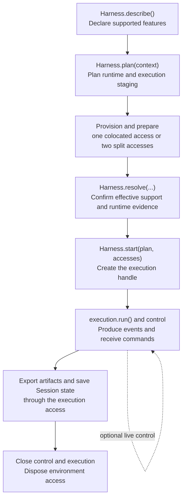

# Worker reference

This page is the contract reference for implementers of SuperTag's execution and transport
extensions. For plain definitions, start with
[Worker Hosts, Worklets, Workers, and harnesses](../concepts/workers.md); to run a shipped Worker,
use [Run a Worker](../guides/workers.md). The normative cross-language lifecycle and ownership
rules are in the [Worker service-provider contract](../../spec/worker-spi.md).

A **harness runtime** is where a harness process, model authentication, and private state live.
An **execution environment** is the local workspace or remote sandbox where the harness's tools
read files and start processes.

Other terms on this page are defined in the glossary: [Tag](glossary.md#tag),
[Role](glossary.md#role), [Objective](glossary.md#objective), [Team](glossary.md#team),
[Mailbox](glossary.md#mailbox), [Task](glossary.md#task), [Task Attempt](glossary.md#task-attempt),
[Session](glossary.md#session), [Skill](glossary.md#skill),
[Context Item](glossary.md#context-item), [Context Plan](glossary.md#context-plan),
[Permission Set](glossary.md#permission-set), [Control Plane](glossary.md#control-plane),
[API Server](glossary.md#api-server), [Gateway](glossary.md#gateway),
[Surface Account](glossary.md#surface-account), [host service](glossary.md#host-service),
[Worklet API](glossary.md#worklet-api), [Worker Profile](glossary.md#worker-profile),
[Volume](glossary.md#volume), [Workspace](glossary.md#workspace),
[Harness Plan](glossary.md#harness-plan),
[Runtime Input Provider](glossary.md#runtime-input-provider),
[Runtime Input](glossary.md#runtime-input), [Context Resolver](glossary.md#context-resolver),
[Tool Adapter](glossary.md#tool-adapter), [Tool Provider](glossary.md#tool-provider), and
[Workspace Resolver](glossary.md#workspace-resolver).

## Boundary

```text
collaboration surface
  -> Control Plane
     -> Gateway: collaboration ingress
     -> admission, durable state, and scheduling
     -> API Server: Worklet API connection
        -> Worker Host
           -> Worklet
           -> Worker + versioned Worker Profile
              -> Runtime Input Providers
              -> optional harness
              -> optional execution environment
           -> Skills, workspace, and tools
     -> Gateway: reply egress
```

The Control Plane owns durable Tasks, admission, dispatch, reconciliation, and audit. Its Gateway
subsystem carries collaboration ingress and reply egress, while its API Server exposes the Worklet
API. Neither component launches harnesses, provisions sandboxes, or proxies arbitrary MCP calls.

## Core execution concepts

### Worker Host

A Worker Host is a machine, container, VM, or sandbox that provides execution capacity. It can run several Workers, such as separate Codex, Claude Code, Cursor, and OpenCode Workers. Its descriptor contains its stable ID and Worker catalog.

The Control Plane maintains observed Worker Host state from reports carried over Worklet
connections. A Worker Host reports four conditions: `Connected`, `Ready`, `Draining`, and
`Unreachable`. Scheduling matches Task execution requirements against advertised profiles and
chooses a Ready Worker Host with an available concurrency slot. The chosen profile is fixed on the
Task Attempt. Draining Worker Hosts finish active Task Attempts without receiving new ones.
Unschedulable Tasks remain pending without consuming a Task Attempt.

A Volume is a named storage source that a workspace can copy beside its git checkout. A host
service maps Volume credential names to environment or file references in
`supertag.yaml`. The Worker Host keeps these secrets. A Workspace mount requires both a mapped
credential and a provider that supports the copy strategy. The host refuses ineligible Workspaces
before calling the provider, with a reason naming the Volume.
`file://` Volumes require the same host mapping, even though copying local files needs no cloud
key. A host advertises only mappings whose secret reference it can read.

### Worklet

A Worklet is the persistent supervisor running on one Worker Host. It maintains an outbound
connection to the Control Plane API Server's Worklet API, reports its host descriptor and heartbeat, accepts
assignments, enforces host concurrency, and streams execution events. A Worklet has its own
identity because the supervisor can restart while the Worker Host remains the same operational
resource.

### Worklet connection transports

In the TypeScript SDK, `WorkletConnection` accepts `transport: "websocket" | "grpc"`. When omitted, HTTP(S) origins
select gRPC and explicit WS(S) URLs retain WebSocket. Selection happens before connecting;
failures never trigger transport failover.
For gRPC, supply an HTTP/2 listener origin in `url`, an enrolled host `credential`, and a
`durableWorklet`. `tlsCa` accepts a PEM trust root for a private certificate authority. The
built-in CLI exposes this through `--transport grpc` and `SUPERTAG_WORKLET_TLS_CA_FILE`.
The Python SDK's `WorkletConnection` connects over WebSocket only; it converts `http://` and
`https://` URLs to `ws://` and `wss://`.

A TypeScript Worklet connection reconnects after a closed connection unless the close code is
permanent:

| Close code | Meaning | Worklet keeps retrying |
| --- | --- | --- |
| 4001 | Authentication timed out or was already in progress, or the first message was not authentication | yes |
| 4002 | Unsupported protocol version | no |
| 4003 | Authentication failed | no |
| 4004 | Invalid Worklet frame or hello | no |
| 4007 | Connection superseded or its generation is stale | no |
| 4008 | Worker Host credential revoked | no |

The Python SDK treats 4002, 4003, and 4004 as permanent only before its first registration.
Every other code is transient, including a proxy-rewritten code such as `1005`. A proxy that
rewrites close codes therefore turns a rejected credential into endless reconnects. See
[A remote Worklet keeps disconnecting](../guides/troubleshooting.md#a-remote-worklet-keeps-disconnecting).

The gRPC adapter requires protocol 18. It checks Team input authority when the harness is ready
to take it and supports host-local selection with an expiring reservation for the exact
Worker/profile. Protobuf frames enter the shared typed dispatch path directly. Named nested
documents, including execution requirements and Context Plans, remain schema-validated and size
bounded JSON.

A custom Control Plane composition can import `startWorkletGrpcServer` from
`supertag-ai/transport`, pass its existing `RemoteWorkletServer` as `remote`, and configure
`host`, `port`, and `tls: { key, cert }`. Both listeners share authentication, connection
generations, capacity reservations, and durable acceptance. Closing the gRPC listener disconnects
its channels; it does not create a second scheduler or erase host journals.

### Session persistence transport

A **Session archive** stores the native harness conversation state needed to resume later. The
shipped Worker uses a separate Session gRPC service when started with `--transport grpc`. Archive
chunks share the listener with Worklet RPCs but do not travel inside its control stream. The
service uses the Task Attempt's credential and existing database authorization; a host token does
not grant access to conversations.

HTTP remains the Session transport for an explicit WebSocket Worker. gRPC clients renew
execution authority through the gRPC listener. Shared execution environments keep
their own transport selection.

Custom TypeScript Workers can set `sessionStateStore` to a factory receiving the admitted
`TaskAttemptSpec`, then return `GrpcSessionStateStore` from `supertag-ai/transport`. Configure its
`baseUrl`, per-Task Attempt `token`, and optional `tlsCa`. Authority renewal uses the same gRPC listener;
set `renewAuthority: false` to disable renewal. The
factory runs for each execution, keeping authority separate across concurrent Tasks. The built-in
Control Plane API Server registers the Session service automatically; the low-level
`startWorkletGrpcServer` helper alone does not provide persistence ownership.

Native Session resume also checks live Team input. Preparing input without sending it,
rejecting it, or revoking it does not block resume. Sent input awaiting acknowledgement,
an unknown acknowledgement, and input withdrawn after dispatch do block resume, so the next
activation starts without a transcript that could duplicate its digest. A prepared delivery
withdrawn before dispatch does not block resume.

For a person's message in a Session, the Control Plane stores the control delivery before
sending it to the active Task Attempt. If the Control Plane restarts while awaiting the
acknowledgement, it recovers the `dispatching` delivery once the 10-second acknowledgement
window expires and the target Task Attempt ends. Recovery records an unknown outcome and
queues one notice asking the person to resend in a new thread. It blocks the original
Session to prevent automatic replay. A live acknowledgement can still settle delivery
before the window expires; after the notice, a late acknowledgement or withdrawal cannot
change the outcome.

### Artifact metadata transport

An **artifact** is a saved output with a catalog record describing its files and source Task.
With `--transport grpc`, the shipped Worker uses typed RPCs for catalog lookup, capture,
acquisition, delivery status, upload receipts, location reports and transfer grants. The catalog
service uses per-Task Attempt credentials; the separate host service authenticates location reports
with the Worker Host credential. Both run on the existing Worklet gRPC listener.

Artifact bytes stay on Worker Hosts and move directly between Worklets; the Control Plane never
carries them. Output recovery preserves the selected metadata transport after a Worker restart.
Explicit WebSocket setups retain HTTP metadata.

Custom TypeScript Workers can provide an `artifactCatalogTransport` factory on `WorkerOptions`.
It receives the admitted `TaskAttemptSpec` and returns a `GrpcArtifactCatalogClient` from
`supertag-ai/transport`. `ArtifactClient` also accepts `catalogTransport` directly. This changes
catalog access only; supply the desired `artifactStore` separately. `GrpcArtifactHostClient`
reports host inventory and retrieves the transfer verification key.

### Worker

A Worker defines how SuperTag turns an admitted Task into executed work. It accepts an immutable `TaskAttemptSpec` and emits ordered `TaskAttemptEvent` values. It owns input resolution, harness and environment orchestration, execution lifecycle, cancellation, cleanup, and event normalization. A Worker Host may expose several Workers or profiles through its Worklet.

Workers can use SuperTag's standard component composition or implement the contract directly. The TypeScript `createWorker` and Python `create_worker` builders return ordinary Workers; they do not create another public runtime layer.

`WorkerDescriptor.type` is a free-form label for the Worker implementation. Workers built with
`createWorker` report `supertag`. A Worker Profile's `workerType` names the Worker behavior that
profile targets; the shipped profiles use `supertag`. Scheduling matches neither label. It matches
the Task's requested profile, harness ID, and capabilities against what each Worker advertises.

### Worker Profile

A versioned, operator-controlled execution policy selected for a Task Attempt. It names the Worker behavior, harness, environment, lifetime, trusted instructions, and resource limits. Profiles contain non-secret configuration; credentials remain inside the Worker Host boundary.

### Harness

Translates a resolved Execution Context into a vendor-native harness invocation and normalizes its events/session state:

```ts
interface Harness {
  readonly id: string;
  describe(): Promise<HarnessCapabilities>;
  plan(context: ExecutionContext): Promise<HarnessPlan>;
  start(
    plan: HarnessPlan,
    environments: {
      runtime: HarnessRuntime;
      execution: ExecutionEnvironment;
    },
    context: ExecutionContext,
  ): Promise<HarnessExecution>;
}
```

A harness must declare `sessions` with boolean `resume` and `export` fields and a
`scope` of `none`, `local`, `environment`, or `portable`. A harness without session
support declares `{ resume: false, export: false, scope: "none" }`.

A harness that resumes receives the Session's prior state and the bounded history replay
together in `continuity`; `resolveHarnessContinuity` picks one. Resume only state the harness
can load where it runs, such as the same SuperTag Session, Tag, and working directory. Do not
reject state because the Worker Profile revision, permissions, or tools changed. Pass the current
Task's tools and permissions on every turn instead. When the harness resumes, leave the replay out
of its prompt. When it cannot, use the replay. The built-in Claude Code, Codex, and Cursor
harnesses resume; OpenCode always replays.

A harness declares its `inputKinds`, runtime placements, continuity mechanisms,
and whether it supports separate runtime and workspace execution environments.
Unsupported required input or an unsupported split fails before provisioning.
Built-ins are `CodexHarness`, `ClaudeCodeHarness`, `CursorHarness`, and `OpenCodeHarness`;
`HarnessExecution` means one vendor-native invocation and is intentionally
distinct from a SuperTag Session. Task `execution.limits` support is described in
[Execution limits](#execution-limits).

The capability declaration is an enforceable contract. A required unsupported Runtime Input fails
before the harness starts.

### Harness lifecycle

The Worker follows this lifecycle:



Rules:

- An explicit split is accepted only when the harness advertises `splitExecution`.
- In the colocated path, the Worker rejects colliding destinations, merges the two staging plans,
  prepares once, and disposes once.
- Effective support from `resolve()` may narrow the declaration; it cannot silently add features.
  The Worker validates the result before calling `start()` and includes it in the runtime input
  manifest.
- A failed resolution still disposes the environment.
- Session capability scope can be `local`, `environment`, `portable`, or `none`; adapters should
  claim only the scope they implement.
- MCP client resolution may narrow `HarnessCapabilities.mcpClients`, but it cannot add a
  connection path that `describe()` did not declare.

### Harness events

`run(signal)` yields `HarnessEvent` values. The Worker adds the Task and Task Attempt identity
and a timestamp before it streams them to the Control Plane:

| Event | Payload |
| --- | --- |
| `output.delta` | `text`: a partial chunk of streamed output |
| `output.message` | `text`: a complete message. Set `final: true` on the Task Attempt's final response: the Worker then finishes the Task Attempt as completed even if cancellation or a time limit fires later |
| `input.withdrawn` | `commandId`: control `input` the harness confirms its model never read before the final response. Team coordination input then returns to the recipient's next activation digest. A person's Session message then runs as its own Task after the current work, including when its acknowledgement was `unknown`; its control delivery is recorded `withdrawn` and the target Task records a `task.session-input` event |
| `result` | `result`: the structured Task result, for example `defaultTaskResult(text)`, which also parses `Finding:` lines into `findings` and `Fixed finding:` lines into `fixedFindings`. A result accompanying a final response claimed before cancellation is kept even when the result event arrives before the final `output.message`. Each finding needs only `severity`, `summary`, and an optional `location`; the Control Plane assigns its `id` and `status` and ignores any the Worker sends. See [review findings](coordination.md#review-findings) |
| `progress.updated` | `progress`: `summary` and up to eight `items` |
| `usage.updated` | `usage`: cumulative token counts, described below |
| `agent.updated` | `agent`: native helper-agent activity |
| `command.updated` | `command`: `id`, `command` text, and `status` of a native shell command |
| `artifact.created` | `artifact`: a saved output reference |
| `session.updated` | `sessionState`: a native Session state reference |
| `tool.call.started`, `tool.call.completed`, `tool.call.failed` | `call`, plus `outcome` or `error` |
| `approval.requested` | `request`: `id`, `description`, and optional `data` |

Once the Worker receives a final response, it also preserves a later `result` event if
cancellation fires between those events. Custom harnesses can finish reporting structured
decisions, changes, and findings for that response.

A streaming harness yields `output.delta` chunks as they arrive, then one `output.message`:

```ts
for await (const chunk of stream) yield { type: "output.delta", text: chunk };
yield { type: "output.message", text: fullText };
```

Each `usage.updated` event carries **cumulative** usage for the Task Attempt, not an increment.
The Control Plane uses the latest valid report and never sums reports. `inputTokens`,
`outputTokens`, `cachedInputTokens`, and `totalTokens` must be non-negative integers. `complete`
is a boolean; set it to `false` when the report does not cover the whole Task Attempt. Optional
`reportedCost` has `amountMinor`, an integer in the currency's minor unit, and `currency`, a
three-letter uppercase code. `estimated: true` means the Harness calculated cost from tokens and
its published-provider-price model table; it is not a provider invoice. The table uses Standard
short-context rates, because usage arrives per Task Attempt rather than per request, so requests
over 272K input tokens and cache writes can make an estimate run low. Models without published
prices remain unpriced even when token counts are known. Codex waits briefly for a token report after
the final turn notification. A Task Attempt without reported tokens retains unknown cost.
Optional `unpricedModel` names a model the Harness has no price for,
so tokens are recorded but cost is unknown. It must be 1 to 200 letters, digits, `_`, `.`, `:`,
`/`, or `-`, and cannot appear with `reportedCost`. The Worker rejects an invalid report.

```ts
yield {
  type: "usage.updated",
  usage: {
    inputTokens: 1200,
    outputTokens: 300,
    cachedInputTokens: 0,
    totalTokens: 1500,
    complete: true,
  },
};
```

Once the `AbortSignal` fires, the Worker accepts only `usage.updated`. Any other event, including
output, results, and artifacts, ends execution with the cancellation error. The Task Attempt
cannot complete successfully. During cancellation cleanup, emit your final cumulative usage
promptly and nothing else.

### Live control rules

- `LocalHarnessExecutionControl` returns an identical duplicate's prior acknowledgement without
  dispatching again; reuse of an ID with different content is rejected.
- An uncertain dispatch is not retried automatically.
- `worker.control(command)` routes only to a matching active Task Attempt and rejects unsupported
  controls. Codex app-server mode implements these controls; the default exec adapters do not
  advertise them.
- Worklets may expose `controlCapabilities(taskId, attemptId)` and `control(command)`. Protocol 18
  Worklets advertising `durableProtocolVersion: 1` negotiate remote
  control through the optional `controlProtocolVersion: 1` descriptor field.
- The durable TypeScript Worklet journals command fingerprints and acknowledgements before native
  dispatch and routes only to the original Worker.
- The Python Worklet currently reports control unsupported, so Session messages wait in the
  Control Plane queue.
- The Control Plane persists delivery intent before sending. Unknown delivery is never replayed
  into the same or a replacement Task Attempt.
- The local harness command cache alone does not survive restart; use the Control Plane and
  durable Worklet delivery path for that guarantee.
- Task waiting still ends a Task Attempt and resumes through a new Task Attempt after a durable wake
  condition.

## Harness runtime and execution environment

### Providers

An `ExecutionEnvironmentProvider` provisions the filesystem, processes, and network
used by workspace tools. A `HarnessRuntimeProvider` separately provisions the place
where the harness process and its private credentials and state live. A Harness Plan
separates staging for those two destinations. The Worker supplies one access in both
roles for colocated execution, or resolves each access from its own provider registry
when the Worker Profile requests a split and the harness supports it.
Local and sandbox providers consume the same portable files, mounts, environment
values, secret bindings, network policy, and process specification.

### Shared execution provider

`SharedExecutionEnvironmentProvider` is an experimental remote provider for
split-capable harnesses. It issues one expiring access per Task Attempt while
several accesses use one service-owned workspace. It provides durable operation
receipts, bounded output replay, shared process admission, and access-scoped
process cleanup. It does not currently provide filesystem isolation, restricted
network enforcement, read-only mounts, or secret binding by default. It supports
bounded streaming output and interactive process input.
Writable local `file:` sources are copied only into paths that do not already exist,
preserving later shared changes.

The provider accepts these connection options:

| Option | Meaning |
| --- | --- |
| `baseUrl` | URL of the selected service listener. |
| `transport` | `"http"` (default) or `"grpc"`. No automatic fallback. |
| `tlsCa` | Optional PEM trust root for a private gRPC certificate. |
| `adminToken` | Worker-side credential used to issue and revoke Task Attempt access. |
| `environmentId` | Identity expected from the execution service. |
| `accessTtlMs` | Lifetime of each issued access; defaults to five minutes. |
| `requestTimeoutMs` | Maximum wait for one request (10 seconds by default); gRPC output watches reconnect after a healthy stream reaches this deadline. It does not set a process timeout. |
| `maximumReadBytes` | Maximum bytes read or staged per file; defaults to 1 MiB. |

HTTP and gRPC use one service owner and operation journal. gRPC requires TLS
outside loopback and carries typed file/process requests and sequenced output.
The SDK preserves operation IDs during retries; an RPC timeout does not cancel
accepted work. A service restart marks unfinished operations `uncertain` instead
of replaying them. This transport choice does not change MCP or Worklet protocols.
See [Share an execution environment](../guides/shared-execution.md#choose-http-or-grpc)
for listener setup, credentials, and recovery boundaries.

### Split-capable harnesses

`ClaudeCodeHarness` supports separate runtime and execution access for file reads,
writes, edits, search, and foreground commands. It redirects familiar Claude tool
names to execution-environment tools and removes the native local versions. Native
browser and web tools remain unavailable in split mode.

`CursorHarness` also supports separate runtime and execution access. It disables every built-in
tool and exposes read, write, edit, glob, grep, ls, and foreground commands as SDK custom tools
through the shared workspace bridge. See [Cursor](#cursor) for runtime and rule-loading limits.

`CodexHarness` supports separate access in app-server mode. The harness runtime
must currently be local. It holds app-server, subscription authentication, native
thread state, and manager-only tools. The execution environment runs a matching
Codex exec-server for native filesystem and process operations. Both providers must
support bounded process output, and split Codex additionally requires interactive
process input. The adapter compares the exact app-server and exec-server CLI
versions before starting a thread and fails closed on mismatch or disconnection.
Host services with `environment` select this split automatically. An application that supplies
explicit `exec` mode with a host environment is refused at startup. The sandbox image needs a matching Codex CLI
binary to run `codex exec-server`; it needs no model credential or Codex auth home.
Codex `exec` mode cannot be split. `OpenCodeHarness` currently requires colocated access.
See [Codex](#codex) for the full split-execution behavior.

### Guarantees

`environment.guarantees` describes filesystem isolation, enforcement of the planned
network policy, process-tree termination, and scoped HTTP support. Missing guarantees
are unknown. `local`, `remote`, and `managed` indicate placement only.

- Third-party providers should advertise only guarantees they enforce.
- The generic sandbox provider forwards backend guarantees; it does not manufacture isolation
  claims from the fact that a backend is remote.
- The shared provider reports no filesystem or network enforcement unless its operator supplies
  explicit `guarantees`. These are deployment claims, not facts inferred by the SDK. Its operator
  may declare stronger `guarantees` only when the deployed service actually enforces them.
- Remote placement alone supplies no guarantee.
- Codex's explicit `sandboxMode: "external"` requires sandbox filesystem isolation, enforced
  network policy for a restricted network plan, confirmed process-tree termination, and allowed
  file writes. An arbitrary remote provider is insufficient. Local execution retains the native
  sandbox by default. See [Codex](#codex).

### Command sandboxing

A harness reports `commandIsolation: "sandbox"` from `describe()` when it runs a Task's commands
inside its own operating-system sandbox; Codex does. Omitting it means commands run with the
authority of the process that hosts the harness. `createWorker` combines this with the execution
environment for each profile:

| Profile | Capabilities it advertises |
| --- | --- |
| Harness with `commandIsolation: "sandbox"`, or any harness outside the local process environment | `supertag.commands.execute` |
| Harness without it, in the local process environment | `supertag.commands.unsandboxed` |
| The same, with the Worker option `allowUnsandboxedCommands: true` | Both |

For a Task with `commands:execute`, placement requires `supertag.commands.execute` on any host
whose profiles report either capability, so Claude Code, Cursor, and OpenCode run such Tasks only
after the opt-in. Hosts that report neither are not checked. `createClaudeCodeWorker`,
`createCursorWorker`, and `createOpenCodeWorker` accept `allowUnsandboxedCommands`; a host service sets it from
[`allow-unsandboxed-commands`](supertag-yaml.md#unsandboxed-harnesses). Both IDs are exported as
`COMMANDS_EXECUTE_CAPABILITY` and `UNSANDBOXED_COMMANDS_CAPABILITY` from `supertag-ai/worker`, and
the SDK reserves them, so an execution environment cannot add them.

### Scoped server connections

An environment may implement `connect(process, options, signal)` to open a bounded HTTP
connection to a server process it started. See
[Connect to a supervised server](../guides/harness-runtime.md#connect-to-a-supervised-server) for
an example.

- The connection accepts an environment-owned process handle and a port, not an arbitrary host
  URL.
- Requests use origin-relative paths. Redirects are returned without being followed, and
  request/response sizes and time are bounded.
- Closing or disposing the environment revokes its connections. Closing an idle connection does
  not terminate its server; normal environment cleanup still owns that process.
- The local provider checks listener and accepted-connection ownership with POSIX `lsof` and
  `ps`, failing closed when ownership cannot be verified.
- Modal performs requests inside the attempt sandbox. Aborting an in-flight Modal request
  terminates the attempt sandbox because that backend cannot independently terminate the proxy
  command.
- This interface currently supports bounded HTTP exchanges, not WebSocket or streaming SSE
  transport.

### Local temporary-directory recovery

A Task Attempt with its own execution environment receives `SUPERTAG_SCRATCH_DIR`, an absolute
path to a writable scratch directory inside that environment. Use it for temporary copies and test
files. The Worker removes it after success, failure, or cancellation, once execution cleanup is
confirmed. If cleanup cannot be confirmed, the directory stays for safe recovery. Scratch files are
not submitted as deliverables. The variable is unset when the execution environment is shared
between Task Attempts, such as a shared execution service, or when its provider cannot create
directories, such as a custom sandbox backend without `prepareOutputDirectory`; the Task Attempt
still runs. Harnesses that accept instruction inputs also receive a short instruction about the
directory. A local Worker Host measures free space on the filesystem containing
its temporary directory and reports the count to the Control Plane on heartbeats. `supertag ps`
and `supertag status` warn when free space is below the smaller of 10 GiB and 5% of the volume.

Built-in Workers call the provider's optional `recover()` hook before advertising capacity.
`LocalExecutionEnvironmentProvider` also runs recovery before its first provision when used directly.
On supported POSIX hosts, recovery removes an attempt directory only when its private ownership
record matches the directory and its owning execution and tracked process groups have ended.
No process is killed during recovery. A live or reused PID, uncertain process registration,
invalid metadata, or an unmarked legacy directory causes the directory to be retained.

Keep the configured `temporaryDirectory` on the Worker Host's local filesystem. Ownership records
are stored beside attempt directories in a private, per-user registry. External workspaces and
session state stores are outside the cleanup scope; symlink targets are not traversed. Processes
launched through the environment share tracked process groups. Custom code that launches or
daemonizes processes outside that mechanism must manage their lifetime itself.
Stopping one owned process terminates its process group and tracked descendants. Environment
disposal also sweeps processes still working inside the Task Attempt directory before removing it.
Disposal first waits for in-flight spawns to finish registering their processes or recording that
nothing launched. A spawn still preparing ownership when disposal begins is refused.

Recovery is conservative on platforms without POSIX process-group and ownership checks, including
Windows: automatic crash cleanup is skipped. Normal disposal also retains directories while
tracked processes are alive or their termination cannot be established.

### Task Attempt process inventory

### Process discovery and identity

The local provider finds those processes with the host's own process list:

| Host | Process list | Working directory |
| --- | --- | --- |
| Linux | `/proc/PID/stat` for the parent, process group, session, and start time; `/proc/PID/environ` for the process marker | `/proc/PID/cwd` |
| macOS | `ps` for identities; a bounded `/usr/bin/perl` helper for `getsid(2)` sessions and `KERN_PROCARGS2` environment markers | `lsof` in `/usr/sbin`, `/usr/bin`, or `/usr/local/bin` |

While a process runs, the local provider lists PIDs, parents, process groups, and start times
once a second. It checks working directories when stopping processes and confirming they ended.
Claude Code also checks environment markers during each periodic scan, about once a second;
it skips that read for processes it already tracks.

The Worker runs `lsof` only from one of those paths, and only when the path has no symbolic
link, the file and its directory belong to root, and neither is group- or world-writable.

A start time identifies each process, because a PID can be reused. On Linux, the Worker reads
`/proc/PID/stat` again after it reads the environment and working directory. A changed start
time means the PID was reused mid-read, so the Worker reads that PID once more. A PID that keeps
changing counts as uncertain. On macOS, the Worker checks `ps` identities before and after
reading sessions and environments. Changed identities or memberships discard those details.
On macOS, a process that returns `ESRCH` from `getsid(2)` stays in the `ps` snapshot
without a session. Its parent can still establish ownership. Only a previously tracked
process with an unreadable session makes the scan uncertain.
If a tracked member's parent changes between the two `ps` listings,
cleanup retains its previously observed session while that same process identity survives.
Before each signal, the Worker rechecks that PID's start time and skips the PID when it differs.
On Linux, that check reads `/proc/PID/stat` synchronously right before the signal; on macOS it runs `ps`, a few milliseconds earlier. Node has no pidfd, so a
reuse between that final check and the signal remains possible. The new process would also need
the Worker user's permission to be signalled.

### Linux ownership and hidden processes

The directory sweep covers only the Worker user's processes. On Linux, `/proc/PID/status`
gives the process's user. A process that vanishes or belongs to another user is skipped.

For local environment directory sweeps on Linux `hidepid=1`, the process list can include
other users' unreadable PIDs.
When a read is refused, the Worker probes whether it can signal that process.
If signaling is denied, the Worker checks the owner of the process's `/proc/PID` directory.
Entries owned by the Worker's effective user ID stay uncertain, as do failed ownership checks.
Entries owned by other users and processes that have exited are skipped.
Signalable entries and entries with unknown signal permission also stay uncertain for the
directory sweep. An inventory that hides the Worker itself still fails.

Setuid programs that keep the Worker's real user ID remain signalable, even when their
effective user ID changes. A process in that sweep that changes its real user ID to another user,
for example through `sudo -u`, `su`, or `runuser`, can escape cleanup on these hosts
if the Worker can no longer signal it and its directory belongs to another user.
Such a process may still write group-writable workspace files through the Worker's groups.
A process keeping the Worker's effective user ID is treated as uncertain instead.
Under `hidepid=2`, all processes hidden from the Worker already escape cleanup.

The kernel can hide a same-user process's environment and working directory, for example after
`prctl(PR_SET_DUMPABLE, 0)`, for a setuid program or an execute-only binary, or for `ssh-agent`.
A hidden child of a tracked process is tracked through its parent. On Linux, any other hidden
process counts as uncertain when both hold:

- It started after the Worker read the clock: just before the spawn for a process's own stop,
  and when the environment was created for the disposal sweep. A launcher that exits before the
  first scan therefore still bounds what it left behind.
- Its parent could have adopted an orphan of the Task Attempt: init, an ancestor of the Worker
  (a possible subreaper), or another uncertain process. The Worker sets no subreaper, so the
  Worker's own other children, such as another Task Attempt's processes, are excluded, as are
  children of any process that is neither.

### Uncertain cleanup

Termination cannot be confirmed while an uncertain process runs, so cleanup reports that and
keeps the directory. The Worker never signals an uncertain process. A hidden, daemonized
same-user program that starts during the Task Attempt, such as a new `ssh-agent`, cannot be told
apart from a Task Attempt orphan and keeps that Task Attempt's process stop and disposal sweep
unconfirmed until it ends. Claude Code cleanup uses the narrower ownership rule below instead.
On macOS, `ps` shows no such distinction.

When the list itself cannot be read, cleanup reports that termination could not be confirmed and
keeps the directory; an unreadable list never counts as "no processes".

### Claude Code process ownership

Claude Code cleanup stops the process it launched and the tool processes it can identify.
For example, a background shell still belongs to the Task Attempt after Claude exits.
The Worker tracks processes carrying the Task Attempt's inherited environment marker and
children found through a tracked parent's PID and start time. Tracked children remain owned
after reparenting, even if they later clear their marker.

The local launcher creates an isolated process group. Cleanup also follows groups led by
tracked tool processes, including Claude Code's separate group for each Bash tool command.
A tracked member descended from the isolated launcher can establish ownership of a new group.
This covers job-control shells that change groups. A marker alone does not claim a shared
host group or prove session isolation.
On macOS and Linux, cleanup also follows a session whose leader is tracked.
This includes new job-control groups within that session, even if their intermediate shells
exit between scans. Linux reads session IDs from `/proc`. macOS reads real session IDs
with `getsid(2)` through the system `/usr/bin/perl`; `ps` does not expose those IDs reliably.
The helper has bounded input, output, and execution time. It requires no compiler or added
package. A missing or blocked helper prevents process inspection and cleanup confirmation.

### Process group and session discovery

Group and session discovery usually require a surviving tracked identity in each scan.
The isolated launcher also passes ownership to members seen in the first scan after it exits.
This catches a double-forked `/bin/sleep` whose shell parents exit between scans, including
when macOS hides the sleeper's environment marker. The Worker drops that temporary claim
after the scan; a discovered member must then anchor later scans. It also drops the claim
if the launcher's PID has a new start time or its group and session have no members.
The Worker checks each process's start time before signaling its PID. It never signals a
saved group or session number, which another process could reuse after membership ends.
Unrelated unmarked processes outside the tracked chain, owned groups, and owned sessions
do not belong to the tree.

On Linux, Claude Code also reads child PIDs from each readable tracked process's per-thread
kernel child lists. A child that hides its identity before its first scan remains linked to
that parent. The Worker keeps a linked hidden PID and its readable descendants unresolved,
including after reparenting. It does not signal them until a readable parent chain or marker
independently proves ownership. A previously tracked PID that becomes unreadable remains
tracked, but cannot be signaled until its identity is readable again. New children of that
unreadable PID block confirmation without gaining signal authority. These rules also apply
when another surviving member anchors the process's group or session.

On `hidepid=1` hosts, Claude Code accepts a baseline with an unreadable process only when
the Worker can signal it, or signaling is denied and its `/proc/PID` directory belongs to
another user. When signaling is denied, a process whose directory belongs to the Worker's
effective user ID, or whose owner cannot be read, makes the baseline incomplete. The same rule
keeps cleanup unconfirmed if such a process appears during the Task Attempt. The Worker never
signals it without a readable process identity.

Linux can make a process non-dumpable after `setresuid` while retaining the Worker's effective
user ID. Its `/proc/PID` directory may then belong to root and signaling may be denied. Under
`hidepid=1`, that process is indistinguishable from an unrelated root daemon, so Claude Code
excludes it from the baseline and from unrelated cleanup scans. A hidden child of a tracked
process still blocks confirmation through its parent link. A new same-user `ssh-agent` under
an unrelated operator shell stays outside the tree. Reparenting to init or a Worker ancestor
alone does not establish ownership. A hidden process can still escape if it and its parent
exit before a scan links them, or if it moves beyond the readable child lists.

### Process escape limits

A process can still escape by starting an untracked session with `setsid`, double-forking,
and hiding or clearing its marker before a scan sees its parent chain or group.
If an owned group or session has no members at a scan, its number cannot establish ownership
later. The Worker cannot safely distinguish that number from a reused one.
For example, Claude Code can start a detached Bash tool that only runs `(sleep 600 &)` or
`nohup x &`. If that tool creates a new session and exits before a scan observes it,
the orphan's session ID alone does not prove that Claude Code created it. Cleanup can
miss that orphan when its environment marker is hidden or cleared. Shortening the scan
interval cannot eliminate this race. Linux can still identify an inherited readable marker.
On macOS, Apple protects system-binary environments, including `/bin/sh` and `/bin/sleep`.
The macOS helper reads only environment entries after the kernel-reported argument list;
a marker appearing in command arguments or another environment value does not claim a process.

Work launched through an already-running daemon also escapes this tree: examples include
a tmux or screen server, `systemd-run --user`, `ssh localhost`, and `at`.
Use an isolated container or VM when these limits are unacceptable.

## Execution limits

Task `execution.limits` can require a native-agent ceiling or an interruption threshold based on
provider token reports. Per-Task controls use the provider-neutral execution requirements:

```json
{
  "execution": {
    "harness": "codex",
    "limits": { "maxNativeAgents": 0, "maxReportedTokens": 20000 }
  }
}
```

Limit support is advertised per Worker Profile, so incompatible profiles are excluded during
scheduling and the Worker rechecks effective support before harness startup. A Task that sets a
limit its candidate Workers do not advertise stays queued. `read_task` then reports a scheduling
incompatibility that names the unmet `execution.limits` path. The standard Worker rejects
unsupported requirements before starting the harness.

Each built-in harness advertises these limits:

| Harness and mode | `maxReportedTokens` | `maxReportedCost` | `maxNativeAgents` |
| --- | --- | --- | --- |
| Codex app-server | 1–1,000,000, interrupts when reported usage reaches it | Not supported | `0` only |
| Codex exec | Not supported | Not supported | Not supported |
| Claude Code | Not supported | USD only, enforced by the provider's budget | Not supported |
| OpenCode | Not supported | Not supported | Not supported |

`supertag connect worklet --harness codex` runs Codex in exec mode by default. Add
`--codex-execution-mode app-server` to advertise the Codex token and native-agent limits. For
Codex token-limit behavior when running the shipped Worker, see [Run a Worker](../guides/workers.md#codex).

### Reported-token threshold

The Codex app-server option `maxTokens` on `CodexHarness` is optional, with no cumulative token
limit by default.
Explicit values accept one through 1,000,000. It interrupts execution when reported aggregate
Task Attempt usage reaches the threshold. This counts reported usage from the manager, including
repeated and cached input; it is independent of the context window. Codex manages context
compaction natively. Compaction does not reset accumulated usage. If the harness option and the Task
both specify a limit, the lower limit applies.

Reports arrive after consumption and may be incomplete or overshoot. This is an observed token
threshold, not a hard token quota, price limit, or dollar-spending cap. The reported-token control
can overshoot between reports and does not cap billing. `usage.updated` distinguishes complete
from incomplete reports; `agent.updated` identifies native helper activity. Durable Worklets
persist and replay these events.

A harness reports each shell command it runs itself with `command.updated`. Codex command
executions and Claude Code Bash calls are examples. Yield `status: "running"` when the command
starts. Yield `"completed"` or `"failed"` with the same `id` when it ends. `supertag describe
task` and `supertag status` show the latest command still running and how long it has run:

```ts
yield { type: "command.updated", command: { id: "call-1", command: "pnpm test", status: "running" } };
```

Command text is AI-authored and untrusted. The Worker removes ANSI escape sequences, control
characters, and format characters, collapses whitespace, and cuts the text to 200 characters
before the event leaves the Worker. The CLI cleans it again before it prints. Never treat it as
evidence of what ran; it is a display hint.

### Reported-cost ceiling

Claude Code supports a provider-native USD budget via
`"maxReportedCost": { "amountMinor": 250, "currency": "USD" }`; the provider may stop after
crossing the requested $2.50 ceiling. Codex exec and OpenCode fail closed for that control, and
other currencies fail closed. Actual provider-reported cost is emitted separately in
`usage.updated`.

### Relation to Objective allocation

Objective and Task `maxCostMinor` values reserve estimated budget. An Objective currency permits
comparison with a Task's provider monetary ceiling; currencyless allocations remain internal
units. Only an optional `usage.updated.reportedCost` value represents an actual provider-reported
charge. See [Budgets and allocation](coordination.md#budgets-and-allocation).

## Built-in harness behavior

This section records how the shipped Codex, Claude Code, Cursor, and OpenCode harnesses behave inside an
environment. To choose and authenticate one, see [Run a Worker](../guides/workers.md#choose-a-harness).

### Effective support

Built-in harnesses resolve their effective support after the environment is prepared. The runtime
input manifest records that resolution, including whether native session resume/export is
supported in the selected placement. Codex and Claude support local native sessions; OpenCode
currently does not. Bundled local runtimes report the installed package version; configured
executables and injected runners do not claim an unverified binary version.

- Codex app-server mode supports portable native Sessions through `SessionStateStore`.
- Claude Code mirrors main and subagent conversation entries through the Agent SDK on its
  supported local runtime path.
- OpenCode uses bounded Session history replay.
- Built-in connected TypeScript Workers store native state in the Control Plane database; a
  standalone Worker must supply durable storage if it needs to survive a restart.

Worker Profiles can set `harness.configuration.model` and `harness.configuration.timeoutMs` for
all three built-ins, plus `maxTurns` for Claude Code. Without `maxTurns`, SuperTag sets no turn cap
for Claude Code, and the default Task Attempt time limit is 60 minutes. Unknown fields and invalid values are
rejected. The profile's execution timeout limit still caps a harness timeout override. Each
adapter advertises these accepted controls through a versioned configuration schema.

### Tool routing

Tool routing depends on whether the harness runtime and execution environment are the same
access. It does not depend on whether that access is local or remote. Colocated execution
preserves the harness provider's native tools. Split execution uses the provider's supported
remote bridge.

| Harness arrangement | Workspace tool path |
| --- | --- |
| Claude Code colocated locally or remotely | Claude's native tools |
| Claude Code runtime separated from execution | Shared workspace tool bridge |
| Cursor runtime separated from execution | Shared workspace tool bridge via SDK custom tools |
| Codex `exec` colocated locally or remotely | Codex's native tools |
| Codex app-server colocated locally or remotely | Codex's native app-server behavior |
| Codex app-server separated from execution | Codex exec-server in the execution environment |

The Claude bridge provides a bounded compatibility subset for read, write, edit, file search, and
foreground commands. It does not claim exact behavioral parity with Claude's native tools.
SuperTag disables the native local versions only for that explicit split so a tool cannot
silently act on the harness runtime instead.

### Codex

**Split execution.** Codex split execution uses the official exec-server rather than a SuperTag
reimplementation of Codex tools. The Worker starts Codex app-server in the local harness runtime.
That keeps the contributor's Codex subscription sign-in, model requests, native thread, and
private harness state on the Worker Host. It starts Codex exec-server inside the execution
environment, where filesystem and process operations take effect. A Worker-local bridge converts
app-server's WebSocket messages to exec-server's JSONL standard input and output. It does not
implement the filesystem or command operations itself.

Host services with e2b or Modal `environment` always use this path. Without an explicit
mode, they select `app-server`; an explicit `exec` mode stops startup.
Codex's native file and command tools act in the sandbox, while model requests and native
Session state stay on the Worker Host. Provider keys and `.codex/auth.json` stay on that host.

The execution environment must advertise `supertag.process-input-streaming@1` and
`supertag.process-output-streaming@1`. Its `codex` command, or the command selected with
`execServerCommand`, must report exactly the same Codex CLI version as the app-server executable.
SuperTag checks both versions before starting the native thread. A missing capability, missing
stream operation, version mismatch, exec-server exit, or lost bridge connection fails the Task Attempt
without running the operation in the harness runtime.

The local, E2B, Modal, and shared-execution providers expose the required duplex process contract.
E2B and Modal have deterministic adapter tests for interactive input. Subscription-backed Codex
runs have passed with a local split and with the shared execution service hosted in Docker and
E2B, and with exec-server in a native Modal sandbox. Subscription-backed Claude split execution has
passed against the Docker-hosted shared service. A mixed-harness live test also verifies that
Claude and Codex can use separate access grants to exchange files through one shared environment
incarnation without sharing model credentials or private state.

**External sandbox mode.** For a split Codex run, `sandboxMode: "external"` tells Codex that the
selected execution environment enforces the sandbox boundary. SuperTag accepts this only when the
provider reports sandbox filesystem isolation, confirmed process-tree termination, and enforced
network policy for a restricted network plan. It also requires allowed `files:write` access
because this mode cannot represent a read-only Task. A shared-execution provider reports no
isolation or network enforcement by default; see [Guarantees](#guarantees).

**Session portability.** Portable session state contains bounded thread transcripts, not
host-local directory references. Restoration into a fresh environment preserves native thread
identity and updates workspace context. Session, Tag, profile, and workspace identity must still
match. Credentials, configuration, and workspace artifacts are excluded; configure authentication
and transfer artifacts separately. Keep Session storage available to the replacement Worker and
protect it as conversation data. Portability does not imply compatibility with arbitrary Codex
versions. Codex session state format version 2 records the manager tool surface. Version 1 state
and state whose manager tool signature changed start a fresh root thread and recover prior work
through bounded Session history replay instead of resuming a thread with stale tools.

**Timeouts.** Codex's `timeoutMs` also bounds its app-server initialization and native turn.
Progress events and control requests do not extend that deadline. On expiry, the Worker stops the
owned process and waits for cleanup; unverified cleanup remains uncertain rather than being
reported as a clean failure. A custom MCP connector that has not returned a connection at the
deadline also leaves cleanup unconfirmed; any connection it returns later is closed. A separate
caller cancellation can stop execution sooner.

**Native agents.** Native agent delegation is unavailable in the Codex exec path. App-server mode
supports duplex process input, but Codex native subagents are also disabled there; see
[Helper-agent delegation](#helper-agent-delegation).

### Codex authentication file

Use `authFile` only when intentionally moving Codex authentication into a colocated or remote
harness runtime. Split execution keeps app-server and its subscription authentication in the local
harness runtime; exec-server does not need that model credential.

To use an existing Codex sign-in in an isolated remote environment, explicitly select its
credential file in your Worker application with `new CodexHarness({ workspace, authFile })` or
`createCodexWorker({ workspace, environment, authFile })`. `authFile` is a local path chosen by the
application; it is not a CLI credential flag. The harness stages only that JSON file as
`.codex/auth.json` inside the Task Attempt, with private file permissions. It copies no user
configuration or session directory. Files must contain authentication material and be no larger
than 64 KiB. Credential values are redacted from emitted events and errors. The selected file takes
precedence over ambient API keys for that invocation; without this option, existing local login
behavior is unchanged. Remote environments do not automatically read or transfer the host's Codex
login.

### Claude Code

Claude Code's local runtime path uses the Agent SDK's Session storage callbacks to mirror native
conversation entries as they arrive. Main and subagent transcripts are saved together, then loaded
through the SDK before resuming the native Session. Host services with `environment` keep
this SDK runtime on the Worker Host, so native resume also works when workspace tools run
in e2b or Modal. The process-only path captures the available transcript after execution.
Remote runtime placements use bounded Session history when native restoration is unavailable.
The harness reports only the placement support it can provide.

Built-in connected TypeScript Workers save this private state in the Control Plane database.
Standalone Workers must supply durable storage if continuity must survive a restart. Restoration
requires matching Tag, Worker Profile, Session, workspace, and allowed tools. Credentials,
configuration, and workspace files are not part of the conversation archive. See
[Session persistence](control-plane-api.md#session-persistence) for retrieval.

Local Claude Code execution preserves the existing Claude sign-in through its secure
credential-store selector while isolating settings and transcripts in the Task Attempt directory.
Credentials are not copied into session state. For a host service with `environment`, Anthropic
credentials stay on the host; provider keys never enter sandbox files, environment variables, or
processes. A custom colocated remote runtime instead requires explicitly supplied provider
credentials; it does not inherit the local secure credential-store location.
Split Claude Code uses the Worker Host's Claude sign-in or environment credential; neither enters
the sandbox.

In split mode, read, write, edit, glob, grep, ls, and foreground commands use the workspace bridge.
Write and edit require `files:write`; commands require both `commands:execute` and `files:write`
in the Task's **Permission Set**, the selected allowed actions. The bridge checks each call and
refuses file paths or symbolic links escaping the workspace. Output is bounded. Cancellation
and disposal stop the bridge's remote processes. The provider's sandbox confines commands.
Configured read-only roots restrict bridge file tools only. A Task with
`commands:execute` can change those files inside its own sandbox.

Native local tools and web/browser tools are disabled, including background Bash, `BashOutput`,
`KillShell`, and `NotebookEdit`. Subagents receive the same native tool deny list. Skills are
staged in the host runtime, and their commands go through the bridge. SuperTag coordination and
collaboration surface MCP clients stay on the host. Workspace stdio MCP servers may still run
in the sandbox. See [Workspace MCP servers](#workspace-mcp-servers-in-a-remote-sandbox).
The sandbox image needs `python3` and POSIX shell tools, plus project dependencies, with no
Claude executable or harness install. A service with `environment` refuses
`allow-unsandboxed-commands` at startup.

Claude Code mounts allowed immutable artifact inputs under `inputs/artifact-N` and can declare
bounded workspace-relative output files for Worker export through the configured ArtifactStore.

### Cursor

`CursorHarness` uses the [Cursor TypeScript SDK](https://cursor.com/docs/sdk/typescript.md)
through a supervised child process. The bundled runner requires `CURSOR_API_KEY`; app, CLI, and
SDK logins do not supply it. `cursor-agent` is not required. `Agent.resume`
preserves a Session across Task Attempts when its native state is available. The restored store
points the agent at the new Task Attempt's workspace, because the SDK finds a local agent only from
its recorded working directory. The Worker cancels active runs and confirms child process cleanup.
The runner connects to each admitted MCP server itself. It passes only the admitted tools to Cursor
as [custom tools](https://cursor.com/docs/sdk/typescript.md#custom-tools), named
`<server>_<tool>`, and writes nothing to the user's repository. Sandboxed SDK runs reject inline MCP
server tools because they cannot ask for approval. If Cursor still declines an admitted tool call,
the Task Attempt fails. See [Cursor MCP](https://cursor.com/docs/mcp.md).
The Worker sends the API key to the SDK runner through a private process input channel, rather
than the runner's environment. Shell tools and MCP child processes cannot inherit it from that
environment. Processes owned by the same operating system user may still inspect process memory.

During process discovery, the Worker briefly stops its Cursor runner to keep child ownership
visible. The runner stays alive after sending a result or error until the Worker finishes that
scan and closes its input. A separate watchdog resumes the runner if the Worker exits or the scan
exceeds five seconds. A double-forked daemon can still escape cleanup if it clears its inherited process
marker and leaves every observed parent chain, process group, and session before the first scan.
See [Process escape limits](#process-escape-limits).

For colocated local execution, the tool allowlist is read, grep, glob, ls, and MCP.
`files:write` adds edit. `commands:execute` adds shell, but requires `files:write` and
the host service's `allow-unsandboxed-commands: [cursor]` opt-in. `web:search` adds web
search; subagents remain disabled. Cursor enables its
[sandbox](https://cursor.com/docs/agent/security/run-modes.md) as
defense in depth on macOS and Linux, and refuses a run when the sandbox is unavailable. A repository
or Task Attempt home with `.cursor/sandbox.json` is refused, including a symlink. The agent can
still create this file during a run and widen later shell decisions, so Cursor does not claim an
enforced command boundary. Reads can reach outside the workspace, and Cursor cannot request
per-call approval. A private `HOME` excludes operator hooks, MCP servers, and rules; workspace
instructions may still be read. See [Cursor tools and sandbox options](https://cursor.com/docs/sdk/typescript.md)
and [Cursor permissions](https://cursor.com/docs/cli/reference/permissions.md).

`Cursor.models.list` validates configured IDs and reports available IDs for an unknown model.
The SDK provides token usage per turn. SuperTag reports provider cost when available, otherwise
estimates it from a published price for the selected model. Without either price, it records
tokens and marks the Task Attempt unpriced. For `auto`, provider-reported cost is recorded when
available, while SuperTag does not estimate one. See
[Cursor models and pricing](https://cursor.com/docs/models-and-pricing.md).

### Cursor split execution

With a host service's `environment`, the SDK runner and native Session state stay on the Worker
Host. `Agent.resume` continues to use that host state across Task Attempts. `local.cwd` points
to an empty host directory, rather than the remote checkout. Repository rules, including
`AGENTS.md` and `.cursor` rules, do not load automatically; supply needed instructions as
Task context. SuperTag disables all built-in tools, including web search and subagents.
Cursor's own sandbox provides no useful boundary for remote workspace operations; the e2b
or Modal sandbox enforces that boundary.
Native-tool exclusion depends on Cursor honoring the SDK's `tools: ["mcp"]` allowlist and
`disallowedTools` denylist. The SDK offers no per-call approval, and Cursor's sandbox does not
confine reads. See [Cursor SDK tools](https://cursor.com/docs/sdk/typescript.md) and
[Cursor run modes](https://cursor.com/docs/agent/security/run-modes.md).

SDK custom tools bridge read, write, edit, glob, grep, ls, and foreground commands to the
execution environment. Write and edit require `files:write`; commands require both
`commands:execute` and `files:write`. The bridge checks permissions on every call, refuses
file paths and symbolic links escaping the workspace, and bounds output. Non-zero command
exits return errors with the exit code. Background commands are unavailable; cancellation
and disposal stop the bridge's remote processes. Provider keys never enter sandbox files,
environment variables, or processes. SuperTag and collaboration surface MCP clients remain
on the host. A service with `environment` refuses `allow-unsandboxed-commands` at startup.
Configured read-only roots restrict bridge file tools only. A Task with
`commands:execute` can change those files inside its own sandbox.
The image needs `python3` and POSIX shell tools, plus project dependencies; no Cursor
executable or harness install is needed.

### OpenCode

The OpenCode Worker requires an installed [OpenCode CLI](https://opencode.ai/docs/cli/) on the
Worker Host and an explicit `provider/model` selection. Host services with an e2b or Modal
`environment` refuse OpenCode at startup: its provider key would enter the sandbox. Use Claude
Code, Codex, or Cursor for remote execution, or remove `environment` for local OpenCode:

```sh
supertag connect worklet --harness opencode --model openai/YOUR_MODEL --workspace /path/to/repository
```

Set the selected provider's credential through its environment variable, such as
`OPENAI_API_KEY`; credentials never belong in command flags. The CLI forwards only the selected
provider's key. SDK applications import `createOpenCodeWorker` or `OpenCodeHarness` from
`supertag-ai/harnesses/opencode` and can supply a `providerEnvironment` map for other providers.

OpenCode runs through the execution environment's streaming process interface. Its workspace is
staged below an isolated process root; results do not directly edit the source checkout. The
adapter supports instructions, bounded Session history, resources, workspaces, and Control
Plane-enforced coordination MCP tools. Arbitrary MCP servers, skill packages, and native session
state are not supported. Unsupported capabilities fail before execution rather than gaining
ambient access. For its subagent and coordination-proxy rules, see
[Helper-agent delegation](#helper-agent-delegation).

To use an API credential already saved by OpenCode, explicitly pass `authFile` to
`createOpenCodeWorker` or `OpenCodeHarness`. SuperTag reads only the selected model provider's API
credential from that local JSON file and stages it with mode `0600` in the Task Attempt's isolated
OpenCode data directory. Other providers and settings are excluded. OAuth credentials are
rejected; there is no automatic use of your global OpenCode login. Do not pass credential values
as CLI flags.

### Provider network hosts and workspace staging

Codex and Claude Code allow their model-provider endpoints independently of agent web-tool
access. Codex defaults to `api.openai.com` and `chatgpt.com`; Claude defaults to
`api.anthropic.com`. Set `providerNetworkHosts` on the harness or Worker factory for an explicitly
configured alternative provider. This controls environment connectivity, not permission to call
web tools or run commands.

Both Codex and Claude Code stage the configured default workspace into each Task Attempt. Edits affect
that copy; use declared outputs and artifact handoff to retain results. Injected runners receive
the same staged workspace as the stock CLI runners. A Task that names a Workspace is different; see
[Workspace staging](#workspace-staging).

### Workspace staging

A workspace Runtime Input reaches the harness in one of two ways:

| Placement | Source | Harness view | Changes |
| --- | --- | --- | --- |
| `copy` (default) | The Worklet's unnamed `--workspace PATH`, or a GitHub commit snapshot | A copy staged into the execution environment; read-only unless the Task has `files:write` | Stay in the copy; only declared outputs return |
| `in-place` | A per-Task git worktree of a declared Workspace checkout or of a host-managed clone | The worktree itself is the working directory; nothing is copied | Committed to the Task branch after each Task Attempt |
| `execution-root` | A Task checkout inside a remote Workspace sandbox, at `mountPath` | The execution root is the checkout's parent; staging into the checkout is refused | Committed in the sandbox and imported into the host-managed clone after each Task Attempt |

For a Task whose workspace plan has `status: "workspace"`, the Worker Host's
`WorkspaceEnvironmentResolver` does the following:

1. It resolves the Workspace name to the checkout declared with `--workspace NAME=PATH`. A path
   that is not a git repository is refused. Without a declared checkout, and when the plan records
   a `source` and the resolver was created with `cloneSources`, it uses the bare clone
   `~/.supertag/workspaces/<workspace>/clone`, creating it on first use.
2. It creates or reuses the worktree `~/.supertag/workspaces/<workspace>/worktrees/<task>` on the
   Task branch recorded at admission. Before creating a worktree from a clone, it fetches the
   source. A new branch continues the source's copy of the Task branch when another host already
   pushed it. Otherwise it starts from the plan's `ref`, else the checkout's current branch or the
   source's default branch, else `main`. The base commit is recorded in the worktree's private git
   directory.
3. It adds a new worktree detached at the merge base of the Task's base and the base ref, a
   commit reachable from the operator-chosen ref. It runs `setup` there with `/bin/sh -c` and the
   Worker's process-launch environment, with a fresh `TMPDIR` under
   `~/.supertag/workspaces/<workspace>/tmp/`. It copies each untracked file with more than one
   hard link, never following symlinks, then checks out the Task branch in place, keeping ignored
   files. It records that commit and the command; a kept worktree with a different record is
   recreated, or refused when it has uncommitted changes. Failed setup removes the worktree.
4. It returns an `in-place` workspace input. The input is marked read-only unless the Task has
   `files:write`; the harness enforces that, because a worktree is not a filesystem boundary.

Every git command runs through `execFile` with an argument list, never through a shell, with no
hooks or filesystem monitor. In a worktree it uses the git directory the repository recorded,
ignoring the worktree's `.git` file. Claude Code, Codex, Cursor, and OpenCode use the worktree as their
working directory and stage no copy. Skills, artifact inputs, and declared outputs stay in the
execution root, outside the checkout.

### In-place placement and policy

Only a profile whose harness and tools run together in the local process environment can use an
in-place workspace. Such profiles advertise the `supertag.workspace.in-place` capability, and also
`supertag.workspace.clone` when a Workspace Resolver clones sources. A Worklet advertises its
Workspace names, and matching `workspace:NAME` labels, when one profile has the in-place
capability. The Control Plane first places a workspace Task on a bound host with that label, on an
in-place profile; for a Workspace with a `source`, it then tries hosts whose profiles all clone. See
[Worker Host labels](resource-model.md#worker-host-labels). A Worker that receives one anyway on
another environment fails the Task Attempt before preparing anything.

Git commands that the Tag runs inside its worktree are not yet checked against policy. The
worktree shares `.git` with the checkout, so a push, forced update, or branch deletion affects the
repository.

### Workspace environments

A Workspace environment is how one execution environment provider runs a named Workspace. Every
provider implements the same `WorkspaceEnvironment` interface, so one Workspace definition can run
locally today and in remote sandboxes later. The Worker Host keeps the repository, its source
credentials, and delivery; the provider only prepares and runs.

| Method | Runs | Does |
| --- | --- | --- |
| `refuse(definition)` | Before any provider call | Returns a reason naming what the provider cannot run, or `undefined` |
| `prepare(definition)` | Once per digest | Turns the trusted commit and `setup` into a native artifact. Reads only trusted content |
| `start(prepared, checkout)` | Each Task Attempt | Checks out the Task's `head` on its branch and returns an `ExecutionEnvironment` |
| `finalize(environment, commit)` | Every outcome | Commits what the Task Attempt left. No changes returns `committed: false` |
| `evict(prepared)` | Cache eviction | Discards the artifact |

A `WorkspaceDefinition` holds only operator and trusted-commit content: the Workspace name, its
source, the trusted commit, `setup`, the digest of the selected MCP servers, and the harness
requirement. The resolved MCP servers can hold host credentials, so they stay with the Worker and
never reach a provider. The harness requirement names the Harness provider of the Task's Worker
Profile, such as `codex`. The trusted commit is the merge base of the Task's base and the Workspace ref, so it
is always reachable from the operator-chosen ref. `capabilities` tells the Worker whether one
artifact serves many Tasks (`sharedPrepare`), whether `setup` runs on the host (`setupOnHost`),
and where stdio MCP servers run (`mcpStdio`).

`LocalWorkspaceEnvironment` is the first provider. It wraps the behavior described above: `prepare`
adds the Task worktree at the trusted commit and runs the hardened `setup`; `start` is the forced
checkout onto the Task branch; `finalize` commits on the host; `evict` removes the worktree.
`prepare` reuses an existing worktree only when the Worker's retry checks accepted it; `start`
refuses a Task branch or kept worktree at any commit other than the Task Attempt's `head`. Setup
outputs can embed the worktree's absolute path, so local prepares once per Task and its digest
includes the Task id. `WorkspaceEnvironmentResolver` builds each Task's definition from the host
repository and drives these methods.
`WorkspaceEnvironmentResolver` selects a registered implementation by the selected profile's
execution provider id. A profile without one reports `workspaceRefusal` in its capability entry.
Placement may use a host with mixed profiles because it requires
`supertag.workspace.environment` on the selected profile. The Control Plane includes static
profile refusals in placement and Runnable reasons when no eligible profile can serve a source.
Refusals that require reading the repository are checked when the Worker resolves the Task.

### Prepared workspace cache

Prepared digests are SHA-256 hashes of canonical JSON over the provider and its base, the source,
the trusted commit, `setup`, the devcontainer subset, the MCP digest, and the harness requirement.
Any change makes a new digest; nothing is rebuilt in place. `PreparedWorkspaceCache` records
shared artifacts at `~/.supertag/workspaces/<workspace>/prepared/<digest>.json` and takes one lock
per digest, so concurrent Tasks prepare once. Each lock names its holder, stays fresh while held,
and is released only by that holder; eviction rereads a record under its lock and keeps one
another process just reused. After every prepare, new or reused, it keeps at most three artifacts
per Workspace per host, counted across the providers it can evict with, and evicts any unused for
7 days. A record whose provider is unavailable stays and takes no slot. These limits
are fixed and have no settings.
Reuse is keyed to the exact trusted commit, so there is no time-based reuse window. On a miss, the
cache can warm-prepare: it hands the provider the newest artifact with the same key apart from the
trusted commit, whose trusted commit is an ancestor. The provider starts from that artifact and runs
`setup` again, like a devcontainer prebuild.

### Conformance and delivery

`runWorkspaceEnvironmentConformance(factory)` in `supertag-ai/testing` checks a provider against
these properties with a repository it builds. Prepare must not run a Task branch's `setup`. Every
input must change the digest. A canary host credential, given to the fixture's `define`, must
never reach `refuse`, `prepare`, or `start`. `start` must reach exactly `head` for a new branch,
an existing branch, and a reviewed commit, and must never start at an existing branch's other
head. A Task's writes to setup outputs must not reach a later Task.

`deliverWorkspace(clone, plan, finalized)` runs on the Worker Host after `finalize`. When
`finalized.objects` names a bundle, delivery requires a host-managed bare clone. The Worker
copies at most 32 MiB into a private bare repository, verifies the SHA-256 digest and bundle,
indexes the pack with strict checks and resolves thin deltas only against objects reachable from
`base`. It requires each prerequisite to be in `base`'s history and checks that the original
bundle pack contains exactly the objects added after `base`. It requires
one advertised ref and verifies that `head` descends from `base`. It moves only the Task branch
ref after validation.
Patch, branch, and pull-request results read that ref and return a `WorkspaceDeliveryRecord`.
`finalize` must skip ignored files, and `refuse` must name each unsupported property.

### Remote Workspace environments

`E2BWorkspaceEnvironment` and `ModalWorkspaceEnvironment` run a named Workspace in a remote
sandbox. Both share `SandboxWorkspaceEnvironment` from the Worker SDK. The Worker Host keeps the
repository and its source credentials. A provider receives git bundles, never credentials, and the
host never runs anything a sandbox produced. Register one with `WorkspaceEnvironmentResolver`
under its execution provider id, in `environments`. A remote provider serves a Workspace from its
source only: the resolver refuses a Workspace whose checkout is declared on the Worker Host. If
resolution fails, it removes any MCP snapshot created for that Task.

| Method | E2B | Modal |
| --- | --- | --- |
| `prepare` | Builds a template from the base, trusted-commit bundle, checkout, and `setup`; split Claude Code and Cursor need no harness install | Builds cached base layers, then a setup sandbox with network runs checkout and `setup`; its filesystem snapshot becomes the image. Split Claude Code and Cursor need no harness install |
| `start` | Creates the Task's sandbox from the template | Creates the Task's sandbox from the image |
| `finalize` | Commits in the sandbox and reads `base..head` back as a bundle | Same |
| `evict` | Deletes the template | Deletes the image |

`prepare` reads only the trusted commit. The Worker builds `content` with `bundleTrustedCommit`:
a bundle of that one commit, with no history and no other ref. `prepare` refuses a bundle that
holds anything else, then runs `setup` inside the provider's build, with network. Modal needs the
setup sandbox because its SDK refuses local files in image builds. One artifact serves every Task
with the same digest, because the checkout path is the same in every sandbox.

`start` creates a new sandbox from the artifact with the Task's own network policy. The Worker
passes `bundleTaskObjects` output, the commits from the trusted commit to the Task's head. The
sandbox fetches them with `fetch.fsckObjects` and checks out exactly `head` on the Task branch.
Each Task writes to its own copy of the artifact, and no Task sandbox is ever snapshotted, so
nothing a Task produces flows back into an artifact or the cache.

`finalize` commits inside the sandbox without hooks or signing. When the head moved, it reads the
Task branch back as a bundle of at most 32 MiB. The host checks that the bundle carries exactly one
ref, the Task branch, at the reported head, and writes it to a private file for delivery to import.
`finalize` does not dispose the environment, so call it before `dispose`.

The sandbox lives until `dispose`. Killing, timing out, or cancelling one of its processes
terminates only that process. `wait()` resolves once the process exits, and rejects with an
`ExecutionCleanupError` if the backend can't confirm termination. Before it finalizes a remote
Workspace, the Worker closes the Harness and its sandbox MCP bridges while the sandbox still runs.
If that close fails, the Task Attempt fails.

| Bound | Size |
| --- | --- |
| Trusted-commit content, to `prepare` | 512 MiB |
| Task objects, to `start` | 128 MiB |
| Returned commits, from `finalize` | 32 MiB |

`refuse` names what remote sandboxes cannot run yet: a `file:` source, a missing content bundle,
devcontainer settings, and a stdio MCP server with `env` (below). A Task head whose history reaches commits older
than the trusted commit other than through it, such as a merge of an older branch, is refused, because
the sandbox holds only the trusted commit. A failed remote Task Attempt loses the files git
ignores; committed work persists.

### Remote Workspace setup failures

Remote providers run package installs, such as Node.js for a stdio MCP server, in the image or
template build. On Modal, they therefore do not count against the setup sandbox's `memoryMiB`.
When Modal setup fails, the error carries the exit code and the last 20 lines of setup stderr, at
most 1,000 characters. The Worker redacts it like other Workspace errors. Exit 137 with no stderr
means the setup process was killed, most often because the sandbox exceeded its memory limit.

### Running a remote Workspace Task

For Claude Code and Cursor host services with `environment`, the runtime stays on the Worker
Host. Auth files, native Session state, and Skills are staged there. Workspace tools use the
remote checkout through the bridge. SuperTag and collaboration surface MCP stay on the host.
Workspace stdio servers still use the trusted snapshot in the sandbox. The following
sandbox staging details apply to colocated remote runtimes.

A Worker runs a remote Workspace Task in two phases, because the Workspace's stdio MCP servers can
only be listed inside the started sandbox, and the sandbox's network policy is fixed when it starts:

1. `resolve` fetches the source, builds the trusted-commit bundle, and prepares the environment.
   It does not start a sandbox. The workspace Runtime Input has placement `execution-root`.
2. The Worker plans the sandbox's network policy from the Task's authorization and the inputs
   known before tool resolution, then calls the resolver's `startWorkspaceSandbox` instead of the
   provider's `provision`. The resolver starts the sandbox at the Task's head.
3. Tool resolution lists the Workspace's servers. stdio servers are bound to the started sandbox
   with `sandboxWorkspaceMcpServers`. The Worker then plans the harness again; a final plan that
   needs more network than the sandbox started with fails the Task Attempt. The one exception is
   `MCP_POLICY_PROXY_HOST` (`127.0.0.1`), which a harness plan allows for its route to a Workspace
   stdio server: inside the sandbox that host is the relay on the sandbox's own loopback, not
   egress, so `workspaceSandboxNetworkNeed` drops it. Any other added host still fails.
4. The harness runs with the sandbox as its execution environment. `finalize` commits in the
   sandbox, `deliverWorkspace` imports the returned bundle into the host-managed clone and
   delivers it, and the resolver then disposes the sandbox. The Worker never disposes it.

Claude Code and Codex use an `execution-root` Workspace as their working directory. OpenCode
refuses one. The harness's environment is `harnessEnvironment(started)`: the same sandbox rooted
at the checkout's parent, with the checkout at `checkoutPath` (the input's `mountPath`). The
harness stages its auth file, session state, Skills (Codex: `.codex/skills`), inputs, and outputs
at that root, beside the checkout, so `finalize` never commits them. The view refuses a file,
mount, or output directory inside the checkout. The checkout's parent must not be `/`.

### Workspace MCP servers in a remote sandbox

`WorkspaceDefinition.mcp` carries the selected servers as `.mcp.json` declares them, with nothing
resolved: a stdio server's `command`, `args`, and the variable each `env` entry references, and
an HTTP server's name only. Resolved URLs, headers, and `env` values stay with the Worker.

| Server | Remote sandbox |
| --- | --- |
| HTTP | The Worker's policy proxy calls it, holding its headers on the Worker Host, as locally |
| stdio, no `env` | Runs inside the Task's sandbox, from the trusted copy at `mcpDirectory` |
| stdio with `env` | `refuse` names the server and the host variable it references |

When a stdio server is selected, `prepare` places a git worktree of the trusted commit at
`mcpDirectory`, beside the checkout: `.workspace-supertag-mcp` next to `/home/user/workspace` on
E2B, and `.repo-supertag-mcp` next to `/workspace/repo` on Modal.
`sandboxWorkspaceMcpServers(resolved, { provider, sandbox, directory })` turns the Worker's
resolved servers into the Task's: HTTP servers unchanged, stdio servers bound to the started
sandbox. It throws for a stdio server with `env`, naming it. The tool provider lists the server's
tools through the environment MCP bridge inside the sandbox. The harness gets the usual
placeholder binding and reaches the server through the policy proxy. The proxy, a Worker-owned MCP
client, and an execution-environment MCP client all start the bridge there. Each checks grants,
resource mappings, and approvals before every call. The bridge needs Node.js 18 or later in the
sandbox. When a stdio server is selected, a cold `prepare` passes the driver
`WorkspaceSandboxBuild.mcpRuntimeInstall`. The driver runs it as root before the content and the
colocated harness install, even when the devcontainer's Dockerfile ends with `USER`, then restores that user.
It also passes `WorkspaceSandboxBuild.mcpDirectory`; the driver creates it with the checkout, owned
by the devcontainer's `remoteUser`, `containerUser`, or else the Dockerfile's last `USER`. Prepare empties and refills it in place. It installs Debian's `nodejs` with `apt-get` when `node` is missing, and does
nothing on an image without `apt-get`. After `setup`, the prepare script fails, naming the reason,
unless `node` runs and is new enough. Nothing it installs comes from the Task or the Worker Host. The
server gets the harness's authority in the sandbox, and none of the Worker Host's. It starts with
the provider's base environment only, never the variables the harness plan set. The
conformance suite runs a stdio server that the Task branch rewrote, and requires the trusted
copy's tools.

The policy proxy listens only on the Worker Host's loopback, which a harness inside the sandbox
cannot reach. Pass the harness runtime to `startMcpPolicyProxy(input, { harnessRuntime })`; when
it is not local, `relayMcpPolicyProxy` starts a relay inside it. The relay listens on the
runtime's loopback, and the proxy's URL becomes that address. It sends each `POST /mcp` request,
with only the MCP headers, to the Worker over the runtime's supervised process streams. The Worker
forwards it to the proxy, which checks the per-Task Attempt secret, grants, and approvals as for a
local harness. The relay holds no credential and needs Node.js in the runtime. Claude Code and
Codex pass their runtime.

### Workspace copy mounts

A Workspace's `mounts` arrive in the Task's plan, as the operator declared them when SuperTag
accepted the Task. When the Control Plane dispatches a Task Attempt, it adds the plan's `volumes`:
each named Volume's `name`, `source`, and `credential` name, read from the Volume catalog then. A
Volume no longer in the catalog is left out. The plan never carries a credential value.

`WorkspaceEnvironmentResolver` checks the mounts first, before it clones, prepares, or calls a
provider. It refuses with `WorkspaceSetupError`, naming the Volume, when the provider's
`capabilities.mounts` has no read-only `copy`. It also refuses when the resolver's `volumes`
option cannot resolve a Volume or its credential. It reads each object-store credential once,
checks it, and resolves each `file://` source to its real path. It then passes the mounts to the
environment's `start` in `TaskCheckout.mounts`, and in `TaskCheckout.volumes` a `VolumeResolver`
that serves only those resolved Volumes. `start` copies every mount after the checkout, so after
`setup` and outside the prepared artifact, and before the Worker resolves tools or starts the
harness.

```ts
interface VolumeResolver {
  // Host paths a file:// source may not be in or contain, such as the Worker's state
  readonly protectedDirectories?: readonly string[];
  resolve(volume: string, task: VolumeTask, signal?: AbortSignal): Promise<ResolvedVolume>;
}
interface VolumeTask {
  readonly taskId: string;
  readonly attemptId: string;
  // The plan's volumes: { name, source, credential? }, never a credential value
  readonly volumes?: readonly TaskWorkspaceVolume[];
}
interface ResolvedVolume {
  readonly volume: string;
  readonly source: string; // s3://bucket/prefix, r2://bucket/prefix, or file:///path on this host
  credentials?(signal?: AbortSignal): Promise<VolumeCredentials>; // required for s3:// and r2://
}
interface VolumeCredentials {
  readonly accessKeyId: string;
  readonly secretAccessKey: string;
  readonly sessionToken?: string;
}
```

### Volume resolution on the Worker Host

Connection settings (`region`, `endpoint`, and `forcePathStyle`) come from the
[Volume source URL](resource-model.md#volumes). `VolumeCredentials` carries only credential values.

The built-in Worklet supplies the resolver. It takes each Volume from the plan's `volumes`. It
reads the credential through the host service's
[`volume-credentials`](supertag-yaml.md#host-service) mapping, in the Worker process only. A
Volume missing from `volumes`, without a credential name, or without a readable mapping fails as
`WorkspaceSetupError`, naming the Volume and never the secret. A `file://` Volume needs a readable
mapping too, as the host's consent; its value is not used. The resolver's `protectedDirectories`
are SuperTag's state directory, the host service's settings and env_file files, and every
`{ file }` secret it references. A remote `start` lists every mount before it creates a sandbox, so
a refused credential, source, or limit leaves no sandbox behind. Credentials stay in
the Worker process. `copyWorkspaceMount` lists and downloads with them through the AWS SDK. It
redacts credential values from store errors and never writes them to the Task's environment, the
harness input, `.mcp.json`, or a provider call. Single-mount calls share one `CopyBudget` per
Task Attempt; batch planning uses one budget for the entire list.

| Step | Rule |
| --- | --- |
| List | `ListObjectsV2` in pages of 1,000, or a walk of a `file://` directory. It stops at the first page that passes `maxBytes` (default `DEFAULT_MOUNT_MAX_BYTES`, 1 GiB) or `MAX_MOUNT_OBJECTS` (10,000), before any download. Every listed key counts toward `MAX_MOUNT_OBJECTS`, folder markers included. A listing may take at most 11 requests, and a page over 1,000 keys is refused, so a store that returns empty truncated pages cannot keep it going. Every listed object also counts its manifest entry against `MAX_MOUNT_MANIFEST_BYTES` (2 MiB of JSON for all of a Task Attempt's mounts), so the manifests always fit in one Worker event |
| Keys | Relative to the prefix. A key that is absolute, has an empty, `.`, or `..` segment, a backslash, a control character, or a segment over 255 bytes refuses the whole copy. So does a key that is both a file and a directory. Zero-byte keys ending in `/` are folder markers: counted, but not copied |
| `file://` | Only regular files are listed. Symbolic links and special files are skipped, never followed. Each file is opened with `O_NOFOLLOW` and must retain its listed device, inode, size, and change times, with exactly one hard link. A source overlapping Task-writable temporary directories, declared checkouts, the resolver's `protectedDirectories`, or the Workspace state root is refused. Both sides are compared by real path, after every symbolic link resolves. A protected path that does not exist yet is compared through its nearest existing parent |
| Download | `GetObject` with `If-Match` on the listed ETag. More or fewer bytes than listed, or a changed ETag, refuses the copy |
| Write | `VolumeCopyTarget.create` refuses a mount path that exists. Every file is written exclusively, mode `0644`, without following links. Each target's rules follow |
| Seal | Write permission is removed from every file and directory under the mount path |

### Copy mount targets and symbolic links

`HostVolumeCopyTarget` makes local copies. It works against a Task that renames a directory and
puts a symbolic link in its place:

- `create` refuses a mount path, literal or resolved, inside a directory a sandboxed local Task
  can write: the system and per-user temporary directories (`os.tmpdir()`, `TMPDIR`, `TMP`,
  `TEMP`, `/tmp`, `/var/tmp`, and `/dev/shm`). Codex's `workspace-write` sandbox can write there.
  It also refuses a path that overlaps a forbidden directory.
- `create` checks all forbidden destinations before creating any missing parent. Each directory
  is created by a short Node child whose current directory is pinned to the verified parent. It
  checks that directory’s identity before an exclusive relative `mkdir`; a symlink swap cannot
  redirect this operation.
- `create` resolves the parent's real path once and records the device and inode of every
  directory from `/` down to the new mount directory. Every later step uses that real path.
- Before each `mkdir` and `write`, and again after a file is opened but before any byte is
  written, every directory from `/` down to the target's parent must still have its recorded
  device and inode, and must not be a link. Otherwise the copy stops with `HostCopyChangedError`.
- `seal` refuses a copy holding any entry SuperTag did not write. It changes modes through
  handles opened with `O_NOFOLLOW`, after checking each handle's device and inode.
- `removeHostVolumeCopy` takes the `HostVolumeCopy` record, not a path. It refuses to touch
  anything unless every recorded directory still verifies. It then makes each directory writable
  through a verified handle and verifies the chain again before each `unlink` and `rmdir`. A link
  inside the copy is removed itself, never followed.

Node.js has no directory-relative file operations, so a process that can write one of these
directories can still race a single check. Refusing temporary directories keeps such directories
out of a sandboxed Task's reach. A local harness with no sandbox can already change any file the
host user can, so these checks add no boundary for it.

`SandboxVolumeCopyTarget` creates the mount directory with one sandbox command. The command
refuses a path where any component is a link, before or after it creates the parent. The final
`mkdir` is exclusive, so a path that appears between the check and the creation is refused.

| Environment | Target | Notes |
| --- | --- | --- |
| `LocalWorkspaceEnvironment` | `HostVolumeCopyTarget`, at the mount path's real path | Refused when the path is in a temporary directory, resolves into the checkout, any declared checkout, the worktree git directory, or the Workspace state root, or when another running Task Attempt in this Worker holds it. A record under `<root>/.mounts/` holds the `HostVolumeCopy` of each directory the Worker created. A recorded copy is replaced or removed only when it still verifies. If it doesn't, the record is dropped and the path is left alone, so a later `start` refuses it as an existing path. `finalize` removes the Task Attempt's copies |
| `SandboxWorkspaceEnvironment` (E2B, Modal) | `SandboxVolumeCopyTarget`, through one sandbox command for `create`, then `SandboxInstance.mkdir`, `write`, and `makeReadOnly` | Refused before any provider call when the path overlaps the bundle transfer directory or the trusted MCP copy. The Worker Host delivers file bytes; the provider never fetches the source |

### Copy mount manifests

Each copy produces a `MountManifest`: `volume`, `source`, `path`, `strategy`, `access`,
`objectCount`, `totalBytes`, `digest`, `copiedAt`, and `objects`. Each object has `key`, `size`,
and `etag` and `versionId` from an object store, or `sha256` for `file://`. `digest` is
`mountManifestDigest(source, objects)`: SHA-256 over the source and the objects in key order. The
resolver's `mountManifestsForAttempt` returns them. The Worker reports them in a
`workspace.mounts.copied` event before the harness starts. The Control Plane validates the event
with `parseMountManifests`, which also refuses manifests over `MAX_MOUNT_MANIFEST_BYTES`. It
stores the manifests once per Task Attempt, in `TaskAttempt.mountManifests`.

The conformance suite copies a small `file://` Volume with a link that points outside it. It
requires a read-only copy at the mount path, no followed link, a manifest of exactly the copied
files, nothing in the checkout or a later Task Attempt, and a refusal over `maxBytes`. Providers
opt in with `copyMount` in their fixture.

### Live mount provenance

A live mount exposes its source as it changes. For example, a dataset mounted from an S3 prefix
can change while a Task runs. `supertag describe task ID` labels it `live` so operators can
distinguish attachment evidence from a pinned copy.

After a successful native attachment at `start`, the provider returns `ExecutionEnvironment.liveMounts`.
Each `LiveMount` contains `volume`, `source`, `prefix`, `path`, `strategy: "mount"`,
`access: "read-only"`, and `attachedAt` in ISO 8601 UTC. The prefix matches the source URL; an
empty string means the entire source. Providers project these fields explicitly, without credential
names, values, or provider configuration. Setup and prepared snapshots produce no attachment records.

The resolver exposes `liveMountsForAttempt`. Before the harness starts, the Worker emits
`workspace.mounts.attached`. Transport and the Control Plane validate it with `parseLiveMounts`.
The Control Plane stores it in `TaskAttempt.liveMounts` once per Task Attempt. Identical journal
replay is a no-op; conflicting records are refused. A later Task Attempt records its own attachment
time. Live mounts have no manifest, object listing, or digest. `TaskAttempt.mountManifests` continues
to describe copies only.

### Workspace git safety

The Worker's own git commands run on the Worker Host, outside the harness sandbox, so they must
not run anything a Task wrote:

| Rule | Detail |
| --- | --- |
| No hooks or monitors | Every Worker git command sets `core.hooksPath=/dev/null`, `core.fsmonitor=false`, and `submodule.recurse=false` |
| Repository config only | Every command except `fetch`, `push`, and `ls-remote` runs with `GIT_CONFIG_GLOBAL=/dev/null`, `GIT_CONFIG_NOSYSTEM=1`, `GIT_ATTR_NOSYSTEM=1`, and `core.attributesFile=/dev/null` |
| `lfs` by name | When `git lfs version` succeeds, those commands receive `-c filter.lfs.clean`, `smudge`, `process`, and `required` from the host's system and global config, and no other driver. `GIT_LFS_SKIP_SMUDGE=1` leaves pointers on checkout |
| Network commands | `fetch`, `push`, and `ls-remote` keep global config for credential helpers. They run in the repository, and a managed clone must be bare, so they never touch a working tree |
| No diff drivers | `diff` and `format-patch` add `--no-ext-diff --no-textconv` |
| Integrity check | See below |

When a Task Attempt starts, after setup, the Worker records the repository's local config,
the worktree's `config.worktree`, and the common git directory's `info/attributes`,
`info/exclude`, and hooks. Before each later git command for that Task Attempt, including a
pull-request push, it compares them. On a change it refuses that command and every later one
with `WorkspaceIntegrityError`, naming the file and whether it was added, removed, or modified.
It restores the recorded git files and leaves the Task worktree and its uncommitted changes in
place. The Task Attempt fails; the Control Plane records
`failureKind: "workspace-integrity"` on the Task result. The operator inbox then shows a
`task_attention` item for the failed Task, with no next actor Tag, until the Task is retried or its
Objective closes. Other Task Attempts continue after restoration.

The Codex permission profile grants writes to the worktree, the Task Attempt's output directory,
and the temporary directories that Codex's `:workspace` profile includes. For local worktrees,
it marks the repository's common git directory read-only. Claude
Code and OpenCode have no OS sandbox, so these checks do not stop them from writing anything the
Worker Host user can.

The private copies of setup outputs are copy-on-write clones where the filesystem and Node.js
support them, such as Btrfs or XFS on Linux, and full copies elsewhere, including APFS on macOS.

### Workspace commits

After the harness finishes, including after failure or cancellation, the Worker runs `git add -A`
and commits any changes to the Task branch as `SuperTag <supertag@localhost>` with `--no-verify`.
The Claude Code and Codex harnesses are asked to end a result that changed files with a line such
as `Change: Add pause and resume for Objectives`, an imperative summary of at most 72 characters.
That line becomes the commit subject. Without a usable one, the Task title, the first line of its
instruction, supplies the subject, capped at 72 characters. The harness summary goes in the commit
body. Without an instruction, the subject is `Update task <id>`. Title Tasks by the change they
make, not by item or round numbers. Each commit includes a `SuperTag-Task: <id>`
trailer. Files matched by `.gitignore` are never staged. It then records a `progress.updated` event
with the branch, base, head, and changed-file count; it omits the branch when the Worker deleted it.
Its item ids, such as `workspace-head`, are reserved: the Worker drops them from harness progress.
A review of the Task is pinned to this recorded head, not to a change the harness reported. For a completed Task Attempt it also adds a
`changes` entry to the Task result with reference `git:<branch>@<head>`. With `delivery: patch`, it
saves `git format-patch --stdout <base>..<head>` as an artifact on the result. A completed Task Attempt
removes the worktree and keeps the branch. A failed or cancelled Task Attempt keeps the worktree for a
retry. A Task Attempt of any outcome with no commits since the base deletes the worktree and the
branch and delivers nothing: no patch, pull request, or branch reference; a retry starts afresh
from the base. The Worker never changes the checkout's working
tree or current branch.

### Workspace dependency merges

When the Control Plane dispatches a Task Attempt whose Task has accepted dependencies, the
Workspace plan carries `dependencyBranches`: for each dependency in the same Workspace, its
`taskId`, Task `branch`, and the full `head` commit its Worker recorded delivering in the accepted
Task Attempt. A dependency that delivered no commits contributes its own accepted dependencies'
entries instead. The Worklet protocol refuses any other field, a branch outside `supertag/`, or an
abbreviated commit.

A new Task branch starts from the Workspace ref commit merged with each entry, in order. The Worker
does this in the repository's object store with `git merge-tree --write-tree` and
`git commit-tree`, before it adds the Task worktree, so no harness merges. It needs git 2.38 or
later. A commit the result already contains is skipped, and a commit that contains the result is
fast-forwarded to. Each merge commit has two parents, the subject
`Merge dependency branch <branch>`, and `SuperTag-Dependency` and `SuperTag-Task` trailers. Its
author and date are fixed, so a later Task Attempt that starts afresh produces the same commit.
The merge result is the Task's base: delivery measures changes from it, and the trusted commit
stays the newest commit both it and the Workspace ref contain.

With `branch` delivery, a dependency's commit stays in the repository of the Worker Host that ran
it. A host-managed clone that lacks the commit after its usual fetch fetches it from the source by
commit id. That works when the commit reached the source under any ref, such as a pull request.
The fetch changes no ref.

A commit still missing, or a conflicting merge, fails the Task Attempt as a Workspace setup failure
before any worktree exists. A missing-commit error says what makes the commit available: push the
dependency's branch to the Workspace source, fetch it into the checkout, or run the Task on the
Worker Host that ran the dependency. A conflict error names the dependency, its branch and commit,
and up to 20 conflicting paths. Each path is escaped to one printable line: control characters,
line separators, bidirectional controls, and backslashes become `\n`- or `\uXXXX`-style escapes.

A kept worktree and a review's submitted commit are used as they are, without merging. A later
Task Attempt that continues the Task branch without a kept worktree redoes the deterministic
merge from where the branch forked from the Workspace ref. When the branch contains that merge,
the merge stays the Task's base, so the dependencies' commits never count as the Task's own
changes. Otherwise the fork point is the base.

### Workspace clones

Clone, fetch, worktree, and push operations on one repository hold a lock: in-process, and a
`repository.lock` file against other Worklet processes that share the Workspace root. A lock whose
process has exited is replaced. For fetch and push, an optional `WorkspaceSourceCredentials`
supplies a username and password. Git receives them through the command's environment and an
inline `credential.helper` that first clears configured helpers, so no credential store records
them. Without credentials, git uses the host's own configuration. The shipped
`GitHubWorkspaceSourceCredentials` answers for `https://github.com/...` sources with the Worker
GitHub credential of a Surface Account that the Task's authorization names for the repository.

### Pull-request delivery

With `delivery: pull-request`, a completed Task Attempt whose branch has commits goes to the resolver's
`WorkspacePullRequestPublisher`. The shipped `GitHubPullRequestPublisher` does the following:

1. It finds the Task authorization resource whose `reference` names the source repository and
   whose actions include `pull-requests:create`. Without one, it pushes nothing.
2. It resolves that Surface Account's Worker credential, which must list the repository scope in
   its allowed scopes.
3. It looks up the Task branch's pull request. A closed one is left closed and nothing is pushed.
4. Before opening a new pull request, it applies `approval: required` on `pull-requests:create`
   through `request_action_approval`. It waits up to ten minutes; a pending or denied request
   pushes nothing.
5. It pushes the Task branch, then opens a draft into `ref`, or the default branch, or updates the
   existing pull request's title and body.

The result is recorded as a `changes` entry and a `references` entry with
`resourceType: pull-request`. A delivery that did not open or update a pull request adds its
reason to `unresolved`; the Task Attempt still completes. The Control Plane marks the pull request
ready for review when the Task is accepted, and closes it with a comment when the Task is cancelled
or rejected. It uses the Surface Account credential it holds for the Gateway. It retries a step
that failed because of a network error, a GitHub 5xx response, or a rate limit, with backoff from
1 minute to 1 hour for at most 10 attempts; a 404 or a permission denial is not retried.

### E2B

The E2B adapter requires `python3` in its sandbox template for atomic file staging and bounded
reads that reject symbolic links. Its read-only staging uses filesystem permission bits; it is not
an immutable mount against a hostile process running as the same user. Cancellation terminates the
entire attempt sandbox. Session-scoped and host-scoped sandbox reuse are not currently supported.

## Task Attempt input

`TaskAttemptSpec` includes:

- Task and Task Attempt identity;
- Tag identity;
- normalized origin, requester messages, and attachments;
- immutable authorization snapshot;
- immutable Context Plan;
- immutable Task workspace plan;
- exact Worker Profile revision;
- optional native Session state and bounded Session history.

It is surface-neutral. Workers never need raw Slack, GitHub, Lark/Feishu, Linear, or Teams event shapes. The workspace plan is a Task admission decision, not a Context Item: it identifies one authorized operational repository, records that selection is still required, or records that a requested repository is unavailable.

## Execution Context

The immutable Control Plane specification and the Worker-local execution input are different
objects. `TaskAttemptSpec` describes what was admitted; `ExecutionContext` records how the Worker
safely resolved that Task Attempt inside the Worker Host boundary:

- instructions, Skills, and prior Work come from Worker Profile and Context Resolver output;
- `workspace` comes only from the captured Task workspace plan;
- tools come only from Permission-derived Tool Providers;
- `continuity` contains canonical Session replay and an optional compatible native session state;
- `sessionStateStore` gives the harness access to Session persistence through the Worker.

The resolved values appear in the ordered `inputs` collection. Each Runtime Input has a stable ID, kind, required/optional status, and provenance when applicable. This structure preserves the boundary between knowledge, operational workspace, authority, and continuity. Tools, workspaces, session state, and secrets are Runtime Inputs, but they are not described as context.

## Runtime Input resolution

Every Runtime Input Provider receives the same immutable **Resolution Context**: the admitted Task Attempt and exact Worker Profile. A component-based Worker resolves inputs through three independent provider types:

1. Context Resolvers resolve admitted Skills and selected artifact metadata.
2. Workspace Resolvers resolve the Task's already-captured operational target, such as an immutable repository revision.
3. Tool Providers map admitted collaboration surface permissions to semantic Tool Capabilities and Worker-local Runtime Bindings. Runtime permissions independently select harness-native tools and execution policy.

Every Context Resolver declares `outputKinds`. A Runtime Input Provider that advertises
`contextTypes` must supply `contextOutputs` for every advertised type and version.
Each contract lists all possible `inputKinds`; the selected harness must support them all.
Registration rejects missing contracts, and resolved context inputs must identify their
`sourceItemKey` and stay within their declared output kinds.

The Worker emits `runtime-inputs.resolved` with a credential-free **Runtime Input
Manifest** before execution output. Its `executionEnvironment` field records the
workspace access ID, provider, placement, asserted guarantees, and credential-free
provider provenance. Shared execution provenance identifies the environment,
incarnation, per-Task Attempt access, and expiry without recording its bearer token.
Split profiles also include `harnessRuntime` with the harness access ID, provider,
placement, guarantees, and provenance. The `harness.provenance` object can add
provider-specific protocol evidence. Built-in harnesses record each MCP server's
credential-free client location and transport. Split Codex records
the exec-server protocol and transport, bridge environment ID, execution
environment ID, exact CLI version, and exec-server session ID. The harness plans
the vendor-native adaptation, and the selected providers prepare both boundaries
before the harness starts.

The Control Plane projects this durable evidence through `supertag describe task
TASK_ID`. For colocated execution it resolves the omitted harness runtime to the
execution environment; for split execution it reports the two placements separately. The report remains available after Control Plane
recovery even when the Worklet receipt is temporarily unavailable.

## Runtime Input kinds

- `instruction` — ordered non-secret instructions;
- `skill` — portable Skill package;
- `history` — bounded automatic same-Session history;
- `workspace` — read-only operational workspace;
- `tool` — a semantic Tool Capability plus an MCP or native Runtime Binding with runtime-only secrets;
- `resource`, `sessionState`, `secret`, and `harness-specific` — extension contracts for compatible profiles.

These are typed assembly records used to build `ExecutionContext.inputs`; they are not a second authorization system or a flattened public context model. Required unsupported inputs fail; optional ones are recorded as omitted in the Runtime Input Manifest.

Harnesses normalize external operations into `tool.call.started`, `tool.call.completed`, and
`tool.call.failed` events. A successful event may carry a bounded `ToolCallOutcome` containing
canonical external references, but never raw tool logs or credentials. The Control Plane persists
these events, includes changed references in the Task result, and can include them in the final
surface reply.

## Official provider MCP tools

SuperTag does not reimplement collaboration surface APIs as MCP servers. Host service presets name the official hosted endpoints or the provider's official stdio package:

| Provider | Endpoint |
| --- | --- |
| GitHub | `https://api.githubcopilot.com/mcp/` |
| Slack | `https://mcp.slack.com/mcp` |
| Lark / Feishu | `@larksuiteoapi/lark-mcp` over stdio |
| Linear | `https://mcp.linear.app/mcp` |
| Teams | tenant-specific preview Agent 365 `mcp_TeamsServer` |

The harness reaches every preset only through the per-Task policy proxy, which lists and forwards only granted tools. Tokens stay in proxy headers and Lark's App Secret in its server's environment; neither reaches the harness, Runtime Input Manifests, or process arguments.

Each resolved tool carries a portable authorization envelope: provider, effect (`read` or `write`),
action names, and exact collaboration surface resources. Harness events normalize every tool call into
`started`, `completed`, or `failed` Task events, so the Control Plane can preserve an audit trail
without proxying the MCP traffic.

## Tool capabilities, bindings, and adapters

Permission-derived tools have two independent parts:

- a **Tool Capability** describes the provider, permitted operations, effects, actions, and exact resources;
- a **Runtime Binding** describes how this Worker can provide it, such as hosted MCP, stdio MCP, a native SDK adapter, a local function, or a policy-wrapped command.

A Tool Provider should keep authority separate from execution. It emits a semantic
`ToolCapability` (operations, effects, actions, and resources) and a `ToolRuntimeBinding` that
explains how this Worker can provide it. The built-in Codex and Claude Code harnesses share
`McpToolAdapter`; a custom agent SDK can supply a native-function adapter. `ToolAdapterRegistry`
fails closed for required unsupported bindings and preserves the same normalized tool-call audit
envelope across mechanisms.

Changing a GitHub capability from hosted MCP to an Octokit adapter does not change the Tag's Permission Set or the Task authorization snapshot. A Tool Adapter turns a compatible binding into a harness-native tool or executes a Worker-managed call. Required bindings that no installed adapter supports fail before execution; optional bindings may be omitted.

For MCP, a client owns one server connection. `HarnessCapabilities.mcpClients`
declares which connection paths an integration implements:

- `harness-runtime` configures the server in Codex, Claude Code, OpenCode, or another harness;
- `worker-host` keeps the connection in the Worker and exposes admitted calls through a harness-native custom-tool channel;
- `execution-environment` places the client beside sandbox files, processes, or a private server.

HTTP and stdio remain server transports. An HTTP server can be reached from any
client location whose network allows it. A stdio server is launched beside its
client. Tool Adapters select a client path without changing the Tool Capability,
and resolved harness support may narrow but never add a path. See
[Route MCP tools](../guides/mcp-tools.md) for the topology matrix.

`McpToolAdapter` produces a credential-bearing server configuration for a selected
client path. It must receive the client location it is configuring, and that choice is
recorded without credentials in harness provenance. `connectWorkerMcpClient` implements the Worker Host HTTP path and
`connectExecutionEnvironmentMcpClient` implements the execution-environment HTTP and stdio
path. Both return connections whose discovered tools and calls remain limited by
the same Tool Capability.

Native SDK and function bindings remain Worker-managed: the harness requests a
structured operation and a Tool Adapter validates it against the resolved
capability before an SDK, function, command, or remote action executes it. Every
path uses the same portable call record and keeps the collaboration Gateway out
of the external-action data path.

The provider identity remains the resource ceiling. Tool filtering does not necessarily restrict channel/repository/team arguments, so native credentials must match the admitted resource envelope.

## Placement topologies

### Everything local

The Control Plane and one Worker Host run on the same machine. The Worklet, Workers, harnesses, and
processes remain within the Worker Host boundary; the Gateway remains a Control Plane subsystem.

### Remote Control Plane, local Worker Host

The Worklet on a local Worker Host connects outbound to the remote Control Plane API Server.
Workers run their harnesses near local files and tools.

### Local Worker, remote sandbox

The Worker resolves policy and Runtime Inputs on its Worker Host while a provider such as E2B executes the launch plan in an isolated remote environment.

### Fully remote

The Control Plane and Worker Hosts run separately. Each host's Worklet connects outbound through
the API Server's Worklet API, and each Worker may still choose local or remote execution per profile.

Placement changes transport and failure domains, not Task, policy, or harness contracts.

## Session continuity

A **Session** groups a conversation's Tasks and stored history. It also owns native conversation
state when the harness supports resumption. The built-in TypeScript Workers persist that state
in the Control Plane database through an authenticated API, including for conversations without
coordination tools. A Session-only execution credential gives the Worker storage access without
granting Mailbox or artifact access. `SessionStateStore` is the Beta
extension interface used to save and restore it; it does not create a Control Plane resource.

- Codex app-server saves portable native thread transcripts and restores them before resuming.
- Claude Code mirrors main and subagent transcript entries through the Agent SDK on its
  supported local runtime path.
- Bounded history from completed Tasks remains available when native restoration is unsupported
  or incompatible.

Stored state and safe resumption are different. Automatic continuation uses only state from the
latest successfully completed Task with compatible Tag, Session, audience, permissions, Roles, Context
Plan, Worker Profile, workspace, and harness. Incomplete state may remain available for inspection;
a failed Task Attempt never advances the automatic resume point. Conversation state does not restore
workspace files, running processes, or a sandbox.

Standalone custom Workers can supply a `SessionStateStore`. The in-memory implementation is
not durable; the optional file implementation keeps state only on that host. Existing local
checkpoint files are not automatically imported into the database. Upgrade connected Workers
and the Control Plane together before relying on database-backed continuation.

## Customization levels

For full customization, implement `Worker` and run it through a `Worklet`. The implementation may be an AI system, deterministic workflow, or another execution engine and does not need a harness or Environment Provider.

For component customization, call `createWorker` or `create_worker` with custom `Harness`,
`ExecutionEnvironmentProvider`, `ContextResolver`, `WorkspaceResolver`, `ToolProvider`,
`ToolAdapter`, or `SessionStateStore` implementations. The returned value implements the same Worker
contract as a fully custom implementation. Worker Profiles remain locally defined, immutable
recipes; the Control Plane sends only their ID and revision through the Worklet API. Context Resolvers,
Workspace Resolvers, and Tool Providers share the Runtime Input Provider contract.

Replace only the provider you need:

| You want to… | Implement |
| --- | --- |
| Host a harness process and its private state elsewhere | `HarnessRuntimeProvider` |
| Run workspace tools locally, in a sandbox, or on custom infrastructure | `ExecutionEnvironmentProvider` |
| Resolve another allowed knowledge resource | `ContextResolver` |
| Resolve an operational workspace | `WorkspaceResolver` |
| Expose permission-scoped external actions | `ToolProvider` plus a compatible `ToolAdapter` |
| Store native conversation continuity elsewhere | `SessionStateStore` |

The transport package exposes `connectWorklet({ url, credential, worklet, durableWorklet })` for the common SDK path and returns a persistent `WorkletConnection` handle. The credential is issued for the declared Worker Host through the Control Plane's enrollment API. Transport frames and reconnect bookkeeping remain below the Worker customization contract.

SDKs expose idiomatic projections of this hierarchy. TypeScript commonly uses
camelCase and `AsyncIterable`; Python commonly uses snake_case and async
iterators. Only the encoded Control Plane Worklet API messages use the exact camelCase
wire names in `spec/`. Extension behavior is portable even when method spelling
is not.

### Resolver registries

Add a registry to `createWorker` only when the harness supports Skills, operational workspaces, or
permission-derived tools:

| Registry | `createWorker` option |
| --- | --- |
| `ContextResolverRegistry` | `contextResolvers` |
| `WorkspaceResolverRegistry` | `workspaceResolvers` |
| `ToolProviderRegistry` | `toolProviders` |

These registries share the Runtime Input Provider contract. Other providers go in
`runtimeInputProviders`. Python's `WorkerOptions` has one `runtime_input_providers` tuple instead
of separate registries. Missing resolvers fail closed rather than silently dropping allowed inputs.

### Conformance probes

`supertag-ai/testing` provides reusable probes. The Worker probe verifies the advertised profiles
and capabilities, event identity and ordering, exactly one terminal event, and cancellation when
the Worker claims to support it. The same entry point contains probes for harnesses, collaboration surfaces,
execution environments, Workspace environments, Tool Providers, Tool Adapters, and Worklet
transport negotiation. See
[Build a custom Worker or harness](../guides/custom-workers.md#3-run-the-conformance-probe) for
examples.

Language-independent implementations can validate their wire fixtures against the published
schemas. The installed package ships them, with the Worker SPI and fixtures, in
`node_modules/supertag-ai/dist/spec/`. Import them as `supertag-ai/spec/*`, for example
`supertag-ai/spec/task-attempt-spec.schema.json`.

The [`examples/custom-worker`](../../examples/custom-worker) Workers, harnesses, and Environment
Providers run conformance checks using only their published SDK surfaces.

## Capabilities belong to executable profiles

When composing several profiles in one Worker, each profile advertises the support of its
selected harness and environment. A harness that cannot consume tools and instructions does
not receive Objective coordination work. This lets deterministic and agent-backed profiles
share a Worker without advertising each other's capabilities.

Custom Workers must supply `profileCapabilities` entries for exact profile IDs and revisions.
The map must include each supported profile; missing entries are not eligible for dispatch.
Worker-wide capabilities and context types never substitute for profile declarations. Set each entry's optional `harness` to the actual harness ID when
that profile uses one. A Task with `execution.harness` is eligible only when its candidate
profile advertises that matching ID; the Worker type is not a substitute. The standard
`createWorker` composition supplies this metadata automatically. Required inputs are still
validated before harness execution.

An entry may also list `models`, the models its harness serves with the default first, and
`efforts`, the reasoning efforts it applies (`low`, `medium`, `high`). A Task with
`execution.model` is eligible only on a profile whose `models` include it; effort never affects
eligibility. A harness reports both from `describe()` as `models` and `efforts`, and reads the
Task's choice from `attempt.execution.model` and `attempt.execution.effort`. The built-in harnesses
accept a `models` option and fall back from the Task's model to the profile's configured model,
then to the first served model.

## Helper-agent delegation

Native helpers remain inside their allowed Task Attempt and do not acquire a separate SuperTag identity.
SuperTag coordination tool inputs have a manager-only audience. A harness must keep their bindings
and credentials unavailable to native children and reject every child invocation while retaining
harness-local delegation; unsupported authority isolation fails before execution. The advertised
`schemaIsolation` value distinguishes hard schema non-observation from a provider guardrail. Local
helper results return to the manager, which performs any Team, Objective, Mailbox, or other durable
coordination operation. Custom harness implementations must enforce their own child-agent
authority boundary.

### Claude Code subagent

The Claude Code adapter exposes one programmatic `supertag-local` subagent to the root manager. Its
tool list is derived from the Task Attempt's runtime actions, its MCP server list is empty, and `mcp__*`
is explicitly denied. While manager coordination is present, command and web tools are removed from
the helper so it cannot reach the local proxy. The root keeps its MCP tools, including
SuperTag coordination, while Claude's built-in agent types are denied by named `Agent(...)` rules;
`Agent(supertag-local)` is the only allowed spawn target.
The Worker replaces a manager coordination binding with a loopback policy proxy before starting the
local harness process, so the process receives no Control Plane API bearer header in its
environment, configuration, or arguments. Remote placement fails closed until the execution
environment can supply an equivalent trusted proxy. The same child definition is supplied through
Agent SDK `agents` and direct CLI `--agents` launches.

### Codex root-thread tools

Codex app-server exposes manager-only coordination through root-thread `dynamicTools` backed by a
Worker-owned client. The Worker connects to the Control Plane itself and keeps the coordination
MCP server and bearer credential out of the Codex process and its process-wide MCP configuration.
For a selected HTTP or stdio server, the same dynamic-tool channel can call an MCP client owned by
the execution environment, keeping the server process, session, and environment-scoped
credentials beside the workspace. The Worker dispatches a dynamic call only when its thread ID and
turn ID identify the active root turn and its namespace, operation, arguments, and call identity
match the allowed input. Unexpected child lineage fails the Task Attempt because the native-agent
ceiling is zero.

Codex native subagents are currently disabled because Codex children inherit the root agent's
tools. The adapter advertises and enforces `maxNativeAgents: 0`, rejects positive harness or Task
limits, and launches app-server with its agent, multi-agent, and fanout flags disabled. Codex
subagents stay disabled until the provider can give children a separately scoped tool set.

### OpenCode child agents

OpenCode permits its primary `build` agent to use only explicit `general` and read-only `explore`
child profiles. OpenCode children inherit allowed local permissions and cannot nest another
`task`. While manager coordination is present, they cannot run commands or web tools and are
denied SuperTag MCP tools by both the configured and normalized server-name wildcards. As with
Claude Code, the local Worker gives the root process a credential-free loopback proxy endpoint and
holds the Control Plane API bearer in the policy proxy. It rejects remote manager coordination
until a trusted environment-side proxy exists.

Task delegation across Task Attempts still uses Control Plane assignments, where identity, permissions,
and capacity are tracked.

## Events and results

Workers stream events such as:

- `execution.started` / `execution.completed` / `execution.failed`;
- `runtime-inputs.resolved`;
- `output.delta` / `output.message`;
- `progress.updated` with a bounded, user-facing work snapshot;
- `artifact.created`;
- `session.updated`;
- `approval.requested`;
- structured `result`.

A durable Worklet's journal adds `execution.uncertain` when it marks a receipt `unknown`; Workers
never emit it. See [Cleanup evidence](#cleanup-evidence).

A harness reports `usage.updated` with cumulative counts; the Control Plane keeps the latest valid
report. After cancellation the Worker accepts only `usage.updated` from the harness. See
[harness events](#harness-events).

The Control Plane persists the event stream under the Task Attempt and separately records
Task/Task Attempt lifecycle events. A separate durable egress loop asks the Gateway to deliver a short,
human acknowledgement while execution remains active. On Slack, the terminal result or error edits
that acknowledgement in place, so retries and internal execution phases do not create thread noise.
Task IDs, Worker details, and artifact catalog identities remain available through authenticated operational
interfaces instead of appearing in normal conversation. Each Task keeps one canonical response and structured result regardless of retry count.

Harnesses may emit `progress.updated` when they have structured progress to share. A snapshot has a
short summary and up to eight stable items marked `pending`, `active`, `completed`, or `blocked`. It
is presentation-only: it cannot authorize work, invoke tools, or change Task state. Workers validate
and redact it before transport. Raw reasoning, prompts, commands, tool arguments, credentials, and
infrastructure identifiers do not belong in progress. The Control Plane coalesces snapshots under
one durable delivery key, then the Gateway delivers them. Collaboration surfaces that declare in-place
replacement update the acknowledgement instead of adding lifecycle messages; create-only surfaces
omit intermediate progress.

The Worker shortens progress summaries longer than 240 characters and item text longer than 160
characters, ending shortened text with `…`. The transport applies the same limits to custom Worker
events. It also shortens a result finding's summary or location beyond 500 characters. Other event
and result text has no character limit at this boundary.

## Failure behavior

- Unsupported required capabilities fail before the harness starts.
- Cancellation is Task Attempt-scoped.
- Worker disconnects do not erase durable Tasks.
- Leases allow retry/recovery on another compatible Worker.
- Session state from failed Task Attempts are not reusable.
- Runtime Input Manifests record provenance without credentials.

For Worker Host selection, leases, unknown outcomes, and reclaiming capacity, see
[Scheduling and interrupted execution](scheduling-and-recovery.md).

## Durable Worklet execution

`DurableLocalWorklet` and `FileAttemptJournal` are exported from `supertag-ai/worker`.
Wrap a `LocalWorklet` with a journal in a private, persistent directory, then supply the wrapper
as `durableWorklet` to `connectWorklet` while supplying the underlying Worklet as `worklet`.
For what the Control Plane does when execution is interrupted, see
[Scheduling and interrupted execution](scheduling-and-recovery.md).

### Protocol versions

WebSocket and gRPC connections require protocol 18. A WebSocket hello must advertise exactly
`protocolVersions: [18]`; any other list is rejected before authentication. WebSocket
authentication requires `credential`; `pairingToken` is rejected.
WebSocket hellos must advertise `durableProtocolVersion: 1`; otherwise the Control Plane
returns `unsupported_protocol` and closes with code 4002 before authentication.
Remote execution requires a `durableWorklet`; legacy job delivery is unsupported. Protocol 18
includes Session persistence, host-local Worker/profile reservations, and a one-use authority
request before a harness takes Team input. Task Attempt Specs must include `workspacePlan`,
and unknown Task Attempt Event kinds are rejected.

Python applications connect with protocol 18 only, using `credential` in the handshake.
The client refuses HTTP redirects before sending credentials. Placement request IDs cannot be
reused on the same connection. Worker Host allowlists must be arrays of exact string IDs.
Wrap a `LocalWorklet` with `DurableLocalWorklet` and a persistent `FileAttemptJournal`
before connecting. Placement reservations pin each Task Attempt to its selected Worker.
The durable journal requires a POSIX host. For Python
setup, see [Build a Python Worker](../guides/python-workers.md).

### Acceptance, observation, and cancellation

The optional `DurableWorklet` contract separates `accept`, `inspect`, `events`, and `cancel`.
Acceptance reserves an exact Worker and persists a receipt before returning. Repeated acceptance
of the same Task Attempt and specification returns its receipt; conflicting specifications are
rejected. Event sequence cursors allow an observer to resume without rerunning execution.
Cancelling observation leaves execution running; cancellation is an explicit request and capacity
remains occupied until cleanup finishes. Use `shutdown(reason)` when stopping the host application.

The TypeScript durable wrapper's `execute(spec, signal)` convenience method accepts and observes;
aborting its signal stops observation only. Use explicit `cancel` to request execution cleanup.
The Python durable wrapper requires the explicit durable methods and rejects legacy `execute`.

Custom multi-Worker supervisors must support `executeOnWorker` to bind admission to an exact
Worker, or expose a single Worker when using `DurableLocalWorklet`.

### Journal storage

`FileAttemptJournal` keeps its directory-based API and stores receipts and redacted events in
`attempts.sqlite`, using SQLite WAL with full synchronization. Appending an event and advancing
its receipt cursor commit together. This path requires the package's native SQLite addon to be
built during installation; installations that disable dependency build scripts must allow the
`better-sqlite3` build. Replay reads at most 100 events per page; the supervisor
does not retain entire event histories in memory. Full specifications and coordination
credentials are not stored.

Journal retention is currently operator-managed. The Control Plane's mailbox-body retention
command does not prune this journal. The snapshot methods `readAll` and `write` explicitly
materialize or replace snapshots; `DurableLocalWorklet` uses the incremental path.

### Supervisor ownership

A journal permits one live supervisor. Journals use an exclusive SQLite ownership lock,
which the operating system releases when its process exits, including a container crash.
This distinguishes a restarted container from a still-running owner even when both use PID 1.
Initialization holds that lock before creating an atomic acquisition marker, so a process killed
while initializing can restart safely too. The marker must identify the same ownership database;
legacy directory guards, unrelated files, and unverifiable owner records require offline inspection.
Initialization refuses legacy `owner.lock` records without `ownership: "sqlite"`, regardless of
their recorded PID. It preserves those records and unknown directory guards for offline inspection.
These locks require a local filesystem with working SQLite locking; they are not a lease for
journals shared across independent machines. Unfinished Task Attempts become `unknown`; no process
execution is replayed.

### Cleanup evidence

When a built-in Worker cannot confirm cleanup, it first records a `progress.updated` event with
blocked items identifying the failed cleanup stage and bounded, redacted error causes. If execution
failed before cleanup also failed, the original execution error is preserved in this snapshot.
Inspect these events to investigate the uncertainty. They do not prove that execution stopped,
and the Worklet keeps the Task Attempt `unknown` instead of recording a terminal failure or completion.

Cleanup failure belongs to one Task Attempt unless execution processes may still write on the
Worker Host. `ExecutionCleanupError.hostUnsafe` controls whether the Worker refuses later
executions until restart. It defaults to `true`; wrapped cleanup errors preserve this value,
and any unsafe or unclassified failure in an aggregate keeps the Worker blocked.

A denied signal, a tracked process surviving SIGKILL, an unreadable inventory after launch,
or a cleanup timeout leaves termination unconfirmed and blocks later executions. Restart only
after stopping remaining processes or replacing the isolated runtime. Output-pipe closure failure
also blocks later executions: a process outside the terminated group may still hold a pipe open.
A macOS process whose session details are denied stays in the inventory. A process already
inaccessible before Claude Code launched does not block cleanup. A newly inaccessible process may
be a detached child, so cleanup remains unconfirmed until it exits or becomes inspectable.
A failed Claude Code inventory check before launch or failed output staging sets
`hostUnsafe: false`. These failures leave the affected Task Attempt
uncertain, but allow unrelated later Task Attempts.

Whenever the journal marks a receipt `unknown`, it records why in the same write. The receipt
gets `uncertainty` (`name`, `message`, `at`), and the journal appends an `execution.uncertain` event
whose `error` holds the same name and message. The reason is the error that ended execution
without a terminal event, or `ExecutionOutcomeUnknown` when the event stream simply ended. For an
Task Attempt that was still running when a Worklet restarted, it is `WorkletInterrupted`. Only the
top-level name and message are kept. The journal redacts the specification's secrets, secret-bearing
host environment values, and URL credentials before truncation and storage. The same policy protects
Worker Host acceptance, placement, and release failure replies before they reach the Control Plane.

If a Worker records `execution.completed` or `execution.failed` and then its event stream throws,
the Worklet records a final `execution.failed` event and a failed Task Attempt receipt. The final
error includes the earlier failure, when present, and the later exception. For example, a failed
harness run followed by a git delivery error stays failed and releases its Worker slot. After
cancellation, the throw is the Worker's cleanup acknowledgment and the receipt is `cancelled`. A
throw without a recorded terminal event leaves the receipt `unknown` for operator recovery.

### Stored credential redaction

Stored and displayed copies use one redaction rule. This includes events, durable journal
entries, receipts, inbox errors, and Task results. For example, `POSTGRES_PASSWORD=supertag`
leaves an artifact path `/workspace/supertag` readable. The same path in an error message
becomes `/workspace/[REDACTED]`.

1. High-confidence secrets are redacted throughout the stored copy. This includes URIs, paths,
   references, finding locations, tool arguments, approval data, and provenance. In structural
   fields, secrets match substrings at any length. For example, a resolved password `abc1`
   changes `https://host/abc1/report` to `https://host/[REDACTED]/report`. Free-text fields use
   the same substring rule. URL userinfo passwords and credential query values are
   high-confidence. Credentials resolved for a server or Worker
   through `runtimeEnvironment`, `runtimeHeaders`, or `redactValues` are high-confidence at any
   length. Host-environment values from credential-named variables are high-confidence when they
   have at least eight characters and are not ordinary words.
2. Low-confidence host values are redacted only in free-text diagnostics, including messages,
   errors, stdout, stderr, and output text. These values have fewer than eight characters or are
   ordinary words. An **ordinary word** contains only ASCII letters in lowercase, uppercase,
   or with one initial capital followed by lowercase letters. Matching uses the complete value
   without trimming. Thus `supertag`, `ROOT`, and `Postgres` are ordinary words.
   `MixedCase`, `ZqxKmVwLpRtYbNcD`, and `password123` are high-confidence host values.
   Low-confidence values match whole words in diagnostics, ignoring case. They never alter structural fields or URIs, including URIs within
   diagnostic messages. Host values shorter than four characters, booleans (`true`, `false`,
   `yes`, `no`, ignoring case), and numbers containing only digits are not collected as
   low-confidence hints.
   Numeric host credentials of eight or more characters still count as high-confidence.
   These exclusions do not apply to explicit URL credentials or resolved credentials.
3. Credential-named keys have their values replaced with `[REDACTED]` at any depth, including
   objects and arrays. This applies in tool arguments, approval data, provenance, extension fields,
   and usage, such as `usage.apiToken`. Matching ignores case and recognizes camelCase and
   snake_case: `accessToken`, `apiKey`, `clientSecret`, `privateKey`, `refreshToken`,
   `authorization`, `password`, `token`, and `secret` all qualify.
4. Known enum literals remain unchanged only at their defined schema positions. Examples include
   event types, tool-call effects, progress statuses, and finding severities. A same-named key in
   tool arguments, errors, unknown events, or extension data receives normal redaction. So does
   an unknown value at an enum position. Arbitrary provider and operation strings are not enums.
   Content-addressed `supertag-artifact:sha256:` URIs retain their digest. Valid usage counters,
   cost amounts, boolean fields, and currency codes retain their typed values. Malformed usage
   fields are masked. The event envelope keeps `taskId` and `attemptId` exact. It also keeps
   `workerId` in `execution.started` and `commandId` in `input.withdrawn` exact. These are
   protocol identities even when their values match credentials. Same-named keys inside
   diagnostic content receive normal redaction.

High-confidence credentials can redact stored Skill names, sources, and digests at any length;
if a digest or required identity is redacted, the stored entry cannot supply a usable pin.

The rule walks nested records and arrays. Unknown event types and extension fields receive the
same protection. Unknown string fields are treated as diagnostics unless their names identify
structural data, such as IDs, paths, sources, or references. `unpricedModel` is diagnostic text.
Counter exemptions apply only at exact schema paths. A nested unknown `inputTokens` key is
credential-named and is masked, even when numeric.

### Credential names and URLs

Object-field credential names contain one of these words, ignoring case: `token`, `secret`,
`password`, `passphrase`, `pwd`, `credential`, `credentials`, `authorization`, `cookie`, `set-cookie`, `jwt`,
`signature`, `apikey`, `api_key`, `api-key`, `accesskey`, `access_key`, `privatekey`, `private_key`,
`secretkey`, `clientsecret`, `client_secret`, or `sshkey`. A lowercase bare `key` is structural,
so mount-manifest object keys and spec keys remain readable and do not supply secret values.
Identifier names such as `sourceItemKey`, `sessionKey`, `itemKey`, `sortKey`,
`idempotencyKey`, and `cursorKey` do not qualify merely because they end in `Key` or `_key`.
Low-confidence hints preserve these identifiers, `resourceKey`, their snake_case forms, and
plural `Keys`/`_keys` forms. Other key names such as `signingKey`, `encryptionKey`, `hmacKey`,
`masterKey`, and `authKey` receive free-text redaction. They do not expand the credential-name list.
UPPER_SNAKE names also qualify when an underscore-separated segment is `KEY`, `TOKEN`,
`SECRET`, `PASS`, `PASSWD`, `PASSWORD`, `PWD`, `PAT`, `CREDENTIAL`, `CREDENTIALS`,
`AUTH`, `COOKIE`, or `SK`. This includes `DB_PASS`, `GITHUB_PAT`, `PROVIDER_KEY`,
`HOST_PRIVATE_KEY`, `AWS_ACCESS_KEY_ID`, `X_AUTH`, `SESSION_COOKIE`, and `PROVIDER_SK`.
Empty segments from leading, doubled, or trailing underscores are skipped, so `_DB_PASS`,
`DB__PASS`, and `DB_PASS_` qualify. Whole segments matter: `KEYBOARD_LAYOUT` stays readable.
The shell environment variables `PWD` and `OLDPWD` are exempt from value collection. Object fields
with these names still match the credential word `pwd`. Lowercase identifiers such as `sort_key`
stay readable.
URL query-name handling uses the object-field words above and bare `key`, ignoring case.

Application IDs such as `APP_ID` are not credentials. Separated storage suffixes (`_store`,
`_directory`, `_dir`, `_path`, `_file`, or hyphenated equivalents) identify credential
locations. Paths and short lowercase backend names in these host settings remain readable.
Token-shaped values still contribute credentials. The shell's `PWD` and `OLDPWD` variables hold
working directories, so the Worker does not treat their values as secrets.

### URL credential matching

URL environment variables contribute passwords and credential query values, including decoded
copies, at any length. Ordinary usernames do not become detached secret values; URL userinfo
itself is always masked. Recognizable username tokens also contribute detached values:
`ghp_`, `gho_`, `ghu_`, `ghs_`, `ghr_`, `github_pat_`, `glpat-`, `npm_`,
`xoxb-`, `xoxa-`, `xoxp-`, `xoxr-`, `xoxs-`, and `sk-` prefixes qualify.
Other username formats need an explicitly resolved credential to protect detached copies.
Credential query names include `access_token`, `key`, `signature`, `pwd`, `jwt`, `accessKey`, `apiKey`,
`X-Amz-Signature`, and `secretAccessKey`. Bracketed keys qualify if any segment names a credential.
Query names may contain Unicode, punctuation, or bracketed spaces, such as `token:name` or
`user[password]`. Credential matching uses the same fixed words.

Redaction covers percent-encoded, JSON-escaped, and base64 copies of known high-confidence
secrets, plus Basic authorization values. URL userinfo stops at the authority boundary once a
host follows it. Following JSON text and path, query, or fragment `@` characters remain readable.
A numeric port followed by a path stays readable when no later `@` makes it ambiguous.
Ambiguous raw delimiters favor masking the complete password. Escape URL password
delimiters when constructing URLs. Adjacent credential URLs contribute their passwords separately,
including scheme-relative URLs joined by `;//`. Scanning consumes candidate runs once, including
long repeated credential labels and query names containing `?` without a following `=`.
For username-only URLs, a comma, semicolon, or pipe after the authority separates following text. Raw passwords containing `@` can look like a URL
followed by an email address; masking favors the full password in that ambiguous case.
Bare backslash UNC paths remain paths unless they contain a `user:password@` prefix.
That prefix is masked and its password collected even without an explicit scheme, including
percent-encoded backslashes. Commas, semicolons, and pipes inside username tokens do not
terminate userinfo before its first `@`.

Worker inputs are never rewritten. Commands, tool arguments, resource URIs, and effect
reconciliation use their original objects. The Worker sanitizes separate copies before emission
or storage, including output collection and Session export. Credential-free artifact selection
paths and Workspace Skill sources stay usable. High-confidence secrets in those paths and sources
are masked in stored copies, just as they are in other structural content.

### Cleanup recovery

Receipt uncertainty keeps only the top-level error name and message. It never keeps causes or
stacks. Workers never emit `execution.uncertain`.
The event reaches the Control Plane on both transports, which marks the Task's Task Attempt uncertain; see
[Uncertain Task Attempts](scheduling-and-recovery.md#uncertain-task-attempts).
`DurableLocalWorklet` also accepts an `onUncertainAttempts` callback, which a host service uses to
list its uncertain Task Attempts in `supertag ps`.

The TypeScript Worker interface optionally provides `recoverExecutionCleanup(taskId, attemptId,
specDigest)`. Return `true` only when durable evidence proves that execution for that exact
identity has stopped. Missing evidence must return `false`; a disconnected client or expired lease
is not proof. The local Worklet forwards this check to the original Worker. Its durable journal
records confirmed cleanup as `execution.failed` with `InterruptedExecutionOutcomeUnknown`,
releases the reservation, and never restarts the harness as part of that recovery.
Output-transfer recovery takes precedence when a saved output can still be finalized.

Built-in TypeScript Workers support this check for colocated local execution through private
process ownership records. Remote and split execution need provider-specific evidence; a local
harness exiting does not prove a remote sandbox stopped. For explicit operator confirmation when
automatic verification is unavailable, see
[Reclaiming capacity](scheduling-and-recovery.md#reclaiming-capacity).

Local cleanup skips the process inventory when the environment never tried to launch a process.
This lets those Task Attempts finish and closes their coordination credentials without requiring
process inspection permissions. A launch that fails partway still gets the sweep, because its
process may already be running.

## Current shipped implementation

- persistent Worker Hosts supervised by local or remote Worklets
- authenticated Worklet API over gRPC protocol 18 by default for HTTP(S) listener origins,
  with explicit WebSocket compatibility, Worker Host heartbeats, and draining
- Control Plane Worker Host placement, Worklet-local Worker/profile selection, expiring single-use placement reservations, and renewable assignment leases
- standard component-based Workers with Codex, Claude Code, Cursor, and OpenCode harnesses
- local, E2B, Modal, and shared execution environment providers
- colocated execution plus split Claude Code, Cursor, and Codex app-server paths
- Skills, artifact metadata selection, GitHub workspace resolution, and permission-scoped hosted MCP tools
- native same-Session continuity with canonical replay fallback

Future execution features should extend these contracts rather than add user-facing abstractions unless users must explicitly configure or reason about them.
