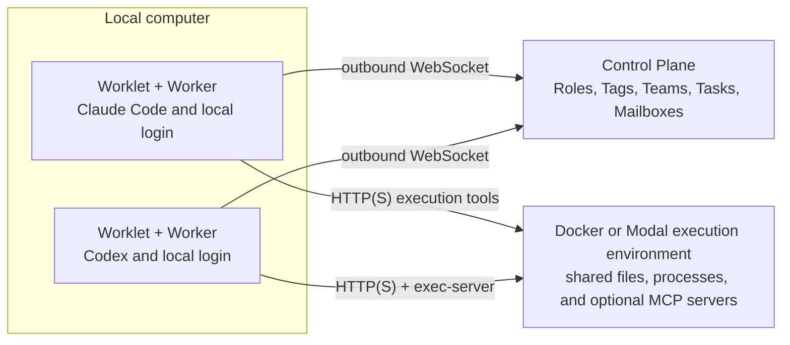

# Two managers, one shared workspace

This example runs a small AI organization that builds and independently reviews a CSV utility.
A **Tag** is a persistent AI identity with its own responsibilities and permissions. A **Role** describes its responsibilities and behavior.
A **Team** groups related work under a manager, and an **Objective** describes the result
that organization should achieve. A **Task** is one assignment toward that result.
Managers choose their assignments and exchange evidence through
**Mailboxes**, SuperTag's durable messages between teams.

Claude Code and Codex run in separate local **Workers**, the processes that execute assignments.
Each keeps its native sign-in on your computer. Their tools run in one shared execution environment, hosted in Docker or Modal,
so both can inspect and change the same source files. The **Control Plane** stores the organization,
schedules work, and records its outcome. A **Worklet** connects each Worker to it.



The example prepares the organization and starts its Objective. It does not implement the managers'
plans in JavaScript: the native agents choose assignments, coordinate, review, and record completion.
The shared workspace is intentionally writable by both managers. Review includes the source digest;
a shared file path is not an immutable SuperTag artifact.

These example deployments do not enforce a separate network policy for each Attempt. The example
therefore grants file writes, command execution, and network access explicitly. The CSV brief needs
no network calls, but that instruction is not a network isolation boundary. Use a provider with
enforceable network controls when your organization requires them.

## Run it

Use macOS or Linux with Node 20.18.1 or later, Docker, and installed Claude Code and Codex CLIs with
working native sign-ins. This example targets the accompanying SuperTag source revision. Until those changes are
published, install a matching `supertag-ai` package archive; the registry's current alpha version
may not contain them. Copy this directory and install the supplied matching archive:

```sh
npm install /path/to/supertag-ai.tgz
npm run bootstrap
npm run start
npm run status
npm run verify
npm run cleanup
```

Tool access comes from a **Permission Set**, which lists the actions a Tag may perform.
`bootstrap` builds Docker with the installed public SDK and the Codex version pinned by that
package, starts the execution service and Control Plane, and creates the example's Roles, Permission Set,
Tags, Teams, Objective, and Worker Host credentials. It does not run a model. `start` launches the two
Workers and submits the Objective once. `status` reads stored organization state, Task events,
and messages. `verify` independently tests the actual CSV module inside the sandbox; run it when the
Objective reports completion. `cleanup` requests cancellation, stops the example's processes and
container, and preserves state and evidence.

State defaults to `~/.supertag/examples/shared-organization`. Select a fresh directory for another run:

```sh
export SUPERTAG_EXAMPLE_STATE="$HOME/.supertag/examples/my-shared-org"
```

Credentials and logs stay in that private directory; they are not passed as command-line values.
The Workers use their existing native CLI authentication and discard provider API-key environment
variables. No model credential is placed in the execution sandbox. Your provider's subscription limits still apply.

An **Attempt** is one execution of a Task. Each Worker runs at most one assignment at a time.
Execution access lasts for the configured native deadline plus one minute for startup and cleanup;
expired access cannot start more work.
Attempts have a five-minute timeout and Claude
has a 24-turn bound. The brief asks managers to stay within eight Tasks. This is an agent instruction,
not a scheduler-enforced total Task limit; supervise the run with `status` and use `cleanup` to stop it.
Set `SUPERTAG_EXAMPLE_ATTEMPT_MS`, `SUPERTAG_EXAMPLE_CLAUDE_MODEL`, or
`SUPERTAG_EXAMPLE_CODEX_MODEL` before `start` to change those Worker settings.

## Host the shared workspace in Modal

Modal runs the execution sandbox in the cloud. The Control Plane and both Workers still run on
your computer, using the same local Claude Code and Codex sign-ins. Install the example's optional
Modal dependency and authenticate Modal through its normal configuration or environment variables.
Use a fresh state directory, then select the provider before setup:

```sh
export SUPERTAG_EXAMPLE_STATE="$HOME/.supertag/examples/my-modal-org"
export SUPERTAG_EXAMPLE_PROVIDER=modal
npm run bootstrap
npm run start
npm run status
npm run verify
npm run cleanup
```

This creates a paid, temporary Modal sandbox with an HTTPS endpoint and a twenty-minute lifetime.
The image contains the matching Codex executable and public SuperTag package. The service uses a
separate Unix user for workload commands. `cleanup` terminates the sandbox and preserves available
source and review files in the private state directory. Modal may retain the reusable image cache.
The workspace and execution journal are temporary: sandbox replacement does not preserve them.

## Include MCP tools

An **MCP server** provides callable tools; an **MCP client** owns a connection to it. This example can
run a small note service alongside the shared files. Both native managers receive admitted HTTP and
stdio tools, with their MCP clients running in the execution sandbox. SuperTag's organizational
coordination tools remain on their existing manager-only paths.

Modal setup enables these sample tools. To include them with Docker, set
`SUPERTAG_EXAMPLE_MCP=1` before `bootstrap`. Setup first runs a synthetic fault probe: a note write
commits but loses its response, and an out-of-scope request is denied. The managers then read the
surviving note through MCP while carrying out their work. The verifier distinguishes those native
reads from the setup probe and checks the backend call ledger.

The service owns the ledger separately from workload files. It records observed fixture calls;
manager identity comes from the Worker configuration, so it is not cryptographic provenance. This
example demonstrates routing and policy checks in a shared, trusted workspace. See
[Route MCP tools](../../docs/guides/mcp-tools.md) for client placement and recovery boundaries.

## Inspect recovery

```sh
node organization.mjs restart-control-plane
npm run status
```

This stops and restarts only the example's Control Plane on the same address and stored database.
Workers keep running and reconnect through their outbound connections. Recovery may temporarily wait
for the previous Control Plane lease to expire. An uncertain Attempt must remain uncertain until
recovery can establish its outcome; restarting is not permission to duplicate its side effects.

## Run each Worker Host in Docker

A **Worker Host** supplies execution capacity. This mode runs the Claude and Codex Workers in two
separate local containers while their tools share the same Modal sandbox. It exercises separate
process trees, filesystems, native sign-ins, and durable journals on one computer.

```sh
export SUPERTAG_EXAMPLE_PROVIDER=modal
export SUPERTAG_EXAMPLE_WORKER_HOSTS=docker
export SUPERTAG_EXAMPLE_STATE="$HOME/.supertag/examples/shared-organization-docker-hosts"
npm run bootstrap
npm run start
npm run status
npm run verify
npm run cleanup
```

Docker and OpenSSL must be available. On macOS, the containers reach the loopback Control Plane through
`host.docker.internal`, supported by Docker Desktop and OrbStack. This does not require enabling
Docker Desktop host networking or exposing the Control Plane on your LAN. On Linux, the example
uses Docker host networking to reach the same loopback address. Worklets still initiate their own
WebSocket connections; execution tools use the Modal HTTPS endpoint.

Coordination uses a separate HTTPS endpoint bound to host loopback. Setup creates a one-day
certificate and its own certificate authority (CA) under the private state directory, then mounts only the public CA certificate into each
Worker. The Worker-owned MCP clients verify that certificate; certificate verification remains
enabled. The endpoint forwards only coordination MCP and credential recovery to the local Control
Plane. Cleanup stops it after the Workers. Start a fresh example when the certificate expires.

The image installs the public package and its Linux native dependencies. It contains no sign-in
material. At startup, the example stages only each provider's subscription credentials in that
Worker Host's private home directory under `worker-hosts/claude/` or `worker-hosts/codex/`. Claude
credentials come from its file store or the macOS Keychain; Codex credentials come from its native
`auth.json`. Optional `SUPERTAG_EXAMPLE_CLAUDE_AUTH_FILE` and `SUPERTAG_EXAMPLE_CODEX_AUTH_FILE` select
other native credential files. API-key-only credentials are rejected for this subscription example.

Each container mounts only its own native home, Worker configuration, and durable state. It runs as
your user ID with a read-only image filesystem and no Docker socket. Native credential refreshes
remain in the staged copy; they do not overwrite the original host sign-in. Neither provider's
credentials are sent to Modal. Treat the staged files as credentials and remove the private state
directory when you no longer need its evidence or sign-ins.

Container IDs, ownership labels, and Worker Host IDs remain in `state.json` after cleanup. Cleanup
stops and removes the owned containers, preserves their redacted logs and journals, then removes
the example's Worker image. A forced stop is reported as potentially uncertain. Codex native
subagents remain disabled; Claude Code retains its supported native subagent behavior.

## Put the Workers on separate hosts

The initial run uses two processes on one computer. To separate them, run `worker.mjs claude` and
`worker.mjs codex` on their respective hosts with the same installed SDK and this example's `seed/`
directory. Each host needs its own native CLI sign-in. Set `SUPERTAG_EXAMPLE_WORKER_CONFIG` to that
host's private configuration file and `SUPERTAG_EXAMPLE_WORKER_STATE` to a private local directory.
The configuration contains the enrolled `hostId`, `credential`, `workletUrl`, `executionUrl`, and
`executionToken`; transfer it through your normal secret-management channel.

The bootstrap configuration binds services to loopback for the local demonstration. For separate
hosts, deploy reachable Control Plane and execution endpoints using the documented authenticated TLS
setup, update their URLs, and provide trusted certificates. Do not simply expose the demonstration's
plain HTTP endpoints publicly. Each Worklet initiates its connection; Worker Hosts need no inbound
listener. Keep the native CLI login local to each host.

See the [shared execution guide](../../docs/guides/shared-execution.md) for placement and isolation
boundaries, and the [Worker Host guide](../../docs/guides/workers.md) for enrollment.
